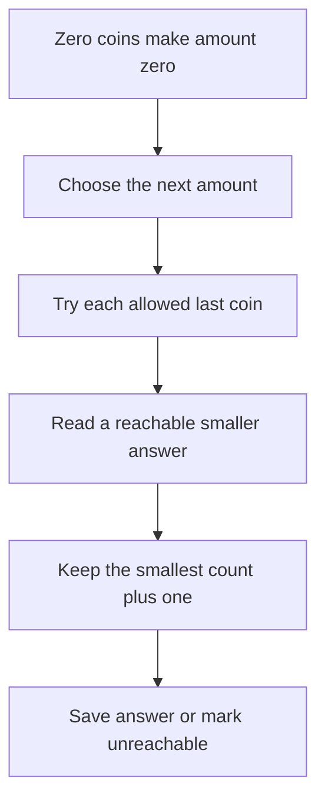

# 7. Dynamic programming

Dynamic programming (DP) saves answers to smaller problems so the program can reuse them. Start by saying exactly what each saved answer means. That meaning is the **state definition**; the table is only where you store it.

## Step 1: state the problem

Given positive integer coin values and a nonnegative integer amount, return the fewest coins needed to make that amount. Each coin value can be used any number of times. Return `NONE` when impossible.

For coins `[1, 3, 4]` and amount `6`, taking the largest coin first gives `4 + 1 + 1`, which uses three coins. The best result is `3 + 3`, which uses two. A greedy choice is not always safe.

## Step 2: define one state

`best[a]` means **the fewest coins needed for amount a**. `best[0] = 0`: making nothing uses no coins. Initialize other states to `∞` to mean unreachable.

## Step 3: describe the last choice

If the last coin has value `coin`, the amount before it was `a - coin`. A candidate answer is therefore `best[a - coin] + 1`. Choose the smallest valid candidate.

```text
FUNCTION minimumCoins(coins, amount)
    best ← array of length amount + 1, filled with ∞
    best[0] ← 0

    FOR a FROM 1 TO amount
        FOR EACH coin IN coins
            IF coin ≤ a AND best[a - coin] ≠ ∞ THEN
                best[a] ← MIN(best[a], best[a - coin] + 1)
            END IF
        END FOR
    END FOR

    IF best[amount] = ∞ THEN RETURN NONE
    RETURN best[amount]
END FUNCTION
```



## Step 4: compute in dependency order

Every coin is positive, so `a - coin < a`. Building amounts from small to large guarantees the smaller answer is ready.

| Amount | Best count for coins `[1, 3, 4]` | One way to make it |
| --- | --- | --- |
| 0 | 0 | No coins |
| 1 | 1 | 1 |
| 2 | 2 | 1 + 1 |
| 3 | 1 | 3 |
| 4 | 1 | 4 |
| 5 | 2 | 4 + 1 |
| 6 | 2 | 3 + 3 |

For each amount, any valid solution has a last coin. We consider every such coin, use the best answer for the smaller amount, and select the minimum. That explains both why we do not miss a solution and why no candidate can beat the true optimum incorrectly.

Time is `O(amount × numberOfCoinValues)` and space is `O(amount)`. This is based on the numeric amount, not the number of digits used to write it. A huge amount can make the table impractical.

## Step 5: extend the result carefully

To return the coins as well as the count, store the chosen last coin whenever `best[a]` improves. Start at `amount`, append that coin, subtract its value, and repeat until reaching zero. Define a tie-breaking rule if the caller requires one particular optimal combination.

Memoization stores the same state answers while a recursive function asks for them. Tabulation builds them in an explicit order. Neither approach removes the need for correct base cases and input rules.

## Apply it to your project

For an optional project challenge, suppose tasks take whole-number time slots and each can be selected once. Plan how to choose tasks within a fixed time budget. Define what a stored answer means before choosing a recurrence; this differs from the unlimited-coin example.

## Practice Problems

| Problem | Level / priority | Practice / notes | Example / answer |
| --- | --- | --- | --- |
| Minimum coins | Practice | Check: `[1, 3, 4], 6 → 2`; `[2], 3 → NONE`; any valid coin list with amount 0 gives 0. | — |
| Empty coin list | Practice | Check: Amount 0 is possible; a positive amount is not. | — |
| Climbing stairs | Practice | Check: Define whether one or two steps are allowed, then define the state and base cases. | — |
| Return a solution | Practice | Check: Verify that the returned coins sum to the amount and their count equals the optimum. | — |

## Interview and debugging check

<details>
<summary>How do you decide the order for filling a DP table?</summary>

Define one state in words, list the states its recurrence reads, and choose an order where those dependencies are already available. If dependencies form a cycle, that simple one-pass fill is not yet justified.

</details>

## Next steps

Next: [correctness, cost, and translation](./08-check-and-translate.md).
