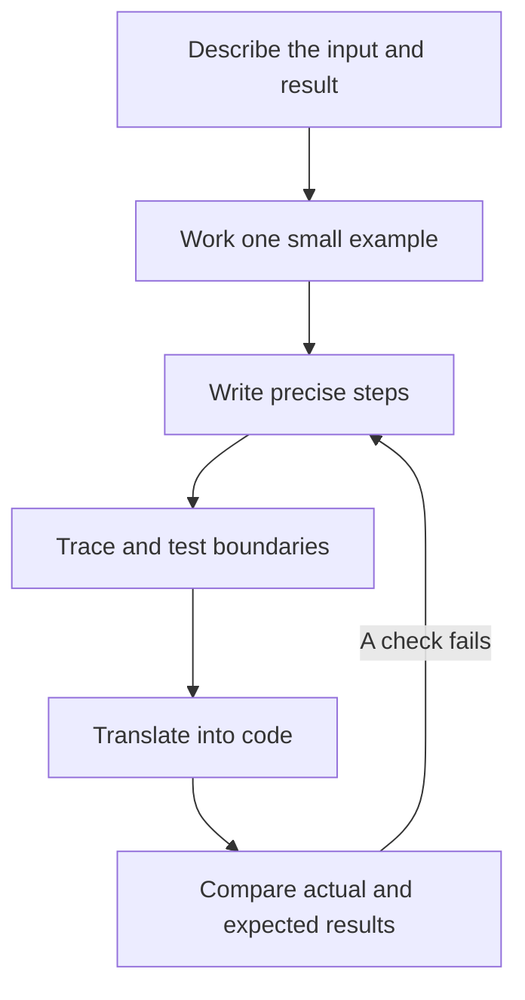

# Pseudocode — from an idea to a working program

Pseudocode is a clear list of steps written for a person. It lets you solve the problem before worrying about JavaScript syntax. You do not run pseudocode; you trace it with a small example, then translate it into a programming language.

You only need basic arithmetic to start. Each lesson adds one idea, works through an input, and shows what to practise next. Use simple English. A good algorithm is precise even when its notation is informal.

**Your first pass:** finish lessons 1–3, then start [JavaScript](../javascript/index.md). Lessons 4–8 are the next problem-solving branch; return when functions and lists feel familiar.

## Learn in this order

| Step | Lesson | You will be able to… |
| --- | --- | --- |
| 1 | [Inputs, values, and output](./01-foundations.md) | Turn a request into clear input, steps, and a result. |
| 2 | [Conditions, loops, and tracing](./02-control-flow.md) | Follow changing values and explain why a loop stops. |
| 3 | [Arrays, strings, and functions](./03-data-and-functions.md) | Break a task into reusable steps and handle empty input. |
| 4 | [Search, sorting, and common patterns](./04-search-and-patterns.md) | Choose a pattern from the input rules instead of guessing. |
| 5 | [Recursion and backtracking](./05-recursion-and-backtracking.md) | Describe smaller subproblems and undo a choice safely. |
| 6 | [Trees and graphs](./06-trees-and-graphs.md) | Track visited nodes and find a path without looping forever. |
| 7 | [Dynamic programming](./07-dynamic-programming.md) | Explain what each saved answer means and which answer comes first. |
| 8 | [Correctness, cost, and translation](./08-check-and-translate.md) | Explain why the steps work, count their work, and check the JavaScript result. |

## Our notation

There is no single universal pseudocode syntax. This course uses these conventions consistently:

| Notation | Meaning | Example |
| --- | --- | --- |
| `x ← value` | Store a value in a variable. | `total ← 0` |
| `=` / `≠` | Compare values for equality / inequality. | `count = 0` |
| `AND`, `OR`, `NOT` | Combine conditions; evaluate left to right and stop when the answer is known. | `i < LENGTH(a) AND a[i] = target` |
| `a[i]` | Read position `i`; the first position is `0`. | `[8, 3][0]` is `8`. |
| `FOR i FROM 0 TO n - 1` | Visit each integer including both endpoints. Do nothing when the start is larger than the end. | For `n = 3`, visit `0, 1, 2`. |
| `FOR EACH value IN items` | Visit each item in order. | Scan an array. |
| `APPEND(list, value)` | Add one item at the end of the list. | Append `7` to `[2]` to get `[2, 7]`. |
| `RETURN value` | End the function and give its caller a result. | `RETURN total` |
| `OUTPUT value` | Show a value to a person. | Print a result. |
| `NONE`, `∞` | No result; an unreachable or not-yet-known cost. | `distance[v] ← ∞` |
| `MOD` | Remainder for the nonnegative integers used here. | `7 MOD 3 = 1` |
| Indentation and `END` | Show which steps belong to a condition, loop, or function. | Indent the loop body. |

Lists can be changed unless a lesson says otherwise; this is called being mutable. `COPY(list)` creates a new list of its elements. `SET` and `MAP` are abstract collections; their operations need a real implementation later. Numeric examples use small values that JavaScript can represent exactly. State extra limits when your task needs large integers, decimal money, or human-language text.

## A useful habit

Before coding, write: **input → expected result → steps → trace → edge cases**. If a step says “process the data,” replace it with an action you could do by hand. If a trace needs a value you never defined, fix the pseudocode first.

After this course, continue with [JavaScript](../javascript/index.md), the [DSA roadmap](../DSA/index.md), or [functional programming](../functional-programming/index.md).

## Completion checkpoint

Take a new list problem and write its input contract, precise steps, one full trace, and a stopping argument. Translate it, then compare expected and actual results for empty, minimal, and ordinary input. Explain any assumption that belongs to the language rather than the algorithm.

Interview cheat sheet: explain an algorithm in a minute

Name input and output, state the maintained invariant, show one transition, explain termination, and give time and extra-space costs under a stated operation model. If you cannot name the invariant, return to the trace before optimizing.

**Key takeaway:** pseudocode is useful when another person can execute its steps without guessing.
