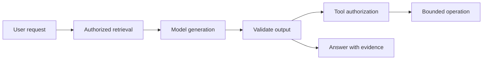

# AI services as fallible system components

Treat model output, retrieval, and tool execution as fallible components.

**Prerequisite / previous:** [Experiment platforms](experimentation.md) · **Next:** [Collaborative document editing](collaborative-editing.md)

An AI feature is a system with ordinary boundaries: input collection, preprocessing, model execution, optional retrieval/tools, output handling, monitoring, and feedback. The original ChatGPT sketch was speculative; this lesson describes a general architecture and does not claim access to a provider's private implementation.

For model-specific implementation, continue with the existing [AI architecture project](../../ai/engineering/04-architecture-and-cost.md), [inference systems](../../ai/engineering/07-inference-systems.md), and [retrieval evaluation](../../ai/rag/04-rag-evaluation.md). This lesson owns the system-boundary view; those pages own model and retrieval mechanics.

## Training and serving are different workloads

Pretraining, supervised fine-tuning, preference optimization, and reinforcement learning are possible development stages, not a mandatory identical pipeline for every model. Training consumes datasets and compute; serving must meet request latency, capacity, privacy, and cost budgets. A model output is a prediction, not proof of correctness.

Retrieval-augmented generation fetches relevant records and supplies them as context. Preserve source identity and access controls through retrieval, ranking, and response generation. Embeddings encode similarity useful for retrieval, not authorization. Model weights, open-source code, hosted services, and commercial licenses are different things; an ecosystem chart is not a license audit.

## Tool-using agents

An agent can choose actions from available tools while maintaining task state. Bound its permissions, time, number of steps, spending, and retry behavior. Treat retrieved text and tool outputs as data rather than authority to change the user's instructions. Durable actions need idempotency and explicit recovery when a tool result is lost. Multiple agents add coordination and cost and should solve a measured need.

## Evaluation, failure, and scale

Use a task dataset and explicit success criteria before selecting a model. Track correctness, unsupported claims, tool success, latency, and cost. Test unavailable models, stale retrieval, malicious content, long inputs, and partial tool failures. Moderation and validation reduce selected risks but do not guarantee all outputs are harmless, unbiased, or true.

Separate interactive serving from offline batch work; bound queues and token budgets and define fallback behavior. Cache only where privacy, input identity, model version, and freshness allow it.

## Exercise

Design a school-library assistant that finds books and can reserve one. Compare a read-only answer with a state-changing reservation. Inject an incorrect book record, a tool timeout after commit, and a document that tries to override permissions. State the evidence required before reporting success.

Related: [search](../data/search.md), [security](../interfaces/security.md), [API design](../interfaces/api-design.md), and [observability](../operations/observability.md).

## Design trade-offs and production exercise

Model-based features handle tasks that fixed rules cannot easily enumerate, but output quality varies with data and context. Separate retrieval, model generation, validation, and authorized tool actions. Larger models or longer context may improve some outcomes while increasing cost and latency; measure against task-specific evaluation data.

A school assistant may draft an answer from course notes, but a retrieved document must not authorize a tool to change grades. Enforce permissions outside the model, cite retrieved sources, and require an explicit workflow for consequential writes. Bound tokens, concurrent calls, and tool retries. How would you detect a plausible answer that cites the wrong document?

## Architecture flow

## Answered failure drill

A model response is syntactically valid JSON but requests an unauthorized action. Which boundary must reject it?

The application validates both the schema and the action against trusted caller permissions and business constraints. Model output is a proposal, not authority. Preserve the proposed action and rejection outcome in suitable redacted diagnostics; do not execute it just because parsing succeeded.

**Interview and revision cue:** Measure useful task completion, unacceptable failures, latency, and cost on the same evaluation cases. Link model behavior to an application release gate.

## Further reading

- [Google: rules of machine learning](https://developers.google.com/machine-learning/guides/rules-of-ml).
