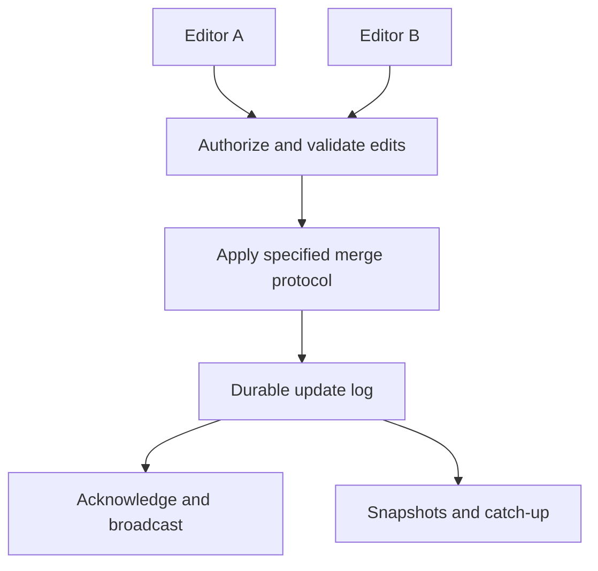

# Collaborative document editing

**Prerequisite / previous:** [AI services as fallible system components](ai-systems.md) · **Next:** [Live streaming and latency budgets](live-streaming.md)

## Overview

A collaborative editor accepts edits from several clients, merges concurrent changes under a specified protocol, and recovers durable history. Prerequisites: [WebSockets](../interfaces/websockets.md), [consistency](../distributed/consistency-models.md), and [replication](../distributed/replication.md). This is a hypothetical design, not a claim about a named product's internals.

## Why it exists

Replacing the whole document with the last received copy can erase another person's work. Offline clients make arrival order different from editing order. The design needs operation identity and a merge contract, not just a live connection.

## Mental model

Replicas receive edits in different orders. A collaboration protocol defines how accepted edits produce a consistent document. Convergence means replicas agree under the protocol's assumptions; it does not automatically mean the text expresses the users' intentions or that every edit was authorized.

## Architecture flow

This design acknowledges durable acceptance. A different acknowledgement point changes what a crash can lose and must be stated explicitly.

## How it works

1. Assign each edit a document ID and unique operation identity.
2. Include the version or causal context required by the chosen protocol.
3. Check the sender's current access before accepting an edit.
4. Merge or transform according to that protocol, preserving enough history for replay.
5. Record the accepted update before confirming durable success.
6. Reconnect using a snapshot and missing updates, with duplicate handling.

## Real-world example

Two students insert different words at the same location while offline. A defined ordering rule resolves concurrent inserts, and both replicas eventually display the same result. If one student loses access before reconnecting, their buffered edits are not automatically accepted simply because they were typed earlier.

## Trade-offs

Operational transformation transforms operations under a specified ordering and context protocol. A CRDT defines merge behavior for a specified replicated data type. Both require careful treatment of text positions, deletions, undo, and metadata. The label alone does not establish correctness. Start with a maintained implementation and its documented assumptions; [Automerge](https://automerge.org/docs/hello/) is one CRDT library example.

## Failure scenarios

| Trigger | Symptom | Detection and recovery |
| --- | --- | --- |
| Acknowledgement lost after persistence | Client resubmits an edit | Deduplicate by operation identity and return its accepted result. |
| History compacted beyond a client's context | Old client cannot apply the delta | Use the protocol's resynchronization procedure; do not guess missing context. |
| Access revoked while client is offline | Buffered edits arrive with old credentials or assumptions | Recheck authorization and explain rejection without losing the user's local draft. |
| Whole-document undo | Another writer's later changes disappear | Use protocol-aware undo or an explicit versioned restore action. |

## Production considerations

Bound document size, update size, pending history, and catch-up work. Separate ephemeral presence from durable edits. Monitor sync lag, rejected operations, duplicate rates, and reconnect failures. Test Unicode and rich-text structure according to the chosen library's model. Compaction and retention must preserve the protocol's correctness and documented offline window.

## Exercise

Accept edit E, persist it, crash before acknowledging, then replay E after restart. Next reconnect a client whose snapshot predates compaction. Define both responses.

Expected outcomes

The replayed edit is identified as already accepted and is not applied twice. The old client receives a supported resynchronization path, possibly a fresh snapshot and protocol-specific reconciliation. It must not apply an arbitrary delta to an incompatible base.

## Interview questions & answers

Does a CRDT remove the need for a server?

Some synchronization designs can be peer-to-peer, but an application may still need identity, authorization, durable storage, discovery, and policy enforcement. Conflict resolution is one part of that system.

**Revision cues:** identity → causal context → permission → durable acceptance → resync. **Key takeaway:** convergence, intention, authorization, and durability are distinct contracts.

## Further reading

- [Automerge merge rules](https://automerge.org/docs/reference/under-the-hood/merge-rules/).
