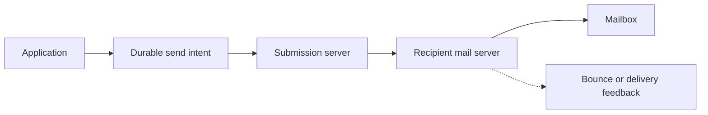

# Email delivery as a store-and-forward system

Separate submission, relay, acceptance, and mailbox delivery.

**Prerequisite / previous:** [Geospatial indexing and proximity search](../distributed/geospatial.md) · **Next:** [Internationalization](internationalization.md)

Email resembles postal mail: submission, relay, mailbox storage, and reading are separate stages. A sender uses a mail user agent. A submission service accepts the message; transfer agents use SMTP to relay it toward the recipient's domain, normally discovered using DNS MX records. A delivery agent places it in a mailbox. IMAP or POP can retrieve mail, while browser-based mail can use HTTPS APIs rather than those protocols directly.

## Acceptance is not delivery

A successful submission means that one service accepted responsibility under its contract, not that the recipient read the message. Relays can queue and retry temporary failures; permanent rejection and delayed failure need explicit handling. Repeated submission can create duplicate messages. Stable message IDs help correlation but are not a universal deduplication guarantee.

## Architecture decisions

Keep durable queues, bounded retry policies, recipient-specific outcomes, abuse limits, and searchable delivery records. Large attachments can dominate storage and bandwidth. Separate inbound abuse filtering from outbound reputation and quota controls. Encryption in transit does not by itself provide end-to-end content secrecy; mailbox access remains a trust boundary.

## Exercise and interview checks

Design an email notification where one of three recipients fails temporarily. Show per-recipient state, retry timing, expiry, and what the user sees. Explain why retrying the entire send operation can duplicate delivery to recipients who already succeeded.

Related: [notifications](../services/notifications.md), [message queues](../services/message-queues.md), and [networking](../foundations/networking.md).

## Design trade-offs and production exercise

Email decouples sender and recipient availability through store-and-forward queues. Retry temporary failures with bounded backoff; permanent recipient failures need suppression and feedback. SMTP acceptance is not proof of inbox placement or reading. Multiple relays increase resilience but make end-to-end status harder to interpret.

A school sends 50,000 report notifications after term closes. Smooth provider traffic, separate transactional mail from bulk campaigns, and retain an operation ID so a worker retry does not intentionally create another send. How do you respond to a bounce after the API already returned success?

## Architecture flow

## Answered failure drill

A notification has three recipients. Two submissions are confirmed and one has a temporary failure. What should retry?

Track recipient-level outcomes and retry only the pending recipient under a bounded policy. A later bounce updates delivery state even after submission was accepted. Preserve the original event and status history so the UI distinguishes accepted, delivered where known, and failed. A repeated message ID is useful correlation, not a universal guarantee that recipients cannot receive duplicates.

**Interview and revision cue:** Which acceptance boundary did you measure, and what evidence supports the displayed delivery status?

## Further reading

- [SMTP specification](https://www.rfc-editor.org/rfc/rfc5321.html).
