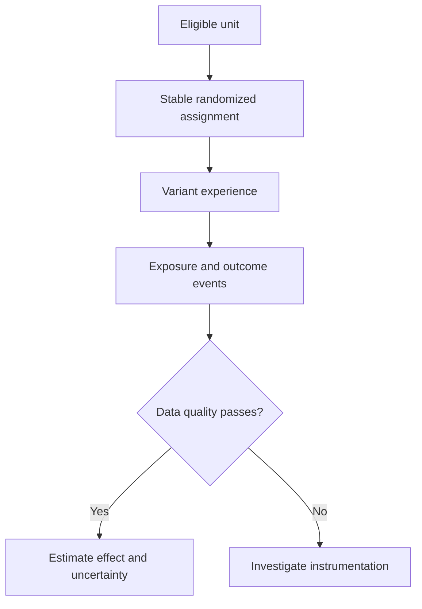

# Experiment platforms

**Prerequisite / previous:** [Internationalization](internationalization.md) · **Next:** [AI services as fallible system components](ai-systems.md)

## Overview

An experiment platform assigns eligible units to variants and collects evidence about their outcomes. The goal is a defensible comparison, not simply two versions of a screen. Prerequisites: [event pipelines](../data/data-pipelines.md) and [experimental uncertainty](../../ai/mathematics/04-experiments-and-uncertainty.md).

## Why it exists

A before/after dashboard can change because traffic, season, or instrumentation changed. Randomized assignment helps separate a treatment effect from other differences, but broken exposure logging can still invalidate the result.

## Mental model

Separate **assignment** from **exposure**. Assignment selects the variant a unit should receive; exposure records that the unit actually received it. Outcome attribution needs an explicit relationship to that exposure and to the chosen unit of randomization.

## Architecture flow

The system records both what was intended and what was delivered. A successful assignment API alone does not establish a valid experiment.

## Key Components

Configuration defines eligibility, allocation, metric definitions, and an experiment version. Delivery makes assignment stable for the chosen unit. Instrumentation records deduplicated exposure and outcome events. Analysis validates the data before estimating the effect. A rollout controller enforces guardrails and can stop exposure without deleting the evidence.

## Real-world example

A school app compares a new recommendation screen with the old one. Choose the learner as the assignment unit only if learners do not materially affect one another's outcomes; shared classroom behavior may require a different design. Define reading completion and a crash-rate guardrail before launch. Give delayed completion events an attribution window and track missing exposures.

## Trade-offs

Stable hashing of an experiment identity and unit identity can implement a consistent allocation, but changing the salt or unit identity can reassign users. Randomizing by a larger cluster reduces some interference while changing effective sample size. Rich telemetry helps diagnosis but increases privacy and retention obligations.

## Failure scenarios

| Trigger | Symptom | Detection and recovery |
| --- | --- | --- |
| Variant breaks exposure logging | Assignment counts look normal but observed cohorts differ | Compare assignment and exposure; investigate before interpreting effects. |
| Configuration changes mid-run | Users switch treatment unexpectedly | Version configuration and preserve assignment policy. |
| Duplicate conversions | Apparent improvement without real user change | Use event identity and a defined counting unit. |
| Repeated peeking without a plan | Attractive false-positive conclusions | Use a prespecified analysis or an appropriate sequential method. |

## Production considerations

Define the primary metric, guardrails, allocation, stopping policy, and analysis population before launch. Check sample-ratio mismatch: a statistically unexpected departure from intended proportions is a diagnostic signal, not proof that the product won. Causes can occur in assignment, execution, or analysis; see [Microsoft Research's diagnosis guide](https://www.microsoft.com/en-us/research/articles/diagnosing-sample-ratio-mismatch-in-a-b-testing/).

Keep experiments reproducible using configuration and event-schema versions. Protect unit identifiers, bound data retention, and distinguish safety rollback from statistical interpretation.

## Exercise

A 50/50 experiment has roughly equal assignment counts but far fewer recorded exposures in the new screen. Its observed completion rate is higher. Explain the next step.

Expected reasoning

Do not declare a winner. Investigate which exposed users are missing and whether failures correlate with device, latency, or outcome. The observed population may be biased. Repair logging and establish a valid analysis window or rerun under a documented plan.

## Interview questions & answers

Why is an A/A test useful?

Identical experiences can expose assignment and instrumentation problems without an intentional product difference. It is a diagnostic exercise, not a guarantee that every later experiment will be valid.

**Revision cues:** unit → eligibility → assignment → exposure → data quality → uncertainty. **Key takeaway:** a metric comparison is meaningful only when the experiment and measurement contracts hold.

## Further reading

- [Experiments and uncertainty](../../ai/mathematics/04-experiments-and-uncertainty.md) for the statistical explanation.
