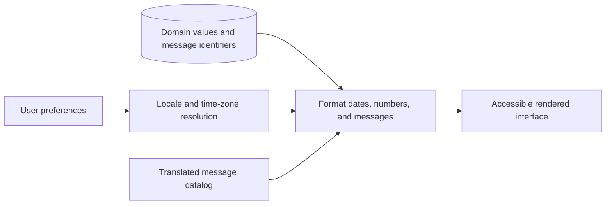

# Internationalization

Preserve language, time, currency, and regional business meaning.

**Prerequisite / previous:** [Email delivery as a store-and-forward system](email.md) · **Next:** [Experiment platforms](experimentation.md)

The diagram below shows how we can internationalize a simple e-commerce website.

Different countries have differing cultures, values, and habits. When we design an application for international markets, we need to localize the application in several ways:

## Language

*   Extract and maintain all texts in a separate system. For example:

    *   We shouldn’t put any prompts in the source code.
    *   We should avoid string concatenation in the code.
    *   We should remove text from graphics.

*   Use complete translatable messages with named parameters and explicit plural/select rules. Avoid assembling translated sentences from fragments.
*   Display business data such as currencies in different languages.

## Layout

*   Describe text length and reserve enough space around the text for different languages.
*   Plan for line wrap and truncation.
*   Keep text labels short on buttons.
*   Adjust the display for numerals, dates, timestamps, and addresses.

## Time zone

The time display should be segregated from timestamp storage.

Common practice is to use the UTC (Coordinated Universal Time) timestamp for the database and backend services and to use the local time zone for the frontend display.

## Currency

We need to define the displayed currencies and settlement currency. We also need to design a foreign exchange service for quoting prices.

## Company entity and accounting

Since we need to set up different entities for individual countries, and these entities follow different regulations and accounting standards, the system needs to support multiple bookkeeping methods. Company-level treasury management is often needed. We also need to extract business logic to account for different usage habits in different countries or regions.

## Exercise

Schedule a reminder at 09:00 local time across a daylight-saving transition. Preserve the time-zone identifier and intended calendar rule, and explain why storing only a UTC instant cannot represent every recurring schedule.

## Design trade-offs and production exercise

Internationalization makes product behavior adaptable; localization supplies locale-specific content. Keep stable business identifiers separate from translated labels. Store money as an amount plus currency under an explicit precision rule; formatting is not currency conversion. Cache keys must distinguish locale when representation changes.

A parent books a meeting in another time zone on a daylight-saving transition. Validate ambiguous or nonexistent local times and display the selected zone. A missing translation can fall back to a declared language, but silently changing a currency cannot. What should a cached invoice preserve when exchange rates change?

## Answered failure drill

A reminder repeats at 09:00 in a named time zone. Is one stored UTC timestamp sufficient?

No. One instant identifies one occurrence. A recurring local-time intent also needs its time-zone identifier, calendar rule, and policy for ambiguous or nonexistent local times. Recalculate future occurrences under that rule. An invoice similarly preserves the agreed amount and currency; reformatting it is not permission to apply a new exchange rate.

**Interview and revision cue:** Keep identity, calendar intent, locale formatting, and business value separate; test long translations and daylight-saving boundaries.

## Further reading

- [W3C: internationalization and localization](https://www.w3.org/International/questions/qa-i18n).

## Architecture flow

A language is not a time zone, and formatted display text is not a stable storage format. Keep domain values separate from presentation and define fallback behavior when a translation is missing.
