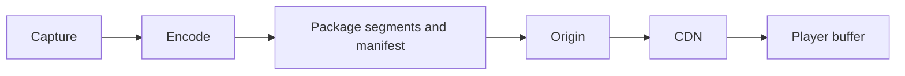

# Live streaming and latency budgets

Allocate capture, encode, transport, and playback latency budgets.

**Prerequisite / previous:** [Collaborative document editing](collaborative-editing.md) · **Next:** [Build and operate a task service](../case-studies/task-service.md)

Live streaming captures and encodes media continuously, delivers it through a network, and plays it while more content is being produced. End-to-end delay includes capture, encoding, buffering, transport, and playback. Different use cases tolerate different delays: a broadcast and a conversation need different designs.

## Pipeline and trade-offs

Capture → encode → package → distribute → buffer → decode is a useful flow. Adaptive playback offers several renditions and changes quality according to conditions. Upload/ingest protocols and viewer playback protocols can differ. RTMP is used in some ingest workflows; HTTP-based HLS/DASH and real-time transports have different latency and compatibility trade-offs. Device, codec, container, and player support must be checked together; blanket claims that Apple devices support only one format are incorrect.

Encoding already performs compression; it does not universally begin by separating a background image. Segment length and buffering trade resilience to jitter against live delay. A CDN can distribute immutable media segments, while recording stores an archive for replay.

## Failure exercise

Delay one encoder and disconnect the origin. Explain player buffering, fallback quality, discontinuity handling, and when the viewer receives an error. Estimate peak concurrent viewers × average delivered bitrate, and measure startup delay separately from steady playback delay.

Related: [video platform](../case-studies/video-platform.md), [storage](../data/storage.md), and [networking](../foundations/networking.md).

## Design trade-offs and production exercise

Live delivery balances latency, playback stability, bandwidth, and cost. Short segments and small buffers can reduce delay but leave less room to absorb jitter. A CDN scales repeated media delivery; personalized authorization and manifest policy remain separate.

For a live school assembly, start with a latency target and allocate capture, encoding, packaging, network, and playback budgets. An encoder crash needs a failover source or an explicit interruption; a stale manifest must not look like a healthy stream. How do you prevent all viewers reconnecting at once from overloading the origin?

## Architecture flow

## Answered failure drill

An origin interruption ends, and every player reconnects together. Why can recovery itself cause another outage?

The synchronized requests create a burst beyond the steady workload. Use bounded, jittered retry where the player protocol permits it, cache reusable segments, and protect origin capacity. Monitor manifest freshness and playback failures separately; a healthy HTTP response can contain stale media state.

**Interview and revision cue:** Account for capture, encoding, packaging, network, and player buffering separately; distinguish startup delay from live-edge delay.

## Further reading

- [HTTP Live Streaming specification](https://www.rfc-editor.org/rfc/rfc8216.html).
