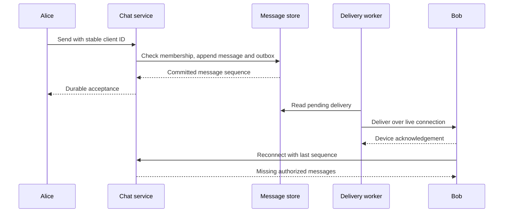

# Design a durable chat system

Persist messages, enforce membership, and recover delivery state.

**Prerequisite / previous:** [Design a URL shortener](url-shortener.md) · **Next:** [Design a social feed](social-feed.md)

Design one-to-one and small-group messaging with history, delivery status, and reconnect support. The original handbook used WhatsApp as a prompt; this worked example is hypothetical and makes no claim about its current internals.

## Requirements and invariants

A sent message should have a durable identity, authorized conversation membership, and a defined order within its conversation. Clarify whether acknowledgement means accepted, durably stored, delivered to a device, or marked read. These are distinct states. Decide retention, offline duration, group limits, attachment limits, and whether content is end-to-end encrypted before choosing storage.

## Workload assumptions

| Input or result | Calculation |
| --- | --- |
| Daily active users | 50 million |
| Messages per active user | 40/day |
| Message ingress | 2 billion/day ≈ 23,148/s average |
| Text payload | 100 bytes/message → 200 GB/day |
| Media assumption | 5% of messages × 100 KB → 10 TB/day |
| Total raw ingress storage | 10.2 TB/day; about 37.23 PB over ten 365-day years |

These estimates omit metadata, encryption overhead, replicas, indexes, and deletion. Average ingress is about 118 MB/s; outbound traffic depends on recipients, devices, retries, and media downloads. A group fan-out multiplier cannot be inferred from the number of incoming messages alone.

## Data model and API

Model users, conversations, membership with versions, messages keyed by conversation and sequence, and per-device delivery cursors. A message includes sender, client-generated operation ID, server identity, creation time, content or attachment reference, and deletion state. Check membership on reads and writes; do not trust an arbitrary `user_id` supplied by the client.

| Operation | Important behavior |
| --- | --- |
| Open connection | Authenticate, bind device/session, establish heartbeat policy |
| Send message | Supply conversation and stable client message ID; return canonical ID and durable status |
| Read history | Cursor pagination within a conversation; enforce membership and retention |
| Resume sync | Fetch messages after the last acknowledged sequence |
| Join/leave group | Authorized membership change with versioned effect |
| Mark delivered/read | Record per-device or per-user progress under the chosen semantics |

A SQL store can establish an initial transactional boundary. A distributed store becomes useful when access patterns, retention, or throughput justify it; select based on ordered range reads and durable writes rather than a generic SQL/NoSQL label.

## Message flow

WebSocket supports bidirectional updates, while polling or long polling can be simpler for different latency and connection budgets. None eliminates the need for reconnect recovery. A gateway's connection map can become stale, so live delivery is an optimization over durable history.

Redis Pub/Sub can distribute live signals in a small prototype, but ordinary Pub/Sub does not retain missed messages for disconnected subscribers. A sorted set ordered only by arrival timestamp cannot establish an unambiguous total conversation order. Use an authoritative append/order scheme and catch-up cursor; see [message queues](../services/message-queues.md).

## Presence, notifications, and attachments

Heartbeat expiry indicates that a device has not recently been observed, not proof that a person is inactive. Bound presence staleness, protect privacy, and account for mobile background restrictions. A read receipt reports a client action, not proof of human comprehension.

For offline devices, enqueue a notification with expiry and deduplication metadata. Provider acceptance is not delivery proof; the client still fetches durable chat state. Keep attachments in object storage with scoped access, checksums, scanning appropriate to the encryption model, and lifecycle cleanup. Do not assume uploaded media is immediately deleted after one recipient downloads it.

## Scaling and failure modes

Partition history by conversation with bounded time buckets if needed. Very large groups may require different fan-out and history policies. A hot conversation is not fixed merely by hashing its ID. Separate connection capacity, message storage, attachment transfer, and notification throughput.

After a crash between commit and delivery, the outbox can replay; consumers deduplicate by message ID. After membership revocation, block new sends and define historical access explicitly. End-to-end encryption shifts key distribution, multi-device enrollment, and recovery responsibilities to clients; server-side search and moderation capabilities then change.

## Exercises

Disconnect Bob after the server sends a message but before acknowledgement. Reconnect from two devices and demonstrate no missing history or duplicate display. Next, remove a group member while messages are in flight. Explain which messages remain accessible and why.

Interview check: distinguish ordering, uniqueness, durable acceptance, and delivery. Related: [notifications](../services/notifications.md), [authentication](../interfaces/authentication.md), [storage](../data/storage.md), and [consistency](../distributed/consistency-models.md).

## Original design illustrations

## Engineering account: Discord: message storage and hot partitions

This Discord: message storage and hot partitions account is retained as historical design evidence. Read its workload and period with the linked sources; it is not a current technology inventory or a universal benchmark.

### Verified account

Discord's March 6, 2023 engineering account describes its message-storage migration from Cassandra to ScyllaDB, completed in May 2022. It reports growth from 12 Cassandra nodes in 2017 to 177 in early 2022, then a 72-node ScyllaDB deployment. Messages were partitioned using channel and time-bucket information. A Rust data-service layer added request coalescing and routing to reduce pressure on hot partitions. Reported p99 reads improved from 40–125 ms to 15 ms, and writes from 5–70 ms to 5 ms. These are results for Discord's combined workload and architecture changes, not a controlled proof that one database engine is universally faster. [Discord's engineering report](https://discord.com/blog/how-discord-stores-trillions-of-messages).

### Exercise

Many readers request the same channel history at once. Compare request coalescing with adding replicas. Explain the coalescing key, authorization boundary, cancellation, timeout, and maximum waiting callers. Then create a time-bucket migration plan that preserves pagination across old and new buckets.

Related: [chat design](chat-system.md), [caching](../data/caching.md), and [sharding](../distributed/sharding.md).

## Engineering account: What is the Journey of a Slack Message

This What is the Journey of a Slack Message account is retained as historical design evidence. Read its workload and period with the linked sources; it is not a current technology inventory or a universal benchmark.

In the original historical technical account, Slack explains how its real-time messaging framework works. Here is my short summary:

A Slack message travels through five important servers:

*   **WebApp:** defines the API that a Slack client could use
*   **Admin Server (AS):** finds the correct Channel Server using channel ID
*   **Channel Server (CS):** maintains the history of message channel
*   **Gateway Server (GS):** deployed in each geographic region. Maintain WebSocket channel subscription
*   **Envoy:** service proxy for cloud-native applications

*   Because there are too many channels, the Channel Server (CS) uses consistent hashing to allocate millions of channels to many channel servers.
*   Slack messages are delivered through WebApp and Admin Server to the correct Channel Server.
*   Through Gate Server and Envoy (a proxy), the Channel Server will push messages to message receivers.
*   Message receivers use WebSocket, which is a bi-directional messaging mechanism, so they are able to receive updates in real-time.

### Exercise

Move a channel between servers while clients remain connected. Explain versioned ownership, reconnect recovery, stale routing, and how a message committed before handoff remains retrievable.
