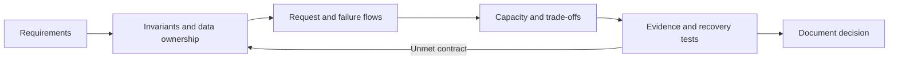

# Architecture reviews and interviews

Defend assumptions, estimates, failure recovery, and trade-offs.

**Prerequisite / previous:** [Designing an ordered matching service](stock-exchange.md) · **Next:** [Source provenance and verification](../references/sources.md)

Practice explaining requirements, estimates, trade-offs, and failure recovery under time limits.

Technical interviews are a critical part of the hiring process for software engineers. They are designed to test your problem-solving skills, coding abilities, and technical knowledge. In this category, you will find resources to help you prepare for technical interviews, including coding challenges, system design questions, and tips for acing the interview.

## A 45-minute design session

Spend roughly 5 minutes clarifying scope, 5 on estimates and invariants, 10 on APIs/data and a minimal architecture, 15 on a targeted deep dive, and 10 on failure recovery, alternatives, and review. These are practice timeboxes, not a universal interview script. Ask for clarification when a requirement changes the design.

## Worked-design practice ladder

| Design | Prerequisites | Deliverable and completion check |
| --- | --- | --- |
| [Task service](../foundations/requirements.md) | HTTP and basic SQL | An ownership-safe API, indexed query, workload estimate, and a complete request trace |
| [URL shortener](url-shortener.md) | API, caching, data modeling | Creation and redirect contracts, collision handling, abuse controls, expiration, and a hot-link failure test |
| [Chat](chat-system.md) | Queues, replication | Message identity, per-conversation order, offline delivery, reconnect replay, and duplicate suppression |
| [Feed](social-feed.md) | Caching, sharding | Fan-out strategy and a celebrity hotspot plan; state the freshness contract |
| [Video](video-platform.md) | Queues, object storage, CDN | Durable upload, resumable processing, rendition storage, and behavior when an encoding job fails |
| [Ride dispatch](ride-dispatch.md) | Geospatial indexes, consistency | Stale-location handling, an atomic assignment rule, cancellation races, and payment reconciliation |

The named products are teaching scenarios, not claims about current company implementations. Preserve the source exercises' estimates as assumptions and recompute them if the workload changes. The [primer](design-review.md) provides alternative exercises and links to upstream companion solutions.

## Assessment rubric

Score each criterion 0 (missing), 1 (named without a convincing mechanism), or 2 (explained with a worked example or test). A useful completion target is at least 10 of 12 points, with no zero for correctness or failure recovery.

| Criterion | Evidence for 2 points |
| --- | --- |
| Requirements | Scope, non-goals, latency/freshness/availability targets, and unknowns are explicit |
| Capacity | Arithmetic includes units, peaks, retention, replication, and one sensitivity analysis |
| Correctness | Data ownership, constraints, transaction boundaries, and retry identities are defined |
| Architecture | Components have clear purposes and one request is traced end to end |
| Failure recovery | Partial failure, overload, data loss, replay, and restore behavior are concrete |
| Trade-offs | At least two plausible alternatives are compared against constraints and operational cost |

## Common interview mistakes

Adding a cache, queue, or microservice without a requirement does not earn design credit. A broker does not make external effects exactly once; a replica does not constitute a backup; a large QPS number does not establish a need for sharding. State what evidence would justify each additional component. Close by identifying the riskiest assumption and the experiment that would test it.

## A reusable design review

Clarify users, operations, invariants, scale, latency, availability, security, cost, and exclusions. Estimate one expensive path, draw a simple baseline, define data ownership and APIs, and explain a complete request. Then test partial failure and choose one justified scaling step. Document the migration and rollback, not only the destination architecture.

Review algorithm choices in context: hashing for placement, heaps for priority, Bloom filters for approximate membership, spatial indexes for nearby search, and graph traversal for relationships. An algorithm ranking chart is not a requirement to use every technique.

**Exercise:** take the URL-shortener, chat, feed, video, and ride-dispatch designs in the course order. For each, submit requirements, a capacity table, data model, request flow, two rejected alternatives, three failure scenarios, and a migration plan. Explain the design aloud to a beginner without starting with product names.

## Architecture flow

## Further reading

- [Google SRE: non-abstract large system design](https://sre.google/workbook/non-abstract-design/).
