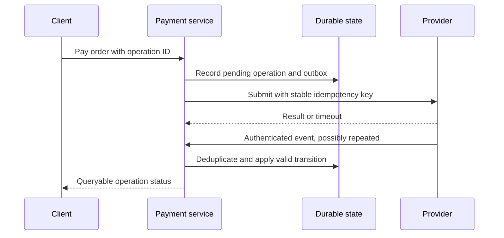

# Payment processing and reconciliation

Handle unknown charges, settlement boundaries, and reconciliation.

**Prerequisite / previous:** [Design a ride dispatch service](ride-dispatch.md) · **Next:** [Designing an ordered matching service](stock-exchange.md)

A payment service records a business obligation and coordinates changes with an external provider. Sending a request is not proof that money moved. This is a technical design exercise; actual rails, settlement timing, and accounting requirements depend on the system being integrated.

## Start with the invariant

For one order, retries must not create an unintended second charge. Each provider operation needs a stable business operation ID, a stored request fingerprint, and a durable status. A timeout leaves the outcome unknown. Reusing an idempotency key can help within the provider's documented scope and retention window; it is not an unlimited exactly-once guarantee. [Stripe's idempotency contract](https://docs.stripe.com/api/idempotent_requests) is a concrete example.

## Roles and lifecycle

A payer authorizes a payment to a payee. In card systems, issuers, acquirers, processors, and networks perform different roles; a particular company may perform several. Authorization, capture, clearing, settlement, refund, and dispute are separate events. Do not assume every rail follows the same timing or state machine.

Clearing establishes obligations and may net them; settlement transfers value to discharge them. In a simplified bilateral example, A owes B 100 units and B owes A 500, so the net obligation is B paying A 400. This arithmetic does not establish settlement finality or eliminate counterparty exposure.

## A durable processing flow

Keep the order state, payment operation, and outbox in one local transaction where they share a database. A worker delivers the provider command. On an uncertain response, query or reconcile the existing operation before creating another. The browser's success redirect is useful UI feedback, not authoritative confirmation.

Verify provider event signatures using the required raw payload, reject stale/replayed events as the contract allows, and deduplicate durable event IDs. Delivery may be repeated or out of order; apply allowed state transitions and use provider retrieval when necessary. See [Stripe webhook delivery behavior](https://docs.stripe.com/webhooks).

## Ledger and balances

An authoritative ledger records balanced postings with an immutable business operation reference. Define the account types and debit/credit convention with the accounting model; “debit buyer, credit seller” is not a sufficient universal model. Do not independently update a wallet balance and its ledger without an atomicity or reconciliation strategy.

Store monetary amounts with explicit currency and fixed precision appropriate to that currency and operation. Never silently add different currencies. Corrections should leave an audit trail, often through reversing and replacement postings rather than deleting history. Separate spendable, reserved, pending, and settled balances when the product requires them.

## Reconciliation

1. Ingest provider reports and internal operations with source identifiers, import versions, and completeness markers.
2. Normalize currency, time zones, amount representation, and event types without losing the raw evidence.
3. Match stable provider/business IDs first; amount-and-time matching alone can confuse repeated purchases.
4. Classify missing, duplicated, late, mismatched, refunded, and disputed records.
5. Investigate exceptions with a bounded manual queue and a durable resolution record.
6. Re-run safely after late files or corrections. Compare totals as well as individual records.

A missing record at today's cutoff may arrive tomorrow. Do not automatically create a refund or another charge from an incomplete report. Alert on reconciliation lag, unmatched value by currency, duplicate-operation rejection, and time spent in unknown states.

## Trade-offs, failures, and scale

Partition work by operation or account when order matters. Rate-limit provider calls and isolate one provider's outage. Keep retry budgets bounded, with a dead-letter workflow that supports safe replay. Cross-region writers need ownership rules for the same payment; a cache lock alone is insufficient. Durable deduplication and ledger retention have costs that grow with operations, not merely active users.

## Interview questions and exercises

- A provider charges successfully but its response is lost. Walk through recovery without creating another payment operation.
- A refund event arrives before a delayed capture event. Define valid transitions and the evidence needed to resolve them.
- Design an import where yesterday's report arrives twice and today's file is incomplete. Show which totals are trustworthy.

Completion check: demonstrate duplicate requests, duplicate events, partial failure, and late reconciliation while preserving the business invariant. Related: [distributed transactions](../distributed/distributed-transactions.md), [message queues](../services/message-queues.md), and [resilience](../operations/resilience.md).

## Hot accounts

A large merchant can serialize many updates on one balance row. Bound admission, batch eligible postings, or partition ledger ingestion while maintaining the required balance invariant. Splitting an account into subaccounts complicates global limits and spendable-balance reads. Updating a disposable cache first and asynchronously copying balances is unsafe for authoritative money state unless a durable, replayable protocol establishes the invariant. Measure contention before choosing the workaround.

## E-commerce Workflow

What happens behind the scenes when we shop online?

Disclaimer: I have limited knowledge of the eCommerce system. The diagram above is based on my research. Please suggest better names for the components or let me know if you spot an error.

The diagram above shows the 4 key business areas in a typical e-commerce company: procurement, inventory, eComm platform, and transportation.

### Procurement

*   Step 1 - The procurement department selects suppliers and manages contracts with them.

*   Step 2 - The procurement department places orders with suppliers, manages the return of goods, and settles invoices with suppliers.

### Inventory

*   Step 3 - The products or goods from suppliers are delivered to a storage facility. All products/goods are managed by inventory management systems.

### EComm platform

*   Steps 4-7 - The “eComm platform - Product Management” system creates the product info managed by the product system. The pricing system prices the products. Then the products are ready to be listed for sale. The promotion system defines big sale activities, coupons, etc.

*   Step 8-11 - Consumers can now purchase products on the e-commerce APP. First, users register or log in to the APP. Next, users browse the product list and details, adding products to the shopping cart. They then place purchasing orders.

*   Steps 12,13 - The order management system reserves stock in the inventory management system. Then the users pay for the product.

### Transportation

*   Steps 14,15 - The inventory system sends the outbound order to the transportation system, which manages the physical delivery of the goods.

*   Step 16 - Sign for item delivery (optional)

Quick question: If a user buys many products, their big order might be divided into several small orders based on warehouse locations, product types, etc. Where would you place the “order splitting” system in the process outlined below?

### Exercise

Split one order across two warehouses. Reserve stock, accept payment, and cancel one shipment. Define which service owns each transition and how a failed compensation becomes visible.

## Payment rails, wallets, and integration boundaries

Use this reference after [payment processing](payments.md). A user interface, a credential, a message network, and a settlement mechanism are different layers. This is a conceptual integration guide; current timing, limits, fees, and certification rules must come from the actual provider contract.

### Card payments

A cardholder, merchant, acquirer, network, and issuer can participate in authorization, capture, clearing, and settlement. Authorization approves a request under issuer policy; it is not final settlement. Captures, reversals, refunds, and disputes need distinct identifiers and state transitions. Timing varies by flow and agreement; there is no universal end-of-day capture rule.

A merchant's total charge can include acquiring markup, interchange, network fees, and other components. Historical fixed percentages in a diagram are not current price quotes. Preserve gross amount, fees, net amount, currency, and settlement reference separately for reconciliation.

### QR codes and wallets

A QR code can be presented by the merchant or customer and can be static or generated for an operation. This two-axis classification does not imply identical semantics across providers. In a dynamic checkout example, the server creates an expiring operation for 123.45 in a specified currency; the QR code references it. The customer verifies payee and amount, then authorizes payment through the provider. Only an authoritative provider result can mark it paid—never a client saying “I paid.”

Mobile wallets may use tokenized credentials, device security, and provider/network-specific cryptograms. Apple Pay and Google Pay have several product and integration modes; a diagram that treats either as one universal card-storage flow is misleading. Tokenization reduces exposure of original credentials but does not remove replay, authorization, or integration responsibilities.

### ACH, UPI, and SWIFT

ACH supports batch-oriented credit/debit processing through originating and receiving depository institutions and network operators. Scheduling depends on the processing window and agreement, including same-day options; do not hard-code the old 7 PM/midnight/6 AM example as a network guarantee. Track returns and exceptions separately from initial submission. [Nacha's ACH overview](https://www.nacha.org/content/ach-network).

UPI is NPCI's interoperable payment system in India. Apps, payment-service-provider banks, remitter/beneficiary banks, and the central infrastructure have distinct responsibilities. A payment address is a routing identifier, not a password. Banks execute account changes under the network protocol; a client success screen is not a ledger. [NPCI's UPI overview](https://www.npci.org.in/what-we-do/upi/product-overview).

SWIFT provides financial messaging; successful message transport is not itself movement of money or final settlement. Acknowledgement, recipient processing, account posting, and reconciliation are different states. Avoid assuming an old regional/slice-processor illustration is the present internal topology. [SWIFT's explanation](https://www.swift.com/about-us/discover-swift).

### Currency and ledger differences

In a hypothetical conversion, 100 units of currency A at a quoted rate of 0.88 produces 88 units of currency B before fees. Store the quote version, expiry, rounding rule, fee allocation, and both currency amounts. Do not treat this example as a live exchange rate or a verified provider funding flow.

A custodial wallet records claims in its operator's ledger. A self-custody blockchain wallet manages keys used to authorize transactions on a particular network; it does not hold coins as files. Network fees, confirmation/finality rules, chain identity, recovery, and custody differ. A blockchain does not automatically merge all bank accounts, eliminate reconciliation, guarantee privacy, or prohibit advertising. “Web3” is a broad label, not a technical contract.

### Exercise

Trace a payment from QR display to provider acknowledgement to ledger posting to settlement report. Inject a delayed webhook, a duplicate report, an expired quote, and a lost browser response. Identify which authority resolves each uncertainty. Related: [security](../interfaces/security.md), [distributed transactions](../distributed/distributed-transactions.md), and [notifications](../services/notifications.md).

## Engineering account: 10 Principles for Building Resilient Payment Systems

This 10 Principles for Building Resilient Payment Systems account is retained as historical design evidence. Read its workload and period with the linked sources; it is not a current technology inventory or a universal benchmark.

Shopify has some precious tips for building resilient payment systems.

### Lower the timeouts, and let the service fail early

The source discusses reducing long timeouts, including illustrative read and write values. There is no universal 60-second default or universally safe replacement: derive each timeout from the end-to-end deadline, observed dependency latency, and the operation’s retry/idempotency contract.

#### Install circuit breaks

Shopify developed Semian to protect Net::HTTP, MySQL, Redis, and gRPC services with a circuit breaker in Ruby.

#### Capacity management

Queue depth does not determine throughput. With one worker taking 100 ms per request, nominal service capacity is 10 requests/s. Fifty requests already waiting represent about five seconds of work if no new requests arrive. Fifty independent workers could nominally reach 500 requests/s only if downstream resources and contention permit it. Measure service capacity, arrival rate, and oldest-request age separately.

#### Add monitoring and alerting

Google’s site reliability engineering (SRE) book lists four golden signals a user-facing system should be monitored for: latency, traffic, errors, and saturation.

#### Implement structured logging

We store logs in a centralized place and make them easily searchable.

#### Use idempotency keys

Choose a stable, collision-resistant operation identifier and persist its scope and request fingerprint. ULID and UUID-based identifiers are options; sortability does not itself provide idempotency.

#### Be consistent with reconciliation

Store the reconciliation breaks with Shopify’s financial partners in the database.

#### Incorporate load testing

Shopify regularly simulates the large volume flash sales to get the benchmark results.

#### Get on top of incident management

Each incident channel has 3 roles: Incident Manager on Call (IMOC), Support Response Manager (SRM), and service owners.

#### Organize incident retrospectives

For each incident, 3 questions are asked at Shopify: What exactly happened? What incorrect assumptions did we hold about our systems? What we can do to prevent this from happening?

### Exercise

Lower a provider timeout during a payment outage. Predict the effect on unknown outcomes and retries, then bound amplification and prove the same operation cannot create a second charge.
