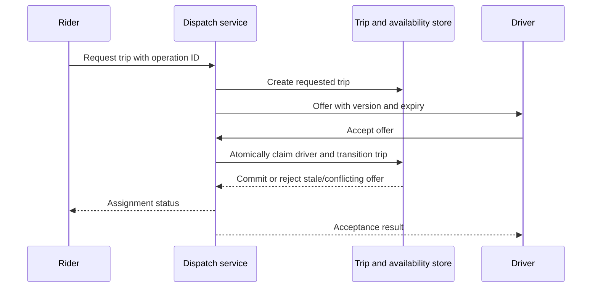

# Design a ride dispatch service

Protect assignment invariants amid stale positions and delayed messages.

**Prerequisite / previous:** [Design a video upload and playback platform](video-platform.md) · **Next:** [Payment processing and reconciliation](payments.md)

A rider asks for a trip; the service finds an eligible driver, coordinates acceptance, tracks the trip, and processes payment. This is a hypothetical exercise adapted from the original Uber prompt.

## Requirements and invariants

One driver must not be assigned to two active trips under the chosen policy. A trip must have explicit requested, offered, accepted, started, completed, and canceled states, with allowed transitions. Clarify geographic coverage, offer expiry, cancellation rules, location freshness, accessibility needs, and payment behavior. ETA is an estimate, not a guarantee.

## Estimate the busiest stream

Assume 100 million daily users making ten actions each: one billion actions/day, about 11,574/s average. If every action stores 400 bytes, that would be 400 GB/day, but many reads do not create such records. Retention must be specified rather than automatically keeping every action for ten years.

Now assume one million active drivers reporting location every five seconds: **200,000 location updates/s**. This dominates the average user-action rate. Separate location ingestion, trip transitions, dispatch queries, notifications, and billing capacity. Estimate peak density by city and neighborhood rather than distributing traffic uniformly around the world.

## State and APIs

Store riders, drivers, vehicles, eligibility, trips, offers, payments, and ratings. Keep recent locations with timestamps and freshness bounds; raw location history needs separate retention and access rules. Trips contain driver/rider IDs, state/version, route/price version, and transition timestamps.

`POST /trips` takes pickup, destination, preferences, and an idempotency key. Identity comes from authentication. `POST /trips/{id}/accept` must atomically validate the offer and driver availability. Start, finish, and cancel operations reference the trip ID and expected state/version. Cancellation by customer ID alone is ambiguous when several operations are pending.

## Dispatch flow

Candidate discovery can use a spatial index, geohash cells plus neighbors, or a quadtree. Filter candidates using actual distance and eligibility. A radius in meters is not a degree offset in latitude/longitude. A relational spatial index can be a sound baseline; not every location query requires a custom in-memory tree.

Nearby distance is only one input. ETA follows roads, traffic, and pickup constraints. Version quoted prices with expiry and require the product's intended acceptance before charging. A process-local mutex cannot protect assignments across several servers: use an authoritative transaction, conditional update, or fenced owner with a proved invariant.

## Live updates and payment

Persistent connections can reduce notification latency, but mobile background execution and battery constraints matter. Store the latest accepted trip state so reconnecting clients recover. Treat an old location as stale evidence; do not offer a trip solely because a cached driver flag says available.

The completed trip creates a durable payment operation. Provider redirects are not authoritative confirmation; use authenticated events, idempotency, and reconciliation as described in [payments](payments.md). If payment remains uncertain, the trip should not silently restart or charge twice.

## Scale and failures

Partition dispatch ownership by region when needed, but define cross-boundary trips, handoff, and busy-region overload. A geohash prefix can still be hot. Regional ownership changes need fencing and recovery for pending offers. Expired offers and delayed acceptances must be rejected against the authoritative version, not just a client's clock.

Observe location age, offer acceptance latency, assignment conflicts, abandoned trips, and payment uncertainty. Cache static vehicle/category information separately from rapidly changing availability. A stale read replica is inappropriate for an invariant requiring current exclusive assignment unless the protocol compensates for it.

## Exercises and interview checks

Two dispatch servers offer different trips to the same driver, and both receive acceptance. Show the atomic decision that allows only one. Then time out after that decision commits and demonstrate how the retry discovers the same result.

Model a stadium exit with 20× local demand, delayed GPS updates, and one unavailable region. Explain admission limits, user feedback, and recovery. Related: [geospatial indexing](../distributed/geospatial.md), [distributed transactions](../distributed/distributed-transactions.md), [notifications](../services/notifications.md), and [resilience](../operations/resilience.md).

## Original design illustrations

## Engineering account: Uber: historical service and delivery notes

This Uber: historical service and delivery notes account is retained as historical design evidence. Read its workload and period with the linked sources; it is not a current technology inventory or a universal benchmark.

These source notes preserve historical observations, not a verified current technology inventory. Use the mechanism and stated period, and consult the company source before relying on a product/version or scale claim.

### Uber Tech Stack

This post is based on research from many Uber engineering blogs and open-source projects. If you come across any inaccuracies, please feel free to inform us. The corresponding links are added in the comment section.

**Web frontend:** Uber builds Fusion.js as a modern React framework to create robust web applications. They also develop visualization.js for geospatial visualization scenarios.

**Mobile side:** Uber builds the RIB cross-platform with the VIPER architecture instead of MVC. This architecture can work with different languages: Swift for iOS, and Java for Android.

**Service mesh:** Uber built Uber Gateway as a dynamic configuration on top of NGINX. The service uses gRPC and QUIC for client-server communication, and Apache Thrift for API definition.

**Service side:** Uber built a unified configuration store named Flipr (later changed to UCDP), H3 as a location-index store library. They use Spring Boot for Java-based services, uAct for event-driven architecture, and Cadence for async workflow orchestration.

**Database end:** the OLTP mainly uses the strongly-consistent DocStore, which employs MySQL and PostgreSQL, along with the RocksDB database engine.

**Big data:** managed through the Hadoop family. Hudi and Parquet are used as file formats, and Alluxio serves as cache. Time-series data is stored in Pinot and AresDB.

**Data processing:** Hive, Spark, and the open-source data ingestion framework Marmaray. Messaging and streaming middleware include Apache Kafka and Apache Flink.

**DevOps side:** Uber utilizes a Monorepo, with a simplified development environment called devpod. Continuous delivery is managed through Netflix Spinnaker, metrics are emitted to uMetric, alarms on uMonitor, and a consistent observability database M3.

### Uber Tech Stack - CI/CD

Uber is one of the most innovative companies in the engineering field. Let’s take a look at their CI/CD tech stacks.

Note: This post is based on research on Uber engineering blogs. If you spot any inaccuracies, please let us know.

*   **Project planning:** JIRA

*   **Backend services:** Spring Boot to develop their backend services. And to make things even faster, they've created a nifty configuration system called Flipr that allows for speedy configuration releases.

*   **Code issues:** They developed NullAway to tackle NullPointer problems and NEAL to lint the code. Plus, they built Piranha to clean out-dated feature flags.

*   **Repository:** They believe in Monorepo. It uses Bazel on a large scale.

*   **Testing:** They use SLATE to manage short-lived testing environments and rely on Shadower for load testing by replaying production traffic. They even developed Ballast to ensure a smooth user experience.

*   **Experiment platform:** it is based on deep learning and they've generously open-sourced parts of it, like Pyro.

*   **Build:** Uber packages their services into containers using uBuild. It's their go-to tool, powered by Buildkite, for all the packaging tasks.

*   **Deploying applications:** Netflix Spinnaker. It's their trusted tool for getting things into production smoothly and efficiently.

*   **Monitoring:** Uber built their own monitoring systems. They use the uMetric platform, built on Cassandra, to keep things consistent.

*   **Special tooling:** Uber relies on Peloton for capacity planning, scheduling, and operations. Crane builds a multi-cloud infrastructure to optimize costs. And with uAct and the OnCall dashboard, they've got event tracing and on-call duty management covered.

### Evolution of Uber's API Layer

Uber’s API gateway went through 3 main stages.

First gen: the organic evolution. Uber's architecture in 2014 would have two key services: dispatch and API. A dispatch service connects a rider with a driver, while an API service stores the long-term data of users and trips.

Second gen: the all-encompassing gateway. Uber adopted a microservice architecture very early on. By 2019, Uber's products were powered by 2,200+ microservices as a result of this architectural decision.

Third gen: self-service, decentralized, and layered. As of early 2018, Uber had completely new business lines and numerous new applications. Freight, ATG, Elevate, groceries, and more are among the growing business lines. With a new set of goals comes the third generation.

### Design review exercise
