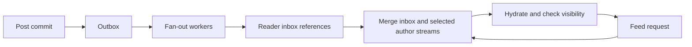

# Design a social feed

Choose fan-out, ranking, pagination, and deletion semantics.

**Prerequisite / previous:** [Design a durable chat system](chat-system.md) · **Next:** [Design a video upload and playback platform](video-platform.md)

This hypothetical design supports posts, follows, a home feed, and media. The original Twitter prompt supplies scale assumptions, not evidence of a company's current implementation.

## Requirements

Clarify chronological versus ranked feeds, private accounts, blocking, deletion, reposts, search, and freshness targets. A user must never gain access to a private post merely because an old copy remains in a feed index. Posting and reading have different availability and latency needs.

## Estimate independently

Assume 200 million daily active users and five posts each: one billion posts/day, or about 11,574/s average. At 100 bytes of text per post, text payload is 100 GB/day. If 10% include 50 KB of media, media adds 5 TB/day. Total raw payload is 5.1 TB/day, about 18.615 PB over ten 365-day years. Average ingress is about 59 MB/s. Feed reads, media downloads, replicas, and fan-out writes are additional; do not derive them from posting rate without more assumptions.

## Data model and interface

Store users, posts, follow edges, reactions, and deletion/visibility state. Reposts can reference an original post instead of copying its full content. A feed projection stores post references and ranking/cursor metadata; the authoritative post store determines current visibility.

`POST /posts` accepts a stable operation ID and validated content/attachment references. `PUT` or `DELETE /following/{author}` changes a relationship idempotently. `GET /feed?cursor=...` returns a bounded page with a documented ordering and freshness contract. Search and notifications are derived consumers, not authoritative sources of permission.

## Feed construction trade-off

| Strategy | Mechanism | Cost |
| --- | --- | --- |
| Fan-out on read | Merge followed authors' recent posts when requested | Read work and tail latency grow with followed sources |
| Fan-out on write | Add a post reference to follower inboxes | Write amplification and wasted work for inactive readers |
| Hybrid | Precompute selected inboxes and merge high-fan-out authors at read time | More coordination and two paths to test |

For an author with one million followers, write fan-out can create one million projection updates for one post. Choose thresholds from measured activity and budgets, not a universal celebrity cutoff. Use durable jobs and idempotent `(recipient, post)` entries so a worker crash does not duplicate feed cards.

## Ranking and related features

Begin with chronological order. A teaching heuristic such as affinity × content weight × time decay can illustrate ranking inputs; it is not a claimed production algorithm. More complex models need evaluation, feature freshness, privacy review, and fallback behavior. Store enough ranking/cursor context to avoid unstable pagination when new posts arrive.

A search index requires ingestion, refresh, deletion propagation, and access filtering. Trending topics require explicit windows, event-time handling, deduplication, and abuse controls. Mutual connections can be computed by intersecting adjacency lists; a graph database is an option when traversal requirements justify it, not a prerequisite.

## Failure analysis

Deleting a post should create an authoritative tombstone and propagate removal to projections, search, and caches. Hydration must enforce current visibility even if fan-out cleanup is delayed. A blocked user must not continue reading cached private content under an obsolete permission decision.

If a celebrity posts during peak load, isolate fan-out work and avoid overwhelming the write store. If ranking fails, a safe chronological fallback can preserve availability. Bound media uploads and use object storage/CDN delivery with access rules; caching entire media collections in application RAM is not a useful default.

## Exercises and interview checks

Compare work for one inactive reader following 5,000 authors and one highly active reader following 50. Choose a feed strategy with explicit cost assumptions. Then crash a fan-out worker halfway through delivery, delete the post, and replay its old event. Show why the post cannot reappear.

Completion check: explain freshness, pagination stability, authorization, and cost separately. Related: [event sourcing and projections](../services/event-sourcing.md), [search](../data/search.md), [caching](../data/caching.md), and [notifications](../services/notifications.md).

## Original design illustrations

## Engineering account: Reddits Core Architecture

This Reddits Core Architecture account is retained as historical design evidence. Read its workload and period with the linked sources; it is not a current technology inventory or a universal benchmark.

A quick look at Reddit’s Core Architecture that helps it serve over 1 billion users every month.

This information is based on research from many Reddit engineering blogs. But since architecture is ever-evolving, things might have changed in some aspects.

The main points of Reddit’s architecture are as follows:

*   Reddit uses a Content Delivery Network (CDN) from Fastly as a front for the application.
*   Reddit started using jQuery in early 2009. Later on, they started using Typescript and have now moved to modern Node.js frameworks. Over the years, Reddit has also built mobile apps for Android and iOS.
*   Within the application stack, the load balancer sits in front and routes incoming requests to the appropriate services.
*   Reddit started as a Python-based monolithic application but has since started moving to microservices built using Go.
*   Reddit heavily uses GraphQL for its API layer. In early 2021, they started moving to GraphQL Federation, which is a way to combine multiple smaller GraphQL APIs known as Domain Graph Services (DGS). In 2022, the GraphQL team at Reddit added several new Go subgraphs for core Reddit entities thereby splitting the GraphQL monolith.
*   From a data storage point of view, Reddit relies on Postgres for its core data model. To reduce the load on the database, they use memcached in front of Postgres. Also, they use Cassandra quite heavily for new features mainly because of its resiliency and availability properties.
*   To support data replication and maintain cache consistency, Reddit uses Debezium to run a Change Data Capture process.
*   Expensive operations such as a user voting or submitting a link are deferred to an async job queue via RabbitMQ and processed by job workers. For content safety checks and moderation, they use Kafka to transfer data in real-time to run rules over them.
*   Reddit uses AWS and Kubernetes as the hosting platform for its various apps and internal services.
*   For deployment and infrastructure, they use Spinnaker, Drone CI, and Terraform.

### Exercise

Trace one vote from request through durable storage, asynchronous aggregation, and feed display. Identify which state is authoritative and how replay avoids counting the vote twice.

## Engineering account: Twitter: historical architecture and ranking notes

This Twitter: historical architecture and ranking notes account is retained as historical design evidence. Read its workload and period with the linked sources; it is not a current technology inventory or a universal benchmark.

### Twitter 1.0 Tech Stack

*   **Mobile:** Swift, Kotlin, PWA
*   **Web:** JS, React, Redux
*   **Services:** Mesos, Finagle
*   **Caching:** Pelikan Cache, Redis
*   **Databases:** Manhattan, MySQL, PostgreSQL

### Twitter Architecture 2022 vs. 2012

What’s changed over the past 10 years?!

### How does Twitter recommend “For You” Timeline in 1.5 seconds?

We spent a few days analyzing it.

The diagram above shows the detailed pipeline based on the open-sourced algorithm.

The process involves 5 stages:

*   **Candidate Sourcing** ~ start with 500 million Tweets
*   **Global Filtering** ~ down to 1500 candidates
*   **Scoring & Ranking** ~ 48M parameter neural network, Twitter Blue boost
*   **Filtering** ~ to achieve author and content diversity
*   **Mixing** ~ with Ads recommendation and Who to Follow

The post was jointly created by ByteByteGo and [Mem](https://www.linkedin.com/company/memdotai/). Special thanks [Scott Mackie](https://www.linkedin.com/in/ACoAABLDe9kBSK7DsORQHK2G1srZCmM1isaUun8), founding engineer at Mem, for putting this together.

### Design review exercise
