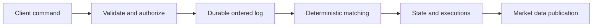

# Designing an ordered matching service

Order matching decisions and rebuild deterministic state.

**Prerequisite / previous:** [Payment processing and reconciliation](payments.md) · **Next:** [Architecture reviews and interviews](design-review.md)

This hypothetical exchange exercise studies ordering, durable recovery, and latency. It does not describe every real exchange or its regulatory requirements. Separate order acceptance, matching, market-data distribution, and reporting; they can have different deadlines while sharing consistent event identities.

## Critical path

A client gateway validates identity, format, and rate policy. An order manager applies mandatory risk and reservation checks. A sequencer and matching engine establish the order in which accepted commands affect the order book. Executions reference both sides of a match and are returned to participants; downstream market-data and reporting consumers use the recorded events.

A single-threaded engine per instrument or partition can simplify deterministic state transitions. Shared memory and co-location can reduce copying and network hops, but do not guarantee no context switches or eliminate every synchronization problem. Removing durable logging without a recovery contract trades away accepted orders.

## Recovery and scale

Define exactly when an order is accepted, where its sequence is durably recorded, and how a standby avoids processing the same sequence inconsistently. Record non-deterministic inputs such as time-dependent decisions when they affect replay. Partition by an ownership boundary, and handle cross-partition risk limits explicitly. Slow reporting consumers must not block the matching loop; dropped market-data updates need a gap/recovery protocol.

## Failure exercise

Crash after recording an accepted order but before returning its acknowledgement. Retry the same client order ID and reconstruct the book from a checkpoint plus log. Prove that the order is not matched twice. Then delay a standby and explain the acknowledgement/failover trade-off.

Interview question: what is included in the latency measurement—from client send, gateway receipt, durable acceptance, or execution? Compare distributions under burst load, not just a best-case microsecond claim.

Related: [consensus](../distributed/consensus.md), [replication](../distributed/replication.md), [processes](../foundations/processes.md), and [payments](payments.md).

## Triggered-order exercise

A hypothetical stop-market sell order for 100 shares has a trigger of 36 units. A qualifying market-data event triggers submission of a market order under the venue's rules; the trigger is not a guaranteed execution price. Partial fills, gaps, delayed data, and rejected submissions need explicit state. Persist the transition so replaying the triggering event does not submit another order. This is a state-machine exercise, not a trading recommendation.

## Architecture flow

## Recovery exercise answer

The durable log contains client order O, but the acknowledgement was lost. What must a retry establish before doing any new work?

Resolve O under its client/session identity to the existing accepted command and result. Replay the recorded sequence from a compatible checkpoint without generating new command identities or re-running nondeterministic decisions from current time. A standby must not become a competing writer without a defined fencing and ownership transition.

**Interview and revision cue:** Name the acknowledgement point, deterministic replay inputs, duplicate boundary, and failover ownership; then test a crash at each boundary.

## Further reading

- [LMAX architecture by Martin Fowler](https://martinfowler.com/articles/lmax.html).
