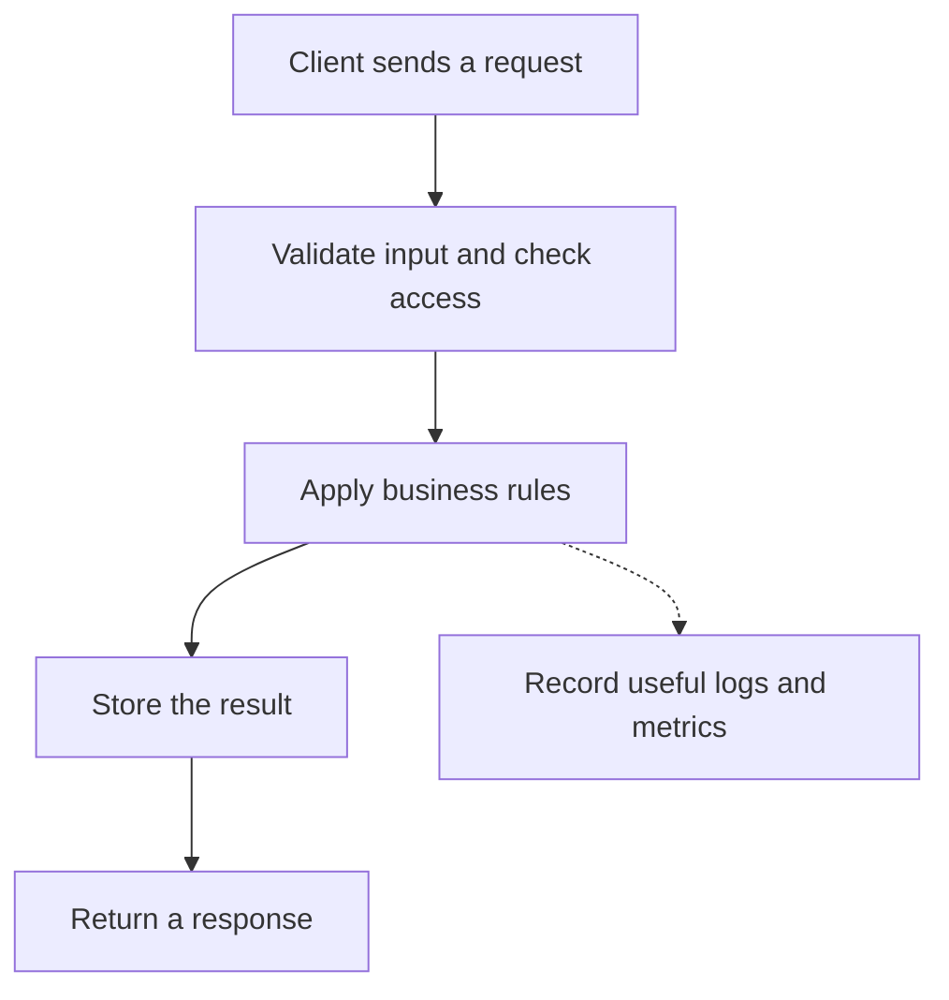

# Build and operate a task service

Implement and recover a tenant-safe API with measurable acceptance checks.

**Prerequisite / previous:** [Live streaming and latency budgets](../applications/live-streaming.md) · **Next:** [Design a URL shortener](url-shortener.md)

A **backend** is the part of an application that runs on a server. When you add a task in the browser, the backend checks the request, saves the task, and sends back a result.

**Before you start:** know [JavaScript functions](../../javascript/functions/README.md), [async/await](../../javascript/asynchronous/async-await.md), HTTP requests, and basic database operations. This project turns those concepts into an API you can test and operate.

## Follow one request

Imagine a client creating a task. The server checks the request body and the caller's permission, stores the task, and returns its identifier.

Authentication identifies the caller. Authorization decides whether that caller can perform this action on this resource. Validation checks the shape and allowed values of input. None of these replaces the others.

## Project scope

Build one task service using the concepts already taught in this course. Start with one process and one relational database. The project is complete when a caller can create, list, and update only their own tasks, retry safely, observe failures, and restore the data. Use the course Previous/Next controls to follow the curriculum.

## Define the contract before coding

| Decision         | Example for `POST /tasks`                          | Failure to think about                                                 |
| ---------------- | -------------------------------------------------- | ---------------------------------------------------------------------- |
| Input            | A non-empty title with a documented maximum length | Empty text, wrong type, or an oversized body                           |
| Access           | Create a task for the signed-in account            | Caller tries to choose another account's ID                            |
| Success          | `201` with the stored task's ID                    | Connection closes after saving but before the client sees the response |
| Validation error | A stable error code and field information          | Response exposes internal exceptions                                   |
| Repeated request | A documented idempotency-key contract when needed  | Retry creates a duplicate task                                         |
| Storage          | A schema and constraints that enforce the rules    | Concurrent requests race past an application-only check                |

Keep business calculations separate from network and database actions where practical. The [functional programming course](../../functional-programming/index.md) shows how to test those calculations with plain data.

## Common choices

| Need                    | Starting point                                    | Trade-off to explain                                       |
| ----------------------- | ------------------------------------------------- | ---------------------------------------------------------- |
| Browser login           | A session or a suitable identity-provider flow    | Revocation, cookie handling, and access checks             |
| Flexible queries        | REST endpoints or GraphQL based on clients' needs | Request shape, query cost, caching, and authorization      |
| Faster repeated reads   | A cache with an explicit freshness rule           | Invalidations, misses, stale data, and memory              |
| Work after the response | A durable queue and worker                        | Retries, duplicate delivery, ordering, and monitoring      |
| Live client updates     | Polling, server-sent events, or WebSockets        | Update direction, frequency, connection cost, and recovery |

Treat these as choices for later versions. For example, a queue can hold a reminder until a worker processes it, but a failed delivery may be retried. The [queue lesson](../services/message-queues.md) explains how to handle repeated work.

## Practice Problems

| Problem | Level / priority | Practice / notes | Example / answer |
| --- | --- | --- | --- |
| Build a task API | Practice | Deliverable: Create, list, and update routes with documented input Check: A user cannot read or edit another user's tasks. | — |
| Add error handling | Practice | Deliverable: Stable error codes and a request ID Check: Internal stack traces stay out of client responses. | — |
| Add a background job | Practice | Deliverable: A queued notification with a retry policy Check: A repeated job does not send the same notification twice under the stated contract. | — |
| Measure the service | Practice | Deliverable: A small latency and error dashboard Check: A dependency outage is visible. | — |
| Rehearse recovery | Practice | Deliverable: Restore test data from a backup Check: Verify restored records, not just the existence of a backup file. | — |

## Architecture and acceptance evidence

Keep `(tenant_id, task_id)` in the access path and enforce a unique `(tenant_id, idempotency_key)` operation record. Write the task and an outbox notification in one transaction. A worker can retry notification delivery with its own durable deduplication contract. Index the list endpoint by tenant and cursor fields.

| Failure injection | Required evidence |
| --- | --- |
| Two simultaneous creates with one key | One task; identical stored result, or a documented pending response |
| Caller guesses another tenant's task ID | No data disclosure or mutation |
| Process dies after commit, before response | Retrying retrieves the committed operation |
| Worker dies after sending | Provider idempotency or a documented duplicate-delivery limitation |
| Restore into an empty environment | Counts, ownership, constraints, and representative reads match the recovery point |

At 200 requests/second with a measured mean processing time of 50 ms, Little's Law suggests 10 requests in service on average in a stable system. It does not size a pool for bursts or tail latency. Measure database and dependency limits before increasing application concurrency.

**Interview:** which operation must remain strongly consistent, what can be stale, and how does your evidence show that a backup is usable?

**Further reading:** [AWS disaster recovery guidance](https://docs.aws.amazon.com/wellarchitected/latest/reliability-pillar/plan-for-disaster-recovery-dr.html).
