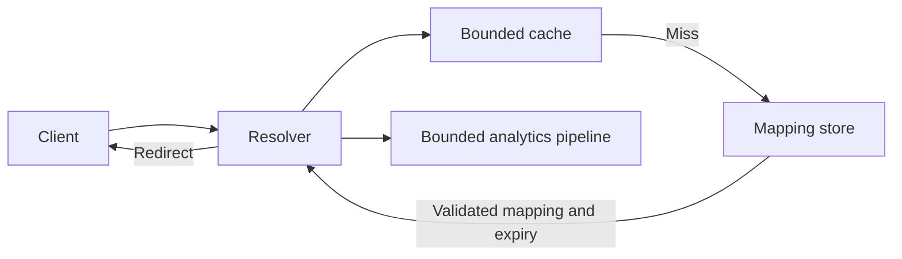

# Design a URL shortener

Allocate codes, manage expiry, and serve hot redirects.

**Prerequisite / previous:** [Build and operate a task service](task-service.md) · **Next:** [Design a durable chat system](chat-system.md)

A shortener gives a long destination a small stable identifier. This is a hypothetical worked design adapted from the original handbook, not a description of a particular company's infrastructure.

## Requirements and invariants

Create a short link, resolve it quickly, and allow its owner to expire or delete it. Optional features include custom aliases, analytics, and private links. Clarify whether destinations can change and whether previews are fetched. A short code must identify at most one active mapping, and an expired or unauthorized mapping must not be returned from a stale cache.

## Estimate the workload

Assume 100 million new URLs per 30-day month and 100 redirects per creation. These are exercise inputs, not measurements.

| Quantity | Calculation | Interpretation |
| --- | --- | --- |
| Average creates | 100 million / 2,592,000 seconds ≈ 38.6/s | Plan bursts separately |
| Average redirects | 100 × 38.6 ≈ 3,858/s | Hot links can dominate |
| Raw records over ten years | 100 million × 120 = 12 billion | Assumes no expiry/deletion |
| Raw payload storage | 12 billion × 500 bytes = 6 TB | Excludes indexes, replicas, logs and backups |
| Approximate payload traffic | 40 creates/s × 500 bytes = 20 KB/s | Rounded; HTTP/TLS overhead is additional |

Cache memory depends on distinct retained keys, value sizes, metadata, and the eviction policy. Taking 20% of daily request count is not a valid cache-sizing formula. Benchmark a hot-key distribution and expiry behavior.

## Data model and interface

Store `code`, `destination`, `owner_id`, `created_at`, `expires_at`, `status`, and a version. Enforce uniqueness on `code`. A relational database is a useful baseline; needing many rows does not automatically require NoSQL. Keep analytics events separate from the mapping's transactional update.

| Operation | Contract |
| --- | --- |
| `POST /links` | Authenticated owner submits destination, optional alias and expiry; stable idempotency key prevents duplicate creation on retry |
| `GET /{code}` | Resolve under status, expiry, and access policy; return the chosen redirect response |
| `DELETE /links/{code}` | Verify ownership, mark unavailable, and invalidate or version cached copies |
| `GET /links/{code}/stats` | Authorized owner reads explicitly delayed aggregate statistics |

Public redirects need not require an API key. Management APIs do require an appropriate identity. Return 401 when authentication is required and absent/invalid, and 403 for an authenticated caller denied access, subject to the application's information-disclosure policy.

## Allocate codes safely

Base62 encodes an allocated numeric ID compactly; encoding an arbitrary long URL does not inherently shorten it. Five Base62 characters provide 916,132,832 combinations; six provide 56,800,235,584; seven provide 3,521,614,606,208. Plan capacity, reserved codes, and growth before selecting a length.

A sequence/range allocator needs durable allocation and safe ownership; unused gaps are usually acceptable. Random codes require collision checking and retry under a uniqueness constraint. Truncating a hash also requires collision handling; hashing the identical input again does not produce a new candidate without changing the construction.

A key-generation service can allocate bounded pools, but precomputing the entire six-character space would require about 340.8 GB just for six bytes per key, before metadata. Atomically claim keys and never return a claimed key to a pool after an uncertain outcome without resolving ownership. See [ID generation](../distributed/ids.md).

## Request flow and architecture

The resolver checks the cached mapping's status/version and expiry contract. On a miss it reads the mapping store and populates a bounded cache. A permanent 301 redirect can remain cached by clients, complicating later changes, deletion, and click counting. For revocable links, choose an appropriate temporary redirect and cache policy. Explain 302/307 method behavior if non-GET requests are supported.

## Scale and failure analysis

Partition by code if a single database reaches measured limits. Hashing spreads different keys but does not split one viral key; cache and request coalescing address that load. Protect the database from a flood of nonexistent codes with bounded negative caching and rate limits. Do not let negative entries hide newly created mappings longer than the documented freshness budget.

Enforce expiration during reads; background cleanup only reclaims storage. Avoid reusing expired codes because old bookmarks could unexpectedly point to a new owner. Analytics should tolerate duplicates and delayed delivery and should not make redirect availability depend on an overloaded reporting system.

Validate URL schemes and limit abuse. A preview fetcher needs SSRF controls independent of the redirect service. Avoid secrets in analytics and define retention. Replicas require a plan for read-after-create and deletion visibility; a stale follower can otherwise return a missing or revoked link.

## Interview questions and exercises

1. The mapping commits but the create response is lost. Walk through the retry and show one resulting code.
2. One link receives half of all redirects. Identify the bottleneck before adding shards.
3. Delete a link while it is cached in the service, CDN, and browser. State the strongest guarantee you can actually provide.
4. Recalculate capacity for a 20× peak and a 30-day default expiry; keep payload estimates separate from provisioned capacity.

Completion check: explain one baseline, one scaling trigger, and the exact authority for uniqueness and expiry. Related: [caching](../data/caching.md), [API design](../interfaces/api-design.md), and [sharding](../distributed/sharding.md).

## Original design illustrations

