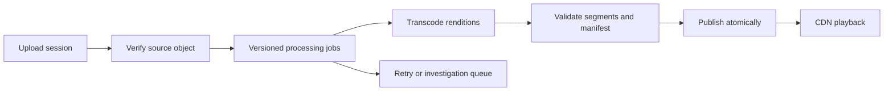

# Design a video upload and playback platform

Coordinate uploads, processing, publication, and playback.

**Prerequisite / previous:** [Design a social feed](social-feed.md) · **Next:** [Design a ride dispatch service](ride-dispatch.md)

The original handbook used a Netflix prompt while including public uploads and comments. This exercise explicitly designs a user-uploaded video service. A licensed subscription catalog would have different ingestion, rights, and moderation requirements.

## Requirements and estimates

Support resumable uploads, asynchronous processing, searchable metadata, adaptive playback, and playback progress. Decide accepted formats, maximum size/duration, publication policy, geography/rights checks, deletion, and latency targets.

| Assumption | Result |
| --- | --- |
| 200 million daily users × five playback starts | One billion starts/day ≈ 11,574/s |
| Five million uploads/day × 100 MB | 500 TB/day raw uploads |
| Ten years with no deletion | About 1.825 EB raw source bytes |
| Average upload bandwidth | About 5.8 GB/s before protocol overhead |
| Illustrative full-view egress: one billion × 100 MB | 100 PB/day; not implied by playback-start count alone |

A playback start generates many manifest and segment requests. Transcoded renditions, replicas, indexes, partial uploads, and backups increase storage beyond source bytes. Use peak concurrency and bitrate distributions for serving capacity.

## Model the lifecycle

Store video ownership, title, tags, rights, upload state, processing version, checksums, rendition metadata, and publication status. Comments and viewing progress have separate access patterns. Object storage holds media bytes; a transactional database owns workflow metadata. An index serves discovery with a documented freshness delay.

Create an upload session, upload/retry numbered parts using scoped credentials, complete and verify it, then expose processing status. A successful upload API response is not a promise that playback is ready. Return an operation ID instead of a boolean that hides partial progress.

## Processing and delivery

A job graph may probe metadata, validate input, transcode, create thumbnails/captions, apply policy checks, and package playback manifests. Key jobs by video ID and processing version so repeats do not create inconsistent outputs. Separate upload chunks from playback segments: scene boundaries alone do not guarantee uninterrupted playback. Adaptive renditions need appropriate codec/keyframe and segment alignment.

Clients choose a supported rendition based on bandwidth and playback conditions. Cache immutable segment versions and publish a manifest only after its required outputs are ready. Range requests and resumable uploads solve different problems. Playback progress updates from several devices need a conflict rule rather than blindly accepting the latest-arriving timestamp.

Recommendations can begin with simple permitted signals and be evaluated separately. Content recognition is imperfect; automated filters do not guarantee correct moderation or copyright decisions. Quarantine and appeals/manual workflows may be needed by the product. Geographic or account rights checks belong on the server and on protected media delivery; hiding a player button does not prevent origin access.

## Scaling and failure modes

Processing capacity follows uploaded duration, codec complexity, and rendition count, not just upload bytes. Separate interactive playback from batch transcoding pools. Bound retries and quarantine corrupt inputs. An abandoned multipart upload, a worker crash, and a published manifest pointing to missing segments require different recovery actions.

Keep metadata caches separate from media CDN caches. Origin shielding and pre-positioning can reduce upstream traffic, but eviction and regional demand remain workload-dependent. Netflix's actual Open Connect is a useful [primary-source CDN example](https://openconnect.netflix.com/), not proof that this hypothetical platform uses Netflix's full stack.

## Exercises and interview checks

Kill a transcoder after it writes half its output, then retry under a newer encoding configuration. Demonstrate that readers see one valid published version. Next, revoke a video's access while segments remain cached and explain the access-token and cache-expiry boundary.

Compare precomputing all renditions with generating uncommon ones on demand. Include storage, compute, startup delay, and failure recovery. Related: [storage](../data/storage.md), [message queues](../services/message-queues.md), [deployments](../operations/deployments.md), and [caching](../data/caching.md).

## Original design illustrations

## Engineering account: How YouTube Handles Massive Video Uploads

This How YouTube Handles Massive Video Uploads account is retained as historical design evidence. Read its workload and period with the linked sources; it is not a current technology inventory or a universal benchmark.

YouTube handles 500+ hours of video content uploads every minute on average. How does it manage this?

The diagram above shows YouTube’s innovative hardware encoding published in 2021.

*   **Traditional Software Encoding**

YouTube’s mission is to transcode raw video into different compression rates to adapt to different viewing devices - mobile(720p), laptop(1080p), or high-resolution TV(4k).

Creators upload a massive amount of video content on YouTube every minute. Especially during the COVID-19 pandemic, video consumption is greatly increased as people are sheltered at home. Software-based encoding became slow and costly. This means there was a need for a specialized processing brain tailored made for video encoding/decoding.

*   **YouTube’s Transcoding Brain - VCU**

Like GPU or TPU was used for graphics or machine learning calculations, YouTube developed VCU (Video transCoding Unit) for warehouse-scale video processing.

Each cluster has a number of VCU accelerated servers. Each server has multiple accelerator trays, each containing multiple VCU cards. Each card has encoders, decoders, etc.

VCU cluster generates video content with different resolutions and stores it in cloud storage.

This new design brought 20-33x improvements in computing efficiency compared to the previous optimized system.

### Exercise

Compare software and dedicated transcoding capacity for a changing codec mix. Include utilization, queue age, fallback, and upgrade cost before applying a published efficiency ratio.

## Engineering account: Netflix: delivery and service boundaries

This Netflix: delivery and service boundaries account is retained as historical design evidence. Read its workload and period with the linked sources; it is not a current technology inventory or a universal benchmark.

### Evidence and scope

Netflix's Open Connect is a CDN built around delivering Netflix video through interconnection and appliances near viewers. Separating media delivery from application control traffic is the relevant architecture lesson. This does not imply that every backend application uses one language, database, or deployment tool. The earlier overlapping stack charts are historical illustrations, not a verified current inventory. [Netflix Open Connect](https://openconnect.netflix.com/).

### Read the design mechanism

A playback service can authorize a session and return delivery information while a CDN handles large media transfers. A metadata cache has different freshness and recovery requirements from a video cache. Precomputed recommendations can be regenerated, whereas an authoritative billing record cannot simply disappear on cache eviction. Backend-for-frontend aggregation and federated schemas address API ownership, but add dependency and query-budget concerns.

### Exercise

Draw the control request and video-byte paths separately. Fail the metadata cache, a CDN location, and the recommendation service one at a time. For each, specify what users see, which data is authoritative, and how traffic is bounded during recovery.

Related: [video platform design](video-platform.md), [API contracts](../interfaces/api-design.md), [caching](../data/caching.md), and [notifications](../services/notifications.md).
