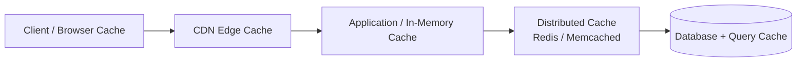
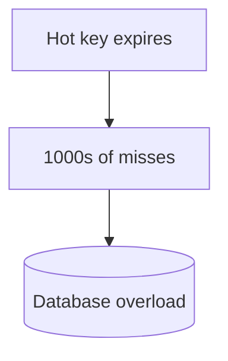
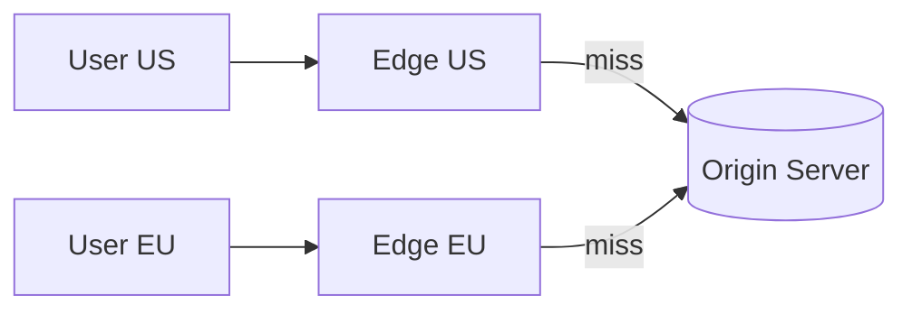
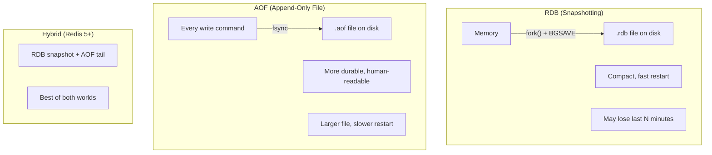
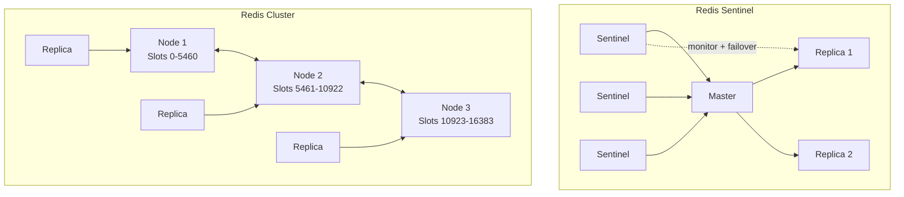
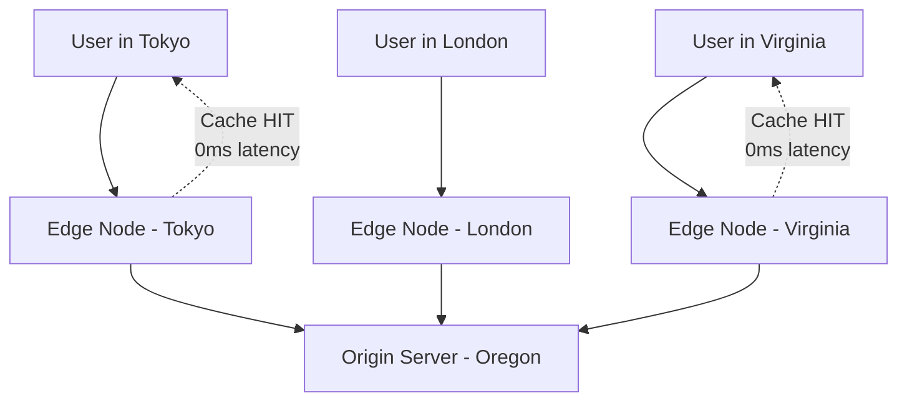

<span id="caching"></span>

# Caching

Balance freshness, correctness, eviction, and origin protection.

**Prerequisite / previous:** [Storage interfaces and large objects](storage.md) · **Next:** [Search indexing and crawling](search.md)


A cache keeps a copy of data so the next request can reuse it. This can avoid a slow database call or repeated calculation. Decide how long the copy stays valid and what happens when the cache is empty.

---

## Follow the task app

A noticeboard displays a copy of the timetable. A cached task summary works the same way: it is convenient to read, but someone must decide when to refresh it.

1. Read a task summary from the original store.
2. Save a copy under a key that identifies the correct user and query.
3. Reuse the copy on a later request.
4. Change a task and check when the summary reflects that change.

## Words to know

| Word | Meaning |
| --- | --- |
| Hit | The requested copy is in the cache. |
| Miss | The copy is absent, so the original work is needed. |
| Stale | Older than the current source data. |

## Core Concepts

A **cache** is a high-speed data layer that stores a subset of data — typically the most frequently or recently accessed — so future requests are served faster. Caching trades a little memory and staleness risk for huge gains in **latency**, **throughput**, and reduced load on [databases](databases.md).

### Why Cache?

- **Reduce response time** — reuse data instead of repeating a slower lookup; measure the improvement in your system.
- **Increase throughput** — serve more requests with the same backend.
- **Reduce cost & load** — fewer expensive DB/API calls, relieving [read replicas](../distributed/replication.md).

Two key metrics: **hit ratio** (fraction served from cache) and **miss penalty** (cost of a miss).

---

## Cache Layers

Caching happens at every tier of a system:



| Layer           | Example                   | Caches                              |
| --------------- | ------------------------- | ----------------------------------- |
| **Client**      | Browser cache, mobile app | Static assets, API responses        |
| **CDN**         | Cloudflare, CloudFront    | Images, CSS/JS, video, edge content |
| **Application** | Local in-process, Guava   | Hot objects near the app            |
| **Distributed** | Redis, Memcached          | Shared cache across app servers     |
| **Database**    | Query/buffer cache        | Recent query results, pages         |

---

## Caching Strategies


| Strategy                      | How It Works                                                 | Pros                               | Cons                              |
| ----------------------------- | ------------------------------------------------------------ | ---------------------------------- | --------------------------------- |
| **Cache-Aside** (lazy)        | App checks cache; on miss, loads from DB and populates cache | Only caches what's used; resilient | First request is slow; stale risk |
| **Read-Through**              | Cache library loads from DB on miss automatically            | Simple app code                    | Needs cache provider support      |
| **Write-Through**             | Write to cache **and** DB synchronously                      | Writes through this path update both stores; other write paths still need coordination                 | Higher write latency              |
| **Write-Back** (write-behind) | Write to cache, flush to DB async later                      | Fast writes, absorbs bursts        | Risk of data loss before flush    |
| **Write-Around**              | Write straight to DB, bypass cache                           | Avoids caching write-once data     | Recent writes miss the cache      |

Choose a cache strategy based on who owns updates and how much stale data the application can accept.

---

## Eviction Policies

Caches are size-bounded, so they must **evict** entries when full:

| Policy                          | Evicts                               | Best For                           |
| ------------------------------- | ------------------------------------ | ---------------------------------- |
| **LRU** (Least Recently Used)   | The item unused for the longest time | General-purpose; temporal locality |
| **LFU** (Least Frequently Used) | The least-accessed item              | Stable popularity distributions    |
| **FIFO** (First In, First Out)  | The oldest inserted item             | Simple, order-based workloads      |

> 🔗 See a full, worked **LRU cache implementation** here: [LRU Cache](../../DSA/lru-cache/README.md).

---

## TTL (Time-To-Live)

A **TTL** sets a reuse/expiry bound on each entry; physical cleanup may happen later:

- Short TTL → fresher data, lower hit ratio.
- Long TTL → higher hit ratio, more staleness.
- Add **jitter** to TTLs so many keys don't expire simultaneously (avoids [thundering herd](#thundering-herd)).

---

## Cache Invalidation

> _"There are only two hard things in Computer Science: cache invalidation and naming things."_

Keeping the cache in sync with the source of truth:

- **TTL / expiry** — let entries age out (simplest, eventually consistent).
- **Write-through / write invalidation** — update or delete the cache key on every write.
- **Event-based** — publish change events (e.g., via [message queues](../services/message-queues.md)) to invalidate keys.
- **Versioned keys** — embed a version/hash in the key so new data uses a new key.

---

## Thundering Herd

When a popular key expires (or the cache restarts), **many** concurrent requests miss at once and stampede the database.



**Mitigations:**

- **Request coalescing / locking** — only one request recomputes; others wait.
- **Stale-while-revalidate** — serve stale data while refreshing in the background.
- **TTL jitter** — spread expirations over time.
- **Cache warming** — pre-populate hot keys before traffic.

---

## Distributed Caches

When one machine's memory isn't enough or the cache must be shared across app servers, use a **distributed cache**:

|                 | Redis                                            | Memcached                        |
| --------------- | ------------------------------------------------ | -------------------------------- |
| **Data types**  | Rich (strings, hashes, lists, sets, sorted sets) | Strings/blobs only               |
| **Persistence** | ✅ Optional (RDB/AOF)                            | ❌ In-memory only                |
| **Replication** | ✅ Built-in                                      | ❌ (client-side)                 |
| **Best for**    | Complex data, pub/sub, leaderboards              | Simple, high-throughput KV cache |

- Partitioning may use [consistent hashing](../distributed/sharding.md#consistent-hashing), fixed hash slots, or a directory; verify the selected cache architecture.
- Can be [replicated](../distributed/replication.md) for availability.

---

## CDN (Content Delivery Network)

A **CDN** caches static (and cacheable dynamic) content at **edge servers** geographically close to users, cutting latency and origin load.



- Great for images, video, CSS/JS, and downloads.
- Uses TTLs, cache-control headers, and purge APIs for invalidation.

---

## Trade-offs / When to Use

- ✅ **Use caching** for read-heavy, tolerant-to-staleness data with high reuse (hot keys).
- ❌ **Avoid / be careful** with rapidly changing data, strong-consistency requirements, or low-reuse data (low hit ratio wastes memory).
- Every cache adds a **consistency vs freshness** trade-off — pick strategy, TTL, and invalidation to match your correctness needs (see [Consistency Models](../distributed/consistency-models.md) and [CAP Theorem](../distributed/cap-theorem.md)).

## Interview Questions

- How would you design a caching layer for a social feed to balance freshness and latency?
- Explain cache invalidation strategies and when you'd pick event-based invalidation over TTL-only.
- How do you mitigate and detect the thundering herd problem at scale?

## Production Checklist

- Measure hit ratio, miss penalty, and memory usage per cache instance
- Add TTL jitter and request coalescing to prevent stampedes
- Backup critical cached state if persistence is enabled (AOF/RDB in Redis)
- Monitor eviction rates, CPU, and network latency to the cache cluster

## Testing & Monitoring

- Simulate cache restart + expiry events to observe system behavior
- Load test with realistic access patterns and hot keys
- Create synthetic traffic to verify cache warming and invalidation flows

## Related Topics

- [LRU Cache](../../DSA/lru-cache/README.md) — full implementation of the LRU eviction policy
- [Databases](databases.md) — the backing store caches protect
- [Replication](../distributed/replication.md) — read replicas complement caching
- [Sharding](../distributed/sharding.md) — consistent hashing for distributed caches
- [CAP Theorem](../distributed/cap-theorem.md) — consistency vs availability trade-offs
- [Consistency Models](../distributed/consistency-models.md) — staleness and consistency guarantees
- [Scalability](../foundations/capacity.md) — caching as a scaling lever


## Worked stale-write race

Reader A misses the cache and reads database version 7. Writer B commits version 8 and deletes the cache key. Reader A then fills the cache with version 7. Invalidation alone did not prevent stale data. Define whether this is acceptable; use version-aware writes, coordinated refresh, or an authoritative read for correctness-sensitive operations. TTL bounds the lifetime of the cached entry, not necessarily the age of the underlying data or a read from a lagging replica.

With 1,000 reads/s and a measured 90% hit ratio, the origin sees about 100 reads/s in steady state. A cache restart can send all 1,000 reads/s to the origin. Reserve origin capacity, coalesce refreshes, rate-limit misses, and measure the oldest served data. Jitter spreads many keys' expirations but cannot by itself fix a stampede on one hot key.

**Common mistake:** caching private responses under a key that omits tenant or authorization context. Cache keys and CDN policies are part of the security boundary. **Exercise:** simulate a cold cache and the version-7 race. **Check:** state the allowed staleness, test it, and show how the origin remains within its connection and request budgets.

## Absent keys, eviction, and durable cache state

Repeated queries for nonexistent keys can overload the database. Cache a negative result briefly, validate inputs, and bound miss traffic. A [Bloom filter](../../DSA/bloom-filter/README.md) can answer “definitely absent” or “possibly present”; false positives remain, and a stale filter that missed a newly inserted key must not become an incorrect authority. Avoid permanent hot-key entries unless an independent refresh/invalidation contract maintains correctness.

TTL is an expiry rule; LRU, LFU, FIFO, random replacement, MRU, and segmented LRU are capacity replacement choices. MRU suits particular scan-like reuse patterns, while segmented LRU can protect repeatedly used entries from one-time scans. A two-tier cache describes topology, not an eviction algorithm. Compare hit ratio, miss cost, bytes, and per-key skew with realistic traffic.

Redis supports counters, hashes, sets, sorted sets, bitmaps, and other structures useful for sessions, ranking, and rate control. Durability and replication settings determine whether it can be authoritative for a particular use case. A list alone is not a complete durable work queue, and a lock alone does not prevent stale-owner writes. Redis Cluster uses hash slots; do not infer that it uses a simple consistent-hash ring.

RDB snapshots and AOF logging have different restore costs and loss windows. AOF fsync policies trade latency for durability; background persistence can still affect latency through fork pauses, copy-on-write memory, disk contention, and large values. “Every second” does not mean big keys have no effect on the main thread. Test crash recovery and measure memory headroom. See [Redis persistence](https://redis.io/docs/latest/operate/oss_and_stack/management/persistence/).

A CDN may select edges through DNS and network routing; neither guarantees the geographically nearest machine. A layered CDN can use an origin shield to coalesce misses. Cache-Control, Vary, cache keys, signed access, and purge behavior must match privacy and freshness requirements. Kafka retention and an authoritative search index should not casually be called disposable caches.

## Implementation details

### Redis Deep-Dive 🧠

Redis (Remote Dictionary Server) is an **in-memory data structure store** — far more than a key-value cache. It's a Swiss Army knife that doubles as a database, cache, message broker, and stream processor.

#### Data Types

Redis is "data-structure server" — each key holds a typed data structure with native operations.

| Type            | Description                            | Key Operations                                | Use Cases                                                  |
| --------------- | -------------------------------------- | --------------------------------------------- | ---------------------------------------------------------- |
| **String**      | Binary-safe, up to 512 MB              | `SET`, `GET`, `INCR`, `SETEX`, `MSET`         | Cache values, counters, serialized JSON, distributed locks |
| **Hash**        | Map of field-value pairs               | `HSET`, `HGET`, `HGETALL`, `HINCRBY`          | User profiles, session data, object storage                |
| **List**        | Linked list (ordered by insertion)     | `LPUSH`, `RPOP`, `LRANGE`, `LLEN`             | Job queues, activity feeds, message buffers                |
| **Set**         | Unordered unique strings               | `SADD`, `SISMEMBER`, `SINTER`, `SCARD`        | Tags, unique visitors, friend lists                        |
| **Sorted Set**  | Set with scores, ordered by score      | `ZADD`, `ZRANGE`, `ZRANK`, `ZREVRANGEBYSCORE` | Leaderboards, rate limiters, priority queues               |
| **Stream**      | Append-only log (Kafka-lite)           | `XADD`, `XREAD`, `XREADGROUP`, `XRANGE`       | Event sourcing, message brokers, audit logs                |
| **Bitmap**      | Bit-level operations on strings        | `SETBIT`, `GETBIT`, `BITCOUNT`, `BITOP`       | Feature flags, online/offline status, daily active users   |
| **HyperLogLog** | Probabilistic cardinality estimation   | `PFADD`, `PFCOUNT`, `PFMERGE`                 | Unique visitors (with &lt;1% error), counting distinct events |
| **Geospatial**  | Latitude/longitude with radius queries | `GEOADD`, `GEORADIUS`, `GEODIST`              | Nearby drivers, store locators, geofencing                 |

**Data type selection guide:**

```text
Cache a JSON object?        → String (serialize with JSON.stringify)
Cache specific fields?      → Hash (update individual fields without full deserialization)
Need a leaderboard?         → Sorted Set (ZADD score member, ZRANGE by rank)
Need a message queue?       → List (LPUSH + BRPOP) or Stream (for consumer groups)
Need to count unique items? → HyperLogLog (12 KB for 2^64 items)
Tracking online users?      → Bitmap + SETBIT user_id 1
```

**Code examples:**

```typescript
// --- Strings: session cache ---
await redis.setex(`session:${sessionId}`, 1800, JSON.stringify(sessionData));

// --- Hashes: user profile (update single field without full serialization) ---
await redis.hset(`user:${userId}`, 'lastLogin', new Date().toISOString());
const email = await redis.hget(`user:${userId}`, 'email');

// --- Sorted Sets: top 10 leaderboard ---
await redis.zadd('leaderboard', 9500, 'player:42');
const top10 = await redis.zrevrange('leaderboard', 0, 9, 'WITHSCORES');

// --- Lists: job queue ---
await redis.lpush('email:queue', JSON.stringify({ to: 'a@b.com', template: 'welcome' }));
const job = await redis.brpop('email:queue', 5); // blocking pop with 5s timeout

// --- Sets: unique tags for a post ---
await redis.sadd(`post:${postId}:tags`, 'javascript', 'caching', 'redis');
const tags = await redis.smembers(`post:${postId}:tags`);

// --- Bitmaps: daily active users ---
await redis.setbit('dau:2025-01-15', userId, 1);
const dauCount = await redis.bitcount('dau:2025-01-15');
```

#### Eviction Policies

What happens when Redis hits `maxmemory`? You choose the eviction policy.

| Policy            | Behavior                                       | Best For                                                  |
| ----------------- | ---------------------------------------------- | --------------------------------------------------------- |
| `noeviction`      | Returns error on writes                        | **Never use for caching** — will crash your app           |
| `allkeys-lru`     | Evict least recently used keys, any key        | **General-purpose caching (recommended)**                 |
| `allkeys-lfu`     | Evict least frequently used keys, any key      | Access patterns where frequency matters more than recency |
| `allkeys-random`  | Evict random keys                              | When access pattern is uniform (rare)                     |
| `volatile-lru`    | Evict LRU among keys **with a TTL**            | Mixed workload: some keys must never be evicted           |
| `volatile-lfu`    | Evict LFU among keys **with a TTL**            | Mixed workload with frequency bias                        |
| `volatile-random` | Evict random among keys **with a TTL**         | Mixed workload, uniform access                            |
| `volatile-ttl`    | Evict keys with the **shortest remaining TTL** | Prefer to evict expiring-soon keys                        |

**Recommendation:** For a pure cache, use `allkeys-lru`. For a mixed cache + persistent store, use `volatile-lru` and ensure only cache keys have TTLs.

```bash
# Check current policy
redis-cli CONFIG GET maxmemory-policy

# Set allkeys-lru with 2 GB max memory
redis-cli CONFIG SET maxmemory 2gb
redis-cli CONFIG SET maxmemory-policy allkeys-lru

# Or in redis.conf
maxmemory 2gb
maxmemory-policy allkeys-lru
```

#### Persistence: RDB vs AOF

Redis stores data in memory for speed, but can persist to disk for durability.



| Criteria               | RDB                                  | AOF                                          | Hybrid                                  |
| ---------------------- | ------------------------------------ | -------------------------------------------- | --------------------------------------- |
| **Durability**         | Low — loses data since last snapshot | High — `fsync` every second (or every write) | High                                    |
| **Restart speed**      | Fast (load single file)              | Slow (replay all commands)                   | Fast (RDB base + small AOF tail)        |
| **File size**          | Small (compressed binary)            | Large (every write logged)                   | Medium                                  |
| **Performance impact** | Low (async `fork()`)                 | Configurable (`fsync` frequency)             | Low                                     |
| **Recovery guarantee** | Last snapshot                        | Up to last fsync                             | Near-last snapshot + tail               |
| **Best for**           | Cache with backup, disaster recovery | Durable queue, message store                 | Production — use if you can't lose data |

**AOF fsync policies:**

| Policy                 | Behavior                    | Durability vs Performance                    |
| ---------------------- | --------------------------- | -------------------------------------------- |
| `appendfsync always`   | fsync after every write     | Safest, slowest (every write waits for disk) |
| `appendfsync everysec` | fsync once per second       | **Recommended** — lose ≤1s of data           |
| `appendfsync no`       | Let OS decide when to fsync | Fastest, least durable                       |

#### Clustering

When one Redis instance isn't enough, you have three scaling options:



| Feature                    | Standalone           | Sentinel                           | Cluster                                      |
| -------------------------- | -------------------- | ---------------------------------- | -------------------------------------------- |
| **Data distribution**      | Single node          | Single master (replicas for reads) | Sharded across 16384 hash slots              |
| **High availability**      | None                 | Automatic failover to replica      | Automatic failover (each shard has replicas) |
| **Horizontal scaling**     | None (vertical only) | None (writes go to one master)     | Yes — add/remove nodes, reshard slots        |
| **Multi-key operations**   | All                  | All                                | Only keys in the same hash slot              |
| **Transactions**           | Full support         | Full support                       | Only within a single hash slot               |
| **Capacity planning** | Measure memory and workload needs | Include memory for replicas and recovery | Measure per-shard load and total memory needs |
| **Client requirements**    | Simple               | Simple (needs sentinel awareness)  | Cluster-aware client required                |
| **Operations complexity**  | Low                  | Medium                             | High                                         |

**Cluster hash slot mechanism:**

```text
HASH_SLOT = CRC16(key) mod 16384

# Keys in the same slot:
user:{userId}:profile   → CRC16("user:{userId}:profile") % 16384
user:{userId}:orders    → CRC16("user:{userId}:orders") % 16384

# Force same slot with hash tags:
user:{userId}:profile   → CRC16("{userId}") % 16384  ← only the content inside {} is hashed
user:{userId}:orders    → CRC16("{userId}") % 16384  ← same slot!
```

---


### Cache Invalidation 🧹

The other hard problem. Invalidation strategies determine how stale data gets removed or updated.

#### Strategies

| Strategy                      | Description                                                    | When to Use                                  |
| ----------------------------- | -------------------------------------------------------------- | -------------------------------------------- |
| **TTL (Time-to-Live)**        | Cache entry expires after a fixed duration                     | Most common — accept brief staleness window  |
| **Write invalidation**        | Delete cache key whenever data is updated in DB                | Strong consistency needed                    |
| **Write update**              | Update cache with new value on every DB write                  | Read-heavy, write-rare data                  |
| **Event-driven invalidation** | DB emits change events (CDC), cache subscribes and invalidates | Microservices, multiple cache nodes          |
| **Versioned keys**            | Append version number: `user:42:v3`                            | Rollback-safe, blue-green deployments        |
| **Soft invalidation**         | Mark entry as "stale" (serve from cache + refresh async)       | High-traffic keys that can't tolerate misses |

#### TTL Strategy Guide

```text
Session data:              15–30 minutes
API rate limit counters:   1 minute window
Product catalog:           1–6 hours (invalidate on product update)
User profile:              5–15 minutes
Static content (blog post): 24 hours
Configuration/flags:       1–5 minutes
Analytics aggregates:      5–60 minutes (depends on freshness needs)
```

#### Stale-While-Revalidate Pattern

Serve the stale cached value while asynchronously refreshing it — prevents cache misses from hitting the database under load.

```typescript
async function getWithSWR<T>(
  key: string,
  ttl: number,
  swrWindow: number, // extra window where stale data is served
  fetcher: () => Promise<T>,
): Promise<{ data: T; fresh: boolean }> {
  const cached = await redis.get(key);

  if (!cached) {
    // Complete miss — must fetch
    const data = await fetcher();
    await redis.setex(key, ttl + swrWindow, JSON.stringify({ data, timestamp: Date.now() }));
    return { data, fresh: true };
  }

  const entry = JSON.parse(cached);
  const age = Date.now() - entry.timestamp;

  if (age < ttl * 1000) {
    // Fresh — return immediately
    return { data: entry.data, fresh: true };
  }

  // Stale — return old data BUT trigger async refresh
  // Use a lock to prevent multiple concurrent refreshes (stampede prevention)
  refreshInBackground(key, ttl, swrWindow, fetcher).catch(() => {});
  return { data: entry.data, fresh: false };
}

async function refreshInBackground<T>(
  key: string,
  ttl: number,
  swrWindow: number,
  fetcher: () => Promise<T>,
): Promise<void> {
  const lockKey = `${key}:refresh-lock`;
  const lockToken = crypto.randomUUID();
  const acquired = await redis.set(lockKey, lockToken, 'EX', 10, 'NX');
  if (!acquired) return; // another process is already refreshing

  try {
    const data = await fetcher();
    await redis.setex(key, ttl + swrWindow, JSON.stringify({ data, timestamp: Date.now() }));
  } finally {
    await redis.eval(
      "if redis.call('get', KEYS[1]) == ARGV[1] then return redis.call('del', KEYS[1]) else return 0 end",
      1, lockKey, lockToken,
    );
  }
}
```

---


### Cache Stampede Prevention 🐘🐘🐘

A **cache stampede** (or thundering herd) happens when a heavily-requested cache key expires, and dozens (or hundreds) of concurrent requests all try to recompute and repopulate it simultaneously — crushing the database.

#### Solutions

##### 1. Locking (Mutex)

Only **one** request is allowed to recompute the value. Others wait or get a stale copy.

```typescript
async function getWithLock<T>(key: string, ttl: number, fetcher: () => Promise<T>): Promise<T> {
  const cached = await redis.get(key);
  if (cached) return JSON.parse(cached);

  const lockKey = `${key}:lock`;
  const lockToken = crypto.randomUUID();
  const acquired = await redis.set(lockKey, lockToken, 'EX', 30, 'NX');

  if (acquired) {
    // This process won the lock — fetch and populate
    try {
      const data = await fetcher();
      await redis.setex(key, ttl, JSON.stringify(data));
      return data;
    } finally {
      await redis.eval(
      "if redis.call('get', KEYS[1]) == ARGV[1] then return redis.call('del', KEYS[1]) else return 0 end",
      1, lockKey, lockToken,
    );
    }
  }

  // Didn't acquire lock — wait and retry
  await new Promise((resolve) => setTimeout(resolve, 100 + Math.random() * 200));
  return getWithLock(key, ttl, fetcher); // recursive retry
}
```

##### 2. Probabilistic Early Expiry (PER Algorithm)

Refresh the cache **before** it expires, with a probability that increases as expiry approaches. This means the "herd" never encounters a true miss.

```typescript
async function getWithEarlyRefresh<T>(
  key: string,
  ttl: number, // total TTL in seconds
  delta: number, // recomputation window in seconds (e.g., 60s before expiry)
  fetcher: () => Promise<T>,
): Promise<T> {
  const metaKey = `${key}:meta`;

  // Lua script to atomically check and potentially trigger refresh
  const script = `
    local value = redis.call('GET', KEYS[1])
    local meta = redis.call('HMGET', KEYS[2], 'value', 'expiry', 'delta')
    local storedValue = meta[1]
    local expiry = tonumber(meta[2])
    local delta = tonumber(ARGV[1])
    local ttl = tonumber(ARGV[2])
    local now = tonumber(ARGV[3])

    if storedValue then
      local remaining = expiry - now
      if remaining > delta then
        return {storedValue, 'hit'}
      end
      -- Within recomputation window — trigger async refresh but return stale
      redis.call('SETEX', KEYS[3], 5, '1')  -- lock to prevent multiple triggers
      return {storedValue, 'stale'}
    end

    return {nil, 'miss'}
  `;

  const [value, status] = await redis.eval(
    script,
    3,
    key,
    metaKey,
    `${key}:trigger-lock`,
    delta,
    ttl,
    Math.floor(Date.now() / 1000),
  );

  if (status === 'miss') {
    return getWithLock(key, ttl, fetcher);
  }

  if (status === 'stale') {
    fetchAndCache(key, metaKey, ttl, delta, fetcher).catch(() => {});
  }

  return JSON.parse(value);
}
```

##### 3. Local (In-Process) Cache Shield

Add an in-memory LRU cache in each application process as the first line of defense — eliminates network hops for hot keys.

```typescript
import { LRUCache } from 'lru-cache';

const localCache = new LRUCache<string, any>({
  max: 10000,
  ttl: 1000 * 10, // 10 seconds — shorter than Redis TTL
});

async function getMultiLevel<T>(
  key: string,
  redisTTL: number,
  fetcher: () => Promise<T>,
): Promise<T> {
  // L1: Local memory (nanoseconds)
  const local = localCache.get(key);
  if (local !== undefined) return local as T;

  // L2: Redis (microseconds)
  const redisCached = await redis.get(key);
  if (redisCached) {
    localCache.set(key, JSON.parse(redisCached));
    return JSON.parse(redisCached) as T;
  }

  // L3: Database (milliseconds) — with lock
  const data = await getWithLock(key, redisTTL, fetcher);
  localCache.set(key, data);
  return data;
}
```

---


### CDN Caching 🌍

A **Content Delivery Network** caches your content at edge locations close to users. For backend engineers, CDNs are essential for caching static assets, API responses, and even entire pages.



#### What to Cache on a CDN

| Content                                | TTL                     | Notes                                                        |
| -------------------------------------- | ----------------------- | ------------------------------------------------------------ |
| Static assets (JS, CSS, images, fonts) | 1 year (versioned URLs) | Use content-hash in filename: `app.a3f2b1c.js`               |
| API responses (public)                 | 1–60 minutes            | GET-only, public data (product listings, search suggestions) |
| HTML pages (public)                    | 5–60 minutes            | Public landing pages, blogs, documentation                   |
| Media files                            | 7–30 days               | Videos, PDFs, audio files                                    |
| GraphQL (persisted queries via GET)    | Configurable            | Only persisted queries with `extensions.persistedQuery`      |

#### Cache-Control Headers for CDN

```http
# Static asset with version hash — cache forever
Cache-Control: public, max-age=31536000, immutable

# Public API response — cache for 5 minutes, allow stale for 1 hour
Cache-Control: public, max-age=300, s-maxage=300, stale-while-revalidate=3600

# Personalized content — don't cache at CDN
Cache-Control: private, no-cache
```

**CDN-specific directives:**

| Directive                | Meaning                                                                                |
| ------------------------ | -------------------------------------------------------------------------------------- |
| `s-maxage`               | Overrides `max-age` for shared caches (CDN) only                                       |
| `stale-while-revalidate` | Serve stale while re-fetching in background                                            |
| `stale-if-error`         | Serve stale if origin returns 5xx                                                      |
| `proxy-revalidate`       | CDN must revalidate with origin after max-age, even if client allows stale             |
| `Surrogate-Control`      | CDN-specific (Fastly, some others) — same semantics as Cache-Control but for CDN layer |
| `Surrogate-Key`          | Tag-based purging — `Surrogate-Key: product-42 category-shoes`                         |

#### Cache Key Design

Cache-key defaults vary by CDN and configuration. Specify the URL, query, and selected representation headers deliberately. For API responses, you often need more control:

```nginx
# NGINX — include specific headers and cookies in the cache key
proxy_cache_key "$scheme$host$request_uri$http_authorization";

# Varnish — vary cache based on specific headers
sub vcl_hash {
  hash_data(req.url);
  hash_data(req.http.Accept-Language);
}

# Fastly — custom VCL for API cache keys
set req.http.X-Cache-Key = req.url ":" req.http.Accept-Language;
```

#### Purging Strategies

| Strategy           | Description                                 | Use Case                                            |
| ------------------ | ------------------------------------------- | --------------------------------------------------- |
| **Purge by URL**   | `PURGE /api/products/123`                   | Single resource update                              |
| **Purge by tag**   | `PURGE /` with `Surrogate-Key: product-123` | Invalidate all cached responses related to resource |
| **Soft purge**     | Mark as stale (serve stale, refresh async)  | High-traffic — never leave the edge cold            |
| **Ban by pattern** | `BAN url ~ ^/api/products/`                 | Bulk invalidation (Varnish)                         |
| **Versioned URLs** | Change URL instead of purging               | Static assets — no purging needed                   |

---


### HTTP Caching Headers 📡

HTTP caching is the first caching layer every backend engineer should understand. It's free, built into every browser and proxy, and dramatically reduces bandwidth and server load.

#### Response Headers

| Header          | Example                            | Purpose                                              |
| --------------- | ---------------------------------- | ---------------------------------------------------- |
| `Cache-Control` | `public, max-age=3600, immutable`  | **The master switch** — dictates cache behavior      |
| `ETag`          | `"abc123"`                         | Resource version identifier for conditional requests |
| `Last-Modified` | `Tue, 15 Jan 2025 10:00:00 GMT`    | Timestamp for `If-Modified-Since`                    |
| `Expires`       | `Tue, 15 Jan 2025 12:00:00 GMT`    | Deprecated — use `Cache-Control: max-age` instead    |
| `Vary`          | `Accept-Encoding, Accept-Language` | Tells caches to store multiple variants              |
| `Age`           | `120`                              | Seconds since response was generated by origin       |

#### Cache-Control Directives

```http
Cache-Control: public, max-age=3600, s-maxage=600, stale-while-revalidate=300, stale-if-error=86400, must-revalidate
```

| Directive                  | Scope         | Meaning                                                        |
| -------------------------- | ------------- | -------------------------------------------------------------- |
| `public`                   | All caches    | Can be cached by browsers, CDNs, proxies                       |
| `private`                  | Browser only  | Only the end-user's browser may cache                          |
| `no-cache`                 | All           | **Can cache**, but MUST revalidate with origin before each use |
| `no-store`                 | All           | **Cannot cache at all** — never write to disk                  |
| `max-age=N`                | All caches    | Cache for N seconds from time of request                       |
| `s-maxage=N`               | Shared caches | Overrides `max-age` for CDNs/proxies only                      |
| `must-revalidate`          | All           | After expiry, must check with origin before using stale        |
| `proxy-revalidate`         | Shared caches | Like `must-revalidate` but for shared caches only              |
| `immutable`                | All           | Resource will never change — don't revalidate even on reload   |
| `no-transform`             | All           | Proxies must not modify (e.g., compress images)                |
| `stale-while-revalidate=N` | All           | Serve stale for N seconds while re-fetching in background      |
| `stale-if-error=N`         | All           | Serve stale for N seconds if origin returns 5xx                |

#### Conditional Requests

The browser sends **validator headers** so the server can respond with `304 Not Modified` (no body sent, saves bandwidth):

```text
# First request
GET /api/products/123 HTTP/1.1
→ 200 OK
  ETag: "v1.2.3"
  Last-Modified: Tue, 15 Jan 2025 10:00:00 GMT
  Cache-Control: public, max-age=3600

# Subsequent request (cache validation)
GET /api/products/123 HTTP/1.1
If-None-Match: "v1.2.3"
If-Modified-Since: Tue, 15 Jan 2025 10:00:00 GMT
→ 304 Not Modified  (no body — use cached copy!)
```

#### Express Middleware for Caching Headers

```typescript
import { Request, Response, NextFunction } from 'express';

interface CachePolicy {
  public?: boolean;
  maxAge: number; // seconds
  sMaxAge?: number; // CDN override
  staleWhileRevalidate?: number;
  staleIfError?: number;
  immutable?: boolean;
  vary?: string[];
}

function cacheControl(policy: CachePolicy) {
  return (req: Request, res: Response, next: NextFunction) => {
    const directives: string[] = [];

    directives.push(policy.public ? 'public' : 'private');
    directives.push(`max-age=${policy.maxAge}`);

    if (policy.sMaxAge) directives.push(`s-maxage=${policy.sMaxAge}`);
    if (policy.staleWhileRevalidate)
      directives.push(`stale-while-revalidate=${policy.staleWhileRevalidate}`);
    if (policy.staleIfError) directives.push(`stale-if-error=${policy.staleIfError}`);
    if (policy.immutable) directives.push('immutable');

    res.setHeader('Cache-Control', directives.join(', '));

    if (policy.vary && policy.vary.length > 0) {
      res.setHeader('Vary', policy.vary.join(', '));
    }

    next();
  };
}

// Usage in routes:
app.get(
  '/api/products/:id',
  cacheControl({ public: true, maxAge: 300, sMaxAge: 600, staleWhileRevalidate: 3600 }),
  productController.getById,
);

app.get(
  '/api/users/me',
  cacheControl({ maxAge: 0 }), // private, no-cache
  userController.getProfile,
);
```

#### ETag Strategies

| Strategy                         | How It's Generated                      | Best For                               |
| -------------------------------- | --------------------------------------- | -------------------------------------- |
| **Content hash**                 | `MD5(response body)`                    | Small payloads that don't change often |
| **Version number**               | `"v" + resource.version`                | Resources with explicit versions       |
| **Last-Modified + content hash** | Combines timestamp with partial content | General-purpose                        |
| **Weak ETags**                   | `W/"abc123"` (byte-range equivalent)    | Compressed/gzip responses              |
| **Database row hash**            | Hash of relevant columns                | API responses backed by a single row   |

---


### Cache Metrics & Observability

You can't improve what you don't measure. Track these metrics across every cache layer:

| Metric                       | What It Tells You                                | Alert Threshold                        |
| ---------------------------- | ------------------------------------------------ | -------------------------------------- |
| **Hit Rate**                 | `hits / (hits + misses)` — overall effectiveness | < 80% — investigate                    |
| **Hit Rate (by key prefix)** | Which data is cacheable vs not                   | Identify un-cached hot keys            |
| **Eviction Rate**            | Keys evicted per second (due to memory pressure) | > 0 — increase memory or change policy |
| **Expired Keys Rate**        | Keys expired due to TTL per second               | Tune TTLs if too high/low              |
| **Latency (p50/p99)**        | Redis response time                              | p99 > 10ms — check network/load        |
| **Cache Fill Time**          | Time to recompute a single cache entry           | > 500ms — precompute or optimize query |
| **Stampede Events**          | How often multiple processes race for same key   | > 0 — implement locking/early expiry   |
| **Memory Usage**             | `used_memory / maxmemory`                        | > 80% — scale up or evict              |

```typescript
// Track cache hit rate in your application
const cacheMetrics = {
  hits: 0,
  misses: 0,
};

function trackHit() {
  cacheMetrics.hits++;
}
function trackMiss() {
  cacheMetrics.misses++;
}

// Expose via Prometheus /metrics endpoint
app.get('/metrics', async (req, res) => {
  const redisInfo = await redis.info('stats');
  res.setHeader('Content-Type', 'text/plain');
  res.send(`
# HELP cache_hit_ratio Cache hit ratio (0-1)
# TYPE cache_hit_ratio gauge
cache_hit_ratio ${cacheMetrics.hits / (cacheMetrics.hits + cacheMetrics.misses || 1)}
${redisInfo}
  `);
});
```

---


### Anti-Patterns & Common Mistakes

| Mistake                             | Why It's Bad                                               | Fix                                                                         |
| ----------------------------------- | ---------------------------------------------------------- | --------------------------------------------------------------------------- |
| **Caching everything blindly**      | Wastes memory on rarely-accessed data                      | Cache only what's hot (80/20 rule — cache the 20% that gets 80% of traffic) |
| **No TTL**                          | Stale data forever, unbounded memory growth                | Always set a TTL, even if it's generous (24h)                               |
| **Cache as primary store**          | If cache is wiped, data is gone                            | Database is source of truth; cache is disposable                            |
| **Large keys/values**               | Slow serialization, network saturation                     | Keep values under 1 MB; compress or store in object storage                 |
| **Using KEYS in production**        | `KEYS *` blocks Redis (O(N) scan)                          | Use `SCAN` (cursor-based, non-blocking)                                     |
| **Cache stampede (no lock)**        | DB crushed under concurrent recomputations                 | Use mutex locking or early refresh (see above)                              |
| **Cache penetration**               | Malicious queries for nonexistent keys hit DB every time   | Cache null/empty results with short TTL (bloom filter also helps)           |
| **Hot key problem**                 | One key gets 90% of traffic, saturates a single Redis node | Replicate the key locally, or use client-side caching                       |
| **Time-based TTL for mutable data** | Stale data served within the TTL window                    | Invalidate on write, use event-driven refresh                               |

---


### Further Reading

- [Redis Official Documentation](https://redis.io/docs/latest/)
- [Amazon ElastiCache Best Practices](https://docs.aws.amazon.com/AmazonElastiCache/latest/red-ug/BestPractices.html)
- [HTTP Caching — MDN Web Docs](https://developer.mozilla.org/en-US/docs/Web/HTTP/Caching)
- [Cloudflare CDN Cache Docs](https://developers.cloudflare.com/cache/)
- [Fastly API Cache Guide](https://docs.fastly.com/en/guides/api-caching)

## Cache policy is part of authorization

`private` excludes shared caches; `no-store` prohibits storing the response; `no-cache` permits storage but requires validation before reuse. Do not treat these as synonyms. CDN rules can override origin behavior, so verify the actual response and cache key with two distinct users. Never share a personalized response under a public key. [Cloudflare's cache-control documentation](https://developers.cloudflare.com/cache/concepts/cache-control/) describes these distinctions.

A refresh lock only reduces duplicate work. Use a unique token and compare-and-delete when releasing it so an expired owner cannot delete another owner's lock. Even then, a paused refresher can publish stale data after the lease expires: use source versions or a conditional write when freshness matters. Short TTLs do not repair an authorization leak.
