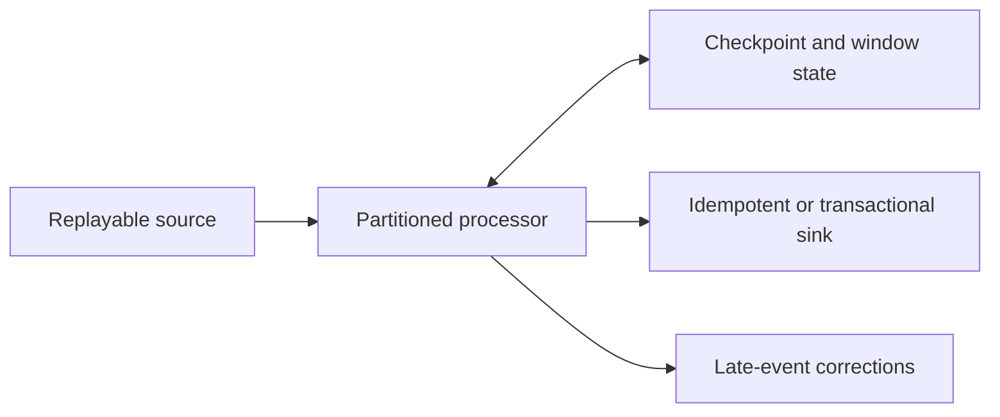

# Data Pipelines Overview

Handle ingestion, event-time windows, checkpoints, and replay.

**Prerequisite / previous:** [Search indexing and crawling](search.md) · **Next:** [Time-series data](time-series.md)

Data pipelines are a fundamental component of managing and processing data efficiently within modern systems. These pipelines typically encompass 5 predominant phases: Collect, Ingest, Store, Compute, and Consume.

## Collect:

Data is acquired from data stores, data streams, and applications, sourced remotely from devices, applications, or business systems.

## Ingest:

During the ingestion process, data is loaded into systems and organized within event queues.

## Store:

Post ingestion, organized data is stored in data warehouses, data lakes, and data lakehouses, along with various systems like databases, ensuring post-ingestion storage.

## Compute:

Data undergoes aggregation, cleansing, and manipulation to conform to company standards, including tasks such as format conversion, data compression, and partitioning. This phase employs both batch and stream processing techniques.

## Consume:

Processed data is made available for consumption through analytics and visualization tools, operational data stores, decision engines, user-facing applications, dashboards, data science, machine learning services, business intelligence, and self-service analytics.

The efficiency and effectiveness of each phase contribute to the overall success of data-driven operations within an organization.

## Storage contracts and replay

A warehouse organizes data for analytical queries; a mart serves a narrower domain. A lake can contain structured, semi-structured, and unstructured data. Table formats and transaction layers can add schema, snapshots, and atomic updates, but the selected implementation determines the contract. A data mesh concerns ownership and data products, not a single storage engine.

Ingestion need not always pass through a queue. Record source position, schema version, event time, and processing time. Late events, duplicate batches, out-of-order changes, and backfills need explicit handling. Keep raw evidence where policy allows, validate quality before publishing, and trace lineage to the source.

**Exercise:** rebuild yesterday's aggregate after a late correction while today's stream continues. Show how deduplication and versioned publication avoid double counting. Related: [event sourcing and CDC](../services/event-sourcing.md), [message queues](../services/message-queues.md), and [storage](storage.md).

## Exercise

Deliver the same batch twice and then a late correction. Trace source identity, schema version, publication, and lineage to demonstrate that the consumer can distinguish duplication from a real update.

## 5 Functions to Merge Data with Pandas

How do we quickly merge data without Microsoft Excel?

Here are 5 useful pandas functions for production data analysis.

- **Concat:** this function supports the vertical and horizontal combination of two tables. Concat can quickly combine the data from different shards.
- **Appending rows:** collect new records and use `concat`; the old `DataFrame.append` API was removed in pandas 2.0.
- **Merge:** this function supports horizontal combination on keys. It works similarly to database joins. Merge can be used to combine data from different domains with the same keys.
- **Join:** this function supports index/key-based joins; the join type must be chosen explicitly.
- **Combine:** this function can apply calculations while combining two tables. The example below chooses the smaller value for the cell. Combine is useful for a data cleansing process.

### Exercise

Merge two datasets where the join key is duplicated on both sides and some keys are missing. Predict row-count expansion, select the intended join contract, and validate counts before publishing the result.

## Streaming windows, late events, and replay

A sensor can record a reading at 10:00 and upload it at 10:07. Event time is 10:00; processing time is when the pipeline sees it. A five-minute window needs an explicit policy for late data: update a prior aggregate, emit a correction, or reject it with an audit trail. A watermark estimates event-time progress; it is not proof that no earlier event can arrive.

Partition by the entity whose updates need order. Bound per-key state with retention and handle idle partitions so one silent sensor does not hold progress forever. A checkpoint must describe both processing state and source position. Committing an external sink separately can still duplicate results after recovery; use idempotent upserts or a transactional sink protocol.

**Worked example:** count unique paid orders per hour. Deduplicate by order ID, define whether refunds change the original window, and attach a version to corrected totals. Measure oldest unprocessed event age and output freshness separately from throughput. Replaying yesterday's data should not send customer emails again.

**Interview:** when can a pipeline promise exactly-once visible results, and what changes if the sink is an email provider? **Exercise:** replay a window with a duplicated order, an event seven minutes late, and a processor crash after sink commit. State the expected total after every restart.

**Further reading:** [Apache Flink: event time and watermarks](https://nightlies.apache.org/flink/flink-docs-stable/docs/concepts/time/), [Fowler on distinct event patterns](https://martinfowler.com/articles/201701-event-driven.html).
