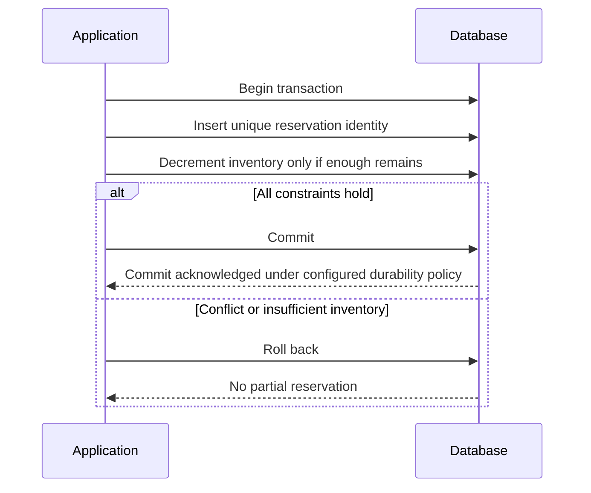

# Data models, indexes, and transactions

Choose models, indexes, transactions, and isolation by access pattern.

**Prerequisite / previous:** [WebSockets](../interfaces/websockets.md) · **Next:** [Storage interfaces and large objects](storage.md)

A database is an organized store of facts that applications can query and change. Think of a library catalogue: you need to find a book, know whether it is available, and prevent two people from borrowing the last copy. The questions and rules come before choosing a database product.

## Follow the task app

A school register has one row per student. A task table can have one row per task, with an ID, owner, title, and completion flag. Start with “show this user’s tasks” and “mark this task complete.”

1. List the records and fields the task app needs.
2. Write the reads and updates it must support.
3. Add rules for required fields and valid ownership links.
4. Try two updates at once and decide which results are allowed.

## Words to know

| Word | Meaning |
| --- | --- |
| Schema | The structure and rules for stored data. |
| Index | An extra data structure that helps find matching records. |
| Transaction | A group of database operations treated as one unit of work. |

## Begin with access patterns and invariants

For a task service, write down these operations: create a task, list one owner's newest tasks, change a task's status, and count overdue tasks. An **invariant** is a rule that must remain true, such as every task having a valid owner. Estimate record sizes, write rate, query selectivity, retention, and acceptable recovery loss.

A relational schema might contain `users(id, name)` and `tasks(id, owner_id, created_at, status)`. A foreign key constrains owners, while an index on `(owner_id, created_at, id)` can support an owner-scoped ordered list. The index must match the actual filter, ordering, and pagination contract; merely indexing every column is expensive.

## Choose a data model rather than a slogan

| Model or workload | Useful shape | Questions before adoption |
| --- | --- | --- |
| Relational | Tables, joins, constraints | What isolation and distributed-transaction scope does this deployment provide? |
| Document | Related values updated as a document | What crosses document boundaries; which fields need indexes? |
| Key-value | Lookup by stable key | How will secondary queries, scanning, and conditional writes work? |
| Wide-column | Partition-key access with clustered rows | Can one partition become too large or too hot? |
| Graph | Traversal of relationships | How large and selective are traversals? |
| Columnar analytics | Aggregation across many rows and selected columns | Can analytical work interfere with transactional latency? |
| Time series | Timestamped values, retention, downsampling | What label cardinality and late-data policy are affordable? |
| Search / vector index | Text or similarity retrieval | How fresh must the derived index be, and how is it rebuilt? |
| Spatial | Points, regions, proximity | Are approximate candidates followed by exact predicates? |

SQL is a query language, not a promise of one-machine deployment. Nonrelational stores can support transactions, and relational systems can shard. A flexible document schema still needs validation and migration. Wide-column stores are not the same design as columnar analytical warehouses. PostgreSQL extensions can add capabilities, but compatibility, maintenance, and production workload tests matter more than a popularity survey.

OLTP concerns short operational transactions; OLAP concerns analysis across larger datasets. A star schema has facts linked to descriptive dimensions; a snowflake schema normalizes those dimensions further. A flat table can be a good small baseline, and hierarchical or graph models fit particular relationships. Mixed workloads may justify separate projections; every additional store adds synchronization and recovery work.

## Understand the query path

A database parses and validates a query, chooses an execution plan, and executes operators using access methods and storage. Buffer management, transaction visibility, locking, logging, and recovery participate according to the engine; it is incorrect to route every `SELECT` around transaction management or every write around buffers.

`INNER JOIN` returns matching combinations; `LEFT JOIN` also retains unmatched left rows with nulls on the right; `RIGHT JOIN` is the symmetric case; `FULL OUTER JOIN` preserves unmatched rows from both sides. Multiple matches multiply output rows. SQL clause order describes a logical model, while the optimizer may choose a different physical join order.

Use `EXPLAIN` with representative data and inspect estimates, actual rows, I/O, and sorting. `EXPLAIN ANALYZE` executes the statement in engines such as PostgreSQL, so do not casually use it on mutating production queries. See [PostgreSQL EXPLAIN](https://www.postgresql.org/docs/18/using-explain.html).

## Index structures and their costs

| Structure | Useful operations | Cost or limitation |
| --- | --- | --- |
| B-tree family | Equality, ordered scans, ranges | Extra pages and write maintenance; result size still matters |
| Hash index | Equality lookups | No ordered range scan; collision and implementation costs |
| LSM tree | Buffered writes into sorted runs | Compaction, read amplification, write amplification, disk-space headroom |
| Inverted index | Term-to-document retrieval | Indexing delay, tokenization choices, storage |
| Spatial tree | Bounding-region candidate search | Exact filtering and skewed geometry |
| Skip list | Ordered in-memory access | Pointer/memory overhead and workload-specific behavior |

An SSTable is a sorted immutable storage structure, not the entire LSM algorithm. A Bloom filter can rule out absent keys but may report false positives. “B-tree reads are always faster” and “LSM writes are always faster” are not valid universal benchmarks. Compare the workload, durability, cache, compaction, and hardware settings. [RocksDB's overview](https://github.com/facebook/rocksdb/wiki/RocksDB-Overview) describes its log-structured design.

For a selective indexed lookup, search may be logarithmic, but reading many matches, fetching heap pages, sorting, and network transfer contribute additional cost. A full scan can be the best plan for a query returning most of the table. Composite index order, collations, and operator support are engine-specific.

## Normalization and derived views

Normalization separates facts so updates do not require changing many inconsistent copies. For example, keep an author's name in `authors`, link books through `author_id`, and use a join. Denormalization may store the author's name in a search document to avoid a runtime join. That copy needs a rebuild and update strategy.

First normal form uses the chosen relational model's atomic values; second normal form removes partial dependencies on a composite candidate key; third normal form addresses non-key dependencies. These are dependency rules, not a promise that normalized data has no redundancy of any kind. Denormalize a measured bottleneck while retaining a clear source of truth. Materialized views trade refresh work and freshness for read speed.

## Transactions and ACID

A transaction groups operations under a defined atomicity and isolation contract. **Atomicity** means its committed effects are all-or-nothing, not that its instructions physically execute simultaneously. **Consistency** concerns invariants maintained by the schema and correct application logic. **Isolation** specifies concurrent visibility. **Durability** is the promised survival of acknowledged commits under a stated failure model; it does not inherently require remote replication.

BASE is a loose architectural description, not a formal alternative isolation level or a universal property of NoSQL. ACID consistency differs from replica freshness and CAP consistency.

### Worked invariant: reserve the last book

Use `inventory(book_id, available)` and `reservation(request_id, book_id, quantity)`, with a unique request ID. In one transaction, insert the reservation and conditionally decrement `available` only if sufficient stock remains. Roll back both effects if either condition fails. Two clients racing for one copy must produce one committed reservation. A separate read followed by an unconditional update can oversell.

A failed response after commit creates an unknown outcome for the client. Retry with the same request identity and read the recorded result; do not silently reserve another copy.

### Isolation, MVCC, and locks

Serializable execution has an outcome equivalent to some serial order; transactions can still run concurrently. Serializable alone does not specify real-time order. Read committed and repeatable read provide weaker, implementation-specific protections. PostgreSQL's repeatable read prevents phantoms but may permit serialization anomalies; its serializable mode can abort transactions that must be retried as a whole. See [PostgreSQL isolation](https://www.postgresql.org/docs/18/transaction-iso.html).

MVCC means multiversion concurrency control: readers select an appropriate version. Internal record layouts and snapshot timing vary by engine. Pessimistic locking acquires protection before changing data; optimistic concurrency checks a version or condition at commit. Either can preserve correctness when used properly. Optimism trades waiting for retries; pessimism can create contention and deadlock. An exclusive row lock does not necessarily block an MVCC reader of an older version.

Lock names such as update, bulk-update, key-range, and schema lock are product-specific. Know the selected engine's compatibility rules, keep transactions short, use consistent lock ordering where possible, and retry whole aborted transactions. Avoid holding a transaction open while waiting on a remote payment service.

## Connection pools and scaling

A pool amortizes connection establishment and bounds concurrency. If 40 application instances each allow 50 database connections, the system may attempt 2,000 connections. Budget the aggregate, reserve administrative access, and set pool-wait deadlines. Adding app instances can make a database bottleneck worse.

Before distributing writes, inspect query plans, indexes, batch sizes, lock contention, working-set memory, and storage I/O. Replicas can offload eligible reads; caches can reduce repeated work; sharding changes transaction and query boundaries. Each improvement should answer a measured constraint.

## Exercises and interview questions

1. Draw both buyers' operations for the last-copy race. **Check:** stock stays nonnegative and retries do not create another reservation.
2. Compare a full scan with a composite index for an owner's newest 20 tasks. **Check:** include index maintenance and a skewed large tenant.
3. Design an expand–migrate–contract schema change. **Check:** the old application remains compatible during the promised rollback window.

Explain when a document update boundary is useful, why a lock is not the same as isolation, and how you would test backup restoration rather than equating replication with a backup.

## Engineering account: How Levelsfyi Scaled to Millions of Users with Google Sheets

This How Levelsfyi Scaled to Millions of Users with Google Sheets account is retained as historical design evidence. Read its workload and period with the linked sources; it is not a current technology inventory or a universal benchmark.

I read something unbelievable today: Levelsfyi scaled to millions of users using Google Sheets as a backend!

They started off on Google Forms and Sheets, which helped them reach millions of monthly active users before switching to a proper backend.

To be fair, they do use serverless computing, but using Google Sheets as the database is an interesting choice.

Why do they use Google Sheets as a backend? Using their own words: "It seems like a pretty counterintuitive idea for a site with our traffic volume to not have a backend or any fancy infrastructure, but our philosophy to building products has always been, start simple and iterate. This allows us to move fast and focus on what’s important".

### Exercise

Separate published/read-heavy data from write ingestion. Identify the first quota, consistency, or collaboration requirement that would justify migrating the spreadsheet-backed workflow.

## Engineering account: iQIYI Database Selection Trees

This iQIYI Database Selection Trees account is retained as historical design evidence. Read its workload and period with the linked sources; it is not a current technology inventory or a universal benchmark.

One picture is worth a thousand words.

iQIYI is one of the largest online video sites in the world, with over 500 million monthly active users. Let's look at how they choose relational and NoSQL databases.

The following databases are used at iQIYI:

*   MySQL
*   Redis
*   TiDB: a hybrid transactional/analytical processing (HTAP) distributed database
*   Couchbase: distributed multi-model NoSQL document-oriented database
*   TokuDB: open-source storage engine for MySQL and MariaDB.
*   Big data analytical systems, like Hive and Impala
*   Other databases, like MongoDB, HiGraph, and TiKV

The database selection trees below explain how they choose a database.

### Exercise

Recreate the decision from access patterns and constraints rather than starting from the historical vendor tree. Compare one transactional lookup, an analytical scan, and a cache miss under failure.

## Architecture flow

The invariant belongs in one transactional boundary. A separate read followed by an unconditional update can race. A timeout during commit leaves an unknown outcome that must be resolved using the reservation identity.
