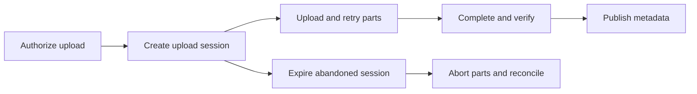

# Storage interfaces and large objects

Select file, block, or object storage and make uploads recoverable.

**Prerequisite / previous:** [Data models, indexes, and transactions](databases.md) · **Next:** [Caching](caching.md)

A disk is a device; a storage service is a contract for reading, writing, and recovering data. Choose the contract before the brand. A photo service may use a relational database for ownership and an object store for image bytes.

## Block, file, and object storage

| Interface | What the client sees | Typical fit | Cost or failure to consider |
| --- | --- | --- | --- |
| Block | Addressable blocks in a volume | Filesystems, database storage, VM disks | Filesystem consistency, attachment rules, IOPS and latency |
| File | Named files and directories | Shared documents, existing file-oriented applications | Locking, metadata hotspots, network filesystem semantics |
| Object | Objects addressed by keys through an API | Media, backups, datasets, artifacts | Request costs, replacement semantics, authorization, retrieval tiers |

Block storage can be local or networked; shared attachment exists but requires compatible coordination and filesystems. File services such as NFS/SMB hide block management from clients. Object storage is not restricted to cold archives and is not universally slow. Large objects can serve active media workloads; many small operations may be expensive. Provider consistency, listing, conditional writes, and metadata updates must be checked individually.

A storage volume is a logical unit of capacity, not a backup. A NAS provides file access over a network. Distributed filesystems such as HDFS spread data and coordinate metadata under their own placement and failure rules.

## RAID and durability

RAID 0 stripes without redundancy. RAID 1 mirrors. RAID 5 uses single-parity protection and RAID 6 uses dual parity; RAID 10 combines mirroring with striping. Capacity, minimum disk counts, rebuild time, write costs, and which simultaneous failures are tolerable depend on the layout. RAID does not protect against every controller fault, accidental deletion, corruption, or site loss. See [replication and recovery](../distributed/replication.md) for backup restoration and erasure coding rather than assigning universal durability percentages.

## A multipart upload

For a hypothetical 1.6 GB file, eight 200 MB parts allow a failed part to be retried independently. In S3, initiate an upload, keep the upload ID, upload numbered parts, record returned ETags, and complete using the chosen part list. The resulting object's ETag is not necessarily an MD5 digest. Use the documented checksum mechanisms and verify the completed object. Incomplete uploaded parts can continue to incur storage charges until completion or abort. [S3 multipart upload documentation](https://docs.aws.amazon.com/AmazonS3/latest/userguide/mpuoverview.html).

The application authorizes the user before issuing scoped upload credentials or signed URLs. Record owner, expected size, checksum, state, and expiry in metadata. Mark an upload usable only after validating completion; a request to complete is not proof that validation succeeded. Bound concurrent parts, client retries, and total per-user storage.

This is a conceptual application architecture, not a claim about S3's private metadata/database internals. Do not infer a specific internal UUID service from the public API.

## Practical uses and trade-offs

Media storage separates large bytes from transactional metadata. A data lake needs schemas, cataloging, ownership, retention, and access controls; dumping files alone does not create usable analytics. IoT data can be batched into objects, trading freshness for fewer requests. Archive tiers can reduce storage cost while adding retrieval delay or minimum-duration charges. Backups need encryption, independent access, restore testing, and a plan for deleted or compromised credentials.

## Failure and scaling exercise

The object exists but the database transaction publishing its metadata failed. Design a reconciliation process for orphaned objects and an idempotent completion endpoint. Now reverse the failure: metadata exists, but the object is missing. Decide what the reader sees and what alert fires.

Interview checks: why can a successful upload still be unsafe to serve? What happens when a signed download expires during playback? Estimate retained bytes, peak upload bandwidth, request rate, and cleanup backlog separately. Related: [databases](databases.md), [deployments](../operations/deployments.md), and [video delivery](../case-studies/video-platform.md).
