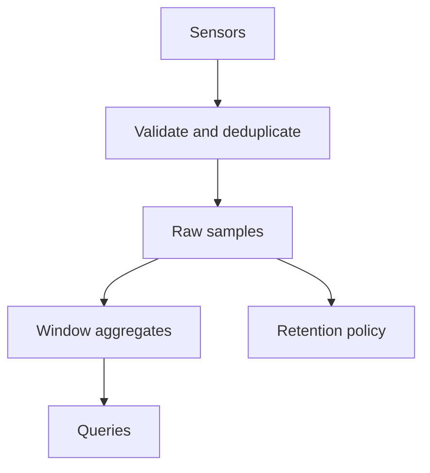

# Time-series data

**Prerequisite / previous:** [Data Pipelines Overview](data-pipelines.md) · **Next:** [Load Balancing](../services/load-balancing.md)

## Overview

Time-series workloads record measurements with timestamps, then read windows and aggregates. Learn to choose series identity, distinguish event time from arrival time, and retain enough information to repair late data. A relational database can serve these workloads; a specialized store may optimize time partitioning, ingestion, compression, and retention.

## Why it exists

A dashboard asks “what happened during this hour?” rather than just “what is the latest row?” Late readings, retries, and retention make a simple append-and-average approach insufficient unless their policies are explicit.

## Mental model

A series is one measurement identity observed over time. Labels distinguish identities; timestamps distinguish samples. Do not confuse more samples in an existing series with more distinct series. Product data models differ; not every time-series database shares one storage engine or schema.

## Architecture flow

Raw data and derived aggregates have different lifetimes. A correction is only repairable if you retain the needed inputs or sufficient correction information.

## How it works

1. Define the measurement, unit, source identity, and timestamp semantics.
2. Define duplicate identity and whether a corrected reading replaces a previous one.
3. Partition to support measured write load and time-window queries.
4. Aggregate by event time with a lateness and correction policy.
5. Expire raw and derived data according to their separate retention contracts.

## Worked example

Assume 10,000 sensors each produce one reading per second. That is 10,000 samples/s and `10,000 × 86,400 = 864,000,000` samples/day before retries. Multiplying by bytes per stored sample is only a first estimate: indexes, replicas, compression, and metadata change capacity needs. Measure those factors with representative data.

Store source, event time, value, unit, and ingestion metadata. If a device may produce two readings at one timestamp, timestamp alone is not a unique sample ID. A monotonically increasing device sequence can help only with a defined restart/reset policy.

## Trade-offs

Raw samples support reprocessing but cost storage and query work. Downsampling reduces those costs while discarding detail. Preserve sums and counts to combine means correctly; an average of averages is wrong when window counts differ. Averages cannot reconstruct percentiles. Time partitions simplify expiration, while tenant or device partitioning can spread writes; choose from actual queries and hot-key behavior.

## Failure scenarios

| Trigger | Symptom | Detection and recovery |
| --- | --- | --- |
| A random request ID becomes a label | Active series and memory grow rapidly | Inspect series creation and label values; remove the unbounded dimension. |
| Device reconnects with buffered readings | Old weather appears in the current window | Track event and arrival time separately; route to the correct windows. |
| A batch is retried | Counts and sums increase twice | Deduplicate using a defined sample identity. |
| Raw data expires before corrections are processed | Historical aggregate cannot be rebuilt | Align retention with lateness or expose the correction limit. |

## Production considerations

Cap catch-up traffic so reconnecting devices cannot starve live ingestion. Monitor ingestion lag, rejected samples, duplicates, active series, query latency, and storage growth. Bound labels and queries by tenant. [Prometheus label guidance](https://prometheus.io/docs/practices/naming/) illustrates why unbounded dimensions are costly; verify the corresponding contract for your chosen store.

## Exercise

Yesterday's hour has sum 100 and count 10. A reading of 8 is corrected to 12, then the correction message is replayed. State the repaired aggregate and duplicate policy.

Expected outcome

The repaired sum is 104, count stays 10, and mean is 10.4. Replaying the same correction must not add another 4. Record correction identity/version or recompute from authoritative raw values. The policy also needs to define competing corrections and data beyond retention.

## Interview questions & answers

Why can adding a label be more expensive than doubling the sample frequency?

An unbounded label can create many new series, each with identity and index overhead, while higher frequency adds samples to existing series. The actual cost depends on the store; measure series count and samples separately.

**Revision cues:** identity → event time → deduplication → correction → retention. **Key takeaways:** aggregates are derived state, cardinality is a capacity concern, and repair depends on retained evidence.

## Further reading

- [Prometheus data model](https://prometheus.io/docs/concepts/data_model/).
- [Data pipelines](data-pipelines.md) and [observability](../operations/observability.md).
