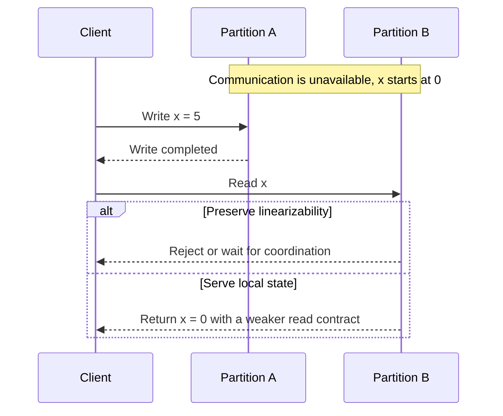
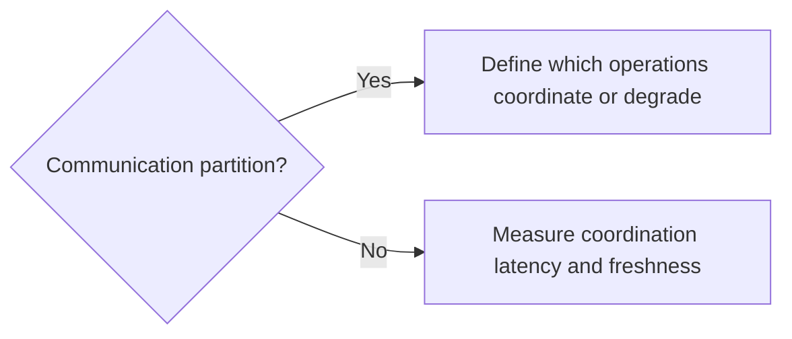

# CAP Theorem

Reason about a partition without reducing design to a slogan.

**Prerequisite / previous:** [Consistency Models](consistency-models.md) · **Next:** [Consensus and leader election](consensus.md)

During a network partition, a distributed read/write system cannot guarantee both linearizability and availability in the CAP sense. This is a statement about permitted behavior during communication failure, not a menu for choosing any two features of a database.

## Follow the task app

Two school offices share task records, but their connection breaks. One receives an update. The other cannot tell whether its copy is still current. It must either wait or reject some work, or answer without that guarantee.

1. Draw two servers holding the same task.
2. Break the communication link between them.
3. Update the task on one side and read it on the other.
4. Explain which guarantee each possible response gives up.

## Words to know

| Word | Meaning |
| --- | --- |
| Consistency in CAP | Linearizability: operations appear in one order that respects completed operations. |
| Availability in CAP | Every request to a non-failing node eventually receives a response. |
| Partition | A network failure that prevents nodes from exchanging some messages. |

## Core concepts

**Consistency (C)** means linearizability: operations appear to occur atomically in a single order that respects real-time completion. **Availability (A)** requires every request received by a non-failing node to eventually complete with a valid result. An error does not satisfy the operation, and CAP does not itself specify a latency SLO. **Partition (P)** means communication between some nodes can be lost indefinitely. A design must specify what happens under that failure rather than assuming it cannot occur.

## A partitioned read

Assume `x` initially equals 0. A write of 5 completes through one partition. A later reader reaches the other partition, which cannot learn whether that write happened. Returning 0 violates linearizability; waiting indefinitely or rejecting the read sacrifices CAP availability. This example assumes the write was allowed to complete; some protocols instead block that write.

## Choose behavior per operation

| Operation | Invariant or tolerance | Partition behavior to design |
| --- | --- | --- |
| Reserve the last inventory item | At most one successful reservation | Coordinate on an authoritative path; reject if authority cannot be established |
| Read a recommendation list | Older suggestions are acceptable | Serve a dated cache with an explicit freshness policy |
| Edit an offline shopping list | Concurrent edits can be merged | Accept local changes; define merge rules and expose unresolved conflicts |
| Update shard ownership | Only one authoritative owner/version | Require consensus and fence stale owners |

Do not label entire products permanently “CP” or “AP.” Guarantees depend on the operation, replication topology, read/write settings, and failure scope. A primary read plus an acknowledged write is not automatically linearizable across failover. SQL versus NoSQL is also not a CAP classification. Correctness can require application constraints beyond a storage consistency model.

## PACELC and ordinary latency

PACELC asks a second question: when there is no partition, what latency cost is paid for the selected consistency contract? Cross-region coordination may increase write latency; serving a nearby replica may return stale state. This framing helps compare a specific configuration rather than a product logo.

## Failure modes and scaling considerations

Failover can expose acknowledged-write loss with asynchronous replication, while a quorum-based service may stop writes when it loses a majority. A larger fleet does not eliminate either behavior. A fallback that serves stale reads must advertise the weaker contract and must not silently authorize correctness-critical writes. Recovery requires reconciliation of divergent state and tests for clients retrying unknown outcomes.

## Common mistakes

- Equating a healthy uptime percentage with CAP availability, or a fast error with a successful operation.
- Treating ACID consistency, serializable transactions, and linearizable reads as interchangeable guarantees.
- Assuming eventual consistency imposes a fixed staleness bound.
- Lowering a quorum during a partition without analyzing split-brain behavior.
- Using a blanket “money requires CP” label instead of defining ledger invariants and transaction boundaries.

## Interview questions and exercises

1. Walk through the `x = 5` example and identify the exact real-time ordering that makes the stale read invalid.
2. Design checkout and product browsing for the same storefront. **Deliverable:** different fallback rules, freshness bounds where enforceable, and user-visible errors for each operation.
3. Partition a three-replica test deployment and then heal it. **Check:** record which writes completed, verify they remain visible under the promised contract, and measure recovery time. A diagram alone does not establish correctness.

## Production checklist and testing

Document partition behavior per endpoint, test replica lag and leader loss, and retain a history of operation IDs and observed results during drills. Measure quorum health, error rate, p99 latency, and recovery progress. Check that maintenance retains the required voting majority. Backups and restore testing remain separate from replication.

## Related topics

[Consistency models](consistency-models.md), [replication](replication.md), [consensus](consensus.md), [transactions](../data/databases.md), provide the related implementation context. For the formal result, see [Gilbert and Lynch's proof](https://groups.csail.mit.edu/tds/papers/Gilbert/Brewer2.pdf).
