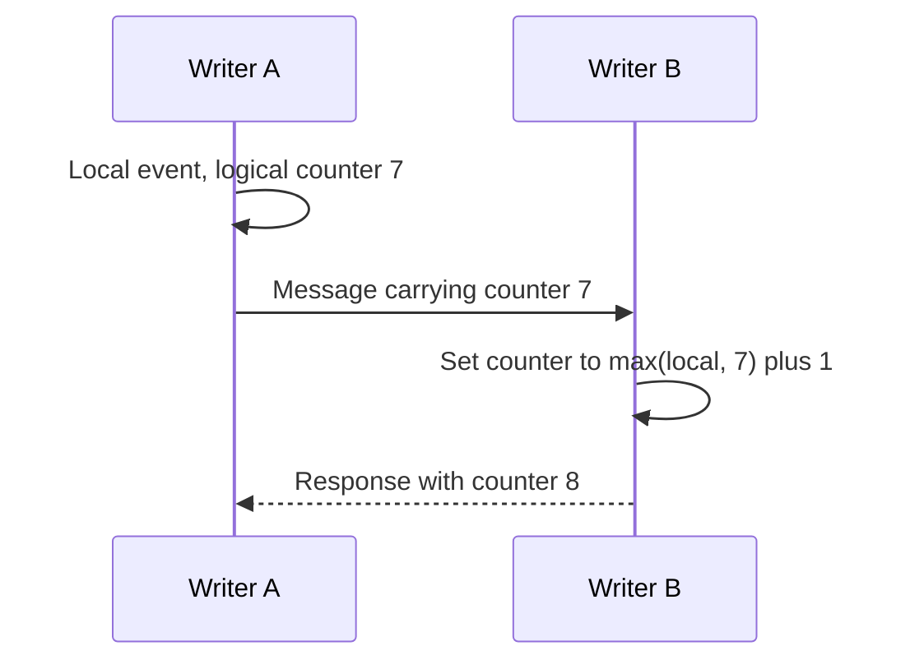

# Clocks, time, and ordering

Separate chronology, elapsed time, causal order, and lease safety.

**Prerequisite / previous:** [Sharding](sharding.md) · **Next:** [Identifiers in distributed systems](ids.md)

A classroom clock tells you when a lesson starts. A stopwatch tells you how long an activity lasted. Computers need both, and confusing them can expire a lock early or give two events the wrong order.

## Why time is part of the data model

Use civil time for appointments and audit displays, an instant for a point on a timeline, and a monotonic timer for elapsed time on one machine. Store the time zone or calendar rule for recurring appointments; an offset alone cannot describe future daylight-saving changes. Two machines can disagree even when both synchronize their clocks.

## How ordering works

A Lamport clock increments on local events and advances beyond a received counter. If event A caused event B, A's logical time is smaller. The reverse is not guaranteed: smaller counters do not prove causality. A vector clock can distinguish some concurrent histories at the cost of more metadata. A database sequence or consensus log provides a different, explicitly scoped ordering contract.

## Worked failure: an expired lease

Worker A holds lease epoch 41, pauses, and loses it. Worker B obtains epoch 42. When A resumes, its old process can still send a write. The storage owner must reject epoch 41 after seeing 42. A clock-based timeout alone cannot stop A. This is fencing; see [consensus](consensus.md).

## Trade-offs, scale, and real systems

Wall-clock last-write-wins is cheap but may discard a newer business change from a slow clock. Per-key sequence numbers avoid global sequencing overhead but cannot order unrelated keys. Central ordering adds a coordination dependency. Choose the smallest scope that protects the invariant.

Google Spanner's TrueTime exposes a time interval with uncertainty, not an exact universal clock; transaction processing uses that uncertainty to provide external consistency. This is a product-specific protocol, not a guarantee supplied by ordinary NTP. [Google's TrueTime explanation](https://docs.cloud.google.com/spanner/docs/true-time-external-consistency).

Leap seconds and leap smearing can make different time sources disagree. UTC, TAI, GPS time, Unix timestamps, and TrueTime are not interchangeable formats. Specify the time scale, precision, synchronization policy, and conversion rules at boundaries.

## Exercise and interview questions

A host clock moves backward by two seconds while a payment request and a lease renewal are in progress. Identify which fields need civil time, elapsed duration, an operation ID, or a fencing token. Explain why sorting records by client timestamps does not establish causality. Then simulate a paused old writer after failover and specify the write the storage owner must reject.

## Further reading

- [Lamport's original paper: Time, Clocks, and the Ordering of Events](https://lamport.azurewebsites.net/pubs/time-clocks.pdf).
- [Google Spanner's TrueTime and external consistency](https://docs.cloud.google.com/spanner/docs/true-time-external-consistency).
