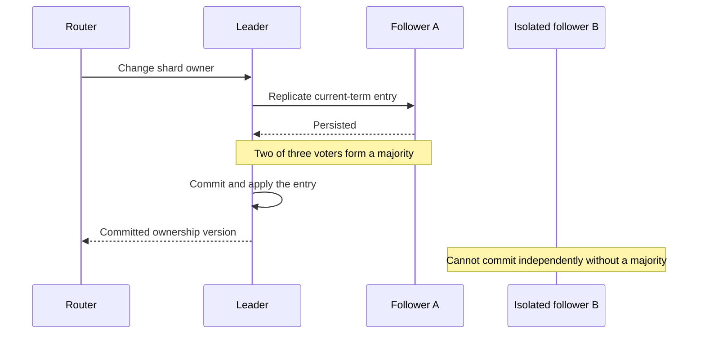

# Consensus and leader election

Explain agreement, quorum, leader terms, and fencing.

**Prerequisite / previous:** [CAP Theorem](cap-theorem.md) · **Next:** [Distributed transactions and sagas](distributed-transactions.md)

Consensus lets a group agree on an ordered sequence of decisions despite some nodes crashing or becoming unreachable. A useful example is the authoritative shard-ownership map: two routers must not commit incompatible owners for the same shard. Replication alone does not establish which copy is authoritative.

## A three-node decision

Assume three voting replicas, durable storage, crash failures, and eventual communication between a majority. A leader proposes a new ownership record. In Raft, a current-term entry can be committed once replicated to a majority under the protocol's log and election rules. The service applies committed entries in order. An isolated replica cannot independently commit another ownership change.

## Elections and reads

A heartbeat timeout means suspicion, not proof of failure. Raft uses increasing terms and voting rules that protect committed log entries. A restarted or isolated former leader must not perform authoritative work merely because it still remembers being leader. Reads also need the implementation's linearizable-read protocol; reading a local copy on a stale leader is insufficient. The [Raft paper](https://raft.github.io/raft.pdf) defines the detailed safety rules and membership-change protocol.

## Fencing external work

Consensus can select a worker without making an external side effect atomic. Suppose worker A holds lease version 41, pauses, and resumes after worker B acquires version 42. The storage service must reject A's writes using a monotonically increasing fencing token. A lock expiration alone cannot stop a paused process. For external actions that cannot enforce fencing, use an idempotent operation contract and reconciliation; do not promise exclusive effects from the lock alone.

## Trade-offs and scaling

Three voters can continue with one unavailable voter; five can continue with two. Those statements assume a communicating majority and the protocol's storage/failure model. More voters increase replication work and can increase latency. Place voters across independent failure domains, but measure the quorum round-trip cost. Use consensus for metadata or replicated state that needs agreement; sharding independent groups scales work while introducing cross-group coordination.

## Failure modes and common mistakes

| Event | Required behavior | Mistake to avoid |
| --- | --- | --- |
| Majority unavailable | Stop committing new decisions; alert on quorum loss | Lowering the majority requirement to restore writes |
| Old leader returns | Reject stale terms or fencing tokens | Trusting a cached leader identity |
| Disk is slow | Observe replication and commit latency | Treating all timeouts as network failure |
| Membership changes | Use the implementation's safe transition procedure | Replacing voters independently in each partition |
| Client times out | Look up or retry the same operation identity | Assuming an unobserved result means no commit |

Consensus is not a backup, a Byzantine fault-tolerance protocol, or a transaction across an arbitrary payment provider. Recovery still needs verified snapshots, retained log history, and application-level invariants.

## Interview questions and exercises

1. Partition five voters into groups of three and two. Which side can commit, and why is a heartbeat insufficient to authorize the smaller side? **Check:** identify intersecting majorities and the need for election/log rules.
2. Pause a lease owner before its write, expire its lease, then resume it. **Deliverable:** a timeline showing where token 41 is rejected after token 42 has been accepted.
3. Design a shard-map service. **Deliverable:** ownership version, router cache invalidation, retry behavior, and an alert for commit latency. Explain why the data plane must enforce ownership as well as the metadata service.

## Related topics

[Replication](replication.md), [CAP](cap-theorem.md), [distributed locks](../operations/resilience.md), and [sharding](sharding.md) describe the surrounding contracts.
