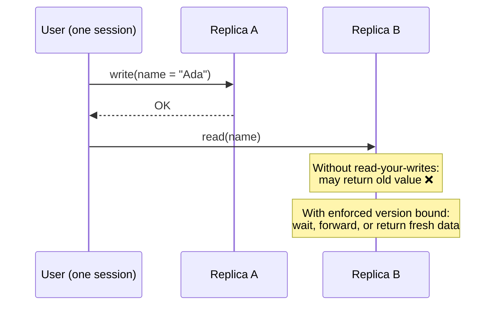
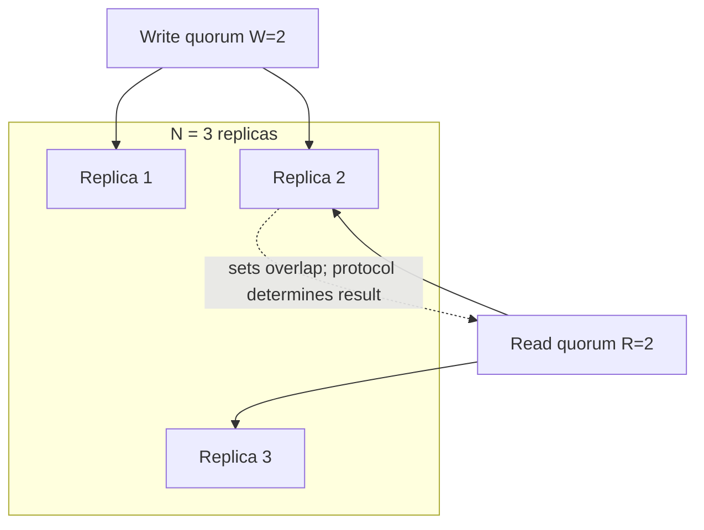
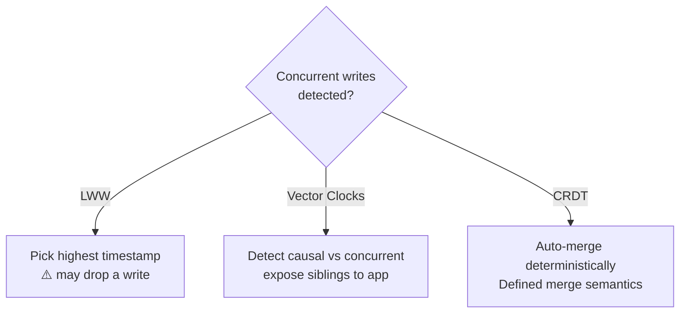

<span id="consistency-models"></span>

# Consistency Models

Specify the visibility and ordering promised to a reader.

**Prerequisite / previous:** [Replication](replication.md) · **Next:** [CAP Theorem](cap-theorem.md)


A consistency model defines what a read may see after data changes. If two servers hold copies of the same record, can one still return the old value? Different models make different promises about timing and order.

---

## Follow the task app

If you complete a task on your phone and open it on your laptop, must the laptop show the change immediately? Different applications can accept different answers, but the rule should be clear.

1. Write a task update and name the moment it is reported successful.
2. Read it from the same client.
3. Read it from a different client or data copy.
4. State which old or new results are allowed in each case.

## Words to know

| Word | Meaning |
| --- | --- |
| Strong consistency | A family of strict ordering guarantees; name the exact guarantee you need. |
| Eventual consistency | Copies converge if updates stop and propagation succeeds. |
| Read your writes | A client can see the effect of its own completed writes. |

## Core Concepts

When data is replicated across nodes (see [Replication](replication.md)), reads and writes can race. A **consistency model** defines what guarantees you get. Stronger models are easier to reason about but cost latency and availability (recall the [CAP theorem](cap-theorem.md) and PACELC's else-latency-vs-consistency trade-off).

---

## Visibility and ordering contracts

| Model | Promise | Key distinction |
| --- | --- | --- |
| Linearizable | Operations appear atomic in an order respecting real-time completion | Concurrent operations may be ordered either way |
| Sequentially consistent | One total order preserves each process's program order | It need not respect real-time ordering across processes |
| Causal | Observations preserve causally related order | Concurrent operations can be observed differently |
| Eventual | Replicas converge if updates stop and propagation/repair assumptions hold | No fixed staleness bound follows |

These contracts do not form a universal price or latency ranking. Check the operation, topology, and implementation rather than assigning a permanent model to a product name.

## Client-Centric (Session) Guarantees

Even under eventual consistency, these per-client guarantees make behavior sane for a single user session:

- **Read-your-writes**: after you write a value, your subsequent reads see it (never a stale value you just overwrote). _Example: after editing your profile, you see the update immediately._
- **Monotonic reads**: once you read a value, you never see an _older_ value on later reads. _No "time-travel backwards."_
- **Monotonic writes**: your writes are applied in the order you issued them.
- **Writes-follow-reads**: a write made after reading a value happens-after that value.



---

## Quorum Reads & Writes (W + R > N)

Dynamo-style stores tune consistency with three numbers:

- **N** = number of replicas that store each key
- **W** = replicas that must acknowledge a **write** before it's considered successful
- **R** = replicas that must respond to a **read** before returning

> **Intersection condition:** if **W + R > N** for a fixed set of N replicas, a successful read quorum intersects a successful write quorum. Linearizability also depends on the versioning, read/write, and failure protocol; overlap alone is insufficient.



| Config (N=3) | W + R | Property                                           |
| ------------ | ----- | -------------------------------------------------- |
| W=3, R=1     | 4 > 3 | Intersecting sets; writes need every replica     |
| W=1, R=3     | 4 > 3 | Intersecting sets; reads need every replica                    |
| W=2, R=2     | 4 > 3 | Intersecting majorities; protocol still matters       |
| W=1, R=1     | 2 < 3 | Eventual; fastest & most available, may read stale |

---

## Conflict Resolution

When concurrent writes diverge (common in AP / multi-leader systems), replicas must reconcile:

- **Last-Write-Wins (LWW)**: keep the write with the highest timestamp. Simple but **loses data** on true concurrency and depends on clock sync. _Used by Cassandra by default._
- **Vector clocks**: track causality per replica to detect whether writes are ordered or truly concurrent; concurrent writes are surfaced as **siblings** for the app (or a merge function) to resolve. _Used by Riak / Dynamo._
- **CRDTs (Conflict-free Replicated Data Types)**: data types whose specified operations and merge/delivery rules ensure convergence under their model. _Used by Redis CRDTs, Riak, collaborative editors._



### Vector clock example

```text
Replica A writes:  {A:1}
Replica B writes:  {B:1}     → concurrent (neither dominates) → sibling / merge
Replica A reads {A:1,B:1}, writes: {A:2,B:1} → dominates {A:1} → supersedes
```

---

## Request-specific guarantees

Some databases expose read concern, write acknowledgement, replica selection, or quorum settings. Their interaction determines the contract; setting one option is not enough. Check failover and transaction semantics for the selected version and verify operation histories under faults.

## Trade-offs / When to Use

- **Strong / linearizable**: use for correctness-critical data — balances, inventory, locks, unique constraints. Accept higher latency and reduced availability under partitions.
- **Causal**: great sweet spot for social apps — preserves "reply appears after the post" without full linearizability cost.
- **Eventual + session guarantees**: use for high-scale, latency-sensitive workloads (feeds, carts, telemetry) where users mainly need to see _their own_ actions consistently.
- **Quorum tuning (W+R>N)**: controls set intersection; verify the complete consistency protocol rather than inferring a guarantee from the numbers.
- **Conflict strategy matters**: prefer CRDTs/vector clocks over LWW when losing concurrent writes is unacceptable.

---

## Interview Questions

- Compare linearizability vs eventual consistency and give examples where each is appropriate.
- How would you design a shopping cart so users don't lose their items while keeping high availability?
- Explain how quorum parameters (W, R, N) affect consistency and latency.

## Production Checklist

- Define which operations require strong consistency vs eventual consistency and document per-endpoint guarantees
- Instrument client-centric session guarantees where needed (read-your-writes, monotonic reads)
- Ensure clocks are reasonably synchronized (NTP) if using timestamp-based conflict resolution
- Provide clear API documentation stating consistency expectations

## Testing & Monitoring

- Run tests that assert client guarantees under leader failover and replication lag
- Simulate conflicts and verify chosen conflict-resolution strategies (LWW vs vector clocks vs CRDTs)
- Monitor per-operation latency, error rates, and observed staleness windows

## Related Topics

- [CAP Theorem](cap-theorem.md) — the C-vs-A trade-off these models refine
- [Replication](replication.md) — leader/follower & quorum mechanics that implement these models
- [Databases](../data/databases.md) — which stores offer which consistency guarantees
- [Message Queues](../services/message-queues.md) — delivery guarantees (at-least/at-most/exactly-once) as a consistency analog


## Counterexample: overlap is not a complete protocol

For fixed `N = 3`, `W = 2`, and `R = 2`, every successful read set intersects a successful write set. That set-theoretic fact says nothing by itself about how to select between concurrent versions, a partially failed write, clock-skewed timestamps, or replicas outside the original set. A linearizable register needs a protocol with a safety argument, not just those three numbers.

Consider two concurrent changes to a shopping cart. Last-write-wins may discard one change. A suitable set CRDT can merge additions and removals according to its defined semantics, but it does not automatically preserve an inventory or monetary invariant. Choose conflict semantics with the product owner before choosing a replication algorithm.

**Exercise:** draw histories for read-your-writes, monotonic reads, and linearizability. **Check:** include a client switching replicas after failure. Explain what version token is carried, whether the replica waits or forwards, and what happens at the deadline. Separately show a transaction that is serializable without asserting a real-time ordering guarantee.

## Further reading

- [PostgreSQL: transaction isolation](https://www.postgresql.org/docs/current/transaction-iso.html).
