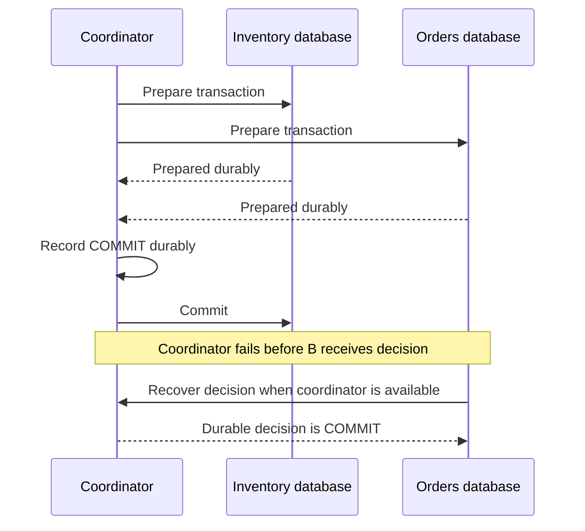

# Distributed transactions and sagas

Compare atomic commit with compensating workflows.

**Prerequisite / previous:** [Consensus and leader election](consensus.md) · **Next:** [Sharding](sharding.md)

A local transaction can atomically reserve a book and record its loan in one database. A purchase spanning an inventory service and an external payment provider has several independent authorities. The design must say whether all effects commit together or whether partial progress is visible and later compensated.

## Two-phase commit

Two-phase commit (2PC) coordinates an atomic decision across participating transactional resources. In the prepare phase, each participant durably records whether it can commit and holds the necessary state. If all vote yes, the coordinator durably records the commit decision and tells participants to commit. Otherwise it decides abort.

A prepared participant cannot simply abort because a timeout occurs: the coordinator may have committed and another participant may already have applied that decision. It must recover the decision according to the protocol. A coordinator failure can leave prepared participants blocked and holding resources. Replicating the coordinator can improve recovery but does not remove every participant or network dependency.

Atomic commit is not the same problem as consensus, and 2PC alone does not establish transaction isolation. The resource managers must also supply concurrency control. The [Gray and Lamport transaction-commit paper](https://www.microsoft.com/en-us/research/publication/consensus-on-transaction-commit/) explains this relationship.

Three-phase commit adds an intermediate state under stronger timing and failure assumptions. It is not a universal nonblocking replacement for 2PC in an asynchronous, partitionable network. Do not decide locally to commit or abort on arbitrary timeout rules without the protocol's assumptions.

## Sagas and compensation

A saga is a sequence of local transactions with explicit recovery or compensating business actions. Reserve stock, request payment authorization, and confirm the order. If payment is rejected, release the reservation. If payment succeeded but the next step fails, compensation may require a refund or void according to the provider's contract.

A refund is a new action, not an erasure of history. An email cannot be unsent. Other transactions may observe intermediate saga state, so sagas do not provide the atomicity or isolation of a single ACID transaction. Persist the workflow state, use stable command identities, handle duplicate events, and reconcile unknown external outcomes.

**Orchestration** puts the workflow state and transitions under a coordinator. **Choreography** has participants react to events. Neither automatically provides reliability: both require durable state, compatible contracts, retry limits, timeouts, and an owner for stuck workflows. An orchestrator may itself be replicated; it is not necessarily one physical machine. See the [saga pattern](https://learn.microsoft.com/en-us/azure/architecture/patterns/saga).

## Worked race: reservation expires during payment

An order reserves a book for five minutes. Payment processing is delayed, the reservation expires, and another buyer obtains the book. A late payment success must not blindly confirm the first order. Include a reservation version or expiry check in the authoritative transition. Decide whether to re-reserve, refund, or route to manual reconciliation. Retrying the notification cannot repair the missing stock.

## Choosing and scaling the boundary

Prefer a single local transaction when one data owner can protect the invariant. Use a database's supported distributed transaction mechanism when its guarantees and availability costs match requirements. Use a saga when the business can tolerate and recover from partial progress, especially across systems without a shared commit protocol.

Cross-region round trips and long prepared transactions can increase lock time and tail latency. Measure blocked transactions, oldest prepared state, stuck sagas, compensation failure rate, and reconciliation backlog. A successful happy-path request is insufficient evidence.

## Exercises and interview questions

Crash the coordinator before and after recording its decision. Crash each saga participant after committing but before sending its reply. **Check:** record the durable states and show how every uncertain operation reaches a defined outcome without a duplicate business effect.

Explain why a prepared participant cannot always abort on timeout, why 2PC is not Raft, and why compensation can fail even after the original workflow has been marked unsuccessful.
