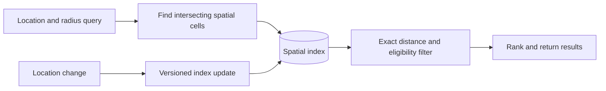

# Geospatial indexing and proximity search

Retrieve spatial candidates, filter by distance, and protect location privacy.

**Prerequisite / previous:** [Identifiers in distributed systems](ids.md) · **Next:** [Email delivery as a store-and-forward system](../applications/email.md)

Finding nearby places means avoiding a distance calculation against every place on Earth. Think of a map divided into boxes: first find boxes near you, then measure the actual distance to the places inside them.

## Define the query before the index

For a restaurant finder, separate business metadata updates from proximity queries. Store a stable place ID, coordinates, status, and searchable attributes. Specify whether the query asks for all places within a radius, the nearest ten, or an approximate list. These contracts require different stopping rules.

## Geohashes and neighboring cells

A geohash encodes a rectangular cell by interleaving coordinate bits. Longer prefixes identify smaller cells. A prefix lookup finds candidates in a cell, but two nearby places can lie on opposite sides of a cell boundary. Search neighboring intersecting cells, deduplicate place IDs, and filter using an appropriate geographical distance calculation.

A prefix expression such as `geohash LIKE 'prefix%'` is a candidate-generation step, not an exact radius query. Check whether the database index and collation support an efficient prefix range. At the antimeridian and poles, longitude ranges and planar approximations need special handling.

## Quadtrees and spatial databases

A quadtree recursively splits a two-dimensional region into four children until a capacity or minimum-size condition is met. It adapts to dense cities better than a fixed grid, but clustered points can produce deep trees. Quadtrees can be held in memory or persisted; they are not inherently restricted to application memory.

For a radius query, visit every node whose bounding box intersects the search region and then filter exact distances. For nearest neighbors, prioritize nodes by a lower bound on distance and stop only when unseen nodes cannot improve the answer. Returning 100 points from the current leaf does not prove they are the nearest 100.

R-tree-based spatial indexes organize bounding regions differently. A spatial database can provide candidate filtering and exact predicates, reducing application-level indexing work. [PostGIS spatial indexing](https://postgis.net/workshops/postgis-intro/indexing.html) explains the two-stage approach.

## Updates, scaling, and failure modes

Build a replacement index from a consistent snapshot, catch up changes, verify counts and query results, and atomically switch readers to its version. Keep serving from the previous index while rebuilding. A mutable location requires deletion from its old cell as well as insertion into its new cell.

Dense areas become hot partitions. Split cells, cache popular immutable queries with a freshness policy, or route to dedicated capacity. Moving drivers need a different update and freshness budget from relatively static restaurants. An offline driver must expire from availability even if its last position remains stored.

## Exercise and interview questions

Place two restaurants one metre apart on opposite sides of a cell boundary. Query a radius containing both. Then move one place, delete the other, and rebuild the index while queries continue. **Check:** neither is silently missed or duplicated, and exact filtering removes false positives.

Explain the difference between a radius search and nearest-neighbor search, why a geohash prefix alone is insufficient, and how stale location data affects a ride-dispatch decision.

## Design Google Maps

This is a hypothetical map and navigation service. The original company-scale claim was not sufficiently sourced and is not used as a sizing requirement.

Although Google Maps is a very complex system, we can break it down into 3 high-level components. In this post, let’s take a look at how to design a simplified Google Maps.

### Location Service

The location service is responsible for recording a user’s location update. The Google Map clients send location updates every few seconds. The user location data is used in many cases:

*   detect new and recently closed roads.
*   improve the accuracy of the map over time.
*   used as an input for live traffic data.

### Map Rendering

The world’s map is projected into a huge 2D map image. It is broken down into small image blocks called “tiles” (see below). The tiles are static. They don’t change very often. An efficient way to serve static tile files is with a CDN backed by cloud storage like S3. The users can load the necessary tiles to compose a map from nearby CDN.

What if a user is zooming and panning the map viewpoint on the client to explore their surroundings?

An efficient way is to pre-calculate the map blocks with different zoom levels and load the images when needed.

### Navigation Service

This component is responsible for finding a reasonably fast route from point A to point B. It calls two services to help with the path calculation:

1.  Geocoding Service: resolve the given address to a latitude/longitude pair.
2.  Route Planner Service: this service does three things in sequence:

    *   Calculate top-K shortest paths between A and B
    *   Calculate the estimation of time for each path based on current traffic and historical data
    *   Rank the paths by time predictions and user filtering. For example, the user wants to avoid tolls.

### Exercise

A road closes after map tiles have been cached. Separate tile freshness from route-graph freshness and explain how routing avoids the closed road. Compare geographic distance with road travel time.

## How do AirTags work

AirTags work by leveraging a combination of Bluetooth technology and the vast network of Apple devices to help you locate your lost items.

Here's a breakdown of how they function:

*   Bluetooth Signal: Each AirTag emits a secure Bluetooth signal that can be detected by nearby Apple devices (iPhones, iPads, etc.) within the Find My network.

*   Find My Network: When an AirTag comes within range of an Apple device in the Find My network, that device anonymously and securely relays the AirTag's location information to iCloud.

*   Location Tracking: You can then use the Find My app on your own Apple device to see the approximate location of your AirTag on a map.

### Limitations

Please note that AirTags rely on Bluetooth technology and the presence of Apple devices within the Find My network. If your AirTag is in an area with few Apple devices, its location may not be updated as frequently or accurately.

### Exercise

A tracker has no nearby relay devices for six hours. Design how the UI exposes the age and uncertainty of its last observation without implying live location. Include unwanted-tracking and account-access concerns.

## How Google/Apple Maps Blur License Plates and Faces

The diagram below presents a possible solution that might work in an interview setting.

The high-level architecture is broken down into three stages:

*   Data pipeline - prepare the training data set
*   Blurring pipeline - extract and classify objects and blur relevant objects, for example, license plates and faces.
*   Serving pipeline - serve blurred street view images to users.

### Data Pipeline

Step 1: We get the annotated dataset for training. The objects are marked in bounding boxes.

Steps 2-4: The dataset goes through preprocessing and augmentation to be normalized and scaled.

Steps 5-6: The annotated dataset is then used to train the machine learning model, which is a 2-stage network.

### Blurring Pipeline

Steps 7-10: The street view images go through preprocessing, and object boundaries are detected in the images. Then sensitive objects are blurred, and the images are stored in an object store.

### Serving Pipeline

Step 11: The blurred images can now be retrieved by users.

### Exercise

A detector misses a face in one frame. Decide whether the original image can be published, how review and correction work, and how replacement propagates to cached copies. Model false positives separately from false negatives.

## Architecture flow

Search neighboring cells across boundaries, then apply an exact predicate. Index candidates may include false positives; stale moving-object locations also need an age policy.
