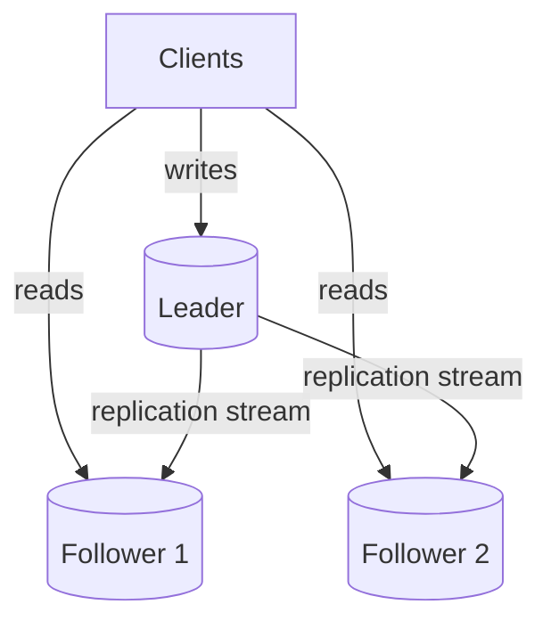
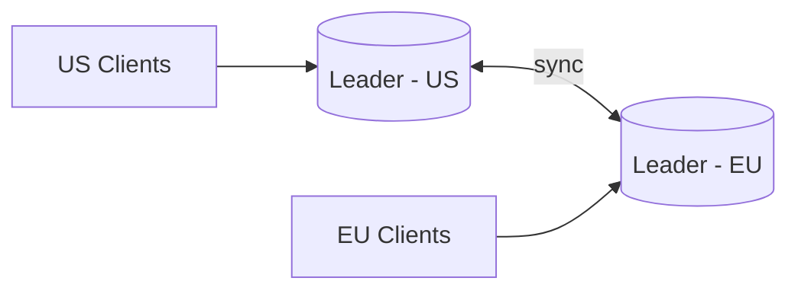
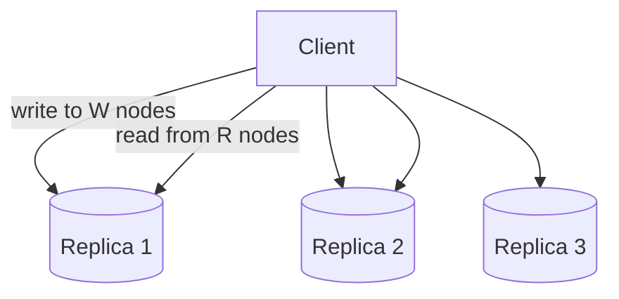
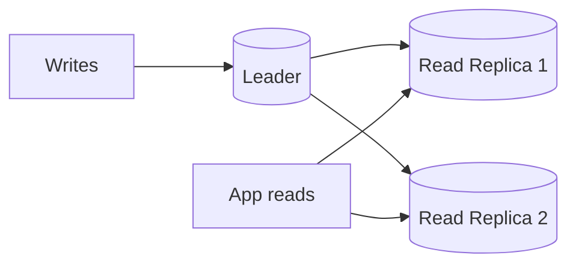
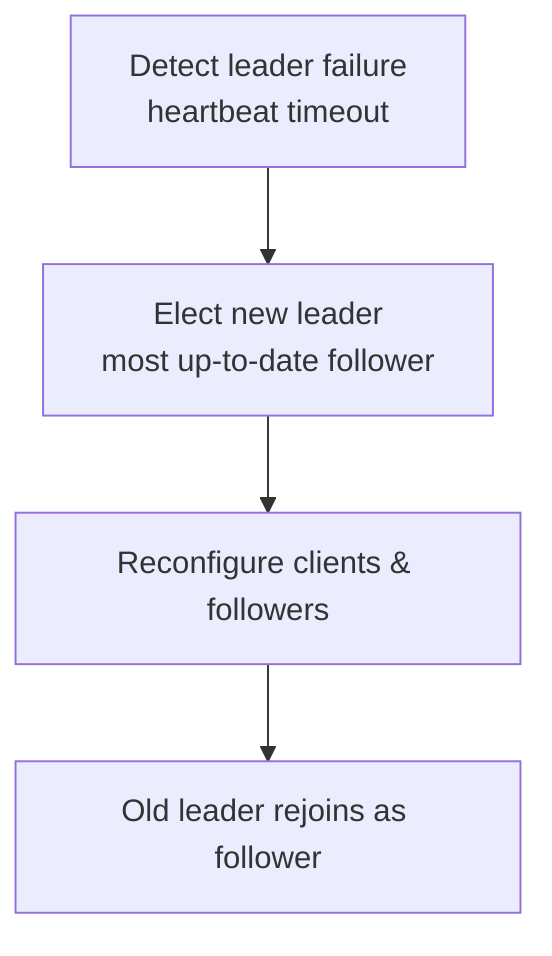

# Replication

Choose acknowledgement and failover contracts; rehearse regional recovery.

**Prerequisite / previous:** [Serverless execution and isolation](../operations/serverless.md) · **Next:** [Consistency Models](consistency-models.md)

Replication keeps the same data on several servers. If one fails, another copy may still be available. The hard part is deciding when a write has reached enough copies and what readers see while copies catch up.

---

## Follow the task app

Suppose two school offices keep copies of the task list. After one office marks a task complete, the other needs to learn about that change before it can show the same answer.

1. Send a task update to the server responsible for writes.
2. Copy the change to another server.
3. Read from the second server before and after the copy arrives.
4. Stop the write server and discuss which copy can safely take over.

## Words to know

| Word | Meaning |
| --- | --- |
| Replica | A copy of the data. |
| Leader | The server that accepts writes in a leader–follower design. |
| Replication lag | The delay before another copy receives a change. |

## Core Concepts

**Replication** maintains multiple copies (**replicas**) of the same data across different machines. Where [sharding](sharding.md) splits data to scale _writes_, replication _copies_ data to scale _reads_ and survive failures.

### Why Replicate?

- **High availability** — if one node dies, others keep serving.
- **Read scalability** — spread read traffic across many replicas.
- **Durability** — data survives single-node loss.
- **Lower latency** — place replicas near users (geo).

---

## Leader–Follower (Master–Slave)

One node is the **leader** (accepts all writes); others are **followers** that replicate the leader's changes and serve reads.

- ✅ Simple; no write conflicts (single writer); great for **read-heavy** workloads.
- ❌ Leader is a **write bottleneck** and a single point of failure (needs [failover](#failover)).

---

## Multi-Leader

Multiple nodes accept writes and replicate to each other — often one leader **per region**.

- ✅ Low write latency per region; tolerant to inter-region partitions.
- ❌ **Write conflicts** are possible — need conflict resolution (last-write-wins, CRDTs, app logic).

---

## Leaderless

Any replica accepts reads and writes; clients (or a coordinator) write to _several_ replicas and read from _several_, using **quorums** to stay consistent (e.g., Dynamo, Cassandra).

- **Quorum rule**: if `W + R > N` for a fixed replica set, successful read and write sets intersect. This alone does not prove linearizability under concurrent writes, failures, or sloppy quorums.
- Uses **read-repair** and **anti-entropy** to converge stale replicas.
- ✅ No single point of failure; highly available. ❌ Tunable but weaker consistency (see [Consistency Models](consistency-models.md)).

---

## Synchronous vs Asynchronous

|                         | Synchronous                 | Asynchronous                         |
| ----------------------- | --------------------------- | ------------------------------------ |
| **When write is ack'd** | After replicas confirm      | After the configured local commit, before remote confirmation |
| **Data safety**         | Survival depends on durable acknowledgements and promotion rules   | ❌ Recent writes may be lost         |
| **Write latency**       | ❌ Higher                   | ✅ Lower                             |
| **Availability** | Blocks when the required acknowledgement set is unavailable | Can acknowledge locally while the authoritative writer is available |

> 💡 **Semi-synchronous** is a common middle ground: one replica syncs synchronously, the rest asynchronously.

---

## Replication Lag

With asynchronous replication, followers trail the leader by a **lag** window. This causes classic anomalies:

- **Read-your-own-writes** — a user updates data then reads a stale replica. _Fix_: read from leader for that user's recent writes.
- **Monotonic reads** — successive reads appear to go backwards in time. _Fix_: pin a user to one replica.
- **Consistent prefix reads** — causally ordered writes seen out of order. _Fix_: causal tracking.

---

## Read Replicas

Followers used purely to serve reads. Ideal for **read-heavy** systems: the leader handles writes; replicas absorb read traffic. Combine with [caching](../data/caching.md) for even more read relief.

> ⚠️ Reads from replicas may be **stale** due to lag — acceptable for feeds/analytics, not for read-after-write critical paths.

---

## Failover

When the leader fails, a follower is **promoted** to leader:

**Pitfalls:**

- **Split-brain** — two nodes believe they're leader (use fencing/consensus like Raft).
- **Data loss** — async writes not yet replicated are lost on promotion.
- **Choosing the replica** — follow the protocol’s eligibility and fencing rules; apparent freshness alone is not sufficient.

---

## Trade-offs / When to Use

| Topology            | Consistency       | Write Scale         | Complexity  | Best For               |
| ------------------- | ----------------- | ------------------- | ----------- | ---------------------- |
| **Leader–Follower** | Depends on read, commit, and failover protocol  | Single writer       | Low         | Read-heavy apps        |
| **Multi-Leader**    | Conflict-prone    | Multi-region writes | High        | Geo-distributed writes |
| **Leaderless**      | Tunable (quorums) | High                | Medium–High | Always-on, HA systems  |

- Replication and [sharding](sharding.md) are complementary: shard to scale writes, replicate each shard for availability and read scale.
- The consistency you get is governed by the [CAP Theorem](cap-theorem.md) and your chosen [Consistency Models](consistency-models.md).

---

## Interview Questions

- Describe leader–follower failover and the data-loss trade-offs with async replication.
- When would you pick multi-leader replication over leader–follower? What conflict resolution would you use?
- How do you guarantee read-your-own-writes in the presence of replication lag?

## Production Checklist

- Monitoring: replication lag, apply rate, and follower health
- Define failover procedures and automate leader election with consensus where possible (Raft/Paxos)
- Plan backup & restore per replica and validate recovery drills
- Ensure replication streams are authenticated and encrypted between nodes

## Testing & Monitoring

- Simulate leader loss and validate failover, promotion, and client reconfiguration
- Measure lag under peak write traffic and tune replication strategy (sync vs async)
- Test read-after-write scenarios and provide guidance (read from leader when necessary)

## Related Topics

- [Sharding](sharding.md) — partition data to scale writes (pairs with replication)
- [Databases](../data/databases.md) — SQL vs NoSQL and transactions
- [Caching](../data/caching.md) — offload reads before hitting replicas
- [CAP Theorem](cap-theorem.md) — consistency vs availability under partitions
- [Consistency Models](consistency-models.md) — strong, eventual, causal consistency
- [Scalability](../foundations/capacity.md) — horizontal scaling fundamentals

## Recovery contract and exercise

State what an acknowledgement means: received in memory, persisted to a log, replicated durably to a required set, or applied for reads. Losing the leader after acknowledging an asynchronous write can lose that write on promotion. Even synchronous replication depends on which copies acknowledged, which failures occur, and which replica can be promoted.

**RPO** is the acceptable data-loss window; **RTO** is the acceptable recovery time. Set both from product requirements, retain independent backups and logs, and test restoration into a clean environment. Replication can copy accidental deletion or corruption; it does not replace a backup. Multi-region placement adds cost, lag, and failure independence questions. See [disaster recovery strategies](replication.md).

**Exercise:** record acknowledged operation IDs, stop the leader before a follower catches up, and fail over under the documented policy. **Check:** measure missing acknowledged writes, observed staleness, and time to resume service. Then restore a backup and replay logs to a chosen recovery point. A sticky replica alone does not preserve session guarantees after that replica fails.

## Recovery tiers and erasure coding

Backup-and-restore rebuilds service from retained artifacts; a pilot light keeps essential state ready; warm standby retains reduced serving capacity; a hot secondary keeps more capacity active. These are cost/recovery choices, not guaranteed RTO/RPO numbers. Measure restoration, data validation, client routing, and dependency recovery in a drill.

An ideal 4+2 erasure code stores four data fragments and two redundant fragments, using 1.5 times the raw data space and recovering from any two missing fragments under that code's assumptions. Three full copies use three times raw space. Encoding, repair bandwidth, correlated failures, checksums, placement, and recovery time determine durability; a single disk-failure rate cannot establish a universal number of durability nines. Replication often has simpler reads and repair, while coding can reduce storage cost for large objects.

Read routing can live in the application or a database proxy. Use a committed-position token and wait/forward policy when read-your-writes is required. Simply pinning a user to a replica or choosing the apparently newest follower does not prove safe behavior through failover.

## Multi-region recovery drill

A replica can copy accidental deletion immediately. Keep recoverable backups separate from the live replication mechanism, including access to encryption keys, schemas, configuration, and dependent services. Recovery point objective (RPO) bounds acceptable data loss; recovery time objective (RTO) bounds restoration time. These are objectives to test, not guarantees implied by selecting a region.

For a school registration service, suppose RPO is five minutes and RTO is thirty minutes. Rehearse loss of the primary region: stop old writes or fence the old writer, identify the last recoverable point, restore or promote, validate constraints and tenant access, redirect traffic, and reconcile uncertain operations. Record detection, restore, validation, and routing time separately. Rehearse failback too.

Active-active writes can reduce some regional dependencies but add conflict resolution and write-ownership complexity. A warm standby costs less but needs spare capacity and tested promotion. Both need backups and control over configuration drift. [AWS's DR guidance](https://docs.aws.amazon.com/wellarchitected/latest/reliability-pillar/plan-for-disaster-recovery-dr.html) distinguishes workload recovery from component availability.
