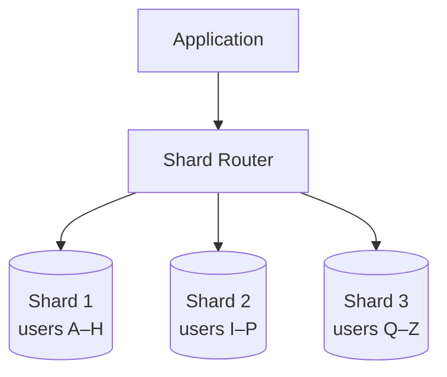
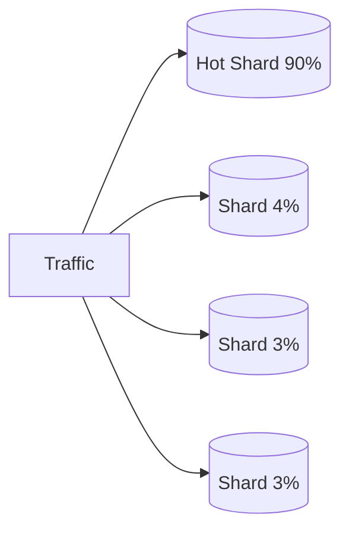
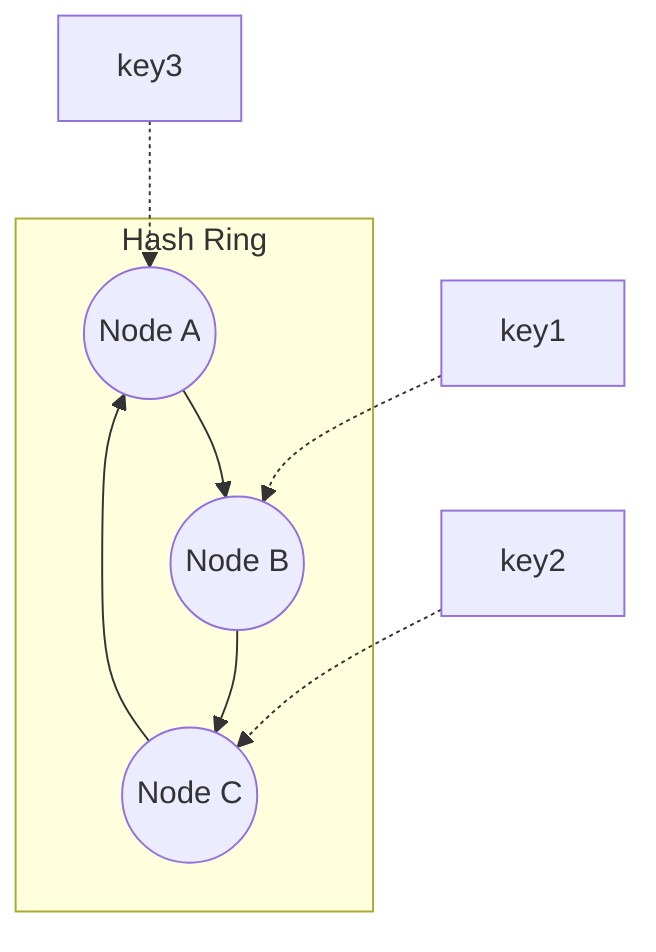

# Sharding

Partition ownership and migrate data while preserving invariants.

**Prerequisite / previous:** [Distributed transactions and sagas](distributed-transactions.md) · **Next:** [Clocks, time, and ordering](clocks.md)

Sharding splits data into separate groups stored on different servers. For example, users can be assigned to servers using a hash of their ID. The main challenge is distributing work evenly and handling queries that need several groups.

---

## Follow the task app

A large school might keep separate registers for different year groups. A task system can divide records by owner, so each shard stores only some users’ tasks.

1. Choose a field that decides where a task belongs.
2. Route each write and read to the right shard.
3. Check whether popular users make one shard much busier than the others.
4. Plan how data moves when a shard fills up.

## Words to know

| Word | Meaning |
| --- | --- |
| Shard key | The value used to choose a shard. |
| Hotspot | A shard or record receiving much more work than the others. |
| Rebalancing | Moving data to spread storage or work more evenly. |

## Core Concepts

**Sharding** (horizontal partitioning) divides a dataset into smaller pieces called **shards**, each stored on a separate database node. Every shard holds a _subset of the rows_, and together they form the whole dataset.

### Why Shard?

- **Scale writes** — a single primary can only handle so many writes; sharding spreads them.
- **Scale storage** — data exceeds one machine's disk.
- **Reduce contention** — smaller working set per node, better cache locality.
- Complements [replication](replication.md) (which scales _reads_ and availability) — sharding scales _writes_.

> ⚠️ Sharding adds real operational complexity. Exhaust vertical scaling, [caching](../data/caching.md), and [read replicas](replication.md) **first**.

---

## Sharding Strategies

### 1. Range-Based Sharding

Assign contiguous key ranges to shards (e.g., users `A–H`, `I–P`, `Q–Z`).

- ✅ Simple; efficient **range queries**.
- ❌ Prone to **hotspots** if data/traffic is skewed (e.g., everyone signs up with names starting `A`, or sequential timestamps hit the newest shard).

### 2. Hash-Based Sharding

Compute `hash(shard_key) % N` to pick a shard.

- ✅ Distributes many distinct keys; a single popular key can still dominate one shard.
- ❌ Range queries become scatter-gather; `% N` breaks badly when `N` changes (mass reshuffle) — solved by [consistent hashing](#consistent-hashing).

### 3. Directory-Based Sharding

A **lookup service** maps each key (or key-range) to its shard.

- ✅ Maximum flexibility; can rebalance by editing the directory.
- ❌ The directory becomes a **single point of failure** and an extra hop — must be replicated & cached.

### 4. Geo-Based Sharding

Partition by **location** (e.g., EU users → EU shard).

- ✅ Low latency for local users; helps data-residency/compliance.
- ❌ Uneven load across regions; cross-region queries are costly.

| Strategy      | Distribution  | Range Queries     | Rebalancing                   | Best For                     |
| ------------- | ------------- | ----------------- | ----------------------------- | ---------------------------- |
| **Range**     | Can be uneven | ✅ Efficient      | Split/merge ranges            | Time-series, ordered scans   |
| **Hash**      | ✅ Even       | ❌ Scatter-gather | Hard (use consistent hashing) | Uniform key access           |
| **Directory** | Flexible      | Depends           | Coordinated copy and ownership change            | Dynamic / heterogeneous data |
| **Geo**       | By region     | Local ✅          | By region                     | Global, latency/compliance   |

---

## Shard Key Selection

The **shard key** determines which shard a row lives on — the most important decision in sharding.

A good shard key has:

- **High cardinality** — many distinct values to spread data.
- **Even distribution** — no single value dominates.
- **Query alignment** — most queries filter by it (avoids scatter-gather).
- **Low mutability** — changing a row's key means moving it between shards.

> ❌ _Bad key_: `country` (few values, skewed). ✅ _Good key_: `user_id` (high cardinality, evenly hashed).

---

## Hotspots

A **hotspot** is a shard receiving disproportionate load — it becomes the bottleneck while others sit idle.

**Causes & fixes:**

- Sequential keys (auto-increment IDs, timestamps) → use **hashing** or **key salting**.
- Celebrity/popular records → add a **cache** ([caching](../data/caching.md)) or split the hot key.
- Poor shard key → pick a higher-cardinality key.

---

## Rebalancing

As data grows or nodes are added/removed, shards must be **rebalanced** to keep load even.

- **Fixed number of partitions**: create many more logical partitions than nodes upfront; move whole partitions between nodes (no re-hashing of keys).
- **Consistent hashing**: only a fraction of keys move when a node joins/leaves.
- Avoid `hash % N` for a variable `N` — changing `N` remaps _most_ keys.

---

## Consistent Hashing

**Ring-based consistent hashing** maps keys and node positions onto a ring. A key belongs to the first node clockwise from it. Under balanced hashing, adding one node to N nodes moves an expected fraction near `1/(N+1)` of keys; actual movement depends on placement and weights.

- **Virtual nodes** (multiple ring positions per physical node) smooth out uneven distribution.
- The standard technique for dynamic sharding & distributed caches. See also [Hashing](../../DSA/hashing/README.md).

---

## Cross-Shard Queries & Joins

Once data is split, operations spanning multiple shards get hard:

- **Cross-shard joins** — no single node has all the data; you must **scatter-gather** (query every shard, merge in the app) or **denormalize** to keep related data co-located.
- **Cross-shard transactions** — may use a database transaction protocol such as 2PC; sagas instead use local transactions and compensating business actions, without equivalent atomicity or isolation.
- **Aggregations** (`COUNT`, `SUM`) — run per-shard then combine.
- **Unique constraints** across shards require a supported global mechanism or a routing/data model that co-locates competing values.

> 💡 Design your shard key so that the most common queries hit a **single shard**.

---

## Trade-offs / When to Use

| Benefit                              | Cost                                      |
| ------------------------------------ | ----------------------------------------- |
| Scales writes & storage horizontally | Operational & code complexity             |
| Smaller working set per node         | Cross-shard joins/transactions are hard   |
| Fault isolation per shard            | Rebalancing & hotspot management overhead |

**Use sharding when** a single node truly can't hold the data or handle the write throughput — and only after simpler options are exhausted.

---

## Interview Questions

- How would you pick a shard key for a user-facing service with both read and write hotspots?
- Explain a safe rebalancing strategy when adding new nodes to a sharded cluster.
- How would you design to avoid cross-shard joins for the most common queries?

## Production Checklist

- Monitor per-shard QPS, storage, and latency to detect hotspots early
- Maintain a partition map and version it for safe rollouts
- Automate rebalancing with low-impact migration windows and throttling
- Ensure backups and consistent snapshots per shard
- Test failure scenarios: node loss, network partitions, and partial rebalances

## Testing & Monitoring

- Load test with skewed key distributions to reveal hotspots
- Verify that rebalancing moves data without violating consistency guarantees
- Monitor shard-level metrics and set alerts on skew, queue buildup, and retry rates
- Run chaos tests that remove/add nodes and validate client behavior

## Related Topics

- [Replication](replication.md) — copies data for read-scaling & availability (pairs with sharding)
- [Databases](../data/databases.md) — SQL vs NoSQL and data modeling
- [Caching](../data/caching.md) — relieve hotspots and reduce shard load
- [CAP Theorem](cap-theorem.md) — consistency/availability under partitions
- [Consistency Models](consistency-models.md) — consistency across shards
- [Scalability](../foundations/capacity.md) — horizontal scaling fundamentals
- [Hashing](../../DSA/hashing/README.md) — consistent hashing internals

## Worked migration and failure exercise

Assume tenant A's records move from shard 1 to shard 2. Copy a snapshot, catch up changes from a durable change log, verify counts and application invariants, then change the ownership-map version under a coordination protocol. Fence the previous writer before accepting authoritative writes at the new owner. Keep routing compatible during the transition and define a rollback point; merely updating the directory can lose writes.

**Scaling:** hashing distributes many keys but cannot divide the write load of a single hot key. A large tenant may need sub-partitioning, an aggregation design, or dedicated capacity. Each option changes query and transaction boundaries. Global uniqueness can use a coordinated allocator or an enforceable unique-key routing rule; support depends on the database rather than being universally impossible.

**Exercise:** pause the migration after snapshot, during catch-up, and immediately after ownership changes. **Check:** send a write through a stale router at every step and show which owner accepts it. Explain how reads avoid missing or duplicating records during scatter-gather. Compare additional replication and migration bandwidth against the capacity gained.

## Partitioning terminology and routing ownership

Vertical partitioning separates columns or functional datasets; horizontal partitioning separates rows. A database can partition tables within one machine, while sharding usually distributes ownership across machines. A federation queries autonomous sources through a shared interface; it does not imply one transaction or one consistent snapshot across all sources.

Routing may live in the application, middleware, or database. Middleware centralizes topology handling but adds latency and availability requirements. Hash collisions between different keys do not lose rows when the full key is stored and compared. Virtual buckets make ownership changes more manageable, but moving a bucket still requires moving its data and handling writes safely. Consistent hashing does not solve a single hot tenant or prove a particular vendor uses a ring internally.

## Engineering account: Figma: scaling PostgreSQL in stages

This Figma: scaling PostgreSQL in stages account is retained as historical design evidence. Read its workload and period with the linked sources; it is not a current technology inventory or a universal benchmark.

### Verified account

Figma's April 2023 account describes moving beyond one large PostgreSQL database by separating related tables into databases. Its March 2024 account reports nearly 100× database-stack growth since 2020, and a progression through caching, read replicas, and a dozen vertically partitioned databases by the end of 2022. Large individual tables and write/I/O limits then motivated horizontal sharding. The migration emphasized incremental rollout, application compatibility, and rollback. These dates and workload constraints matter; the result is not evidence that every application should begin sharded. [Figma's 2023 account](https://www.figma.com/blog/how-figma-scaled-to-multiple-databases/), [Figma's 2024 account](https://www.figma.com/blog/how-figmas-databases-team-lived-to-tell-the-scale/).

### Exercise

A single table outgrows a database even after other tables move away. Explain why vertical partitioning no longer solves the limit. Choose a horizontal key, identify cross-shard transactions, and define copy/catch-up/cutover verification and rollback. Separate CPU, IOPS, maintenance, and connection limits in your measurements.

Related: [databases](../data/databases.md), [replication](replication.md), and [sharding](sharding.md).
