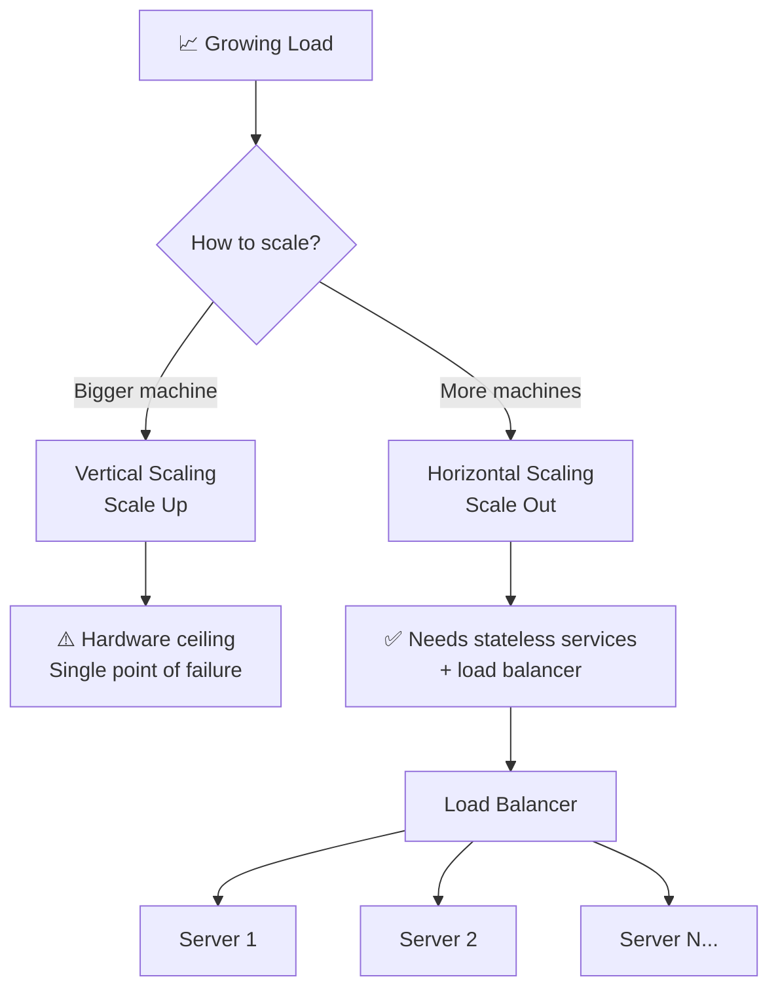
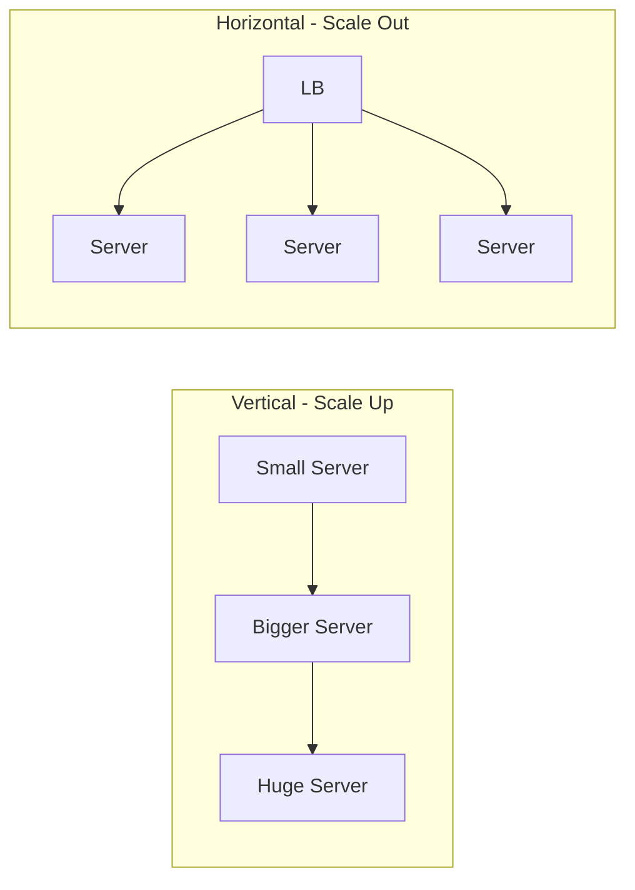
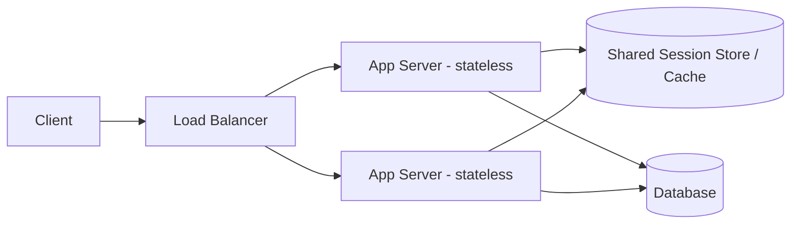
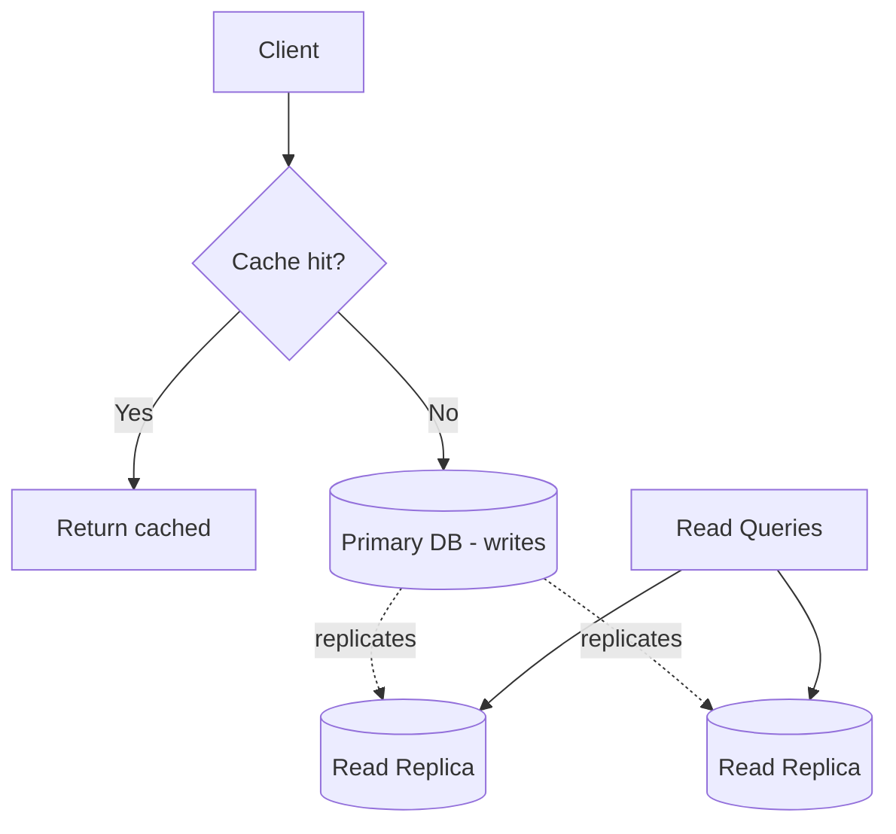
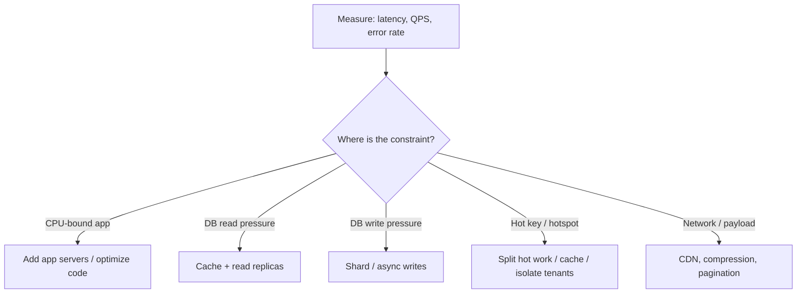

# Capacity, latency, and growth

Estimate traffic and storage with units; find the measured bottleneck.

**Prerequisite / previous:** [From a browser address to a response](request-flow.md) · **Next:** [API Design](../interfaces/api-design.md)

A scalable system can handle more work as demand grows. You can give one server more resources or spread work across more servers. First measure which part is slowing the system down.

---

## Follow the task app

The task app works for one class. Next term, the whole school uses it. Start by measuring task reads and saves; do not assume every part needs to grow at once.

1. Measure how many requests arrive and how long they take.
2. Find the slow part: application code, database, network, or another service.
3. Change one part and repeat the measurement.
4. Check that results remain correct when several requests run together.

## Words to know

| Word | Meaning |
| --- | --- |
| Latency | How long one request takes. |
| Throughput | How much work finishes in a period of time. |
| Bottleneck | The part that limits the whole system’s capacity. |

## Core Concepts

A system is **scalable** when its capacity grows (roughly) in proportion to the resources you add. The two fundamental axes are **vertical** and **horizontal** scaling, and the biggest architectural decision that unlocks (or blocks) horizontal scaling is whether your services are **stateless** or **stateful**.

---

## Vertical vs. Horizontal Scaling

**Vertical scaling (scale up)** means giving a single machine more power — more CPU, RAM, faster disks. It can be operationally simpler than adding machines, but only helps if the workload can use the extra resources. It has hardware and cost limits; one unreplicated machine remains a failure point.

**Horizontal scaling (scale out)** means adding more machines and distributing load across them. It adds aggregate capacity only when work can be distributed. Shared storage, coordination, and skew can still be bottlenecks. Stateless request handlers are often simpler to distribute; stateful systems need explicit ownership and recovery.

| Dimension             | Vertical (Scale Up)     | Horizontal (Scale Out)    |
| --------------------- | ----------------------- | ------------------------- |
| **How**               | Add CPU/RAM to one node | Add more nodes            |
| **Ceiling**           | Hardware limit (finite) | Near-unlimited            |
| **Fault tolerance**   | Poor (single node)      | Strong (redundancy)       |
| **Complexity**        | Low                     | Higher (LB, coordination) |
| **Cost curve**        | Exponential at high end | Roughly linear            |
| **Downtime to scale** | Often requires restart  | Add nodes live            |
| **Code changes**      | None usually            | Requires stateless design |

**Real-world example**: A startup begins on a single large database instance (vertical). As traffic grows, they add read replicas and a fleet of stateless app servers behind a load balancer (horizontal), keeping only the primary database as a vertically-scaled component until they [shard](../distributed/sharding.md) it.

---

## Stateless vs. Stateful Services

Horizontal scaling depends on **statelessness**. A **stateless service** keeps no client-specific data between requests — any instance can serve any request. This makes adding/removing instances trivial and enables simple load balancing.

A **stateful service** stores session or connection data locally, so requests must return to the same instance (see [sticky sessions](../services/load-balancing.md)), which complicates scaling and failover.

> **Golden rule**: Push state _out_ of your app servers. Store mutable session data in a shared store such as Redis or a database. A signed token can carry selected claims, but is not a shared store and does not solve immediate revocation by itself. Define expiry and revocation before making app servers disposable.

|                    | Stateless                          | Stateful                                |
| ------------------ | ---------------------------------- | --------------------------------------- |
| **Scaling**        | Easy (any node serves any request) | Hard (affinity required)                |
| **Failover**       | Seamless                           | Session may be lost                     |
| **Load balancing** | Any algorithm                      | Needs sticky sessions                   |
| **Examples**       | REST APIs, CDN edges               | WebSocket servers, in-memory game state |

---

## Scaling Reads vs. Writes

Most systems are **read-heavy**, so reads and writes are scaled with different tools.

- **Scaling reads**: add a [cache](../data/caching.md) in front of the database, and add **read replicas** so read traffic fans out across many copies (see [replication](../distributed/replication.md)). Cheap and highly effective.
- **Scaling writes**: harder, because a single primary is the source of truth. Techniques include [sharding](../distributed/sharding.md) (partition data across nodes so each takes a slice of writes), batching, write-behind buffers via [message queues](../services/message-queues.md), and choosing write-optimized stores.

| Concern           | Scaling Reads          | Scaling Writes                   |
| ----------------- | ---------------------- | -------------------------------- |
| **Primary tools** | Caching, read replicas | Sharding, queues, batching       |
| **Difficulty**    | Low–medium             | High                             |
| **Trade-off**     | Stale/eventual reads   | Complexity, rebalancing hotspots |

---

## Common Scaling Strategies

1. **Add a cache** — the cheapest win for read-heavy workloads ([Caching](../data/caching.md)).
2. **Load balance** across stateless app servers ([Load Balancing](../services/load-balancing.md)).
3. **Replicate** the database for read scaling and availability ([Replication](../distributed/replication.md)).
4. **Shard** to scale writes and storage beyond a single node ([Sharding](../distributed/sharding.md)).
5. **Go asynchronous** — offload slow work to background workers via [message queues](../services/message-queues.md).
6. **Split the monolith** into [microservices](../services/microservices.md) so each part scales independently.
7. **Use a CDN** to serve static/edge content close to users.

---

## Capacity Estimation Basics

Back-of-the-envelope math justifies every scaling decision. Estimate the load _before_ choosing a design.

- **QPS (Queries Per Second)** = daily requests ÷ 86,400. Then size for **peak** (often 2–10× average).
- **Read:write ratio** — decides how much to invest in caching/replicas vs. sharding.
- **Storage growth** = (bytes per record) × (records per day) × (retention days).
- **Bandwidth** = QPS × average payload size.

> **Example**: 100M requests/day ≈ **~1,160 QPS average**, so plan for **~5,000+ QPS peak**. If each response is 2 KB, peak egress ≈ 10 MB/s. Egress is only one constraint; benchmark CPU, database work, payload distribution, and the latency target before sizing the fleet.

Use 86,400 seconds per day. Decimal KB, MB, and GB are 10³, 10⁶, and 10⁹ bytes; binary KiB, MiB, and GiB are 2¹⁰, 2²⁰, and 2³⁰ bytes.

---

## Identifying Bottlenecks

Scaling the wrong layer wastes money. Find the actual constraint first.

- **Measure before optimizing** — use metrics (p50/p95/p99 latency), not guesses.
- Watch for **single points of failure** and **hotspots** (one shard/key absorbing disproportionate traffic).
- Remember **Amdahl's Law**: a serial bottleneck caps the benefit of parallelism — the slowest shared component limits the whole system.

---

## Trade-offs / When to Use

- **Start vertical, then go horizontal.** For small systems, scaling up is faster and simpler. Adopt horizontal scaling once you need fault tolerance or hit hardware ceilings.
- **Stateless first.** Designing services stateless from day one makes every later scaling move easier.
- **Scaling adds complexity.** More nodes mean more failure modes, harder debugging, and consistency challenges (see [Consistency Models](../distributed/consistency-models.md) and [CAP Theorem](../distributed/cap-theorem.md)). Don't distribute a system that doesn't need it.
- **Cost vs. performance.** Over-provisioning wastes money; under-provisioning risks outages. Autoscaling helps match capacity to real demand.

---

## Interview Questions

- How would you design a system to handle 10x current traffic? Outline trade-offs and steps (vertical -> caching -> replicas -> sharding).
- How do you reason about consistency and availability when scaling read/write workloads?
- Describe how you would identify and mitigate a hotspot (single key receiving disproportionate traffic).

## Production Checklist

- Metrics: p50/p95/p99 latency, QPS, error rates, resource utilization per service
- Capacity planning: peak QPS, read/write ratios, storage growth, retention
- Autoscaling rules and safety limits (scale-up/down cooldowns)
- Runbooks for failover, sharding rebalances, and disaster recovery
- Backups and recovery verification for critical data

## Testing & Monitoring

- Load tests reflecting realistic traffic shapes (spikes, sustained growth)
- Chaos experiments for instance failures and network partitions
- Alerts for saturation: CPU, memory, connection pool usage

## Related Topics

- [Caching](../data/caching.md) — the cheapest way to scale reads
- [Load Balancing](../services/load-balancing.md) — distribute traffic across horizontally-scaled servers
- [Databases](../data/databases.md) — pick storage that scales with your access pattern
- [Sharding](../distributed/sharding.md) — partition data to scale writes and storage
- [Replication](../distributed/replication.md) — copies for read scaling and availability
- [Microservices](../services/microservices.md) — scale components independently
- [Consistency Models](../distributed/consistency-models.md) — the trade-offs distribution forces

---

## Worked capacity budget and exercise

Assume 10 million requests per day, a measured or explicitly assumed peak factor of 5, a 2 KB decimal response, and 200 ms mean time in the system. Average traffic is about 116 requests/s; peak is about 580 requests/s; payload egress at that peak is 1.16 MB/s before protocol overhead. Little's Law gives about 116 concurrent requests at that rate **only for a stable system using matching mean measurements**. Do not substitute p99 latency into the law.

If a tested instance sustains 150 requests/s at the required p99 and error rate, four instances cover nominal peak; five preserve that nominal capacity after one instance fails. This is an illustrative lower bound, not a production sizing guarantee: reserve headroom for skew, deployment, dependency saturation, and growth. Ten million new 1 KB records/day retained for 30 days need 300 GB raw; three full replicas need 900 GB before indexes, compression, backups, and metadata.

**Failure mode:** autoscaling the API doubles database connections while the database is already saturated. Set a total connection budget and bound queues before adding workers. **Common mistake:** treating asynchronous writes as additional sustained database capacity; they only buffer a burst unless downstream capacity changes.

**Exercise:** double the mean payload and make 20% of requests hit one tenant. Recompute egress, identify the per-tenant bottleneck, and propose a load test. **Check:** distinguish throughput, latency, concurrency, data distribution, and the cost of cross-region traffic. Record a before/after p99 and error rate rather than claiming success from CPU alone.

## Diagnose before adding components

For a slow shop, separate application and database resource measurements, optimize queries, then add capacity where the bottleneck is observed. Read replicas can offload eligible reads but do not inherently multiply write capacity. Vertical scaling adds resources to one machine; vertical partitioning separates datasets. Neither means adding product features. Microservices are not the inevitable final stage of growth.

Measure the entire request path. A raw RAM load of roughly nanosecond scale is not a remote Redis request; serialization, queues, transport, scheduling, and server work also contribute. Link speed gives a lower bound on transmission time, not total round-trip latency. Use measured p50/p95/p99 under representative load rather than a universal product latency chart.

Batch processing trades freshness for grouped work; streaming processes ongoing arrivals but still has buffering and lag. Asynchrony moves the completion boundary and requires a status contract—it does not make the work disappear. An overloaded database can remain overloaded behind a longer queue.

**Exercise:** trace a request that performs three serial dependency calls and one parallel fan-out. Calculate its critical path, then test one slow dependency and bounded admission. Explain the freshness, operational, and cost trade-off of each proposed optimization.

## Further reading

- [Google SRE: handling overload](https://sre.google/sre-book/handling-overload/).
