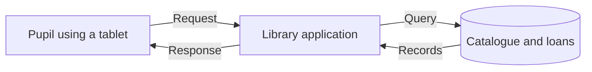

# Start here: computers, requests, and data

Understand programs, bytes, machines, and one request.

**Prerequisite / previous:** [System Design](../README.md) · **Next:** [Requirements and invariants](requirements.md)

You can begin without knowing a cloud product or programming language. This lesson uses a school library to introduce the vocabulary and arithmetic needed by the course. An experienced reader can use the checkpoint at the end to confirm these foundations.

## One small system

A pupil uses a tablet to ask whether a book is available. The **client** is the tablet application. The **server** is a program that handles its request. A **database** stores books and loans. A **network** carries messages between the tablet and server. An **API** is the agreed format for those messages.

A server can mean a program or the computer running it; state which meaning you intend. One computer can run several server programs. A cloud service still runs on computers and networks, even when a provider operates them for you.

**State** is remembered information, such as who borrowed a book. **Memory/RAM** holds working data while a program runs; durable storage is intended to survive specified failures. A **process** is a running program with resources. A **thread** is an execution path within a process. Several tasks can make overlapping progress without running at exactly the same instant: that is concurrency. Parallelism means executing work simultaneously.

## Read the numbers

A bit has two possible values; a byte is eight bits. In this course, KB, MB, GB, TB and PB use decimal powers of 1,000 unless specified otherwise. KiB, MiB and GiB use powers of 1,024. `MB/s` means bytes per second, while `Mb/s` means bits per second; they differ by a factor of eight before protocol overhead.

If 60 pupils make one request each minute, the average arrival rate is 60 / 60 = **1 request per second**. It does not mean requests arrive evenly. If all 60 arrive in one second, the system has a burst.

**Latency** is how long one request takes. **Throughput** is how many requests finish per second. **Capacity** is what a system can sustain under stated conditions. **Concurrency** is the amount of work in progress. A service can have high throughput and still give one unlucky user a very slow response.

If 99 of 100 requests complete within a target time, that sample has a 99% success proportion. A p99 latency describes the upper end of a distribution; it is not an average. Always state the population and observation window.

## What can go wrong?

The tablet may lose its connection. The server may crash. The database may be slow. A reply may disappear after the loan was recorded. Two pupils may request the last copy simultaneously. These are different failures and require different responses.

A **backup** is a recoverable copy from a point in time. A **replica** is another maintained copy of live data. A **cache** is a reusable copy intended to avoid repeated work. If the application accidentally deletes all loans, replication may copy that deletion; an independent backup can still be necessary.

A **trade-off** is a choice with both benefit and cost. Caching the available-book count can make reads faster, but a stale count must not allow two loans of the last copy. A simple solution checks the authoritative inventory when borrowing even if browsing uses a cache.

## Learn by producing an explanation

You do not need a paid cloud account. Use paper, a text editor, and a calculator. Draw the client, application, and database, write one request and response in plain English, and mark the authoritative data. Later lessons add precise APIs, storage rules, and failure controls to this same model.

For implementation practice after you understand the flow, use the repository's [backend course](../case-studies/task-service.md), [JavaScript](../../javascript/index.md), and [data structures](../../DSA/index.md). They support the course; they are not extra required system-design paths.

## Checkpoint and exercises

- Explain client, server, API, state, database, cache, and backup to another person without product names.
- Calculate 600 requests over five minutes: **2 requests/s on average**. Describe a burst with the same average.
- A 2 MB response sent ten times each second uses **20 MB/s**, or **160 Mb/s**, before overhead.
- Draw two pupils requesting the last copy. State the invariant: at most one active loan for that physical copy.

**Ready to continue:** you can explain what is stored, what crosses the network, what the units mean, and why a lost reply does not prove that nothing happened. The next lesson turns this story into measurable requirements.

## Further reading

- [MDN: how the web works](https://developer.mozilla.org/en-US/docs/Learn_web_development/Getting_started/Web_standards/How_the_web_works).
