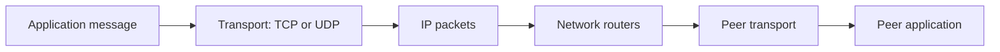

# Network foundations

Explain addressing, transport, routing, DNS, and cloud networks.

**Prerequisite / previous:** [Processes, memory, and concurrency](processes.md) · **Next:** [From a browser address to a response](request-flow.md)

A network moves messages between machines; an application decides what those messages mean. Think of a letter: a street address gets it to a building, while the recipient name gets it to the right person. IP addresses and ports play analogous roles, but routing, retransmission, and application processing remain separate jobs.

## Layers and encapsulation

The OSI teaching model names physical, data-link, network, transport, session, presentation, and application layers. Real Internet protocols do not always fit neatly into seven separate implementations. An HTTP message may be protected by TLS, carried in a TCP byte stream, split into IP packets, and sent in link-layer frames. HTTP/3 instead uses QUIC over UDP. UDP datagrams do not contain TCP sequence numbers.

A sender's application writes through a socket to operating-system buffers and the network interface. The receiver processes frames and packets and delivers bytes or datagrams to the appropriate socket. Linux paths can use interrupts, polling, queues, and offloads; not every packet follows one fixed hard-interrupt/soft-interrupt sequence. Bounded queues, drops, retransmission, and backpressure affect tail latency.

## TCP, UDP, and application guarantees

TCP supplies an ordered byte stream with retransmission and flow/congestion control. It can fail, and a successful write to a socket does not prove the remote business transaction committed. Applications still need framing and recovery rules. UDP preserves datagram boundaries but does not provide delivery, ordering, or congestion control by itself. Protocols built on it must add the properties they need.

Games may discard obsolete position updates while reliably delivering purchases or match results. A custom reliable UDP protocol does not automatically have lower latency than TCP: ordering all messages behind one lost datagram can recreate head-of-line blocking. Separate freshness-sensitive and reliability-sensitive traffic and measure under packet loss. QUIC is a standardized example of adding reliable transport and security over UDP; see the [HTTP/3 specification](https://www.rfc-editor.org/rfc/rfc9114.html).

DNS commonly uses UDP or TCP, and also has encrypted transports. Real-time media and controlled-network multicast are other UDP use cases; “UDP is always faster” is not a design argument.

## Addressing, scope, and routing

IPv4 addresses have 32 bits; IPv6 addresses have 128 bits. IPv6 has a fixed 40-byte base header with extension headers for additional functions. Dual-stack deployments support both families, but applications must test DNS, firewall rules, and connection fallback for each.

PAN, LAN, MAN, and WAN describe personal, local, metropolitan, and wide-area scope. They are not exact performance tiers. A nearby wireless LAN can be slower than a distant well-provisioned link.

| Delivery model | Meaning | Design implication |
| --- | --- | --- |
| Unicast | One addressed destination | Normal point-to-point communication |
| Broadcast | All eligible nodes in a local broadcast domain | Scope and overhead must be bounded |
| Multicast | A subscribed destination group | Network support and loss recovery matter |
| Anycast | Multiple nodes advertise the same address; routing selects one | The selected node is not guaranteed geographically nearest; failover can disrupt stateful flows |

A home router often translates private source addresses and ports to a public address, keeping a mapping for replies. This conserves IPv4 addresses but creates state, port limits, and connectivity complications. NAT is not a replacement for an explicit firewall policy.

## DNS routing and common ports

DNS policies may return weighted, latency-oriented, location-based, or failover answers. Resolver caching and TTLs delay changes, and a resolver's location may differ from the client's. DNS failover is not immediate request-level load balancing. A zone is an administrative portion of DNS; a domain name and a zone are not interchangeable. Recursive resolvers obtain answers on a client's behalf, while iterative responses can refer them to other servers. Reverse DNS maps addresses toward names and is not identity proof.

| Protocol/service | Common port and transport | Caution |
| --- | --- | --- |
| HTTP / HTTPS | 80 TCP / 443 TCP; HTTP/3 commonly 443 UDP | Port alone does not validate a protocol |
| SSH / FTP / Telnet | 22 / 21 / 23 TCP | Telnet and ordinary FTP are not secure substitutes for SSH-based access |
| DNS | 53 UDP and TCP | Allow required fallback and responses |
| SMTP / IMAP / POP3 | 25 / 143 / 110 TCP | Submission and encrypted retrieval use additional ports/configuration |
| DHCP / NTP | 67–68 UDP / 123 UDP | Restrict scope and misuse |
| SMB / NetBIOS session | 445 / 139 TCP | Do not expose internal sharing casually |
| PostgreSQL / MySQL / Oracle listener | 5432 / 3306 / 1521 TCP | Examples, not mandatory bindings |
| RDP | 3389, commonly TCP and UDP | Limit remote administration access |

## Failure exercise

A service works by IPv4 but times out by IPv6. Trace DNS answers, routing, filtering, TLS, and application logs before changing application code. Then simulate packet loss: explain why requests completed by the server can still time out at the client.

Interview check: distinguish a connection timeout, TLS failure, HTTP error, and successful HTTP response containing a rejected business operation. Continue with the full [browser request flow](request-flow.md) and [load balancing](../services/load-balancing.md).

## Typical AWS Network Architecture

Amazon Web Services (AWS) offers a comprehensive suite of networking services designed to provide businesses with secure, scalable, and highly available network infrastructure. AWS's network architecture components enable seamless connectivity between the internet, remote workers, corporate data centers, and within the AWS ecosystem itself.

### Key Components

*   **VPC (Virtual Private Cloud)**

    At the heart of AWS's networking services is the Amazon VPC, which allows users to provision a logically isolated section of the AWS Cloud. Within this isolated environment, users can launch AWS resources in a virtual network that they define.

*   **AZ (Availability Zone)**

    An AZ in AWS refers to one or more discrete data centers with redundant power, networking, and connectivity in an AWS Region.

Now let’s go through the network connectivity one by one:

### Network Connectivity

#### 1. Connect to the Internet - Internet Gateway (IGW)

An IGW serves as the doorway between your AWS VPC and the internet, facilitating bidirectional communication.

#### 2. Remote Workers - Client VPN Endpoint

AWS offers a Client VPN service that enables remote workers to access AWS resources or an on-premises network securely over the internet. It provides a secure and easy-to-manage VPN solution.

#### 3. Corporate Data Center Connection - Virtual Gateway (VGW)

A VGW is the VPN concentrator on the Amazon side of the Site-to-Site VPN connection between your network and your VPC.

#### 4. VPC Peering

VPC Peering allows you to connect two VPCs, enabling you to route traffic between them using private IPv4 or IPv6 addresses.

#### 5. Transit Gateway

AWS Transit Gateway acts as a network transit hub, enabling you to connect multiple VPCs, VPNs, and AWS accounts together.

#### 6. VPC Endpoint (Gateway)

Gateway endpoints provide route-table-based private access to supported services such as S3 and DynamoDB. They are distinct from interface endpoints powered by PrivateLink.

#### 7. VPC Endpoint (Interface)

An Interface VPC Endpoint (powered by AWS PrivateLink) enables private connections between your VPC and supported AWS services, other VPCs, or AWS Marketplace services, without requiring an IGW, VGW, or NAT device.

#### 8. SaaS Private Link Connection

AWS PrivateLink provides private connectivity between VPCs and services hosted on AWS or on-premises, ideal for accessing SaaS applications securely.

### Exercise

Trace an application’s route to a public API and to private object storage. Check route tables, security rules, DNS, endpoint type, and failure scope separately; a VPC label alone does not establish isolation.

## Architecture flow

TCP delivers an ordered byte stream, not application message boundaries. UDP carries datagrams; protocols such as QUIC implement additional reliability and security above it. A network path can fail even when both application processes are healthy.
