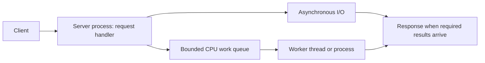

# Processes, memory, and concurrency

Trace execution, memory, concurrency, and operating-system boundaries.

**Prerequisite / previous:** [Requirements and invariants](requirements.md) · **Next:** [Network foundations](networking.md)

A program is a set of instructions; a process is an executing instance with an address space and operating-system resources. Threads execute within a process and commonly share its memory and file descriptors while keeping their own stacks and execution state. Multiple processes can deliberately share memory too. Creation and context-switch costs depend on the platform and workload, not an absolute “processes always cost more” rule.

## From launch to completion

The operating system maps executable code and data, resolves required libraries, establishes memory and resources, and transfers control to an entry point. Some runtimes interpret or compile code dynamically. Loading can be demand-paged rather than copying the entire executable upfront. The process uses system calls for protected operations and releases resources during normal shutdown or operating-system cleanup after termination.

## Memory hierarchy

Registers and CPU caches are small and close to execution. Main RAM holds active data; SSDs and HDDs retain data across power loss subject to their durability mechanisms. SRAM and DRAM describe memory technologies; DDR generations describe interfaces, not universal application latency. Firmware is software stored in nonvolatile memory. Remote storage adds networking and service behavior, so a raw RAM access time is not a Redis request time.

Paging maps virtual page numbers to physical frames, retaining an offset within each page. It avoids requiring one contiguous physical region for a process, but page tables, page faults, and internal fragmentation have costs. Segmentation uses logical regions with a base, limit, and offset; variable-size allocation can suffer external fragmentation. Hardware and operating systems may combine mechanisms. Excessive working sets can cause paging pressure and severe tail latency.

## Concurrency and parallelism

Concurrency allows multiple tasks to make progress over overlapping lifetimes; parallelism executes work simultaneously. A single event loop can handle concurrent I/O without parallel JavaScript execution. More threads do not automatically speed up CPU-bound work: contention, synchronization, cache effects, and scheduling can dominate.

| Mechanism or pattern | Use | Failure to consider |
| --- | --- | --- |
| Pipe or local socket | Transfer bytes between processes | Framing, closed peers, blocked writers |
| Message queue | Exchange discrete work items | Capacity, ordering, receiver failure |
| Signal | Notify a process about an event | Limited payload, safe handler behavior |
| Shared memory | Exchange data without copying through a broker | Synchronization and ownership |
| Semaphore / mutex | Coordinate access | Deadlock, starvation, forgotten release |
| Worker pool | Reuse bounded execution capacity | An unbounded task queue hides overload |
| Future / promise | Represent a later result | Cancellation and errors still need handling |
| Barrier | Wait for a group to reach a stage | A failed participant can strand the group |
| Read-write lock | Permit readers while excluding writers | Writer starvation and upgrade deadlock |

## Deadlock and recovery

In the classic resource model, mutual exclusion, hold-and-wait, no preemption, and circular wait make deadlock possible. Two transactions taking account locks in opposite orders illustrate the cycle. A consistent lock order can prevent this pattern. Avoidance algorithms such as the Banker's algorithm require information about future resource demand that ordinary services may not have.

A timeout bounds waiting only if the operation can release resources safely; it does not prove the remote operation never happened. Databases can detect deadlocks and abort a victim; the application must retry the whole intended transaction when appropriate. Distinguish deadlock from a slow holder, starvation, and livelock.

## Exercise

Two workers transfer inventory between warehouses and lock rows in opposite order. Draw the wait cycle, establish a total ordering, and show how a retried transaction avoids applying the transfer twice. Then explain why that process-local lock cannot coordinate writers on another server.

Related: [computer fundamentals](computer-fundamentals.md), [databases](../data/databases.md), [message queues](../services/message-queues.md), and [resilience](../operations/resilience.md).

## Java Collection Hierarchy

Are you familiar with the Java Collection Framework?

Every Java engineer has encountered the Java Collections Framework (JCF) at some point in their career. It has enabled us to solve complex problems in an efficient and standardized manner.

JCF is built upon a set of interfaces that define the basic operations for common data structures such as lists, sets, and maps. Each data structure is implemented by several concrete classes, which provide specific functionality.

Many Java collections implement `Collection`; `Map` is a separate interface hierarchy. A collection class should support basic operations such as adding, removing, and querying elements.

Through the enhanced for-loop or iterators, the Collection interface extends the Iterable interface, making it convenient to iterate over the elements.

The Collection interface has three main subinterfaces: List, Set, and Queue. Each of these interfaces has its unique characteristics and use cases.

Java engineers need to be familiar with the Java Collection hierarchy to make informed decisions when choosing the right data structure for a particular problem.

We can write more efficient and maintainable code by familiarizing ourselves with the key interfaces and their implementations. We will undoubtedly benefit from mastering the JCF as it is a versatile and powerful tool in our Java arsenal.

### Exercise

Choose a list, set, queue, and map for four different operations. Identify ordering, mutability, duplicate-key, and concurrent-access assumptions rather than selecting by class name alone.

## Linux Boot Process Explained

Almost every software engineer has used Linux before, but only a handful know how its Boot Process works. Let's dive in.

### Step 1

When we turn on the power, BIOS (Basic Input/Output System) or UEFI (Unified Extensible Firmware Interface) firmware is loaded from non-volatile memory and executes POST (Power On Self Test).

### Step 2

BIOS/UEFI detects the devices connected to the system, including CPU, RAM, and storage.

### Step 3

Choose a booting device to boot the OS from. This can be the hard drive, the network server, or CD ROM.

### Step 4

BIOS/UEFI runs the boot loader (GRUB), which provides a menu to choose the OS or the kernel functions.

### Step 5

After the kernel is ready, we now switch to the user space. On a systemd-based distribution, the boot sequence eventually starts systemd as PID 1, which manages the processes and services, probes all remaining hardware, mounts filesystems, and runs a desktop environment.

### Step 6

systemd activates the default.target unit by default when the system boots. Other analysis units are executed as well.

### Step 7

The system runs a set of startup scripts and configure the environment.

### Step 8

The users are presented with a login window. The system is now ready.

### Exercise

A server boots but the application never becomes ready. Distinguish bootloader, kernel, filesystem, service dependency, and application failures; use evidence from the earliest failing stage.

## Linux File Permissions Illustrated

### Ownership

Every file or directory is assigned 3 types of owner:

*   **Owner**: the owner is a user identity assigned to the file; ownership can be changed with sufficient privilege.

*   **Group**: a group can have multiple users. All users in the group have the same permissions to access the file or directory.

*   **Other**: other means those users who are not owners or members of the group.

### Permission

The basic mode bits have three permission classes; ACLs and other security mechanisms can add rules.

*   **Read (r)**: the read permission allows the user to read a file.

*   **Write (w)**: the write permission allows the user to change the content of the file.

*   **Execute (x)**: the execute permission allows a file to be executed.

### Exercise

Give a worker read access to one file without allowing it to traverse every private directory. Explain directory execute/search permission and the difference between writing a file and deleting its directory entry.

## Linux File System Explained

The Linux file system used to resemble an unorganized town where individuals constructed their houses wherever they pleased. However, in 1994, the Filesystem Hierarchy Standard (FHS) was introduced to bring order to the Linux file system.

By implementing a standard like the FHS, software can ensure a consistent layout across various Linux distributions. Nonetheless, not all Linux distributions strictly adhere to this standard. They often incorporate their own unique elements or cater to specific requirements.

To become proficient in this standard, you can begin by exploring. Utilize commands such as "cd" for navigation and "ls" for listing directory contents. Imagine the file system as a tree, starting from the root (/). With time, it will become second nature to you, transforming you into a skilled Linux administrator.

### Exercise

A service writes temporary files until its filesystem fills. Choose an owned location, retention policy, quota, and alert, and distinguish disk capacity from inode exhaustion.

## Most Used Linux Commands Map

This map provides a concise overview of the most commonly used Linux commands, categorized by their primary function.

### File and Directory Management

Use `pwd`, `ls`, and `cd` to locate files; inspect ownership before moving or deleting anything. A pathname is not a guarantee that a process has permission to access it.

### File Viewing and Editing

Use `less`, `head`, and `tail` for bounded inspection. Search with `rg` or `grep`; avoid printing secrets or entire unbounded production logs.

### Process Management

Inspect process IDs, parent relationships, elapsed time, and CPU/memory use with `ps` or `top`. A graceful termination request differs from an immediate kill; account for cleanup and in-flight work.

### System Information

Check memory, filesystem capacity, and load using tools such as `free`, `df`, and `uptime` where available. CPU load and CPU utilization measure different things.

### User and Group Management

Use `id` to inspect identities and groups. Permission changes should follow the intended owner and least privilege, rather than making a failing directory writable by everyone.

### Network Configuration and Monitoring

Inspect addresses, routes, listening sockets, and DNS separately using appropriate platform tools such as `ip`, `ss`, and `dig`. A listening port does not prove the application is healthy.

### Package Management

Use the distribution package manager and verify the configured repository and version. Package installation, application configuration, and service restart are separate operations.

### Exercise

Investigate a slow request without changing the machine first. Record process, memory, filesystem, and socket evidence and explain what each command can and cannot establish.

## Design trade-offs and production exercise

Process isolation consumes more memory than threads sharing an address space. Threads reduce copying but need synchronization around shared state. A memory leak survives request completion when an unwanted reference still owns the object. Bound worker concurrency and inspect heap growth before adding machines.

A school report generator can isolate CPU-heavy PDF work from the API. What happens when all workers are busy, or one worker deadlocks?

## Further reading

- [Linux manual: processes](https://man7.org/linux/man-pages/man7/pthreads.7.html).

## Architecture flow

Threads may share a process address space; separate processes need communication. Bound the worker queue so moving work off the request thread does not hide overload.
