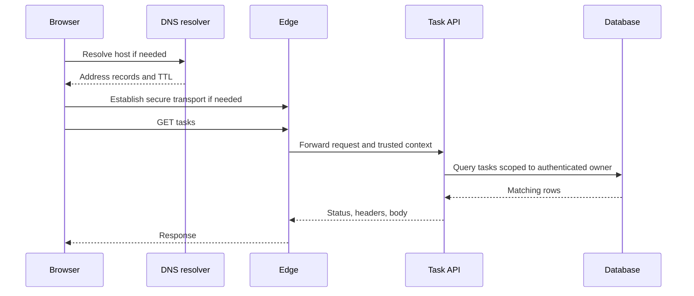

<span id="from-a-browser-address-to-a-response"></span>

# From a browser address to a response

Follow a browser request through DNS, TLS, HTTP, and rendering.

**Prerequisite / previous:** [Network foundations](networking.md) · **Next:** [Capacity, latency, and growth](capacity.md)


A web request is like finding a shop, opening a conversation, asking for an item, and receiving a reply. Each step can fail independently. This lesson follows `https://example.com:443/tasks?limit=20#today` so you can identify which component owns a delay or error.

## Read the address

The scheme is `https`, host is `example.com`, port is `443`, path is `/tasks`, query is `limit=20`, and fragment is `today`. The fragment is interpreted by the client and is not part of the HTTP request target. A URL locates a resource; URI is the broader identifier term, while a URN uses a naming scheme rather than the usual web location syntax.

## Resolve the host with DNS

The browser and operating system may reuse a cached answer. Otherwise a recursive resolver obtains an answer, often following root, top-level-domain, and authoritative-server referrals. The browser normally asks the resolver; it does not personally walk every authoritative server. Cached records avoid repeated work until their TTL expires.

| Record | Purpose |
| --- | --- |
| A / AAAA | IPv4 / IPv6 address |
| CNAME | Alias to another DNS name; the target is visible |
| NS | Nameservers for a zone |
| MX | Mail exchange destinations |
| PTR | Reverse address-to-name mapping, not proof of identity |
| SRV | Service target and port |
| TXT | Text used by particular protocols, including domain verification |

DNS caching means changing a record does not instantly move all users. Measure resolution failures separately from application failures. DNS does not authenticate an HTTPS endpoint; certificate verification serves that role. See the [DNS concepts standard](https://www.rfc-editor.org/rfc/rfc1034.html).

## Establish transport and TLS

HTTP/1.1 and HTTP/2 commonly use TCP. HTTP/3 runs over QUIC using UDP. An existing connection can be reused, so not every request pays for a new handshake. TCP provides an ordered byte stream; a complete application request or business transaction is a separate concept.

For HTTPS, TLS authenticates the server and establishes protected communication. In a typical certificate-authenticated TLS 1.3 handshake, ephemeral key agreement establishes shared secrets, and the certificate/signature authenticates the endpoint. Application data uses efficient symmetric authenticated encryption. The old explanation that the browser simply encrypts a session key with the server's RSA key is not a TLS 1.3 handshake. See [RFC 8446](https://www.rfc-editor.org/rfc/rfc8446.html).

TLS protects data between its endpoints. A trusted inspection proxy terminates one TLS connection and establishes another; it can read plaintext at that boundary. TLS does not make a malicious website trustworthy or protect a compromised browser. A load balancer terminating TLS becomes part of the trust boundary.

## Send the request and produce a response

An illustrative HTTP/1.1 request is:

```http
GET /tasks?limit=20 HTTP/1.1
Host: example.com
Accept: application/json
```

The edge routes the request, the API authenticates and authorizes it, and storage answers the query. A successful HTTP status describes this response, not every subsequent browser resource or business outcome.



## HTTP versions and browser work

HTTP/2 multiplexes streams over a TCP connection and compresses headers with HPACK. TCP packet loss can still stall progress across those streams. HTTP/3 uses QUIC streams, reducing transport head-of-line blocking between independent streams; loss and congestion still cost time. Protocol choice does not guarantee a faster application. Server push and priority behavior depend on implementation; do not build an optimization plan around assumed browser support. See [HTTP/2](https://www.rfc-editor.org/rfc/rfc9113.html) and [HTTP/3](https://www.rfc-editor.org/rfc/rfc9114.html).

For an HTML document, the browser parses markup into a DOM, parses styles, calculates layout, paints, and composites visible content. Scripts and dependent resources can delay this work. First byte, first contentful paint, layout stability, and usable interaction measure different parts of the experience. A fast API alone cannot establish a fast page.

## Failure modes and scaling

A stale DNS answer can reach a retired region; certificate expiration can fail before the API sees traffic; a proxy timeout can occur while a database write continues. Connection reuse reduces handshake costs but large numbers of idle or long-lived connections still consume resources. Edge caching lowers origin traffic only for responses whose cache policy and authorization scope permit reuse.

**Common mistakes:** treating DNS as authentication, assuming every request creates a TCP connection, claiming HTTPS protects compromised endpoints, and diagnosing every slow page by adding application servers.

## Exercise and interview questions

Assign a 500 ms illustrative end-to-end budget to DNS, connection establishment, edge work, API work, and storage. Explain which timings disappear on a warm connection. Then inject a DNS failure, expired certificate, database delay, and lost response after a write.

**Completion check:** identify the first failing boundary and the evidence available there. Explain why retrying the write requires an idempotency contract, why DNS failover can be delayed, and what HTTP/3 changes without claiming it fixes all latency.
