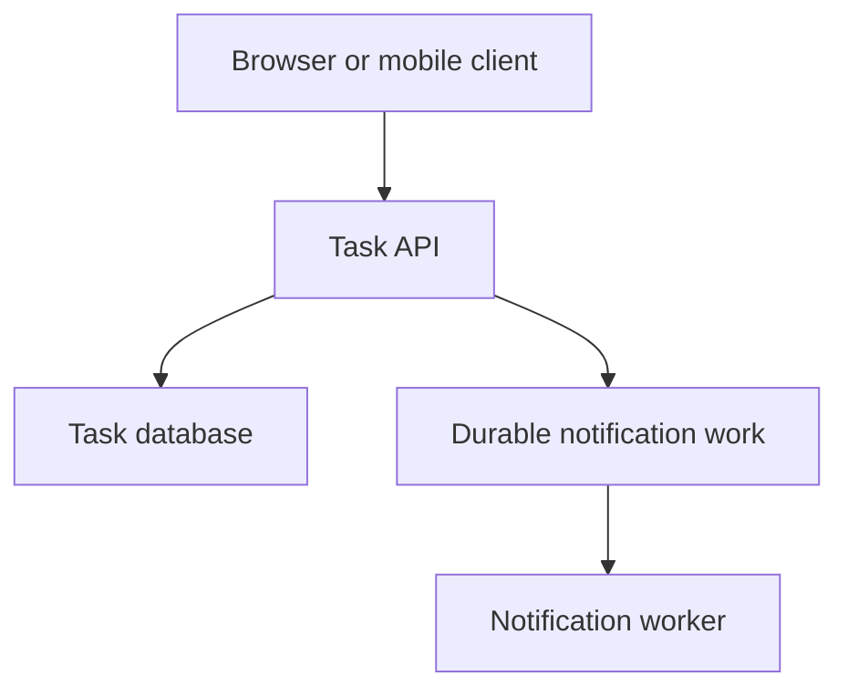

# Requirements and invariants

Turn a user need into constraints, invariants, and measurable success.

**Prerequisite / previous:** [Start here: computers, requests, and data](computer-fundamentals.md) · **Next:** [Processes, memory, and concurrency](processes.md)

System design is deciding how an application's parts work together. Begin with what users need, estimate the load, draw the main data flow, and explain what happens when a part becomes slow or fails.

**Before you start:** know HTTP, basic database operations, and asynchronous work. The [backend learning path](../case-studies/task-service.md) supplies the implementation background.

## Start with requirements {/* #clarify-requirements */}

Use a small task-sharing application as an example. Users create tasks, list their own tasks, and mark them complete.

| Question                             | Example decision                                                    | Why it matters                                    |
| ------------------------------------ | ------------------------------------------------------------------- | ------------------------------------------------- |
| What must users do?                  | Create, list, and complete tasks                                    | Defines the routes and stored data.               |
| Who can see each task?               | Only its owner                                                      | Access checks belong in every relevant operation. |
| How fresh must a read be?            | A user should see their own completed task after the write succeeds | A lagging replica may need special handling.      |
| How much delay is acceptable?        | Agree on a measured latency target                                  | Determines what to measure and optimize.          |
| What can be temporarily unavailable? | Notifications can wait; saved tasks must remain durable             | Separates the main request from background work.  |
| What is outside the first version?   | Shared editing and search                                           | Keeps the first design small enough to explain.   |

A target is a requirement to verify. Drawing a cache or a replica does not prove that the target is met.

## Estimate with units

Suppose the service receives 10 million read requests per day. This is an illustrative assumption, not a traffic claim about a real product.

| Estimate                                      | Calculation         | Approximate result |
| --------------------------------------------- | ------------------- | ------------------ |
| Average reads per second                      | 10,000,000 / 86,400 | 116 reads/s        |
| Peak reads, assuming 5 times the average      | 116 × 5             | 580 reads/s        |
| Raw data for 1 million new tasks at 1 KB each | 1,000,000 × 1 KB    | 1 GB               |

State whether units are decimal or binary; the table uses decimal KB and GB. Storage estimates must also account for indexes, replication, backups, metadata, and growth. Measure real peaks when data is available.

## Draw the smallest useful design

The API owns access checks and task rules. The database holds the authoritative task records. The worker handles notifications separately. If saving a task and scheduling its notification must succeed together, explain how a transaction and an outbox prevent a gap; see [event-driven architecture](../services/event-sourcing.md).

## Learning path

| Stage                            | Topics                                                                     | Question you should answer                                          |
| -------------------------------- | -------------------------------------------------------------------------- | ------------------------------------------------------------------- |
| Define the boundary              | [API design](../interfaces/api-design.md), [databases](../data/databases.md)                 | What can clients request, and what data must remain correct?        |
| Handle growth                    | [Scalability](capacity.md), [load balancing](../services/load-balancing.md)     | Which measured resource is the bottleneck?                          |
| Reduce repeated work             | [Caching](../data/caching.md), [rate limiting](../services/rate-limiting.md)               | What may be stale, and which requests should be limited?            |
| Keep copies or divide data       | [Replication](../distributed/replication.md), [sharding](../distributed/sharding.md)                 | Are you copying data for availability or splitting it for capacity? |
| Define read and write guarantees | [Consistency models](../distributed/consistency-models.md), [CAP](../distributed/cap-theorem.md)     | What may a client observe when nodes cannot communicate?            |
| Move work across boundaries      | [Message queues](../services/message-queues.md), [microservices](../services/microservices.md) | How do retries, duplicate messages, and partial failures behave?    |

Read the topic that answers your current design question. A monolith can be a suitable first architecture; separating services adds network calls, deployment work, and failure modes.

## Walk through a failure

| Failure                                     | Expected behavior to define                          | Evidence to collect                      |
| ------------------------------------------- | ---------------------------------------------------- | ---------------------------------------- |
| Client times out after a successful write   | A retry can discover or reuse the previous result    | Request and idempotency-key records      |
| Database is unavailable                     | Return a defined failure within a bounded time       | Error rate and dependency latency        |
| Worker crashes after sending a notification | Duplicate handling follows the notification contract | Retry count and deduplication records    |
| Cache contains old data                     | Freshness stays within the agreed rule               | Data age and cache invalidation behavior |
| A deployment is faulty                      | Restore a working version and keep compatible data   | Deployment health and rollback result    |

Availability, durability, and consistency describe different guarantees. Define each in terms of what the user experiences.

## Explain the trade-off

A useful design explanation follows this order: requirement → choice → benefit → cost → evidence. For example: “Task lists may be up to 30 seconds old, so we can cache them for that period. This reduces database reads, but a recent update may need invalidation or a direct read.” The 30 seconds is a chosen example requirement, not a default for every application.

## Practice Problems

| Problem | Level / priority | Practice / notes | Example / answer |
| --- | --- | --- | --- |
| Design the task service | Practice | Deliverable: API contract, data model, and one diagram Check: Explain one successful request from start to finish. | — |
| Estimate load | Practice | Deliverable: Average, peak, and storage calculations Check: Every number has a unit and an assumption. | — |
| Add a cache | Practice | Deliverable: Key, freshness, and invalidation rules Check: Describe what happens after a write. | — |
| Add background work | Practice | Deliverable: Delivery and retry contract Check: Explain a crash before and after the external action. | — |
| Review the design | Practice | Deliverable: Three bottlenecks or failure cases Check: Propose a measurement before adding infrastructure. | — |

## Continue learning

For code organization, see [design patterns](../../design-pattern/index.md). For implementation and operations, use [backend engineering](../case-studies/task-service.md).

## Completion checkpoint

Use the [course progress checklist](../README.md#progress-checklist) to demonstrate the skills in this track and connect them in a small application.

## Further reading

- [Google SRE: service level objectives](https://sre.google/sre-book/service-level-objectives/).
