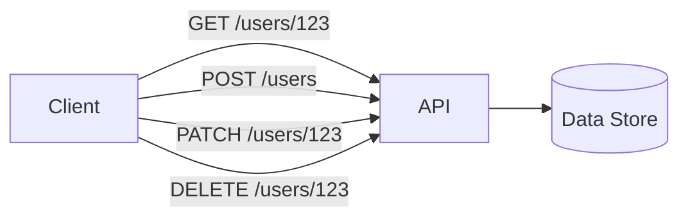

<span id="api-design"></span>

# API Design

Define stable operations, pagination, errors, and retry contracts.

**Prerequisite / previous:** [Capacity, latency, and growth](../foundations/capacity.md) · **Next:** [Validation](validation.md)


An API is an agreement between a caller and a service. It defines what a request looks like, what the response means, and how failures are reported. Consistent names and predictable behavior make that agreement easier to use.

---

## Follow the task app

The task app needs a predictable way to ask for tasks and save changes. A caller should know which fields to send and what result to expect without reading the server’s code.

1. Choose one resource: a task.
2. Describe one read request and its response.
3. Describe a change, including invalid input and missing-task cases.
4. Explain what happens if the caller retries after losing the response.

## Words to know

| Word | Meaning |
| --- | --- |
| Resource | A thing exposed by an API. |
| Pagination | Returning a large list in smaller parts. |
| Idempotency | Repeating an operation has the same intended effect as performing it once. |

## Core Concepts

### REST Principles

**REST** (Representational State Transfer) models the system as **resources** identified by URLs, manipulated with standard HTTP verbs.

- **Resource-oriented URLs** — nouns, not verbs: `/users/123/orders`, not `/getUserOrders`.
- **HTTP verbs** — `GET` (read), `POST` (create), `PUT` (replace), `PATCH` (partial update), `DELETE` (remove).
- **Statelessness** — each request carries all context; no server-side session between calls (enables horizontal scaling).
- **Correct status codes** — communicate outcome via HTTP semantics.
- **Cacheability** — use `Cache-Control`, `ETag`, and conditional requests.



### REST vs. GraphQL vs. gRPC

| Dimension              | REST                              | GraphQL                       | gRPC                               |
| ---------------------- | --------------------------------- | ----------------------------- | ---------------------------------- |
| **Transport / format** | HTTP + JSON                       | HTTP + JSON                   | HTTP/2 + Protobuf (binary)         |
| **Contract**           | OpenAPI (optional)                | Strong schema (SDL)           | Strong schema (.proto)             |
| **Data fetching**      | Fixed endpoints; over/under-fetch | Client selects exact fields   | Fixed RPC methods                  |
| **Round trips**        | Often several                     | Single query, many resources  | One per call; streaming supported  |
| **Streaming**          | Limited (SSE/WebSocket)           | Subscriptions                 | First-class (uni/bi-directional)   |
| **Browser support**    | Native                            | Native                        | Needs gRPC-Web proxy               |
| **Best for**           | Public/CRUD APIs, caching         | Flexible clients, aggregation | Low-latency internal microservices |

**Rule of thumb**: consider resource-oriented HTTP for public APIs, GraphQL for diverse query shapes, and gRPC for schema-defined calls and streaming. Benchmark the actual payloads, transport, and failure settings; gRPC has no universal five-times speed advantage.

### API Versioning Strategies

| Strategy        | Example                               | Pros                            | Cons                             |
| --------------- | ------------------------------------- | ------------------------------- | -------------------------------- |
| **URI path**    | `/v1/users`                           | Simple, visible, cache-friendly | URL churn; not RESTful-purist    |
| **Query param** | `/users?version=1`                    | Easy to default                 | Easy to overlook; caching quirks |
| **Header**      | `Accept: application/vnd.api.v1+json` | Clean URLs                      | Harder to test/discover          |

- Prefer **backward-compatible** changes, and test actual consumers: even an added enum value or field can break a strict client. Remove fields only through a documented migration.
- Version only on **breaking** changes; document a **deprecation policy** with timelines.

### Pagination: Offset vs. Cursor


| Aspect                   | Offset/Limit                | Cursor/Keyset                 |
| ------------------------ | --------------------------- | ----------------------------- |
| **Ease**                 | Very simple                 | Slightly more complex         |
| **Performance at depth** | Degrades (skips rows)       | Indexed seek plus page scan       |
| **Stability**            | Items shift if data changes | Avoids offset shifting; sort-key updates need care |
| **Random page jump**     | Yes                         | No (sequential)               |

Use **offset** for small, admin-style tables; use **cursor** for large, frequently-changing, or infinite-scroll feeds.

### Idempotency

HTTP defines `GET`, `PUT`, and `DELETE` as idempotent in their intended effect; implementations must honor that contract. Repeated responses need not be identical. `POST` is not inherently idempotent. Make unsafe retries safe with an **idempotency key**:

```http
POST /payments
Idempotency-Key: 5f3c9a1e-...-8b2d
```

The server stores the key + result; a retry with the same key returns the original response instead of charging twice.

### Error Handling & Status Codes

| Range   | Meaning      | Common codes                                                                                                            |
| ------- | ------------ | ----------------------------------------------------------------------------------------------------------------------- |
| **2xx** | Success      | 200 OK, 201 Created, 202 Accepted, 204 No Content                                                                       |
| **3xx** | Redirection  | 301 Moved, 304 Not Modified                                                                                             |
| **4xx** | Client error | 400 Bad Request, 401 Unauthorized, 403 Forbidden, 404 Not Found, 409 Conflict, 422 Unprocessable, 429 Too Many Requests |
| **5xx** | Server error | 500 Internal, 502 Bad Gateway, 503 Unavailable, 504 Timeout                                                             |

Return **structured, consistent** error bodies (e.g., [RFC 9457 Problem Details](https://www.rfc-editor.org/rfc/rfc9457.html)):

```json
{
  "type": "https://api.example.com/errors/validation",
  "title": "Validation failed",
  "status": 422,
  "detail": "email must be a valid address",
  "instance": "/users",
  "errors": [{ "field": "email", "message": "invalid format" }]
}
```

---

## Identity and access

Every API must authenticate its caller and authorize the requested action on the specific resource. The complete session, token, OAuth, and revocation explanation is in [authentication](authentication.md); tenant and object ownership checks remain inside the service.

Return 429 for rate-policy rejection and document retry guidance. See [rate limiting](../services/rate-limiting.md).

## Trade-offs / When to Use

| Choose...             | When...                                            |
| --------------------- | -------------------------------------------------- |
| **REST**              | Public API, CRUD, HTTP caching matters             |
| **GraphQL**           | Many client shapes, aggregation, avoid over-fetch  |
| **gRPC**              | Internal, low-latency, streaming, strong contracts |
| **Cursor pagination** | Large/volatile datasets, infinite scroll           |
| **Locally validated JWT** | Avoids a session lookup when the revocation and staleness policy permits it |
| **API keys**          | Simple machine-to-machine identification           |

---

## Interview Questions

- How do you design an API to be evolvable without breaking existing clients?
- Explain when you'd use cursor pagination vs offset pagination and why.
- Describe strategies to make POST/transactional endpoints idempotent.

## Production Checklist

- Document versioning and deprecation policies; provide migration guides
- Enforce API contracts with OpenAPI / protobuf and run schema validation in CI
- Monitor API latency, error rates, and rate-limit rejections
- Provide consistent error payloads and instrument client/consumer SDKs where possible

## Testing & Monitoring

- Run contract tests (consumer-driven) and API contract validation in CI
- Load test common endpoints and simulate spike traffic, ensuring caches and CDNs behave correctly
- Validate idempotency keys and replay behavior under retries

## Related Topics

- [Rate Limiting](../services/rate-limiting.md) — protect endpoints and enforce quotas
- [Load Balancing](../services/load-balancing.md) — distribute API traffic across instances
- [Scalability](../foundations/capacity.md) — stateless APIs scale horizontally
- [Consistency Models](../distributed/consistency-models.md) — what your API can promise about reads after writes
- [Microservices](../services/microservices.md) — API gateways and inter-service contracts


## Worked contract: creating a task safely

For `POST /tasks`, authenticate the caller and derive the owner from that identity. Require a caller-scoped idempotency key and store a request fingerprint with the result. A unique constraint on `(owner_id, idempotency_key)` must serialize concurrent duplicates; a check followed by an unprotected insert is racy. Reject reuse of the same key with a different body. Define retention and the behavior of an in-progress or expired key.

For `GET /tasks?after=...`, order by `(created_at, id)` and use a matching index. An opaque cursor can encode this pair and the filter; validate its scope. Inserts before the cursor do not shift an offset, but updates to sort keys and deletions can still change later pages. Snapshot consistency requires an explicit snapshot mechanism.

**Failure mode:** the server commits a task but the response is lost. A retry with the same key must retrieve the first task rather than create another. **Scaling:** cap page size, request body size, query complexity, and per-tenant concurrency. **Common mistake:** treating a JWT signature as authorization to access any task ID.

**Exercise:** specify status codes and example bodies for success, validation failure, mismatched key reuse, an unknown outcome, and rate limiting. **Check:** run two simultaneous requests with the same key and show one committed task. Explain how clients discover a pending operation after a timeout.

## Interface details retained from the reference notes

An SDK packages API access, models, helpers, and examples; it is not a replacement protocol. SOAP uses structured message envelopes and service contracts. WebSockets and webhooks solve different delivery problems; use the [realtime delivery lesson](../services/notifications.md) for their flow and failure contracts.

GraphQL queries select fields; mutations change data; subscriptions deliver application events, not notifications that the schema changed. Bound depth, complexity, response size, and resolver fan-out. Batch repeated lookups to avoid the N+1 query pattern. A backend-for-frontend can expose a client-specific schema; a federated graph distributes schema ownership but adds cross-service planning and availability dependencies. Persisted-query registries can restrict known operations and carry routing metadata. These are deployment choices, not requirements of GraphQL.

For gRPC, generated client code serializes a request message, the transport delivers it, and server code deserializes it and dispatches the method. The stub itself is not sent as the payload. A remote call can time out after execution, so it must not be treated as an infallible local function call. Set deadlines and cancellation behavior.

Page-number pagination often reduces to offset pagination. A cursor is an API token that can implement a keyset or snapshot; it is not itself an index. Time-based pagination needs a tie-breaker for equal timestamps and a late-arrival policy. Cap bulk requests and define whether partial successes are possible.

Headers communicate representation (`Content-Type`, `Accept`), validation (`ETag`, `If-Match`), caching, credentials, and retry guidance. Do not invent a nonstandard status when a standard code expresses the outcome. HEAD has GET-like semantics without a response body; OPTIONS describes communication options; CONNECT establishes a tunnel; TRACE is diagnostic and normally unnecessary in application APIs.

Test contracts, representative integrations, regression cases, overload, malformed inputs, and authorization boundaries. No test suite covers every threat. Compression trades CPU for bytes; asynchronous logging needs bounded buffers and a loss policy; pooling and caching require their own correctness budgets. Measure each optimization.

## Implementation details

### REST (Representational State Transfer)

REST is an architectural style for distributed hypermedia systems. It defines a set of constraints that, when followed, produce APIs that are scalable, stateless, and cacheable.

#### Core Principles

| Principle             | Description                                                                                  |
| --------------------- | -------------------------------------------------------------------------------------------- |
| **Stateless**         | Each request contains all information the server needs — no server-side session              |
| **Resource-based**    | URLs represent resources (nouns), not actions (verbs)                                        |
| **Uniform interface** | Standard HTTP methods: GET, POST, PUT, PATCH, DELETE                                         |
| **Representation**    | Resources can have multiple representations (JSON, XML, HTML)                                |
| **HATEOAS**           | Hypermedia as the Engine of Application State — responses include links to related resources |

#### HTTP Methods & Status Codes

| Method    | CRUD              | Idempotent? | Safe? |
| --------- | ----------------- | ----------- | ----- |
| `GET`     | Read              | ✅          | ✅    |
| `POST`    | Create            | ❌          | ❌    |
| `PUT`     | Update (full)     | ✅          | ❌    |
| `PATCH`   | Update (partial)  | ❌          | ❌    |
| `DELETE`  | Delete            | ✅          | ❌    |
| `HEAD`    | Metadata only     | ✅          | ✅    |
| `OPTIONS` | Supported methods | ✅          | ✅    |

**Common status codes:**

| Code                        | Meaning                 | When to use                                    |
| --------------------------- | ----------------------- | ---------------------------------------------- |
| `200 OK`                    | Success                 | GET, PUT, PATCH success                        |
| `201 Created`               | Resource created        | POST success (include Location header)         |
| `204 No Content`            | Success, no body        | DELETE success                                 |
| `301 Moved Permanently`     | URL changed             | Resource moved to new canonical URL            |
| `304 Not Modified`          | Not modified            | Caching — use with ETag/If-None-Match          |
| `400 Bad Request`           | Client error            | Invalid input, malformed JSON                  |
| `401 Unauthorized`          | Authentication required | Missing/invalid credentials                    |
| `403 Forbidden`             | Not allowed             | Authenticated but insufficient permissions     |
| `404 Not Found`             | Resource not found      | Single resource or collection                  |
| `409 Conflict`              | State conflict          | Duplicate resource, version mismatch           |
| `422 Unprocessable Entity`  | Validation failure      | Semantic errors (well-formed, but invalid)     |
| `429 Too Many Requests`     | Rate limited            | Include Retry-After header                     |
| `500 Internal Server Error` | Unexpected error        | Unhandled exception (never expose stack trace) |
| `503 Service Unavailable`   | Temporary outage        | Maintenance, overload — include Retry-After    |

#### REST Design Patterns

**Nested resources** (be careful with depth — max 2–3 levels):

```text
GET  /users/:id/orders
GET  /users/:id/orders/:orderId
POST /users/:id/orders
```

**Pagination:**

```json
{
  "data": [{"id": "u21", "name": "Asha"}],
  "meta": {
    "page": 2,
    "limit": 20,
    "total": 150,
    "totalPages": 8
  },
  "links": {
    "self": "/api/users?page=2&limit=20",
    "first": "/api/users?page=1&limit=20",
    "prev": "/api/users?page=1&limit=20",
    "next": "/api/users?page=3&limit=20",
    "last": "/api/users?page=8&limit=20"
  }
}
```

**Filtering, searching, sorting:**

```text
GET /api/users?status=active&role=admin
GET /api/users?q=john          // full-text search
GET /api/users?fields=id,name,email  // sparse fieldsets
```

**Consistent error format:**

```json
{
  "error": {
    "code": "VALIDATION_ERROR",
    "message": "One or more validation errors occurred",
    "details": [
      { "field": "email", "message": "Must be a valid email address" },
      { "field": "age", "message": "Must be >= 18" }
    ],
    "requestId": "req_abc123"
  }
}
```

#### Versioning Strategies

| Strategy            | Example                               | Pros                    | Cons                             |
| ------------------- | ------------------------------------- | ----------------------- | -------------------------------- |
| URL path            | `/api/v1/users`                       | Explicit, easy to route | URL pollution                    |
| Query param         | `/api/users?version=1`                | Clean URLs              | Caching issues                   |
| Custom header       | `Accept: application/vnd.api.v1+json` | Clean URLs, flexible    | Harder to test (curl, browser)   |
| Content negotiation | `Accept: application/json; version=1` | Most RESTful            | Complex, tooling support limited |

**Recommendation:** URL path versioning for public APIs (simplest for consumers).

---


### GraphQL 🧬

GraphQL is a query language and runtime for APIs. Unlike REST's multiple endpoints, GraphQL exposes a single endpoint. Clients specify exactly which fields they need — reducing unnecessary response fields when the schema supports the client's request.

#### Core Concepts

**Schema** — defines types and their relationships:

```graphql
type User {
  id: ID!
  name: String!
  email: String!
  posts: [Post!]!
}

type Post {
  id: ID!
  title: String!
  content: String!
  author: User!
}

type Query {
  user(id: ID!): User
  posts(limit: Int): [Post!]!
}

type Mutation {
  createUser(name: String!, email: String!): User!
  createPost(title: String!, content: String!, authorId: ID!): Post!
}
```

**Queries** — read data (client specifies shape):

```graphql
# Client request — only these fields will be returned
query {
  posts(limit: 5) {
    title
    author {
      name
      email
    }
  }
}
```

**Mutations** — write/update data:

```graphql
mutation {
  createUser(name: "Alice", email: "alice@example.com") {
    id
    name
  }
}
```

**Subscriptions** — real-time updates over WebSocket:

```graphql
subscription {
  postCreated {
    title
    author {
      name
    }
  }
}
```

**Resolvers** — functions that resolve each field:

```javascript
const resolvers = {
  Query: {
    posts: () => db.posts.findAll(),
  },
  User: {
    posts: (user) => db.posts.findByAuthorId(user.id),
  },
  Mutation: {
    createPost: (_, { title, content, authorId }) => {
      return db.posts.create({ title, content, authorId });
    },
  },
};
```

#### GraphQL vs REST

| Criteria           | REST                                           | GraphQL                                            |
| ------------------ | ---------------------------------------------- | -------------------------------------------------- |
| **Data fetching**  | Multiple endpoints, fixed responses            | Single endpoint, client-specified fields           |
| **Over-fetching**  | Common — getting more data than needed         | Selected response fields; backend over-fetching is still possible                |
| **Under-fetching** | Common — multiple round-trips for related data | Nested fields can reduce round trips; resolver fan-out remains             |
| **Versioning**     | Compatibility and deprecation policy required                             | Additive evolution and deprecation; breaking changes still need migration     |
| **Caching**        | HTTP caching (CDN, browser)                    | Client, resolver, and server caches; HTTP caching depends on transport  |
| **Tooling**        | Swagger, Postman, curl                         | GraphiQL, Apollo Studio, GraphQL Playground        |
| **Learning curve** | Low                                            | Medium — requires understanding schema and queries |
| **Best for**       | Simple CRUD APIs, public APIs                  | Complex data models, mobile apps, rapid UIs        |

#### Anti-Patterns to Avoid

- **Deeply nested queries** — can cause N+1 resolver problems (use DataLoader for batching)
- **Exposing raw database types** — create a domain-specific schema, not a mirror of your DB
- **Mutations that aren't verbs** — use imperative names: `createUser`, not `userCreate`
- **Stringly-typed fields** — use enums, unions, and interfaces for type safety
- **No pagination** — every list field should be paginated to prevent unbounded queries

---
