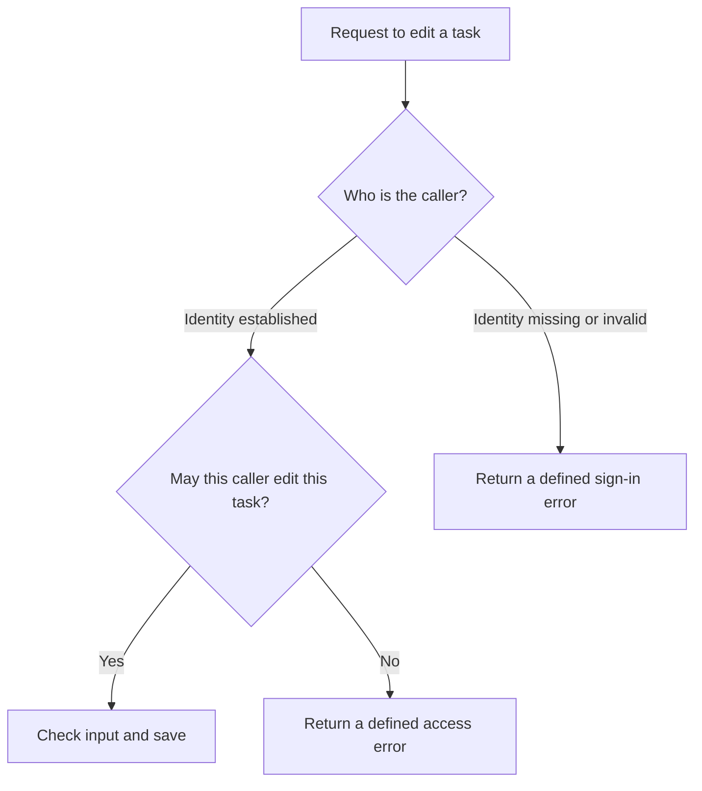
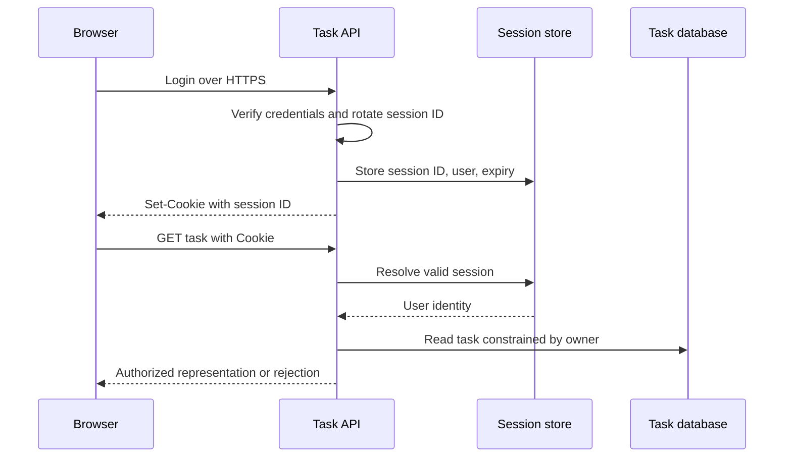

# Authentication, sessions, and delegated access

Establish identity with sessions, tokens, OAuth, OIDC, and recovery.

**Prerequisite / previous:** [Validation](validation.md) · **Next:** [Security and trust boundaries](security.md)

Authentication checks **who is calling**. Authorization checks **what that caller may do**. Think of a school library: a library card identifies a student, but it does not permit them to borrow another student's reserved book. A cookie, token, or successful login never replaces that second check.

## Start with a task-list example

A school ID can identify a student, but it does not give that student access to every locked room. In the same way, a signed-in user should only see tasks they are allowed to read.

1. Identify the caller using the application’s sign-in mechanism.
2. Find the requested task.
3. Check whether that caller may read or change it.
4. Test with two accounts, including a request for the other account’s task.

## Words to know

| Word | Meaning |
| --- | --- |
| Session | Information that connects later requests to a signed-in user. |
| Cookie | A small value the browser stores and can send with matching requests. |
| Token | A value a caller presents as part of proving an identity or permission. |

## Start with one browser and one service

For a small task application, a server-managed session is a useful baseline. After verifying a login, create an unpredictable session identifier, store its association with the user and expiry, and send the identifier in a cookie. On each request, look up the session and check ownership of the requested task. The browser stores the cookie; the session record usually lives on the server.

Rotate the session identifier after login and privilege changes. Set `Secure`, `HttpOnly`, and an appropriate `SameSite` policy, minimize cookie scope, and implement CSRF protection for state changes. `HttpOnly` prevents script from reading the cookie; it does not stop injected script from making requests as the user. Expire sessions on the server and invalidate them on logout. These controls follow the [OWASP session guidance](https://cheatsheetseries.owasp.org/cheatsheets/Session_Management_Cheat_Sheet.html).

## Distinguish the terms

| Term | Responsibility | Does not establish |
| --- | --- | --- |
| Cookie | Browser storage and HTTP transport mechanism | That its contents are trustworthy |
| Session | An authenticated interaction and its lifecycle | Permission to every object |
| Opaque token | Unpredictable credential resolved by its issuer or store | Self-contained claims |
| JWT | A standardized claims format, often signed | Encryption, current account status, or automatic revocation |
| OAuth 2.0 | Delegation of scoped access to a resource | An application login protocol by itself |
| OpenID Connect | Authentication on top of OAuth 2.0 | Permission to use every downstream API |
| SSO | Reuse of an identity-provider login across applications | A single shared cookie for unrelated sites |

An SDK wraps an API and protocol details; using one does not transfer responsibility for configuring trust, scope, and authorization.

## Signed tokens and the revocation trade-off

A commonly used signed JWT has three encoded parts: header, claims, and signature. Encoding is readable, not encryption. Include only necessary claims; never put secrets into a token merely because it is signed. A symmetric MAC uses a shared secret; an asymmetric signature is produced with a private key and checked with the corresponding public key.

The verifier must pin allowed algorithms and trusted issuers, verify the signature, audience, expiry and other applicable claims, and enforce application authorization. Do not choose a verification key or algorithm solely because untrusted token input requests it. PASETO is a different token format with constrained cryptographic choices; it still needs secure storage, audience checks, expiry policy, and revocation design.

A self-contained token reduces session-store reads but a deleted user or changed role can remain represented by an unexpired token. Short lifetimes, introspection, token deny lists, or an account-version lookup make different latency/availability/revocation trade-offs. A shared session store can scale with partitioning and replication; JWTs are not a prerequisite for horizontal scaling. See [JWT security guidance](https://cheatsheetseries.owasp.org/cheatsheets/JSON_Web_Token_Cheat_Sheet.html).

**Worked example:** a token lives for 15 minutes and a teacher revokes a student's access at minute 2. Signature-only validation may accept it until minute 15. If the requirement is revocation within 30 seconds, specify an additional check or shorter bounded cache of revocation state. Document what happens when that check is unavailable.

## OAuth, OpenID Connect, and SSO

In delegated access, the resource owner authorizes a **client** through an **authorization server** to access a **resource server**. For interactive application access, use an established library implementing authorization code flow with PKCE and the applicable redirect, issuer, state/nonce, and token checks. OpenID Connect supplies an ID token for the client to validate as part of authentication; access tokens are for their intended APIs.

Client credentials is a machine-to-machine grant for a confidential client acting for itself; it is not a single-page application flow. Do not use the password grant. Avoid the implicit grant for new designs. Restrict tokens to the intended audiences and scopes. For public clients with refresh tokens, use rotation or sender constraint as required by [OAuth security BCP, RFC 9700](https://www.rfc-editor.org/rfc/rfc9700.html).

For SSO, application A redirects to the identity provider and establishes its own application session after validation. Later application B redirects to that provider, which can reuse its existing login. B still establishes its own session. Provider logout, application logout, and token revocation are distinct operations; test their actual propagation.

## MFA, passkeys, and recovery

A time-based one-time password combines a shared secret and a time step. Enrollment transfers the secret securely, often using a QR code. The service protects the stored secret, checks an intentionally small clock window, rate-limits attempts, and rejects reuse of an already accepted code. Six-digit codes **can** be guessed; a million possibilities is not sufficient protection without attempt limits. Recovery codes and factor resets must be protected too. See [RFC 6238](https://www.rfc-editor.org/rfc/rfc6238.html).

With a passkey, an authenticator creates a credential key pair. The server stores the public key; the authenticator signs a server challenge using the private key after the required user interaction. The private key is not derived from a public key supplied by the website. Verification binds the response to the challenge, relying party, and origin. Biometrics used to unlock a credential are not the server's password. Device loss, credential synchronization, account recovery, and enrollment still require a threat model. See [W3C WebAuthn](https://www.w3.org/TR/webauthn-3/).

## Failure modes, scaling, and common mistakes

- A session-store outage can deny legitimate access. Capacity-plan lookups and define fail-closed behavior for sensitive operations.
- Key rotation can reject valid tokens if verifier caches are stale. Publish overlapping verification keys for a bounded transition and monitor unknown key IDs.
- Browser storage choices affect XSS and CSRF exposure. Putting a token in a cookie does not remove CSRF considerations; putting it in JavaScript-accessible storage exposes it to script theft.
- Bearer credentials can be replayed by whoever obtains them. Keep them out of URLs, logs, analytics, screenshots, and source control.
- Request signing needs a defined canonical request and replay protection. A timestamp alone does not prevent replay within its validity window.
- QR login requires a short-lived challenge bound to the initiating session and explicit confirmation. Scanning arbitrary QR codes must not silently grant account access.

## Practice and interview questions

Draw login, task access, logout, access revocation, and lost-device recovery for two applications. State which component can revoke each credential and the maximum delay. Repeat with an identity-provider outage and a key rotation.

**Completion check:** another user cannot read a task by changing its ID; old sessions fail after logout; retries cannot bypass attempt limits; revoked access meets the stated bound. Explain why a valid signature does not authorize a task, why an access token is not an ID token, and why SSO can increase the impact of identity-provider failure.
