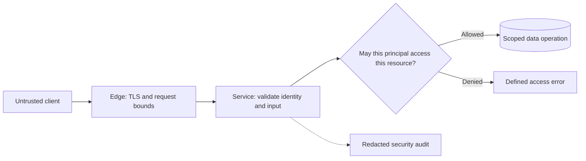

# Security and trust boundaries

Protect data across tenant, network, and privilege boundaries.

**Prerequisite / previous:** [Authentication, sessions, and delegated access](authentication.md) · **Next:** [Implementing a service in Node.js](server-runtime.md)

A school library may recognize your student card without allowing you to change someone else's borrowing record. A system similarly needs both identity checks and permission checks. Begin by listing what must be protected, who can act on it, and where untrusted data enters.

## Work through one request

For a multi-tenant task service, derive the tenant and user from the authenticated session. Load the requested task using both its ID and authorized tenant scope. Apply the same rule to background jobs, exports, search results, and cached responses. A valid token or an unguessable object ID does not establish ownership.

| Boundary | Control | Failure to test |
| --- | --- | --- |
| Browser → API | TLS, session validation, CSRF protection for ambient credentials | A cross-site request changes another user's state |
| API → database | Parameterized queries, ownership predicates, least privilege | A missing tenant filter exposes a record |
| API → worker | Validated message schema and scoped workload identity | A forged event causes a privileged action |
| Cache → client | Tenant-aware keys and permission checks | A shared cache returns private data |
| Service → external URL | Destination restrictions and bounded fetches | SSRF reaches internal infrastructure |
| Export → storage | Authorized, expiring downloads | A leaked link stays usable indefinitely |

The full login/session/OAuth explanation is in [authentication](authentication.md). Authorization belongs at the resource boundary even when an API gateway authenticates requests.

## Permission models

An ACL names subjects and permissions on a resource. RBAC groups permissions into roles, while ABAC evaluates attributes such as tenant, ownership, and resource state. DAC lets an owner delegate access; MAC enforces centrally controlled labels and policy. These are modeling choices and can coexist. For example, a teacher role may grade only students in that teacher's class, requiring a relationship check as well as a role.

Deny by default. Review administrator and support access separately. Cache permission decisions only with a revocation/freshness contract. If the policy service is unavailable, choose explicitly which operations fail closed; quietly allowing all requests is not a resilience strategy.

## Passwords and secrets

Use a maintained password-hashing implementation with a unique salt and suitable work parameters; Argon2id is OWASP's preferred general-purpose choice. A fast hash such as SHA-256, even salted, is unsuitable for password storage. Store the algorithm and parameters with the hash so accounts can be upgraded on successful login. Rate-limit verification because expensive hashing can itself be exhausted. See the [OWASP password storage guidance](https://cheatsheetseries.owasp.org/cheatsheets/Password_Storage_Cheat_Sheet.html).

A password manager has a different job: it must recover saved credentials, so an encrypted vault is appropriate. Its design needs key derivation, authenticated encryption, synchronization, recovery, and device-compromise analysis. Do not assume one vendor's key hierarchy describes every password manager. A stolen unlocked endpoint can defeat otherwise strong vault encryption.

Keep service secrets out of repositories, images, URLs, logs, and client applications. Use scoped workload identity or a secrets manager, automate rotation, and test overlapping old/new credentials during rollout. Environment variables are configuration delivery, not an automatic security boundary.

## Encoding, encryption, signing, and tokenization

| Mechanism | Purpose | What it does not prove |
| --- | --- | --- |
| Encoding, such as Base64 | Represent bytes in a transport-friendly format | Confidentiality |
| Hashing | Produce a digest for a defined purpose | Sender identity without an authenticated construction |
| Symmetric encryption | Protect data with shared secret key material | That every key holder is authorized for every use |
| Public-key cryptography | Support signatures, key agreement, or encryption depending on the scheme | That a public key belongs to the claimed person |
| Digital signature | Verify integrity and origin relative to a trusted public key | Secrecy of signed content |
| Tokenization | Replace sensitive data with a surrogate | Safety of the token vault or permission to resolve a token |

Digital signatures use the scheme's sign/verify operations; “encrypt the hash with a private key” is not a general description. HMAC uses a shared secret and an authenticated hash construction, not an asymmetric public/private key pair. Signed API requests must bind the method, destination, relevant headers, and body, with freshness and replay controls. Both sides need an unambiguous canonical representation.

Use authenticated encryption through vetted libraries. Nonce requirements depend on the algorithm; reusing a nonce with AES-GCM can destroy its security. With envelope encryption, a data key encrypts the payload and a managed key protects the data key. Rotation, restore access, and deletion of keys need an operational plan. Encryption is not a substitute for access control or data minimization.

## Network controls and end-to-end protection

A packet filter checks network fields; a stateful firewall also tracks connection state; an application-aware proxy or WAF inspects selected application traffic. Segmentation limits movement after a breach. None replaces service authorization, input validation, patching, or abuse controls. A NAT address translation is not a complete firewall policy.

TLS protects a connection between its endpoints. A server terminating TLS can ordinarily read the application plaintext. End-to-end encrypted messaging moves the decryption boundary to participant devices; key verification, backups, device enrollment, and metadata still matter. Evaluate the particular product mode rather than labeling an entire messaging product universally secure or insecure.

## Failure modes and scaling

Bound request bodies, decompression, query complexity, file uploads, and authentication attempts. Validate content and filenames before serving uploads; isolate parsers where appropriate. Protect against injection with safe APIs and context-aware output handling. Audit high-impact actions without copying secrets into telemetry. Set retention and deletion rules for replicas, caches, logs, and backups according to the actual product requirements.

Security dependencies can become bottlenecks: signing services, policy engines, secret retrieval, and password verification all need capacity plans. Cache safely, rotate keys with overlap, retain audit evidence, and practice revocation during an outage. Test the security of the degraded path, not just the normal path.

## Interview questions and exercises

1. Alice changes a task ID in a request and receives Bob's task. Explain why stronger password hashing does not fix this bug.
2. Design permission revocation when API servers cache decisions for five minutes. Which actions must observe the change immediately?
3. Draw the plaintext boundaries for TLS termination at a proxy and for an end-to-end encrypted chat.
4. Rotate a database credential while workers process queued jobs. Specify deployment order, monitoring, and rollback.

A good answer identifies the protected invariant, the authoritative decision point, one bypass attempt, and how failure is detected. Related: [API contracts](api-design.md), [authentication](authentication.md), [resilience](../operations/resilience.md), and [observability](../operations/observability.md).

## How does SSH work

SSH (Secure Shell) is a network protocol used to securely connect to remote machines over an unsecured network. It encrypts the connection and provides various mechanisms for authentication and data transfer.

SSH has two versions: SSH-1 and SSH-2. SSH-2 was standardized by the IETF.

It has three main layers: Transport Layer, Authentication Layer, and Connection Layer.

### Transport Layer

The Transport Layer provides encryption, integrity, and data protection to ensure secure communication between the client and server.

### Authentication Layer

The Authentication Layer verifies the identity of the client to ensure that only authorized users can access the server.

### Connection Layer

The Connection Layer multiplexes the encrypted and authenticated communication into multiple logical channels.

### Exercise

A server host key changes unexpectedly. Explain how host authentication differs from authenticating the user, and why accepting every replacement key defeats an important protection. Design a planned host-key rotation.

## VPN boundaries and remote access

A VPN carries selected traffic through a protected tunnel. Remote-access VPNs connect devices to a network; site-to-site VPNs connect networks. Routing decides whether all traffic or only selected destinations use the tunnel.

Encryption protects the tunnel between its endpoints. The VPN operator, destination service, compromised endpoints, DNS configuration, and traffic metadata remain relevant. A VPN does not guarantee anonymity or replace HTTPS and application authorization. Address masking is a routing consequence, not proof that a person cannot be identified.

### Design example and failure modes

An employee connects to an internal dashboard through a VPN. Authenticate the device/user, restrict routes and service access, and revoke access on departure. Test tunnel loss, DNS leakage under the intended routing policy, expired credentials, and overloaded gateways. Multiple gateways improve capacity only if routing, identity, and configuration remain available.

### Exercise

Compare full-tunnel and split-tunnel access for the dashboard. Identify which parties can observe content and metadata, then demonstrate that VPN membership alone does not authorize another tenant's records. Related: [security](security.md), [networking](../foundations/networking.md), and [authentication](authentication.md).

## Architecture flow

Being inside a private network does not grant permission to every record. Recheck the resource and tenant boundary at the service that owns the data, and keep secrets out of audit records.
