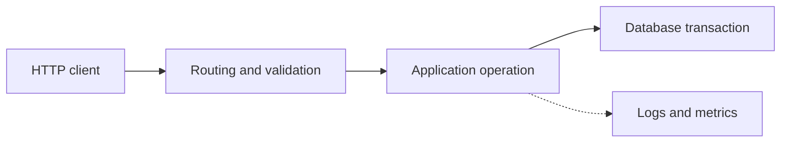

<span id="nodejs-"></span>

# Implementing a service in Node.js

Connect HTTP routing, application services, and explicit dependencies.

**Prerequisite / previous:** [Security and trust boundaries](security.md) · **Next:** [Error Handling](error-handling.md)

Node.js runs JavaScript outside the browser. A server can use it to receive requests, read data, and send responses. Many I/O operations finish asynchronously, so the main JavaScript thread can handle other work while it waits. CPU-heavy work can still block that thread.

## Start with a task-list example

A browser asks for the task list. Node.js runs your request handler, waits for stored tasks, then sends the list back. While waiting for network or file work, asynchronous code can let the server handle other requests.

1. Receive `GET /tasks`: a request to read the list.
2. Run a small function that prepares the answer.
3. Send a response with the tasks and a status code.
4. Try two requests, then make one fail and inspect the result.


## Words to know

| Word | Meaning |
| --- | --- |
| Runtime | The program that executes your JavaScript. |
| Request handler | The function called for an incoming request. |
| Asynchronous work | Work whose result arrives later; use a callback or promise to continue. |

## Architecture

```text
JavaScript Code
      ↓
Node.js APIs (fs, http, path, crypto, ...)
      ↓
libuv (async I/O, event loop, thread pool)
      ↓
Operating System
```

**Key characteristics:**

| Feature                        | Description                                                                                    |
| ------------------------------ | ---------------------------------------------------------------------------------------------- |
| **Single-threaded event loop** | One main thread handles all JS execution; I/O is offloaded to the kernel or thread pool        |
| **Non-blocking I/O**           | Operations that would block use callbacks/promises, keeping the thread free for other requests |
| **Event-driven**               | The event loop picks up completed I/O operations and invokes their callbacks                   |
| **Cross-platform**             | Runs on Linux, macOS, Windows, and more                                                        |

### Core Modules

| Module           | Purpose                                  |
| ---------------- | ---------------------------------------- |
| `fs`             | File system operations                   |
| `http` / `https` | HTTP server and client                   |
| `path`           | File path utilities                      |
| `crypto`         | Cryptographic functions                  |
| `stream`         | Streaming data processing                |
| `events`         | EventEmitter base class                  |
| `child_process`  | Spawn subprocesses                       |
| `worker_threads` | True multi-threading for CPU-bound tasks |
| `cluster`        | Multi-process load balancing             |
| `os`             | Operating system utilities               |
| `url`            | URL parsing and formatting               |

---

## Express 🚂

Express is a Node.js framework for web requests. It provides routes and **middleware**: functions that check, transform, or pass a request to the next step.

### Core Concepts

**Middleware pipeline:**

```javascript
const express = require('express');
const app = express();

// Application-level middleware
app.use(express.json()); // parse JSON bodies
app.use(express.urlencoded({ extended: true })); // parse form data
app.use((req, res, next) => {
  // custom logger
  console.log(`${req.method} ${req.url}`);
  next();
});

// Route-level middleware
app.get('/api/users', authenticate, getUsers);
```

**Routing:**

```javascript
// Basic routes
app.get('/api/users', getUsers);
app.post('/api/users', createUser);
app.put('/api/users/:id', updateUser);
app.delete('/api/users/:id', deleteUser);

// Router modules (modular organization)
const userRouter = express.Router();
userRouter.get('/', getUsers);
userRouter.get('/:id', getUserById);
app.use('/api/users', userRouter);
```

**Error handling middleware** (4 parameters):

```javascript
app.use((err, req, res, next) => {
  console.error(err.stack);
  res.status(err.status || 500).json({
    error: { message: err.message },
  });
});
```

### Project Structure

```text
src/
├── routes/          # Route definitions
│   ├── users.js
│   └── products.js
├── controllers/     # Request handlers
│   ├── userController.js
│   └── productController.js
├── middleware/       # Custom middleware
│   ├── auth.js
│   ├── validation.js
│   └── errorHandler.js
├── models/          # Database models
├── services/        # Business logic
├── utils/           # Helper functions
├── config/          # Configuration
└── app.js           # Entry point
```

---

The following NestJS fragments belong in a NestJS application with the named decorators, DTOs, services, and `Reflector` imported. They show wiring boundaries; an authentication guard must establish `request.user` before the role guard runs.

## NestJS 🐱

NestJS is a progressive framework for building efficient, scalable server-side applications. It uses TypeScript by default and combines elements of OOP, FP, and FRP (Functional Reactive Programming).

### Core Concepts

**Modules** — organize application structure:

```typescript
@Module({
  imports: [UsersModule, AuthModule],
  controllers: [AppController],
  providers: [AppService],
})
export class AppModule {}
```

**Controllers** — handle incoming requests:

```typescript
@Controller('users')
export class UsersController {
  constructor(private readonly usersService: UsersService) {}

  @Get()
  findAll(): Promise<User[]> {
    return this.usersService.findAll();
  }

  @Get(':id')
  findOne(@Param('id') id: string): Promise<User> {
    return this.usersService.findOne(id);
  }

  @Post()
  create(@Body() createUserDto: CreateUserDto): Promise<User> {
    return this.usersService.create(createUserDto);
  }
}
```

**Providers / Services** — business logic, injectable via DI:

```typescript
@Injectable()
export class UsersService {
  constructor(
    @InjectRepository(User)
    private readonly userRepository: Repository<User>,
  ) {}

  async findAll(): Promise<User[]> {
    return this.userRepository.find();
  }
}
```

**Guards** — authorization (roles, permissions):

```typescript
@Injectable()
export class RolesGuard implements CanActivate {
  constructor(private readonly reflector: Reflector) {}
  canActivate(context: ExecutionContext): boolean {
    const roles = this.reflector.get<string[]>('roles', context.getHandler()) ?? [];
    if (roles.length === 0) return false;
    const request = context.switchToHttp().getRequest();
    return roles.includes(request.user?.role);
  }
}

@Controller('admin')
export class AdminController {
  @UseGuards(RolesGuard)
  @Roles('admin')
  @Get()
  getAdminData() { return { status: 'authorized' }; }
}
```

**Interceptors** — transform responses, wrap logic:

```typescript
@Injectable()
export class TransformInterceptor implements NestInterceptor {
  intercept(context: ExecutionContext, next: CallHandler): Observable<any> {
    return next.handle().pipe(map((data) => ({ success: true, data, timestamp: new Date() })));
  }
}
```

**Pipes** — validate and transform input:

```typescript
@Controller('users')
export class CreateUserController {
  constructor(private readonly usersService: UsersService) {}
  @Post()
  create(@Body(new ValidationPipe()) createUserDto: CreateUserDto) {
    return this.usersService.create(createUserDto);
  }
}
```

### NestJS CLI

```bash
# Generate a full CRUD resource
nest g resource users

# Generate individual components
nest g module auth
nest g controller auth
nest g service auth
nest g guard roles
nest g pipe validation
```

### Express vs NestJS

| Criteria                 | Express                    | NestJS                                       |
| ------------------------ | -------------------------- | -------------------------------------------- |
| **Philosophy**           | Minimal, unopinionated     | Opinionated, batteries-included              |
| **Architecture**         | Middleware functions       | Modules, controllers, providers              |
| **TypeScript**           | Optional, manual setup     | First-class, built-in                        |
| **Dependency Injection** | Manual, not built-in       | Built-in DI container                        |
| **Testing**              | Manual setup (Jest, Mocha) | Built-in testing module with Jest            |
| **GraphQL**              | Manual setup               | Built-in code-first and schema-first         |
| **Microservices**        | Manual                     | Built-in transport layer (Redis, NATS, MQTT) |
| **Best for**             | Small to medium apps, APIs | Large enterprise apps, complex architectures |

## Design trade-offs and production exercise

A service runtime connects sockets to application operations. Express exposes a small middleware model; NestJS adds conventions and dependency injection. The trade-off is explicit assembly versus a larger framework contract. Neither framework makes a CPU-bound handler nonblocking.

A school image-resize endpoint can block unrelated requests if it runs CPU work on the event loop. Move suitable work to a bounded worker pool, apply admission limits, and measure event-loop delay. If a dependency fails, stop accepting new work during drain and return a stable error. Why can adding HTTP connections make the service slower?

## Architecture flow



## Further reading

- [Node.js: event loop and worker pool](https://nodejs.org/en/learn/asynchronous-work/dont-block-the-event-loop).
