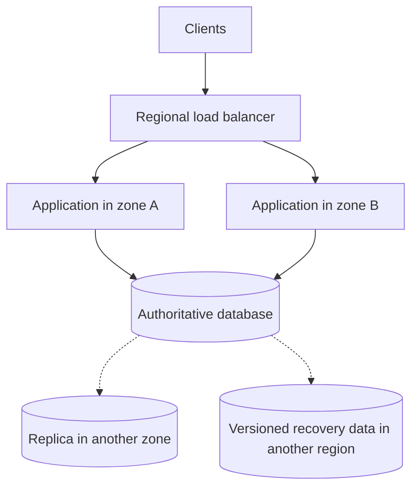

# Cloud service selection and cost

Compare service responsibilities, cost, and resource efficiency.

**Prerequisite / previous:** [Timeouts, retries, and failure isolation](resilience.md) · **Next:** [Serverless execution and isolation](serverless.md)

A cloud service is a managed contract with quotas, failure modes, billing dimensions, and responsibilities. Select capabilities first: compute, networking, identity, transactional storage, object storage, messaging, analytics, and observability. A diagram of vendor logos is not an architecture and services in the same category are not drop-in equivalents.

## Responsibility boundaries

With infrastructure as a service, the customer manages more of the operating system and runtime. A platform service manages more deployment machinery. Function services manage execution infrastructure but still leave application correctness, identity, quotas, data protection, and recovery to the application owner. Managed services do not remove operations.

Document data location, availability boundaries, backup/restore, encryption/key ownership, egress, deployment dependencies, and exit strategy. Test quotas and failure behavior before assuming auto-scaling is instantaneous. Kubernetes is optional; several containers do not make orchestration mandatory.

## Estimate the bill from workload

Estimate compute-hours, retained bytes, storage operations, public IPs, load balancing, network transfer, observability ingestion, and support/operational work separately. Include idle databases, unattached volumes, retained snapshots, and abandoned multipart uploads. Free-tier eligibility, allowances, regional rates, and commitments change; use the provider's current pricing and your actual configuration instead of historical limits in a cheat sheet.

For example, a service storing 1 TB but reading it 100 times per month may be dominated by transfer and requests rather than storage. Compression may save bandwidth while consuming CPU. A CDN may reduce origin traffic while adding cache requests and invalidation work. Cross-zone resilience can add transfer costs that a single-node estimate misses.

## Optimization and failure checks

Measure utilization before right-sizing; preserve failover headroom and latency targets. Remove idle resources only after checking ownership and recovery needs. Schedule disposable environments, bound retention, abort stale uploads, and test restores before deleting backups. Commitments can lower rates for predictable use but create obligations; interruptible capacity requires checkpointing and replacement capacity.

## Exercise

Build a cost model for a photo service with uploads, thumbnails, storage growth, and downloads. Double reads without changing uploads and identify which costs change. Then model one-zone failure and compare the surviving capacity with the optimistic normal-operation budget.

Related: [scalability](../foundations/capacity.md), [storage](../data/storage.md), [containers](containers.md), and [deployments](deployments.md). Original vendor comparison graphics are historical discovery aids retained in the source archive; they are not current product-selection evidence.

## What Are the Greenest Programming Languages

The study below runs 10 benchmark problems in 27 languages. It measures the runtime, memory usage, and energy consumption of each language. This take might be controversial.

The cited study compares runtime, memory, and energy across a fixed set of language implementations and benchmark problems. Its results depend on those implementations, inputs, and hardware; they do not establish an unconditional ranking for all software.

### Exercise

Compare two implementations of the same workload with equal correctness and output. Control hardware, compiler/runtime version, dataset, and warm-up; include total energy as well as runtime and peak memory.

## Design trade-offs and production exercise

Managed services trade infrastructure control for provider contracts, quotas, and cost models. A region is not a recovery plan. Track cost per successful operation as well as total spend, and include egress, idle capacity, storage operations, and backup retention.

For a video lesson platform, compare one hundred small object reads with one larger range read under measured access patterns. What happens if your quota is exhausted or the regional identity dependency is unavailable?

## Further reading

- [AWS Well-Architected framework](https://docs.aws.amazon.com/wellarchitected/latest/framework/welcome.html).

## Architecture flow

This is a starting topology, not an availability guarantee. Define database failover, replica lag, backup isolation, and regional recovery separately; test them with the actual provider and service configuration.
