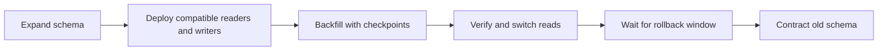

# Deployments, configuration, and safe change

Ship compatible code, configuration, schema, and infrastructure changes.

**Prerequisite / previous:** [Containers and orchestration](containers.md) · **Next:** [Observability and service objectives](observability.md)

A release changes a running system while people still use it. Think of replacing a classroom's desks in small groups: keep enough usable seats, check each group, and keep a way to stop. Deployment safety depends on compatibility and observation, not the name of a tool.

## Build once, promote the same artifact

Continuous integration checks frequent changes together. Continuous delivery keeps a tested version ready to release; continuous deployment automatically releases changes that satisfy its controls. A pipeline typically builds an immutable artifact, runs tests and security checks, deploys to a representative environment, and promotes the same artifact using an explicit rollout policy.

Store configuration separately from code. Version configuration changes, validate them before use, and keep secrets in an access-controlled secret system. Infrastructure as code describes desired resources; configuration management can also be declarative and automated. Neither label guarantees that the live environment matches the intended state. Detect drift and review a concrete change plan before applying it.

## Choose a rollout for the failure you can tolerate

| Method | Operation | Trade-off |
| --- | --- | --- |
| Recreate / big bang | Stop the old version and start the new | Simple but may interrupt service |
| Rolling | Replace bounded groups of instances | Requires old and new versions to coexist and enough spare capacity |
| Blue-green | Prepare a second production-capable environment and switch traffic | Fast application switchback, but duplicated capacity and shared-data compatibility remain |
| Canary | Expose a limited traffic slice, measure, then expand | Needs representative traffic, automated stopping conditions, and sufficient sample size |
| Feature flag | Enable behavior separately from deploying code | Needs ownership, expiry, testing of combinations, and cleanup |

Canaries can and should have pre-production testing. An A/B experiment compares product outcomes; it is not automatically a safe deployment strategy. A green HTTP health check does not prove that checkout or permissions work.

## Worked schema migration

Suppose `full_name` must become `display_name`. First add the new nullable field without removing the old one. Release code compatible with both, backfill in bounded batches, verify counts and values, then switch reads. Remove the old field only after all older readers/writers and the rollback window are accounted for.

An application rollback cannot undo a destructive schema migration or restore deleted data. Define the point after which forward repair is safer than rollback. Keep the migration resumable with progress markers, resource limits, and reconciliation queries.

## Runtime design that supports safe change

The useful ideas in the [Twelve-Factor App](https://12factor.net/) include explicit dependencies, separate build/release/run stages, externally managed configuration, disposable processes, concurrency, logs as event streams, and one-off administrative tasks. Apply them with the workload's requirements; a stateful database is not an architectural mistake just because application workers are replaceable.

Separate startup, liveness, and readiness checks. Remove an instance from new traffic, drain in-flight work to a deadline, and handle long-lived connections. A liveness probe that fails whenever a shared database is slow can restart the entire fleet and worsen the outage. See [Kubernetes probe documentation](https://kubernetes.io/docs/concepts/configuration/liveness-readiness-startup-probes/).

Container image size, dependency initialization, connection warming, and cache warming affect scale-up time. Cloud-native does not mean every application needs microservices or Kubernetes. Choose packaging and orchestration based on operational needs.

## Failure modes, scaling, and practice

Watch user-visible success, tail latency, resource saturation, and data invariants during rollout. Bound surge capacity and unavailable instances. A small canary may miss rare tenants or expensive endpoints; compare like-for-like traffic and watch multiple windows.

**Exercise:** write a rollout and rollback plan for the name migration. Inject a bad configuration, a worker crash during backfill, and a failure after switching reads. **Check:** the previous app can operate during its promised rollback window, the job resumes without double changes, and the stopping condition uses user impact.

**Interview questions:** when is blue-green rollback unsafe? How do you protect secrets in a pipeline? Which changes require forward repair? Explain who owns incident response and how a retrospective turns a failed assumption into a tested control.

## Ownership and infrastructure as code

DevOps emphasizes shared delivery and operation responsibilities. SRE applies engineering to reliability, including SLOs and operational toil. Platform teams provide supported capabilities to product teams. These approaches overlap; managed/serverless products do not eliminate operations or make a universal “NoOps” promise.

Infrastructure as code versions desired infrastructure and configuration. GitOps can reconcile declared state, but state ownership, secrets, drift, policy checks, and recovery still need design. A plan should expose destructive changes before apply. An infrastructure state file can be stale and contain secrets; secure its backend, coordinate writers, and reconcile it against actual resources.

## How To Release A Mobile App

The mobile app release process differs from conventional methods. This illustration simplifies the journey to help you understand.

### 1. Registration & Development (iOS & Android):

- Enroll in Apple's Developer Program and Google Play Console as iOS and Android developer
- Code using platform-specific tools: Swift/Obj-C for iOS, and Java/Kotlin for Android

#### 2. Build & Test (iOS & Android):

Compile the app's binary, run extensive tests on both platforms to ensure functionality and performance. Create a release candidate build.

#### 3. QA:

- Internally test the app for issue identification (dogfooding)
- Beta test with external users to collect feedback
- Conduct regression testing to maintain feature stability

#### 4. Internal Approvals:

- Obtain approval from stakeholders and key team members.
- Comply with app store guidelines and industry regulations
- Obtain security approvals to safeguard user data and privacy

#### 5. App Store Optimization (ASO):

- Optimize metadata, including titles, descriptions, and keywords, for better search visibility
- Design captivating screenshots and icons to entice users
- Prepare engaging release notes to inform users about new features and updates

#### 6. App Submission To Store:

- Submit the iOS app via App Store Connect following Apple's guidelines
- Submit the Android app via Google Play Console, adhering to Google's policies
- Both platforms may request issues resolution for approval

#### 7. Release:

- Upon approval, set a release date to coordinate the launch on both iOS and Android platforms

### Exercise

Release a backend change while some devices retain last year’s client. Define compatibility, feature gating, rollout metrics, and recovery when a store-delivered binary cannot be instantly recalled.

## What do version numbers mean

Semantic Versioning (SemVer) is a versioning scheme for software that aims to convey meaning about the underlying changes in a release.

*   SemVer uses a three-part version number: MAJOR.MINOR.PATCH.
    *   **MAJOR version**: Incremented when there are incompatible API changes.
    *   **MINOR version**: Incremented when functionality is added in a backward-compatible manner.
    *   **PATCH version**: Incremented when backward-compatible bug fixes are made.
*   **Example Workflow**
    *   **Initial Development Phase**
        *   Start with version 0.1.0.
    *   **First Stable Release**
        *   Reach a stable release: 1.0.0.
    *   **Subsequent Changes**
        *   **Patch Release**: A bug fix is needed for 1.0.0. Update to 1.0.1.
        *   **Minor Release**: A new, backward-compatible feature is added to 1.0.3. Update to 1.1.0.
        *   **Major Release**: A significant change that is not backward-compatible is introduced in 1.2.2. Update to 2.0.0.
    *   **Special Versions and Pre-releases**
        *   **Pre-release Versions**: 1.0.0-alpha, 1.0.0-beta, 1.0.0-rc.1.
        *   **Build Metadata**: 1.0.0+20130313144700.

### Exercise

A response adds a field but a client rejects unknown properties. Explain why a version label alone cannot prove compatibility and design a consumer contract test for the change.

## Version control for design and delivery

Git records project history as commits; hosting platforms add collaboration and automation around repositories. The working tree contains current files, the index stages the next snapshot, the local repository stores history, and a remote is another repository. Git does not require GitHub, and GitHub has both free and paid offerings.

### Reviewable changes

Use `git status` and `git diff` to inspect work, stage intentional changes with `git add`, and create a focused commit. `git diff` normally compares the working tree with the index; `git diff --staged` compares staged content with the current commit. Fetch retrieves remote history without integrating it; pull fetches and integrates according to configuration.

Merge combines histories and may fast-forward or create a merge commit; it changes the destination branch. Rebase replays commits on a different base, creating new commit identities. Coordinate before rewriting shared history. Revert adds a commit that undoes an earlier change, while reset and restore have different effects on history, staging, and files. Read the command's mode before discarding work.

### Design exercise

Version an architecture decision alongside its migration plan and tests. A colleague changes the database contract while you change a worker: resolve the semantic conflict even if Git reports no textual conflict. Explain how deployment rollback differs from reverting a source commit when a schema migration already ran.

Related: [deployments](deployments.md) and [design review](../case-studies/design-review.md).

## How does Terraform turn Code into Cloud

There are multiple stages in a Terraform workflow:

### Write Infrastructure as Code

*   Define resources, providers, and configurations in Terraform configuration files.

*   Use variables, modules, and functions to make the code reusable and maintainable.

*   Integrate with Terraform community registries for ready-to-use modules.

### Terraform Plan

Preview the changes Terraform will make to the infrastructure by running “terraform plan”. It can be triggered as part of a CI/CD pipeline.

Terraform compares the desired state defined in the configuration file with the current state in the state file.

### Terraform Apply

Run “terraform apply” to create, update, or delete resources based on the plan.

Terraform makes API calls to the specified providers (AWS, Azure, GCP, Kubernetes, etc) to provision the resources.

The state file is updated to reflect the new state of the infrastructure.

### Infrastructure Ready

Terraform state records its resource mapping and last observed attributes; it can be stale relative to real infrastructure.

Use an appropriately secured remote state backend and concurrency control; state can contain secrets and should not be committed as ordinary source code.

### Exercise

Change a cloud resource outside the declared configuration, then refresh and plan. Explain state locking, sensitive state storage, drift, and why a stale saved plan may no longer be safe to apply.

## Monorepo vs. Microrepo: Which is Best

Why do different companies choose different options?

### Do you believe that Google, Meta, Uber, and Airbnb put almost all of their code in one repository?

This practice is called a monorepo. Guest post by [Xiong Wang](https://www.linkedin.com/in/wangxiong/).

Monorepo isn't new; Linux and Windows were both created using Monorepo. To improve scalability and build speed, Google developed its internal dedicated toolchain to scale it faster and strict coding quality standards to keep it consistent.

Amazon and Netflix are major ambassadors of the Microservice philosophy. This approach naturally separates the service code into separate repositories. It scales faster but can lead to governance pain points later on.

Within Monorepo, each service is a folder, and every folder has a BUILD config and OWNERS permission control. Every service member is responsible for their own folder.

On the other hand, in Microrepo, each service is responsible for its repository, with the build config and permissions typically set for the entire repository.

In Monorepo, dependencies are shared across the entire codebase regardless of your business, so when there's a version upgrade, every codebase upgrades their version.

In Microrepo, dependencies are controlled within each repository. Businesses choose when to upgrade their versions based on their own schedules.

Monorepo has a standard for check-ins. Google's code review process is famously known for setting a high bar, ensuring a coherent quality standard for Monorepo, regardless of the business.

Microrepo can either set their own standard or adopt a shared standard by incorporating best practices. It can scale faster for business, but the code quality might be a bit different.

Google engineers built Bazel, and Meta built Buck. There are other open-source tools available, including Nix, Lerna, and others.

Over the years, Microrepo has had more supported tools, including Maven and Gradle for Java, NPM for NodeJS, and CMake for C/C++, among others.

### Exercise

Two teams release independently but share a library. Compare a monorepo and separate repositories for ownership, dependency upgrades, affected tests, and coordinated rollback. Repository layout does not determine whether the deployed system is a monolith.

## Testing ownership as release frequency increases

The retained illustration proposes staffing ratios; treat those numbers as historical opinion, not a hiring rule or a verified description of current companies. Frequent releases need fast automated feedback, independent investigation of high-risk changes, and clear ownership when a defect reaches production.

Developers can own unit and integration checks. Test specialists can improve exploratory testing, accessibility, security, and failure injection. Platform teams can make reliable test environments and release gates reusable. The balance depends on product risk, regulation, testability, and team experience. More automation does not remove the need to decide whether the system solves the user's problem.

### Exercise

Design a release-quality process for a small team without copying a staffing ratio. Specify developer tests, independent risk review, production signals, and ownership of escaped defects.

## Engineering account: Fixing Bugs Automatically at Meta Scale

This Fixing Bugs Automatically at Meta Scale account is retained as historical design evidence. Read its workload and period with the linked sources; it is not a current technology inventory or a universal benchmark.

Wouldn't it be nice if a system could automatically detect and fix bugs for us?

Meta released a paper about how they automated end-to-end repair at the Facebook scale. Let's take a closer look.

The goal of a tool called SapFix is to simplify debugging by automatically generating fixes for specific issues.

How successful has SapFix been?

Here are some details that have been made available:

*   Used on six key apps in the Facebook app family (Facebook, Messenger, Instagram, FBLite, Workplace and Workchat). Each app consists of tens of millions of lines of code

*   It generated 165 patches for 57 crashes in a 90-day pilot phase

*   The median time from fault detection to fix sent for human approval was 69 minutes.

Here’s how SapFix actually works:

1.  Developers submit changes for review using Phabricator (Facebook’s CI system)
2.  SapFix selects appropriate test cases from Sapienz (Facebook’s automated test case design system) and executes them on the Diff submitted for review
3.  When SapFix detects a crash due to the Diff, it tries to generate potential fixes. There are 4 types of fixes - template, mutation, full revert and partial revert.
4.  For generating a fix, SapFix runs tests on the patched builds and checks what works. Think of it like solving a puzzle by trying out different pieces.
5.  Once the patches are tested, SapFix selects a candidate patch and sends it to a human reviewer for review through Phabricator.
6.  The primary reviewer is the developer who raised the change that caused the crash. This developer often has the best technical context. Other engineers are also subscribed to the proposed Diff.
7.  The developer can accept the patch proposed by SapFix. However, the developer can also reject the fix and discard it.

### Exercise

An automated patch removes a crash by skipping the operation. Define a correctness check that rejects this false fix and explain why passing the original crash test is insufficient.

## Engineering account: Amazons Build System: Brazil

This Amazons Build System: Brazil account is retained as historical design evidence. Read its workload and period with the linked sources; it is not a current technology inventory or a universal benchmark.

Discover Amazon's innovative build system - Brazil.

Amazon's ownership model requires each team to manage its own repositories, which allows for more rapid innovation. Amazon has created a unique build system, known as Brazil, to enhance productivity and empower Amazon’s micro-repo driven collaboration. This system is certainly worth examining!

With Brazil, developers can focus on developing the code and create a simple-to-understand build configuration file. The build system will then process the output artifact repeatedly and consistently. The build config minimizes the build requirement, including language, versioning, dependencies, major versions, and lastly, how to resolve version conflicts.

For local builds, the Brazil build tool interprets the build configuration as a Directed Acyclic Graph (DAG), retrieves packages from the myservice’s private space (VersionSet) called myservice-cpp-version-set, generates the language-specific build configuration, and employs the specific build tool to produce the output artifact.

A version set is a collection of package versions that offers a private space for the package and its dependencies. When a new package dependency is introduced, it must also be merged into this private space. There is a default version set called "live," which serves as a public space where anyone can publish any version.

Remotely, the package builder service provides an intuitive experience by selecting a version set and building targets. This service supports Amazon Linux on x86, x64, and ARM. Builds can be initiated manually or automatically upon a new commit to the master branch. The package builder guarantees build consistency and reproducibility, with each build process being snapshotted and the output artifact versioned.

### Exercise

Two services require incompatible dependency versions. Design a reproducible version set, prove which inputs produced an artifact, and explain how a dependency update is tested and rolled back.

## Engineering account: How TikTok Manages a 200K File Frontend MonoRepo

This How TikTok Manages a 200K File Frontend MonoRepo account is retained as historical design evidence. Read its workload and period with the linked sources; it is not a current technology inventory or a universal benchmark.

A MonoRepo, short for a monolithic repository, is a software development strategy where a single repository contains multiple projects, libraries, and services.

The good parts of a MonoRepo are:

*   **Better code sharing**
*   **Simplified dependency management**
*   **A unified view of the code base**

However, the bigger the MonoRepo gets, the slower the various Git operations.

TikTok faced a similar change with its frontend TypeScript MonoRepo with 200K files.

To deal with this, TikTok built a tool named Sparo that optimizes the performance of Git operations for large frontend MonoRepos.

Sparo dramatically improved the performance of Git operations. Some stats are as follows

*   Git clone time went from 40 mins to just 2 mins.
*   Checkout went from 1.5 minutes to 30 seconds.
*   Status went from 7 seconds to 1 second.
*   Git commit time went from 15 seconds to 11 seconds.

### Exercise

Measure clone, checkout, status, and build time separately. Restrict the fetched scope and prove that branch-specific builds, generated files, and dependency resolution still work.

## Engineering account: The one-line change that reduced clone times by 99 at Pinterest

This The one-line change that reduced clone times by 99 at Pinterest account is retained as historical design evidence. Read its workload and period with the linked sources; it is not a current technology inventory or a universal benchmark.

While it may sound cliché, small changes can definitely create a big impact.

The Engineering Productivity team at Pinterest witnessed this first-hand.

They made a small change in the Jenkins build pipeline of their monorepo codebase called Pinboard.

And it brought down clone times from 40 minutes to a staggering 30 seconds.

For reference, Pinboard is the oldest and largest monorepo at Pinterest. Some facts about it:

*   **350K commits**
*   **20 GB in size when cloned fully**
*   **60K git pulls on every business day**

Cloning monorepos having a lot of code and history is time consuming. This was exactly what was happening with Pinboard.

The build pipeline (written in Groovy) started with a “Checkout” stage where the repository was cloned for the build and test steps.

The clone options were set to shallow clone, no fetching of tags and only fetching the last 50 commits.

But it missed a vital piece of optimization.

The Checkout step didn’t use the Git refspec option.

This meant that Git was effectively fetching all refspecs for every build. For the Pinboard monorepo, it meant fetching more than 2500 branches.

𝐒𝐨 - 𝐰𝐡𝐚𝐭 𝐰𝐚𝐬 𝐭𝐡𝐞 𝐟𝐢𝐱?

The team simply added the refspec option and specified which ref they cared about. It was the “master” branch in this case.

This single change allowed Git clone to deal with only one branch and significantly reduced the overall build time of the monorepo.

### Exercise

Restrict CI fetches to the intended ref and history depth. Test merge-base calculations, tags, release builds, and pull-request checkout before claiming the optimization preserves build behavior.
