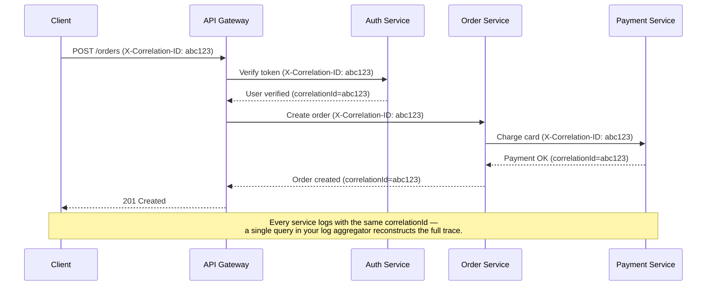
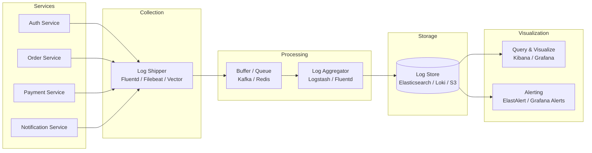
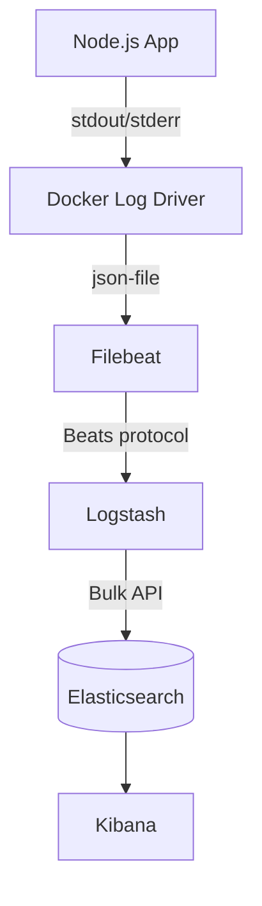
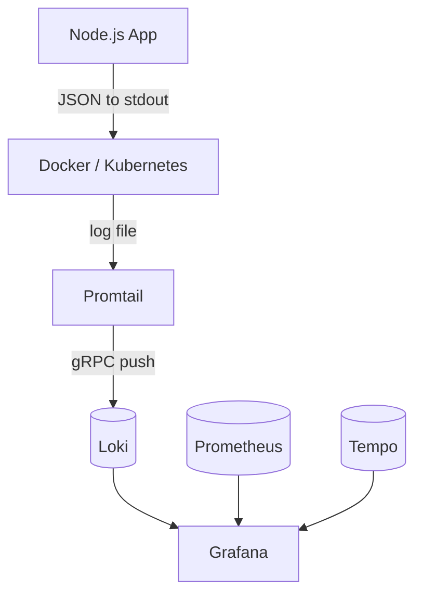
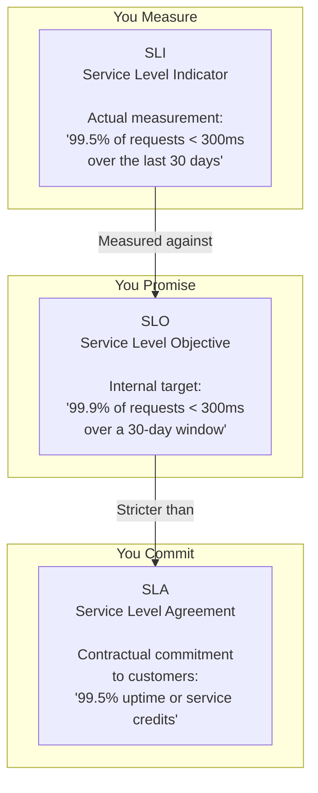

<span id="logging-tracing-and-metrics"></span>

# Observability and service objectives

Measure user outcomes and diagnose failures using signals and SLOs.

**Prerequisite / previous:** [Deployments, configuration, and safe change](deployments.md) · **Next:** [Timeouts, retries, and failure isolation](resilience.md)


Logging, tracing, and metrics are 3 pillars of system observability. The diagram below shows their definitions and typical architectures.


## Start with a task-list example

A teacher’s register records a date, a student, and an attendance result. A task request log can record a time, a request ID, an operation, and an outcome. Do not include passwords or tokens.

1. Choose an event to record, such as a completed task request.
2. Record the same fields for every occurrence.
3. Connect related records with a request ID.
4. Search for one failed request and explain the sequence.

## Words to know

| Word | Meaning |
| --- | --- |
| Structured log | A record with named fields, often written as JSON. |
| Log level | A label describing the kind or severity of an event. |
| Redaction | Removing or hiding data that should not appear in a log. |

## Logging

Logging records discrete events in the system. For example, we can record an incoming request or a visit to databases as events. It has the highest volume. ELK (Elastic-Logstash-Kibana) stack is often used to build a log analysis platform. We often define a standardized logging format for different teams to implement, so that we can leverage keywords when searching among massive amounts of logs.

## Tracing

Tracing is usually request-scoped. For example, a user request goes through the API gateway, load balancer, service A, service B, and database, which can be visualized in the tracing systems. This is useful when we are trying to identify the bottlenecks in the system. We use OpenTelemetry to showcase the typical architecture, which unifies the 3 pillars in a single framework.

## Metrics

Metrics are usually aggregatable information from the system. For example, service QPS, API responsiveness, service latency, etc. The raw data is recorded in time-series databases like InfluxDB. Prometheus pulls the data and transforms the data based on pre-defined alerting rules. Then the data is sent to Grafana for display or to the alert manager which then sends out email, SMS, or Slack notifications or alerts.

## Define an SLI and SLO before choosing dashboards

For the task API, define a good event as an authorized, valid request that completes successfully within 300 ms, measured at the service boundary. Decide explicitly how cancellations and invalid requests count. An illustrative SLO is 99.9% good events over a rolling 30-day window. At one million eligible requests, the error budget is 1,000 bad events; this request-based budget is not automatically 43.2 minutes of downtime.

Logs explain individual events, metrics reveal aggregate behavior, and traces connect work across boundaries. Carry a correlation identifier through asynchronous messages. Use bounded-cardinality metric labels such as route templates; a unique user ID or raw URL as a label can overwhelm the monitoring system. Redact credentials and sensitive payloads from logs and traces.

## Worked incident and trade-offs

API p99 rises while CPU remains low. Trace samples show database-pool wait time; pool saturation metrics and slow-query logs identify the shared bottleneck. Adding API instances could worsen it. Bound work, tune the query, and verify the user-visible SLI after the change. Sampling reduces telemetry cost but can miss rare failures; retain error-focused samples and avoid using sampled trace counts as the denominator of an exact SLI.

## Failure exercise and interview questions

Disable the telemetry exporter and overload the database in a test environment. **Check:** the service still bounds telemetry buffers, alerts detect user impact, and logs can connect one failed request across components. Ask: what would this dashboard miss, what evidence triggers rollback, and how quickly is the error budget being consumed? Use burn-rate alerts with multiple windows rather than a single noisy CPU threshold. Related: [availability](../distributed/replication.md), [deployment strategies](deployments.md), and [disaster recovery](../distributed/replication.md).

## Collection pipelines and browser evidence

Pull collectors discover endpoints and scrape metrics at controlled intervals; push agents send data to a collector. Either model needs authentication, backpressure, loss/retention rules, and discovery or routing. A log pipeline can collect, parse, index, and visualize events; Elasticsearch/Logstash/Kibana is one implementation, not a prerequisite. Protect the application from an unavailable telemetry backend with bounded buffers.

Browser timings include first byte, content paint, layout stability, and interaction delay. DOMContentLoaded follows HTML parsing and deferred/module script execution; it does not mean every image has loaded. Request count alone cannot rank page speed because resource size, priorities, connection reuse, caching, and the critical path matter.

For the illustrative line `INFO 12:34 xxService Exception`, this shell pipeline prints `12:34`:

```bash
grep 'xxService' service.log | grep 'Exception' | cut -d ' ' -f 2
```

It assumes single spaces and fixed fields. Structured logs need a format-aware parser; multiline exceptions and repeated spaces break naive field splitting. `grep` selects, `cut` extracts, `sed` transforms, `awk` processes fields, `sort` orders, and `uniq` combines adjacent duplicates. Do not put secrets into logs to make troubleshooting easier.

## Structured logging implementation

### Structured Logging

Structured logs use named fields, often in JSON. Keeping the same field names makes records easier to search and compare.

#### Why Structured?

**Free-form text:**

```text
User alice@example.com failed to login from IP 192.168.1.100 at 2024-01-15T10:30:00Z
```

**Named fields:**

```json
{
  "timestamp": "2024-01-15T10:30:00.000Z",
  "level": "warn",
  "message": "Failed login attempt",
  "userId": "usr_abc123",
  "email": "alice@example.com",
  "ip": "192.168.1.100",
  "reason": "invalid_password",
  "attemptNumber": 3,
  "service": "auth-service",
  "traceId": "abc123def456"
}
```

With named fields, you can filter by event, user identifier, and time instead of searching for phrases inside a sentence.

#### Key Properties of a Good Log Entry

Every log entry should include:

| Field         | Required?       | Description                                                        |
| ------------- | --------------- | ------------------------------------------------------------------ |
| `timestamp`   | ✅              | ISO 8601 with timezone (millisecond precision)                     |
| `level`       | ✅              | severity level: `trace`, `debug`, `info`, `warn`, `error`, `fatal` |
| `message`     | ✅              | Human-readable summary (the "what happened")                       |
| `service`     | ✅              | Name of the service/application                                    |
| `traceId`     | ✅              | Correlation ID — links requests across services                    |
| `spanId`      | Recommended     | Individual operation within a trace (OpenTelemetry)                |
| `requestId`   | Recommended     | Unique per HTTP request                                            |
| `userId`      | When applicable | Identifier of the authenticated user                               |
| `duration`    | When applicable | Operation duration in milliseconds                                 |
| `error.stack` | On error        | Stack trace (dev/staging only, never production)                   |
| `context`     | Optional        | Additional structured data specific to the operation               |

#### Implementing Structured Logging in Node.js

```typescript
// logger.ts — base logger factory
import pino from 'pino';

export const logger = pino({
  level: process.env.LOG_LEVEL || 'info',
  formatters: {
    level(label) {
      return { level: label };
    },
  },
  timestamp: pino.stdTimeFunctions.isoTime,
  // Redact sensitive fields globally
  redact: {
    paths: [
      'password',
      'token',
      'authorization',
      'creditCard',
      'ssn',
      'body.password',
      'body.token',
      'headers.authorization',
    ],
    censor: '[REDACTED]',
  },
  // Pretty-print in development, JSON in production
  transport:
    process.env.NODE_ENV !== 'production'
      ? { target: 'pino-pretty', options: { colorize: true } }
      : undefined,
});
```

---


### Log Levels

Log levels provide a graduated scale of severity. Using the right level makes it easy to filter noise and focus on what matters.

#### Standard Level Hierarchy

| Level                | Severity | Meaning                                                 | When to Use                                                              |
| -------------------- | -------- | ------------------------------------------------------- | ------------------------------------------------------------------------ |
| `fatal` / `critical` | 60       | System is unusable                                      | Database is down, out of memory — immediate human intervention required  |
| `error`              | 50       | Error events that might still allow continued operation | Failed API call, transaction rollback, unhandled exception in a request  |
| `warn`               | 40       | Potentially harmful situations                          | Deprecated API usage, retry attempts, approaching rate limit, slow query |
| `info`               | 30       | Normal but significant events                           | Application startup, user signup, order placed, config loaded            |
| `debug`              | 20       | Detailed information for debugging                      | SQL queries, request/response payloads, cache hits/misses                |
| `trace`              | 10       | Very fine-grained tracing                               | Every function entry/exit, variable values — extremely verbose           |

#### Level Guidelines

- **Production default:** `info` — captures the signal without the noise
- **Staging:** `debug` — troubleshoot issues before they reach production
- **Development:** `debug` or `trace` — full visibility during local work
- **Never log at `error` for expected failures** — a validation error is a `warn` at most; an `error` implies something broke that shouldn't have
- **Adjust dynamically:** provide an admin endpoint or feature flag to temporarily raise/lower the log level without redeploying

```typescript
// Example: using levels correctly in an Express route
app.post('/api/orders', async (req, res) => {
  logger.info({ userId: req.user.id, items: req.body.items.length }, 'Order creation requested');

  try {
    const order = await orderService.create(req.body);
    logger.info({ orderId: order.id, total: order.total }, 'Order created successfully');
    res.status(201).json(order);
  } catch (err) {
    if (err instanceof ValidationError) {
      logger.warn({ err, body: req.body }, 'Order validation failed');
      res.status(422).json({ error: err.message });
    } else {
      logger.error({ err }, 'Unexpected error creating order');
      res.status(500).json({ error: 'Internal server error' });
    }
  }
});
```

---


### Correlation IDs

A correlation ID (also called trace ID or request ID) is a unique identifier attached to every log entry within a single request's lifecycle. It's the thread that ties together log entries across multiple services, async operations, and time — allowing you to reconstruct the full journey of a request.

#### How It Works



#### Implementation in Express

```typescript
// middleware/correlationId.ts
import { randomUUID } from 'crypto';
import { Request, Response, NextFunction } from 'express';
import { AsyncLocalStorage } from 'async_hooks';

// AsyncLocalStorage keeps context across async boundaries
// without passing the correlation ID through every function call
export const requestContext = new AsyncLocalStorage<{ correlationId: string }>();

export function correlationIdMiddleware(req: Request, res: Response, next: NextFunction) {
  // Accept incoming correlation ID or generate a new one
  const correlationId =
    (req.headers['x-correlation-id'] as string) ||
    (req.headers['x-request-id'] as string) ||
    randomUUID();

  // Attach to request object for convenience
  (req as any).correlationId = correlationId;

  // Echo back to client in response header
  res.setHeader('X-Correlation-ID', correlationId);

  // Run the entire request within AsyncLocalStorage context
  requestContext.run({ correlationId }, () => {
    next();
  });
}
```

```typescript
// logger.ts — logger that automatically includes correlation ID
import pino from 'pino';
import { requestContext } from './middleware/correlationId';

export const logger = pino({
  level: process.env.LOG_LEVEL || 'info',
  timestamp: pino.stdTimeFunctions.isoTime,
  mixin() {
    // Automatically add correlationId to every log entry
    const ctx = requestContext.getStore();
    return ctx ? { correlationId: ctx.correlationId } : {};
  },
});
```

```typescript
// Usage in a service
import { logger } from '../logger';

async function createOrder(userId: string, items: Item[]) {
  // No need to pass correlationId — the logger pulls it from AsyncLocalStorage
  logger.info({ userId, itemCount: items.length }, 'Creating order');
  // ... business logic ...
  logger.info({ orderId: order.id }, 'Order created');
}
```

#### Passing Correlation IDs Between Services

When calling downstream services, forward the correlation ID in the request headers:

```typescript
// httpClient.ts
import { requestContext } from './middleware/correlationId';

export async function callDownstream(url: string, options: RequestInit = {}) {
  const ctx = requestContext.getStore();
  const headers = {
    ...options.headers,
    'X-Correlation-ID': ctx?.correlationId || 'unknown',
    'Content-Type': 'application/json',
  };

  return fetch(url, { ...options, headers });
}
```

#### Trace ID vs Span ID (OpenTelemetry Alignment)

If you're using OpenTelemetry (or plan to), align your correlation ID with the W3C Trace Context standard:

| Field          | W3C Header    | Description                                                   |
| -------------- | ------------- | ------------------------------------------------------------- |
| **traceId**    | `traceparent` | Identifies the entire end-to-end trace (32 hex chars)         |
| **spanId**     | `traceparent` | Identifies a single operation within the trace (16 hex chars) |
| **traceFlags** | `traceparent` | Sampling decision (01 = sampled)                              |

```typescript
// Aligning custom correlation ID with OpenTelemetry trace context
import { trace } from '@opentelemetry/api';

export function correlationIdMiddleware(req: Request, res: Response, next: NextFunction) {
  const activeSpan = trace.getActiveSpan();
  const traceId = activeSpan?.spanContext().traceId || randomUUID();

  (req as any).correlationId = traceId;
  res.setHeader('X-Correlation-ID', traceId);
  res.setHeader('X-Trace-Id', traceId);

  requestContext.run({ correlationId: traceId }, () => {
    next();
  });
}
```

---


### Child Loggers

Child loggers create a new logger instance that inherits configuration from a parent but adds additional bound context. Every log entry from the child automatically includes the bound fields — no need to pass them manually.

#### Why Child Loggers?

Without child loggers, you repeat context everywhere:

```typescript
// Repetitive and error-prone — easy to forget a field
logger.info({ module: 'OrderService', orderId: '123', userId: 'abc' }, 'Processing');
logger.info({ module: 'OrderService', orderId: '123', userId: 'abc' }, 'Validated');
logger.info({ module: 'OrderService', orderId: '123', userId: 'abc' }, 'Saved');
```

With a child logger, context is bound once:

```typescript
// Context bound once — all subsequent logs inherit it
const orderLogger = logger.child({ module: 'OrderService', orderId: '123', userId: 'abc' });
orderLogger.info('Processing');
orderLogger.info('Validated');
orderLogger.info('Saved');
```

#### Child Logger Patterns

**Per-module logger:**

```typescript
// modules/orders/logger.ts
import { logger } from '../../logger';

export const orderLogger = logger.child({ module: 'OrderService' });
```

**Per-request logger (using correlation ID + user context):**

```typescript
// middleware/requestLogger.ts
import { Request, Response, NextFunction } from 'express';

export function requestLoggerMiddleware(req: Request, res: Response, next: NextFunction) {
  const childLogger = logger.child({
    correlationId: (req as any).correlationId,
    userId: (req as any).user?.id,
    ip: req.ip,
    userAgent: req.headers['user-agent'],
    method: req.method,
    path: req.path,
  });

  (req as any).logger = childLogger;

  const start = Date.now();
  res.on('finish', () => {
    childLogger.info(
      {
        statusCode: res.statusCode,
        duration: Date.now() - start,
      },
      `${req.method} ${req.path} ${res.statusCode}`,
    );
  });

  next();
}
```

**Per-job logger (background jobs):**

```typescript
// workers/emailWorker.ts
import { logger } from '../logger';

export async function processEmailJob(job: Job) {
  const jobLogger = logger.child({
    jobId: job.id,
    jobType: 'sendEmail',
    recipient: job.data.to,
  });

  jobLogger.info('Starting email job');

  try {
    await emailService.send(job.data);
    jobLogger.info('Email sent successfully');
  } catch (err) {
    jobLogger.error({ err }, 'Email job failed');
    throw err;
  }
}
```

#### Pino Child Logger Performance

Pino's `.child()` is exceptionally fast because it doesn't create a new logger instance — it creates a lightweight wrapper that prepends the bound fields to every log call. Bunyan has a similar concept (it pioneered child loggers in Node.js). Winston's `.child()` is supported but adds more overhead due to its format pipeline.

---


### PII Redaction

Personally Identifiable Information (PII) must never appear in plaintext in your logs. This includes names, email addresses, phone numbers, government IDs, credit card numbers, IP addresses (in some jurisdictions), and authentication tokens.

#### What Constitutes PII?

| Category               | Examples                                       | Risk Level                                                                |
| ---------------------- | ---------------------------------------------- | ------------------------------------------------------------------------- |
| **Direct identifiers** | Full name, email, phone, SSN, passport number  | 🔴 Critical — never log                                                   |
| **Financial data**     | Credit card numbers, bank account numbers, CVV | 🔴 Critical — never log                                                   |
| **Credentials**        | Passwords, API keys, JWT tokens, session IDs   | 🔴 Critical — never log                                                   |
| **Biometric data**     | Fingerprints, face recognition data            | 🔴 Critical — never log                                                   |
| **Location data**      | GPS coordinates, street address                | 🟡 High — log only if essential; mask or coarse-grain                     |
| **IP addresses**       | Client IP                                      | 🟡 High — GDPR considers IP as personal data; hash or truncate if logging |
| **Device identifiers** | IMEI, advertising IDs                          | 🟡 High — avoid logging raw values                                        |

#### Redaction Strategies

##### 1. **Schema-Level Redaction (Pino built-in)**

Pino's `redact` option removes or masks fields before they reach the transport layer. This is the safest approach — the data never leaves the logger.

```typescript
const logger = pino({
  redact: {
    paths: [
      // Top-level fields
      'password',
      'token',
      'authorization',
      'creditCard',
      'ssn',
      // Nested fields in request/response bodies
      'body.password',
      'body.creditCard',
      'body.*.password', // wildcard support
      'headers.authorization',
      'headers.cookie',
      // Arrays
      'users[*].email', // redact email in every array element
    ],
    censor: '[REDACTED]',
    // Optional: completely remove instead of replacing
    remove: false,
  },
});
```

##### 2. **Serializer-Based Redaction**

For more control, define custom serializers that transform objects before they're logged:

```typescript
import pino from 'pino';

const logger = pino({
  serializers: {
    user(user: any) {
      // Only log non-sensitive fields
      return {
        id: user.id,
        role: user.role,
        // Explicitly omit: password, email, phone, ssn
      };
    },
    req(req: any) {
      return {
        method: req.method,
        url: req.url,
        // Strip sensitive headers
        headers: {
          ...req.headers,
          authorization: req.headers?.authorization ? '[REDACTED]' : undefined,
          cookie: req.headers?.cookie ? '[REDACTED]' : undefined,
        },
        // Don't log the body at all (or sanitize it)
        remoteAddress: req.ip,
      };
    },
  },
});
```

##### 3. **Regex-Based Scrubbing (Winston)**

Winston requires formatter-based scrubbing since it lacks built-in redaction:

```typescript
import winston from 'winston';

// Custom formatter that scrubs PII from the message string
const scrubPii = winston.format((info) => {
  // Scrub email addresses
  info.message = info.message.replace(
    /[a-zA-Z0-9._%+-]+@[a-zA-Z0-9.-]+\.[a-zA-Z]{2,}/g,
    '[EMAIL_REDACTED]',
  );
  // Scrub credit card numbers (basic pattern)
  info.message = info.message.replace(/\b(?:\d[ -]*?){13,16}\b/g, '[CC_REDACTED]');
  return info;
});

const logger = winston.createLogger({
  format: winston.format.combine(scrubPii(), winston.format.json()),
  transports: [new winston.transports.Console()],
});
```

> ⚠️ **Regex scrubbing is a safety net, not a primary strategy.** It's easy to miss edge cases. Always prefer schema-level redaction and serializers.

##### 4. **Hashing for Auditability**

Sometimes you need to identify a user in logs without storing their actual identifier. Hashing provides a one-way mapping:

```typescript
import crypto from 'crypto';

function hashIdentifier(value: string, salt: string = process.env.LOG_SALT || 'default'): string {
  return crypto.createHmac('sha256', salt).update(value).digest('hex').substring(0, 16); // First 16 chars is enough for log correlation
}

// Usage
logger.info({
  userIdHash: hashIdentifier(user.email),
  action: 'password_reset_requested',
});
```

#### Redaction Checklist for Production

- [ ] Passwords and tokens: **never logged** — redact at schema level
- [ ] Email addresses: **redacted or hashed** in production logs
- [ ] Full request bodies: **logged only at debug/trace level**, with PII fields redacted
- [ ] Authorization headers: **always stripped**
- [ ] Stack traces: **logged in dev/staging only** — never in production (they can leak paths, secrets, and query parameters)
- [ ] Third-party API responses: **sanitized before logging** — they may contain user data you didn't expect
- [ ] Log retention policies: **aligned with data retention requirements** (GDPR: right to erasure applies to logs too)

---


### Centralized Logging

In a single-server application, `tail -f /var/log/app.log` works. In a distributed system with dozens or hundreds of services, you need centralized logging — all logs shipped to a single place where they can be searched, correlated, and analyzed.

#### The Centralized Logging Architecture



#### Option 1: ELK Stack (Elasticsearch + Logstash + Kibana)

The most widely deployed centralized logging stack. Mature, feature-rich, and battle-tested — but resource-heavy.

| Component         | Role                                                                      |
| ----------------- | ------------------------------------------------------------------------- |
| **Elasticsearch** | Distributed search and analytics engine — stores and indexes logs         |
| **Logstash**      | Data processing pipeline — ingests, transforms, and ships logs            |
| **Kibana**        | Visualization layer — dashboards, queries, alerting                       |
| **Filebeat**      | Lightweight shipper — tails log files and sends to Logstash/Elasticsearch |

**Architecture:**



**Pino + ELK integration:**

```typescript
// Pino logs JSON to stdout — Docker/Filebeat picks it up natively
import pino from 'pino';

const logger = pino({
  level: process.env.LOG_LEVEL || 'info',
  timestamp: pino.stdTimeFunctions.isoTime,
  // Elasticsearch maps @timestamp by default — align your timestamp field
  formatters: {
    level(label) {
      return { level: label };
    },
  },
  // No pretty-printing in production — raw JSON for Logstash
});

logger.info({ service: 'order-service', userId: 'abc' }, 'Order placed');
```

**Logstash pipeline config:**

```text
# logstash.conf
input {
  beats {
    port => 5044
  }
}

filter {
  json {
    source => "message"
  }
  # Parse @timestamp for Elasticsearch
  date {
    match => ["timestamp", "ISO8601"]
    target => "@timestamp"
  }
  # Remove unnecessary fields
  mutate {
    remove_field => ["@version", "host", "ecs"]
  }
}

output {
  elasticsearch {
    hosts => ["http://elasticsearch:9200"]
    index => "app-logs-%{+YYYY.MM.dd}"
  }
}
```

**Pros:**

- Extremely powerful full-text search and aggregation
- Rich ecosystem of plugins and tools
- Kibana dashboards are highly customizable
- Handles petabytes of data

**Cons:**

- **Heavy:** Elasticsearch is a resource hog (heap memory, disk i/o)
- **Expensive at scale:** licensing (Elastic license changes), infrastructure costs
- **Complex to operate:** tuning JVM, managing indices, shard allocation

#### Option 2: Grafana Loki

Loki is a horizontally-scalable, highly-available log aggregation system inspired by Prometheus. It indexes only **metadata** (labels) — not the full text of log lines — making it dramatically cheaper to operate than Elasticsearch.

| Component    | Role                                                                 |
| ------------ | -------------------------------------------------------------------- |
| **Loki**     | Log storage and query engine                                         |
| **Promtail** | Agent that tails log files, adds labels, and pushes to Loki          |
| **Grafana**  | Unified UI for logs (Loki), metrics (Prometheus), and traces (Tempo) |

**Architecture:**



**Pino + Loki integration:**

```typescript
// pino-loki transport sends logs directly to Loki via HTTP
import pino from 'pino';

const logger = pino({
  level: 'info',
  transport: {
    target: 'pino-loki',
    options: {
      batching: true,
      interval: 5, // batch interval in seconds
      host: 'http://loki:3100',
      labels: {
        service: 'order-service',
        environment: process.env.NODE_ENV || 'development',
      },
      // Map Pino fields to Loki labels (for efficient querying)
      propsToLabels: ['level', 'module', 'userId'],
    },
  },
});
```

**Promtail config:**

```yaml
# promtail-config.yaml
server:
  http_listen_port: 9080

clients:
  - url: http://loki:3100/loki/api/v1/push

scrape_configs:
  - job_name: app-logs
    static_configs:
      - targets:
          - localhost
        labels:
          job: app-logs
          service: order-service
          __path__: /var/log/app/*.log
    pipeline_stages:
      - json:
          expressions:
            level: level
            message: message
            timestamp: timestamp
      - labels:
          level:
      - timestamp:
          source: timestamp
          format: RFC3339
```

**Pros:**

- **Cost-effective:** indexes only metadata, stores compressed log chunks
- **Unified observability:** same Grafana instance for logs, metrics, traces
- **Simple to operate:** single binary, no JVM tuning, object storage backend
- **LogQL:** query language similar to PromQL (familiar to DevOps)

**Cons:**

- Limited full-text search (no indexing of log body — sequential scan of chunks)
- Smaller ecosystem than ELK
- Newer, less battle-tested in very large deployments

#### Option 3: AWS CloudWatch

CloudWatch is AWS's native monitoring and observability service. If you're on AWS, it's the path of least resistance — no infrastructure to manage.

| Component               | Role                                                    |
| ----------------------- | ------------------------------------------------------- |
| **CloudWatch Logs**     | Log storage, querying, and retention                    |
| **CloudWatch Agent**    | Collects logs and metrics from EC2/on-prem              |
| **CloudWatch Insights** | Query language for searching and analyzing logs         |
| **CloudWatch Alarms**   | Alert on log patterns (e.g., "ERROR" count > threshold) |

**Pino + CloudWatch integration:**

```typescript
// Option A: Write JSON to stdout/console — CloudWatch Agent or ECS/Docker log driver picks it up
import pino from 'pino';

const logger = pino({
  level: 'info',
  // Plain JSON to stdout — no transport overhead
});

// Option B: Use AWS SDK directly (for Lambda or when you need programmatic control)
import { CloudWatchLogs } from '@aws-sdk/client-cloudwatch-logs';
import pino from 'pino';

const cloudWatch = new CloudWatchLogs({ region: 'us-east-1' });

const logger = pino({
  level: 'info',
  transport: {
    target: 'pino-cloudwatch',
    options: {
      groupName: '/app/order-service',
      streamName: process.env.NODE_ENV,
      awsRegion: 'us-east-1',
      interval: 2000, // batch interval in ms
    },
  },
});
```

**CloudWatch Logs Insights query examples:**

```text
# Find all errors in the last hour
fields @timestamp, level, message, correlationId
| filter level = "error"
| sort @timestamp desc
| limit 50

# Count errors by service
fields @timestamp, service, level
| filter level = "error"
| stats count(*) as errorCount by service
| sort errorCount desc

# Find slow requests (duration > 1000ms)
fields @timestamp, method, path, duration, statusCode
| filter duration > 1000
| sort duration desc
| limit 20
```

**Pros:**

- **Zero infrastructure management** — fully managed service
- **Deep AWS integration** — automatically collects Lambda, ECS, RDS, and other service logs
- **IAM-based access control** — fine-grained permissions
- **Retention policies** — set per log group (1 day to never expire)

**Cons:**

- **Cost:** ingestion ($0.50/GB) + storage ($0.03/GB/month) + queries ($0.005/GB scanned) — can add up fast
- **Vendor lock-in:** tight coupling to AWS ecosystem
- **Query experience:** CloudWatch Insights is functional but less powerful than Kibana or Grafana
- **Limited visualization:** no dashboards as rich as Kibana/Grafana without exporting to another tool

#### Comparison Matrix

| Criteria                   | ELK Stack                                 | Grafana Loki                                       | AWS CloudWatch                    |
| -------------------------- | ----------------------------------------- | -------------------------------------------------- | --------------------------------- |
| **Full-text search**       | ✅ Excellent                              | ⚠️ Limited (no indexing)                           | ⚠️ Moderate (Insights queries)    |
| **Cost**                   | 🔴 High (infra + licensing)               | 🟢 Low (cheap object storage)                      | 🟡 Variable (pay per GB)          |
| **Operational complexity** | 🔴 High (JVM tuning, clusters)            | 🟢 Low (single binary)                             | 🟢 None (fully managed)           |
| **Visualization**          | ✅ Kibana — powerful                      | ✅ Grafana — unified                               | ⚠️ Basic dashboards               |
| **Alerting**               | ✅ ElastAlert / Kibana                    | ✅ Grafana Alerts                                  | ✅ CloudWatch Alarms              |
| **Retention**              | Configurable                              | Configurable (S3/GCS backend)                      | Configurable per log group        |
| **Multi-cloud**            | ✅ Runs anywhere                          | ✅ Runs anywhere                                   | ❌ AWS only                       |
| **Open source**            | ✅ (with license caveats)                 | ✅ (AGPLv3)                                        | ❌ Proprietary                    |
| **Best for**               | Large enterprises, full-text search needs | Kubernetes, Prometheus users, cost-conscious teams | AWS-native shops, serverless apps |

---


### Logging Best Practices

#### 1. Log Everything to stdout/stderr

Applications should write logs to standard output and standard error — not to files. Let the runtime environment (Docker, systemd, Kubernetes, process manager) handle log routing, rotation, and shipping. This keeps your application portable and follows the [Twelve-Factor App](https://12factor.net/logs) methodology.

```text
✅  console.log(JSON.stringify(logEntry))   // stdout
✅  logger.info('Event')                     // writes to stdout via Pino
❌  fs.appendFileSync('/var/log/app.log')    // don't do this in-app
```

#### 2. Use Appropriate Log Levels

```text
logger.error()  → Something broke that shouldn't have. Needs attention.
logger.warn()   → Something unexpected but handled. Worth investigating.
logger.info()   → Normal business event. Order placed, user signed up, payment processed.
logger.debug()  → Detailed internal state. SQL queries, cache state, intermediate values.
logger.trace()  → Extremely verbose. Function entry/exit, loop iterations.
```

#### 3. One Log Entry Per Event

Resist the temptation to log multiple lines for one event. A single structured log entry with all relevant context is always better:

```typescript
// ❌ Multiple lines — hard to correlate
console.log('Processing order...');
console.log(`User: ${userId}`);
console.log(`Items: ${items.length}`);
console.log(`Total: $${total}`);

// ✅ Single structured entry
logger.info({ userId, itemCount: items.length, total }, 'Order processed');
```

#### 4. Include Enough Context to Reproduce the Issue

A log entry should answer: **who, what, when, where, and why**. If you can't reproduce the issue from the log alone, you didn't log enough context.

```typescript
// ❌ Not enough context
logger.error('Database query failed');

// ✅ Reproducible context
logger.error(
  {
    query: 'SELECT * FROM orders WHERE id = $1',
    params: [orderId],
    dbHost: 'orders-db.internal',
    duration: 5240,
    err,
  },
  'Database query failed — connection timeout after 5s',
);
```

#### 5. Never Log Sensitive Data

Covered in detail in the PII Redaction section above. As a rule of thumb: **if you wouldn't want it shown on a screen during a conference presentation, don't log it.**

#### 6. Log at Service Boundaries

Always log when a request enters your service and when it exits. This creates natural "bookends" that make distributed tracing possible even without a tracing system:

```typescript
// Express middleware — request boundary
app.use((req, res, next) => {
  req.startTime = Date.now();
  logger.info(
    {
      method: req.method,
      path: req.path,
      query: req.query,
      ip: req.ip,
    },
    '→ Request received',
  );
  next();
});

app.use((req, res) => {
  logger.info(
    {
      method: req.method,
      path: req.path,
      statusCode: res.statusCode,
      duration: Date.now() - req.startTime,
    },
    '← Response sent',
  );
});
```

#### 7. Handle High-Volume Logging with Sampling

If measurements show that logging adds too much work, consider **sampling** some debug or trace events. Preserve records required for investigating failures or meeting the app’s audit needs:

```typescript
// Log all errors, but only 1% of debug entries
const debugLogger = {
  debug: (obj: object, msg: string) => {
    if (Math.random() < 0.01) {
      // 1% sampling
      logger.debug(obj, msg);
    }
  },
  // info, warn, error always logged
};

// Or use Pino's level-based approach — set level to 'info' in production
// debug and trace are automatically suppressed
```

#### 8. Monitor Your Logging Pipeline

Logging itself can fail — disk full, network partition, log aggregator down. Monitor log shipment lag and error rates:

```typescript
// Track dropped logs
let droppedLogs = 0;

const logger = pino({
  transport: {
    target: 'pino-loki',
    options: {
      host: 'http://loki:3100',
      onError(err) {
        droppedLogs++;
        if (droppedLogs % 100 === 0) {
          console.error(`Dropped ${droppedLogs} log entries — Loki unreachable`);
        }
      },
    },
  },
});

// Expose as a Prometheus metric
import { Counter } from 'prom-client';
export const droppedLogsCounter = new Counter({
  name: 'app_dropped_logs_total',
  help: 'Total number of log entries dropped',
});
```

---


### Troubleshooting Common Logging Problems

| Problem                      | Likely Cause                                                                  | Solution                                                                                             |
| ---------------------------- | ----------------------------------------------------------------------------- | ---------------------------------------------------------------------------------------------------- |
| **Logs appear out of order** | Buffering in transport; clock skew between services                           | Use NTP; ensure timestamps are generated at log call time, not transport flush time                  |
| **Missing logs**             | Log level too low; transport buffer overflow; disk full                       | Check LOG_LEVEL; monitor dropped log counter; alert on disk usage                                    |
| **Performance degradation**  | Synchronous file writes; too many log calls                                   | Use Pino (async flush); sample debug/trace logs; don't log in hot paths                              |
| **PII in logs**              | Redaction config missed a field; logged raw request body                      | Audit redaction paths; use serializers to whitelist fields instead of blacklisting                   |
| **High log volume costs**    | Logging too much at info level; verbose third-party libraries                 | Set appropriate levels per module; suppress noisy libraries (e.g., `aws-sdk`, `kafkajs`)             |
| **Correlation IDs missing**  | Middleware not applied to all routes; background jobs not propagating context | Apply middleware globally; use `logger.child()` for job workers; propagate via headers in HTTP calls |

---


### Logging Anti-Patterns

| Anti-Pattern                                               | Why It's Bad                                              | Do This Instead                                                                          |
| ---------------------------------------------------------- | --------------------------------------------------------- | ---------------------------------------------------------------------------------------- |
| `console.log()` everywhere                                 | No levels, no structure, can't disable                    | Use a proper logger with levels                                                          |
| Logging entire request/response bodies at info level       | Performance hit, PII exposure, log spam                   | Log bodies at `debug` level only, with PII redaction                                     |
| `try { ... } catch (err) { console.log(err); }`            | Swallows the error completely — no context, wrong level   | `logger.error({ err, context }, 'Descriptive message')` — and re-throw if unhandled      |
| String interpolation for context: `` `User ${id} did X` `` | Not structured — can't query by `id`                      | `logger.info({ userId: id }, 'User performed action X')`                                 |
| Logging and then re-throwing the same error                | Duplicate log entries, confusing trace                    | Log once at the boundary (controller level), or log and wrap with context                |
| Using `logger.error()` for expected validation failures    | Dilutes the meaning of "error" — alerts become noise      | `logger.warn()` for handled/expected issues; reserve `error` for unexpected failures     |
| Not setting a log retention policy                         | Logs grow indefinitely; storage costs explode; legal risk | Define retention: e.g., 30 days hot (indexed), 90 days cold (archive), 1 year compliance |

---


## Metrics and alerting implementation

### The RED Method (Service-Level)

The RED method asks three questions about a request-handling service: how much work arrives, how much fails, and how long it takes.

| Metric       | Definition                           | Why It Matters                                    |
| ------------ | ------------------------------------ | ------------------------------------------------- |
| **R**ate     | Number of requests per second        | Traffic spikes, capacity planning, DDoS detection |
| **E**rrors   | Number of failed requests per second | Degraded experience, bugs, downstream failures    |
| **D**uration | Latency distribution (p50, p95, p99) | Performance regressions, user experience          |

Use the same definitions across related request-handling services so their measurements are comparable.

```typescript
// Express middleware implementing all three RED metrics
import { Counter, Histogram } from 'prom-client';

const requestDuration = new Histogram({
  name: 'http_request_duration_seconds',
  help: 'Request duration in seconds',
  labelNames: ['method', 'route', 'status'],
  buckets: [0.01, 0.05, 0.1, 0.25, 0.5, 1, 2.5, 5, 10],
});

const requestErrors = new Counter({
  name: 'http_request_errors_total',
  help: 'Total failed HTTP requests',
  labelNames: ['method', 'route', 'status'],
});

app.use((req, res, next) => {
  const end = requestDuration.startTimer();

  res.on('finish', () => {
    const labels = {
      method: req.method,
      route: req.route?.path ?? 'unknown',
      status: res.statusCode.toString(),
    };

    // D — Duration
    end(labels);

    // E — Errors (5xx responses)
    if (res.statusCode >= 500) {
      requestErrors.inc(labels);
    }
  });

  next();
});

// R — Rate is derived: rate(http_request_duration_seconds_count[1m])
```

---


### The USE Method (Resource-Level)

USE focuses on **system resources** — CPU, memory, disks, network interfaces, etc. It answers: "Is this resource behaving as expected?"

| Metric          | Definition                                                | Example                                            |
| --------------- | --------------------------------------------------------- | -------------------------------------------------- |
| **U**tilization | Percentage of resource capacity in use                    | CPU at 85%, memory at 92%, disk at 70%             |
| **S**aturation  | Amount of work queued beyond what the resource can handle | Run queue length, swap usage, network packet drops |
| **E**rrors      | Count of error events on the resource                     | Disk I/O errors, NIC CRC errors, page faults       |

```yaml
# Prometheus recording rules for USE method — Node Exporter
groups:
  - name: use_method
    rules:
      # CPU Utilization
      - record: instance:cpu_utilization:ratio
        expr: 1 - avg(rate(node_cpu_seconds_total{mode="idle"}[5m])) by (instance)

      # CPU Saturation (run queue)
      - record: instance:cpu_saturation:load1
        expr: node_load1

      # Memory Utilization
      - record: instance:memory_utilization:ratio
        expr: 1 - (node_memory_MemAvailable_bytes / node_memory_MemTotal_bytes)

      # Memory Saturation (swapping)
      - record: instance:memory_saturation:swapping
        expr: rate(node_vmstat_pgmajfault[5m])

      # Disk Errors
      - record: instance:disk_errors:rate
        expr: rate(node_disk_io_time_seconds_total[5m]) > 0.9
```

#### RED vs USE — When to Apply Each

| Method            | Scope          | Answers                                                       | Apply To                                                  |
| ----------------- | -------------- | ------------------------------------------------------------- | --------------------------------------------------------- |
| **RED**           | Service-level  | "How are my users experiencing this service?"                 | Every microservice, API endpoint, HTTP handler            |
| **USE**           | Resource-level | "Is this resource saturated or failing?"                      | CPU, memory, disks, network, load balancers, DB instances |
| **Both together** | Holistic       | "The service is slow — is it the code or the infrastructure?" | Production systems                                        |

---


### Understanding Percentiles: p50, p95, p99

An average can hide slow requests. A percentile shows a point in the distribution: if p99 request duration is 8 seconds, about 99% of measured requests took no more than that. Measure requests carefully; one user may make many requests.

#### Definitions

| Percentile       | Meaning                                      | Real-World Analogy                                 |
| ---------------- | -------------------------------------------- | -------------------------------------------------- |
| **p50** (median) | 50% of requests are faster than this value   | "The typical user's experience"                    |
| **p90**          | 90% of requests are faster than this value   | "Most users, excluding the unlucky ones"           |
| **p95**          | 95% of requests are faster than this value   | "The practical worst case for most users"          |
| **p99**          | 99% of requests are faster than this value   | "The tail — long-running requests, GC pauses"      |
| **p999**         | 99.9% of requests are faster than this value | "Extreme outliers — usually infrastructure issues" |

#### Why p99 Matters More Than Average

```text
Request latencies (ms):  [10, 12, 11, 10, 13, 12, 11, 10, 10, 5000]
Average: 509 ms  ← Looks terrible!
p50:     11 ms    ← Actually, most users are fine
p95:     13 ms    ← 95% of users have a great experience
p99:     5000 ms  ← 1 outlier request is terrible
```

Use percentiles alongside traffic, errors, and averages. Choose alert rules that reveal user impact rather than relying on one number alone.

#### Computing Percentiles in Prometheus

```promql
# p50 request latency over the last 5 minutes
histogram_quantile(0.50, rate(http_request_duration_seconds_bucket[5m]))

# p95 request latency
histogram_quantile(0.95, rate(http_request_duration_seconds_bucket[5m]))

# p99 request latency
histogram_quantile(0.99, rate(http_request_duration_seconds_bucket[5m]))

# Apdex-like: % of requests under 300ms
sum(rate(http_request_duration_seconds_bucket{le="0.3"}[5m]))
  /
sum(rate(http_request_duration_seconds_count[5m]))
```

---


### SLIs, SLOs, and SLAs

These three terms define how you measure, target, and commit to reliability.



| Term    | Definition                                                             | Example                                     | Who Sets It            |
| ------- | ---------------------------------------------------------------------- | ------------------------------------------- | ---------------------- |
| **SLI** | A quantitative measure of some aspect of the service                   | "p99 latency = 245ms over the last 30 days" | Engineering (measured) |
| **SLO** | A target value or range for an SLI                                     | "p99 latency must be ≤ 300ms over 30 days"  | Engineering + Product  |
| **SLA** | A contract with customers about service reliability, with consequences | "99.5% uptime, or 10% service credit"       | Legal + Business       |

#### Choosing Good SLIs

The "Four Golden Signals" (from Google SRE book) are the most important SLIs:

| Signal         | SLI Example                              | Why                                  |
| -------------- | ---------------------------------------- | ------------------------------------ |
| **Latency**    | p99 request latency < 300ms              | Directly measures user experience    |
| **Traffic**    | Requests per second                      | Capacity planning, anomaly detection |
| **Errors**     | Error rate < 0.1% (5xx / total requests) | Service quality                      |
| **Saturation** | CPU < 70%, queue depth < 100             | Predicts impending degradation       |

#### Error Budgets

An **error budget** is the amount of unreliability your SLO allows. If your SLO is 99.9% uptime, your error budget is 0.1% — about 43 minutes of downtime per 30 days.

```text
Error Budget = 1 - SLO target

SLO: 99.9% availability
Error Budget: 0.1% of 30 days = 43m 50s of acceptable downtime per month
```

**What error budgets enable:**

- **Burn rate alerts**: Alert when you're consuming budget faster than expected (e.g., 5% of budget burned in 1 hour)
- **Release gating**: If budget is nearly exhausted, freeze deployments until reliability recovers
- **Risk-based decisions**: Team can consciously spend budget on risky deployments

```promql
# Error budget burn rate alert — fast burn: 2% of budget in 1 hour
# For a 99.9% SLO over 30 days, the allowed error rate is 0.1%
# 2% of monthly budget in 1 hour = 14.4x burn rate

(
  sum(rate(http_requests_total{status=~"5.."}[1h]))
  /
  sum(rate(http_requests_total[1h]))
) > 0.1 * 14.4
```

---


### Alerting Best Practices

Alerts are your system's way of asking a human to pay attention. Every alert that fires should be **actionable** — if there's nothing for a human to do, it's noise, not an alert.

#### The Alerting Maturity Model

| Level                | Description                         | Example                                |
| -------------------- | ----------------------------------- | -------------------------------------- |
| **Page** (Critical)  | Immediate human action required     | "p99 latency > 5s, error rate > 5%"    |
| **Ticket** (Warning) | Action needed within business hours | "Disk 80% full, will fill in 48 hours" |
| **Dashboard** (Info) | No action needed, visibility only   | "Traffic 10% above normal, no errors"  |

#### Principles

1. **Alert on symptoms, not causes.** "p99 latency > 500ms" is a symptom users experience. "CPU > 90%" is a cause — it might not matter if latency is fine.
2. **Never alert on raw counters in isolation.** A spike in 500s from 0 to 10 when traffic doubles from 10 to 10,000 is fine. Alert on **rate** or **ratio**.
3. **Use multi-window, multi-burn-rate alerts.** Catch both fast-burning and slow-burning error budget consumption.
4. **Avoid alert fatigue.** If an alert fires frequently and the response is "hmm, it always does that," it needs tuning or removal.
5. **Every alert must have a runbook.** A documented, step-by-step response procedure.

#### Prometheus Alerting Rules

```yaml
groups:
  - name: service_alerts
    rules:
      # ─── High Error Rate (Page) ───
      - alert: HighErrorRate
        expr: |
          (
            sum(rate(http_requests_total{status=~"5.."}[5m])) by (service)
            /
            sum(rate(http_requests_total[5m])) by (service)
          ) > 0.01
        for: 5m
        labels:
          severity: page
          team: backend
        annotations:
          summary: 'High error rate on {{ $labels.service }}'
          description: '{{ $labels.service }} error rate is {{ $value | humanizePercentage }} over the last 5 minutes.'
          runbook: 'https://wiki.example.com/runbooks/high-error-rate'

      # ─── High Latency (Page) ───
      - alert: HighLatency
        expr: |
          histogram_quantile(0.99,
            rate(http_request_duration_seconds_bucket[5m])
          ) > 2
        for: 10m
        labels:
          severity: page
          team: backend
        annotations:
          summary: 'p99 latency > 2s on {{ $labels.route }}'
          description: 'p99 latency for {{ $labels.route }} is {{ $value }}s over the last 10 minutes.'
          runbook: 'https://wiki.example.com/runbooks/high-latency'

      # ─── Error Budget Burn (Page) ───
      - alert: ErrorBudgetBurnFast
        expr: |
          (
            sum(rate(http_requests_total{status=~"5.."}[1h]))
            /
            sum(rate(http_requests_total[1h]))
          ) > 0.1 * 14.4    # 14.4x burn rate = 2% of 30-day budget in 1 hour
        for: 10m
        labels:
          severity: page
        annotations:
          summary: 'Error budget burning fast — 2% consumed in 1 hour'
          description: 'At this rate, the 30-day error budget will be exhausted in ~2 days.'

      # ─── Disk Space (Ticket) ───
      - alert: DiskWillFillIn48Hours
        expr: |
          predict_linear(node_filesystem_free_bytes{mountpoint="/"}[6h], 48 * 3600) < 0
        for: 1h
        labels:
          severity: ticket
        annotations:
          summary: 'Disk on {{ $labels.instance }} predicted to fill within 48 hours'
          description: 'Current free space: {{ $value | humanize }}B. Extend or clean up.'

      # ─── No Metrics (Page — service is down!) ───
      - alert: ServiceDown
        expr: up{job="api-service"} == 0
        for: 2m
        labels:
          severity: page
        annotations:
          summary: '{{ $labels.instance }} is down'
          description: 'The metrics endpoint has been unreachable for 2 minutes.'
```

#### Alertmanager Configuration

```yaml
global:
  slack_api_url: 'https://hooks.slack.com/services/xxx'

route:
  receiver: 'slack-warnings'
  group_by: ['alertname', 'service']
  group_wait: 30s
  group_interval: 5m
  repeat_interval: 4h

  routes:
    - match:
        severity: page
      receiver: 'pagerduty-critical'
      continue: true

    - match:
        severity: ticket
      receiver: 'slack-warnings'

receivers:
  - name: 'pagerduty-critical'
    pagerduty_configs:
      - routing_key: 'your-pagerduty-key'
        severity: critical

  - name: 'slack-warnings'
    slack_configs:
      - channel: '#alerts'
        title: '{{ .GroupLabels.alertname }}'
        text: '{{ .CommonAnnotations.description }}'
```

---


### Dashboard Design

A well-designed dashboard tells a story at a glance. Bad dashboards are walls of numbers that require 15 minutes to interpret.

#### The Four Golden Signal Dashboards

Every service should have a dashboard built around the four golden signals, organized in this exact layout:

```text
┌─────────────────────────────────────────────────────────────┐
│  Row 1: RED — Traffic & Errors (sparklines + current rate) │
│  ┌──────────┐ ┌──────────┐ ┌──────────┐ ┌───────────────┐ │
│  │ Requests │ │ Errors   │ │ Error %  │ │ SLO Remaining │ │
│  │ per sec  │ │ per sec  │ │          │ │ Budget        │ │
│  └──────────┘ └──────────┘ └──────────┘ └───────────────┘ │
├─────────────────────────────────────────────────────────────┤
│  Row 2: Latency (heatmap or percentile time-series)        │
│  ┌──────────────────────────────────────────────────────────┐│
│  │ ████ p50  ████ p95  ████ p99  ████ p999                 ││
│  └──────────────────────────────────────────────────────────┘│
├─────────────────────────────────────────────────────────────┤
│  Row 3: Saturation (CPU, memory, connections, queue depth) │
│  ┌──────────┐ ┌──────────┐ ┌──────────┐ ┌───────────────┐ │
│  │ CPU %    │ │ Memory % │ │ DB Conns │ │ Queue Depth   │ │
│  └──────────┘ └──────────┘ └──────────┘ └───────────────┘ │
├─────────────────────────────────────────────────────────────┤
│  Row 4: Business metrics (signups, orders, revenue)        │
│  ┌──────────┐ ┌──────────┐ ┌──────────┐ ┌───────────────┐ │
│  │ Orders   │ │ Revenue  │ │ Signups  │ │ Active Users  │ │
│  └──────────┘ └──────────┘ └──────────┘ └───────────────┘ │
└─────────────────────────────────────────────────────────────┘
```

#### Grafana Dashboard JSON (Excerpt)

```json
{
  "dashboard": {
    "title": "API Service — Golden Signals",
    "templating": {
      "list": [
        {
          "name": "service",
          "type": "query",
          "query": "label_values(http_requests_total, service)"
        }
      ]
    },
    "panels": [
      {
        "title": "Request Rate",
        "targets": [
          {
            "expr": "sum(rate(http_requests_total{service=\"$service\"}[1m]))"
          }
        ],
        "gridPos": { "x": 0, "y": 0, "w": 6, "h": 4 }
      },
      {
        "title": "Error Rate (%)",
        "targets": [
          {
            "expr": "sum(rate(http_requests_total{service=\"$service\",status=~\"5..\"}[1m])) / sum(rate(http_requests_total{service=\"$service\"}[1m])) * 100"
          }
        ],
        "gridPos": { "x": 6, "y": 0, "w": 6, "h": 4 }
      },
      {
        "title": "Latency (p50, p95, p99)",
        "type": "timeseries",
        "targets": [
          {
            "expr": "histogram_quantile(0.50, sum(rate(http_request_duration_seconds_bucket{service=\"$service\"}[1m])) by (le))",
            "legendFormat": "p50"
          },
          {
            "expr": "histogram_quantile(0.95, sum(rate(http_request_duration_seconds_bucket{service=\"$service\"}[1m])) by (le))",
            "legendFormat": "p95"
          },
          {
            "expr": "histogram_quantile(0.99, sum(rate(http_request_duration_seconds_bucket{service=\"$service\"}[1m])) by (le))",
            "legendFormat": "p99"
          }
        ],
        "gridPos": { "x": 0, "y": 4, "w": 12, "h": 8 }
      }
    ]
  }
}
```

#### Dashboard Design Principles

| Principle                             | Good                                    | Bad                                        |
| ------------------------------------- | --------------------------------------- | ------------------------------------------ |
| **Left-to-right, top-to-bottom**      | Most critical info top-left             | Random layout, scrolling required          |
| **Consistent color semantics**        | Green=good, Red=bad, Yellow=warning     | Colors change meaning per panel            |
| **Show trends, not absolute numbers** | Sparklines, time-series graphs          | Large single-stat numbers with no context  |
| **Use percentiles, not averages**     | p50, p95, p99 lines on latency graph    | Single "avg latency" line                  |
| **Annotations for deployments**       | Vertical lines at deploy times          | No correlation between deploys and metrics |
| **Template variables**                | `$service`, `$environment`, `$instance` | Hardcoded per-service dashboards           |
| **Thresholds on graphs**              | SLO line drawn on latency graph         | No reference for what "good" looks like    |

#### Metrics to Expose by Component

| Component                  | Key Metrics                                                              |
| -------------------------- | ------------------------------------------------------------------------ |
| **HTTP Server**            | Request rate, error rate, latency percentiles, active connections        |
| **Database (PostgreSQL)**  | Query duration, connection pool utilization, deadlocks, transaction rate |
| **Cache (Redis)**          | Hit/miss ratio, command latency, connected clients, memory usage         |
| **Message Queue (BullMQ)** | Queue depth, processing rate, failed jobs, oldest pending job age        |
| **External APIs**          | Call rate, error rate, latency, circuit breaker state                    |
| **Node.js Runtime**        | Event loop lag, heap usage, GC pause time, active handles                |

```typescript
// Exposing event loop lag (critical Node.js metric)
import { Gauge } from 'prom-client';
import { monitorEventLoopDelay } from 'perf_hooks';

const eventLoopLagHistogram = monitorEventLoopDelay({ resolution: 20 });
eventLoopLagHistogram.enable();

const eventLoopLagGauge = new Gauge({
  name: 'nodejs_event_loop_lag_seconds',
  help: 'Event loop lag in seconds',
});

// Record p95 event loop lag every 5 seconds
setInterval(() => {
  eventLoopLagGauge.set(eventLoopLagHistogram.percentile(95) / 1e6);
}, 5000);
```

---


### Distributed Tracing in Depth

In a microservices architecture, a single user request can touch dozens of services. Distributed tracing lets you stitch together every hop into a single view.

#### Propagation: The Key to Tracing

Every service must propagate the `traceparent` header (W3C Trace Context standard). If one service drops the header, the trace breaks.

```typescript
// Explicit trace context propagation (when not using auto-instrumentation)
import { context, propagation, trace } from '@opentelemetry/api';

async function callDownstream(url: string, body: unknown): Promise<Response> {
  // Get current active context (includes span)
  const activeContext = context.active();

  // Create headers with trace context injected
  const headers: Record<string, string> = {};
  propagation.inject(activeContext, headers);

  // Forward to downstream
  return fetch(url, {
    method: 'POST',
    headers: {
      'Content-Type': 'application/json',
      ...headers, // traceparent, tracestate
    },
    body: JSON.stringify(body),
  });
}
```

#### Sampling Strategies

Tracing every request is expensive. Sampling reduces data volume while preserving statistical significance.

| Strategy                    | How It Works                                                 | Best For                                              |
| --------------------------- | ------------------------------------------------------------ | ----------------------------------------------------- |
| **Head-based (fixed rate)** | Randomly decide at request start (e.g., 10%)                 | Low-traffic services, consistent sampling rate        |
| **Tail-based**              | Keep all spans, decide after request completes which to keep | Catching all errors and slow requests                 |
| **Adaptive**                | Dynamically adjust rate based on traffic volume              | High-traffic services needing predictable data volume |
| **Error-biased**            | Always trace errors, probabilistically trace successes       | Maximizing debugging value per stored trace           |

---


### Synthetic Monitoring

Synthetic monitoring simulates user behaviour to verify availability and functionality from outside the system — even when no real users are active.

```typescript
// Simple synthetic health check using Node.js
import cron from 'node-cron';
import fetch from 'node-fetch';

// Run every 5 minutes
cron.schedule('*/5 * * * *', async () => {
  const checks = [
    { name: 'Homepage loads', url: 'https://api.example.com/healthz', expectStatus: 200 },
    { name: 'Search works', url: 'https://api.example.com/search?q=test', expectStatus: 200 },
    {
      name: 'Auth endpoint',
      url: 'https://api.example.com/auth/login',
      expectStatus: 200,
      method: 'POST',
      body: { test: true },
    },
  ];

  for (const check of checks) {
    const start = Date.now();
    try {
      const res = await fetch(check.url, {
        method: check.method ?? 'GET',
        headers: { 'Content-Type': 'application/json' },
        body: check.body ? JSON.stringify(check.body) : undefined,
        signal: AbortSignal.timeout(10_000),
      });
      const duration = Date.now() - start;

      // Record as metric
      syntheticCheckDuration.labels(check.name).observe(duration / 1000);
      syntheticCheckStatus.labels(check.name, res.ok ? 'success' : 'failure').inc();
    } catch (err) {
      syntheticCheckStatus.labels(check.name, 'error').inc();
    }
  }
});
```

---


## Top 9 Causes of 100 CPU Usage


The diagram below shows common culprits that can lead to 100% CPU usage. Understanding these can help in diagnosing problems and improving system efficiency.

### Top 9 Causes of 100% CPU Usage

*   Infinite Loops
*   Background Processes
*   High Traffic Volume
*   Resource-Intensive Applications
*   Insufficient Memory
*   Concurrent Processes
*   Busy Waiting
*   Regular Expression Matching
*   Malware and Viruses

### Exercise

Distinguish useful CPU-bound work from a busy loop, expensive regular expression, collection overhead, and retry storm. Capture a profile and compare throughput and queue age before and after one change.

## Check burn-rate arithmetic

For an illustrative 99.9% SLO, the allowed bad-event ratio is 0.001. If the observed ratio is 0.0144, burn rate is 14.4. With steady traffic, one hour at that rate consumes 14.4 × 1 / 720 = 2% of a 30-day budget. Variable traffic requires event-weighted accounting. Pair a long window with a short window to check that the problem is still happening; adapt thresholds for low-traffic or high-value operations. [Google's SLO alerting workbook](https://sre.google/workbook/alerting-on-slos/) explains this approach.

A percentile over all requests cannot be computed by averaging per-instance percentiles. Aggregate compatible histogram buckets first, then estimate the percentile. Check bucket resolution and missing telemetry; a healthy-looking dashboard may be measuring only successful responses.
