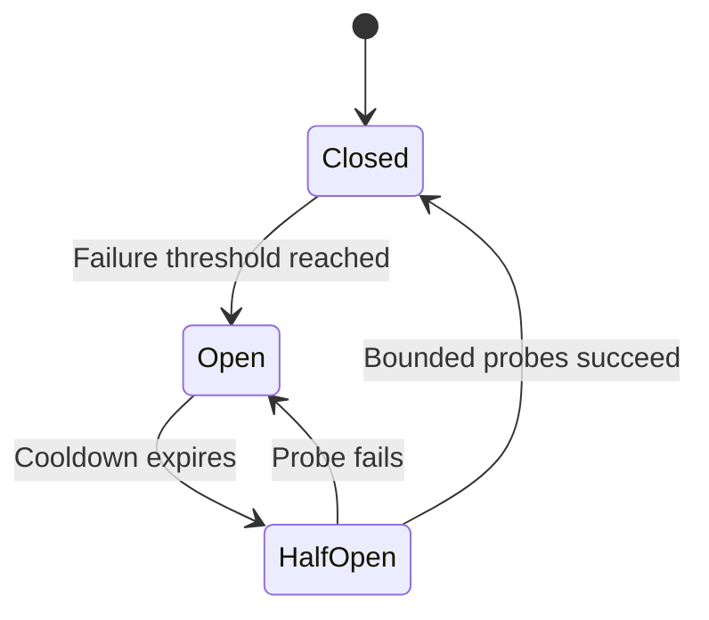

# Timeouts, retries, and failure isolation

Bound waiting, retries, concurrency, and cascading failure.

**Prerequisite / previous:** [Observability and service objectives](observability.md) · **Next:** [Cloud service selection and cost](cloud-platforms.md)

Imagine a school canteen with one slow payment terminal. Asking every pupil to keep trying faster makes the queue worse. A resilient service limits how much work it accepts and how long it waits, while protecting unaffected work.

## Work within a total deadline

Set connection and request deadlines from the user-visible latency budget and measured dependency latency. Include DNS, TLS, queueing, and pool waits where the client library permits. A timeout only means the caller stopped waiting; the operation may already have committed. Cancellation is best effort unless the protocol promises more.

For an illustrative 800 ms budget, reserve 100 ms for local processing and response handling. The remaining 700 ms must cover all dependency attempts and waits, not 700 ms per retry. Measure false timeouts before lowering limits. See [Amazon's guidance on timeouts, retries, and jitter](https://aws.amazon.com/builders-library/timeouts-retries-and-backoff-with-jitter/).

## Retry eligible failures with a budget

Retry only when the operation contract permits it, with a maximum attempt count and total deadline. Reuse a stable operation identity for writes. Validation errors usually need a changed request; rate limiting may allow a later retry; server errors may describe a permanent bug or unknown outcome. The status-code family alone is insufficient.

Linear backoff grows by a fixed increment; exponential backoff grows multiplicatively. Both need a cap. Jitter spreads attempts to avoid synchronization. One possible full-jitter rule chooses a delay uniformly from zero to the current capped exponential delay. Honor server retry guidance and do not exceed the caller's deadline.

If three layers each permit three total attempts, one original operation can trigger up to 27 downstream attempts. Assign a retry owner, propagate the deadline, and bound the aggregate retry rate. Hedged reads also consume capacity and need their own budget.

## Isolate failure instead of amplifying it

| Control | How it helps | Failure to consider |
| --- | --- | --- |
| Circuit breaker | Stops calls after a measured failure threshold, then permits bounded probes | Bad thresholds block recovered services or oscillate |
| Bulkhead | Separate concurrency, connection, or worker pools per dependency or workload | Idle reserved capacity cannot automatically serve every other workload |
| Backpressure | Slows producers when downstream capacity is exhausted | A blocked producer may hold scarce resources |
| Load shedding | Rejects low-priority or excess work early | Clients may retry and worsen overload |
| Graceful degradation | Offers a defined reduced function | A stale fallback may be unacceptable for permissions or money |
| Process supervision | Restarts failed components | Restart loops can lose local state or repeatedly overload dependencies |

## Detecting failure is not proving failure

A missed heartbeat means a node is unreachable or late from an observer's perspective. It may be alive behind a partition or paused by scheduling. Use monotonic local elapsed time for timeout decisions; remote wall-clock timestamps require clock-skew assumptions. Health payloads reveal saturation but can also become stale.

A quorum protocol determines which participants may act; an arbitrary majority of heartbeat responses does not implement consensus. A paused lock holder can resume after its lease expires. Protect writes with destination-enforced fencing tokens or atomic conditions, as explained in the consensus lesson. A distributed lock does not alone make a scheduled task or payment execute exactly once.

## Capacity and recovery example

A pool admits 100 concurrent requests. If each completes in 100 ms, the nominal throughput is 1,000 requests/s under ideal steady assumptions. If a dependency stalls for five seconds, the same pool can saturate at much lower arrival rates. Queueing additional requests without a bound increases latency and memory use rather than recovering capacity.

After a dependency recovers, release work gradually. Limit replay, warm caches carefully, and watch oldest queued work, user-visible errors, and saturation. Replicas and failover require enough remaining capacity; redundancy is not free throughput.

## Exercise and interview questions

Inject a response timeout after commit, a slow dependency, and a network partition. Specify the allowed effect count, maximum attempts, maximum queue size, degraded response, and recovery condition. Pause a lease holder, elect another, and then resume the first.

**Completion check:** no duplicate committed business effect, stale owners are rejected by the protected resource, and unrelated traffic remains within its SLO. Explain why retries can cause an outage and why increasing every timeout is not a recovery plan.
