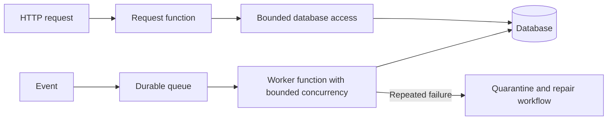

# Serverless execution and isolation

Evaluate execution limits, isolation, state, and per-use cost.

**Prerequisite / previous:** [Cloud service selection and cost](cloud-platforms.md) · **Next:** [Replication](../distributed/replication.md)

A function platform accepts work, chooses an execution environment, initializes code and dependencies when necessary, runs the handler, and reports or records the result. A warm environment may be reused, so initialization, handler duration, and queue delay are different measurements.

AWS's Firecracker project provides lightweight microVM isolation using KVM. It illustrates a way to combine isolation with low startup overhead; do not infer that every current platform path has one identical private architecture. [Firecracker project](https://firecracker-microvm.github.io/).

## Synchronous and asynchronous boundaries

A synchronous caller waits under a deadline. An asynchronous caller receives acceptance while queued execution and retries occur later. Duplicate invocation and unknown completion need idempotent business operations. Event-source integrations have their own batching, ordering, retry, and acknowledgement contracts; an internal queue should not be assumed to be a customer-visible SQS queue.

Cold starts depend on runtime, artifact size, initialization, capacity, and configuration. Snapshot/restore features introduce lifecycle rules; reinitialize uniqueness-sensitive or connection state as the platform requires. Neither Rust nor a microVM alone establishes an application latency guarantee.

## Exercise

A function creates an invoice and times out before returning. Replay the event and show how a stable operation ID prevents a second invoice. Then measure burst startup separately from warm throughput and explain the concurrency limit protecting the database.

Related: [containers](containers.md), [cloud service selection](cloud-platforms.md), [resilience](resilience.md), and [message queues](../services/message-queues.md).

## Engineering account: Amazon Prime Video Monitoring Service

This Amazon Prime Video Monitoring Service account is retained as historical design evidence. Read its workload and period with the linked sources; it is not a current technology inventory or a universal benchmark.

Why did Amazon Prime Video monitoring move **from serverless to monolithic**? How can it save 90% cost?

The diagram above shows the architecture comparison before and after the migration.

### What is Amazon Prime Video Monitoring Service?

Prime Video service needs to monitor the quality of thousands of live streams. The monitoring tool automatically analyzes the streams in real time and identifies quality issues like block corruption, video freeze, and sync problems. This is an important process for customer satisfaction.

There are 3 steps: media converter, defect detector, and real-time notification.

*   What is the problem with the old architecture?

    The old architecture was based on Amazon Lambda, which was good for building services quickly. However, it was not cost-effective when running the architecture at a high scale. The two most expensive operations are:

    1.  The orchestration workflow - AWS step functions charge users by state transitions and the orchestration performs multiple state transitions every second.

    2.  Data passing between distributed components - the intermediate data is stored in Amazon S3 so that the next stage can download. The download can be costly when the volume is high.

*   Monolithic architecture saves 90% cost

    A monolithic architecture is designed to address the cost issues. There are still 3 components, but the media converter and defect detector are deployed in the same process, saving the cost of passing data over the network. Surprisingly, this approach to deployment architecture change led to 90% cost savings!

    This is an interesting and unique case study because microservices have become a go-to and fashionable choice in the tech industry. It's good to see that we are having more discussions about evolving the architecture and having more honest discussions about its pros and cons. Decomposing components into distributed microservices comes with a cost.

*   What did Amazon leaders say about this?

    Amazon CTO Werner Vogels: “Building **evolvable software systems** is a strategy, not a religion. And revisiting your architectures with an open mind is a must.”

    Ex Amazon VP Sustainability Adrian Cockcroft: “The Prime Video team had followed a path I call **Serverless First**…I don’t advocate **Serverless Only**”.

### Exercise

Compare moving video frames through an object store with co-locating processing stages. Estimate bytes transferred, orchestration operations, independent scaling needs, and recovery after a process crash.

## Design trade-offs and production exercise

Function execution reduces idle management but can add startup delay, invocation limits, and per-operation charges. Persistent services can reuse connections and memory but need capacity and lifecycle management. Choose using duration, concurrency, data movement, and recovery cost.

A thumbnail pipeline should retain the source object until all required variants are published. Scale workers only within storage and database budgets. What happens if an invocation succeeds but its acknowledgement is lost?

## Architecture flow

Function concurrency can overwhelm the database. Set admission and concurrency limits, and make repeated event handling safe before enabling automatic retries. Moving to managed execution does not remove recovery ownership.
