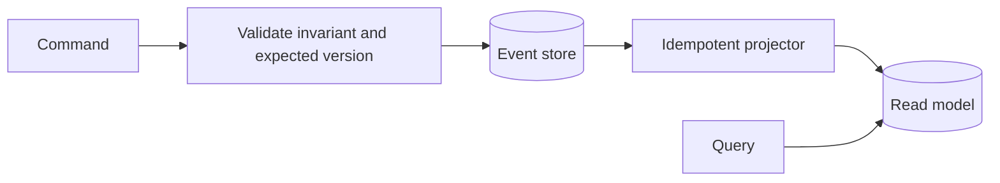
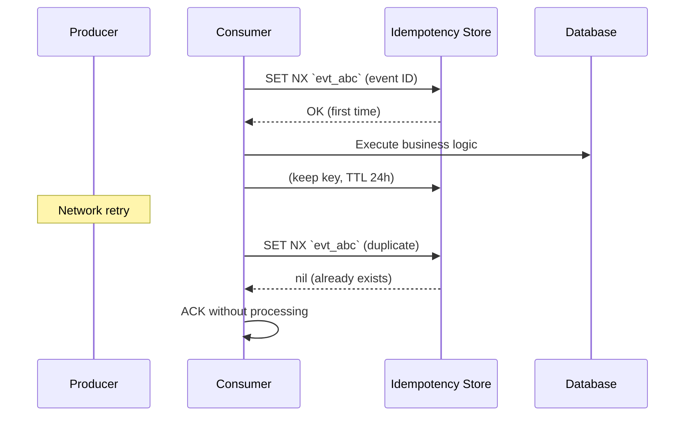
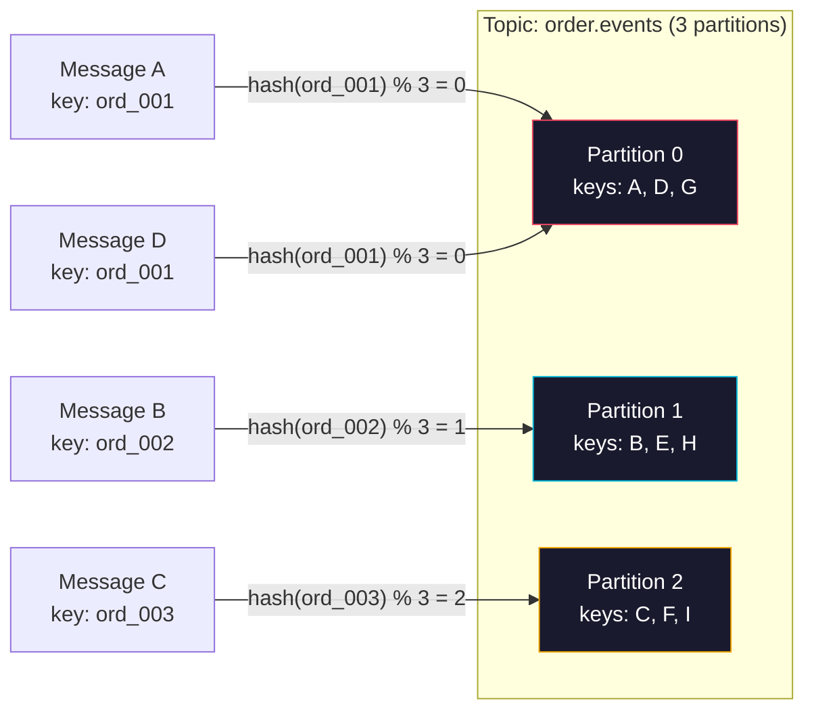
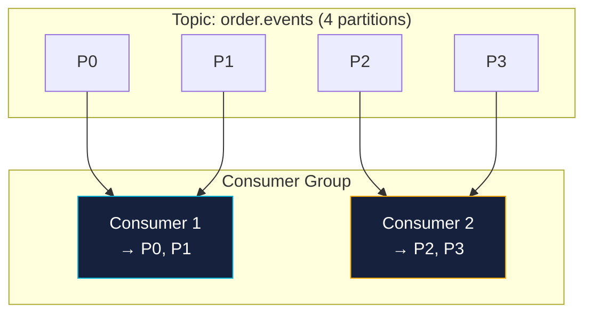
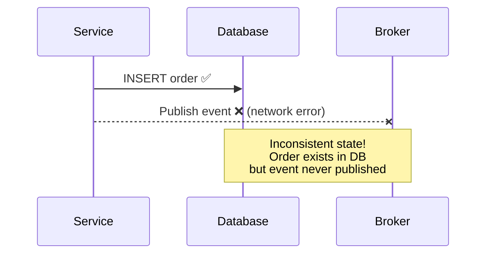
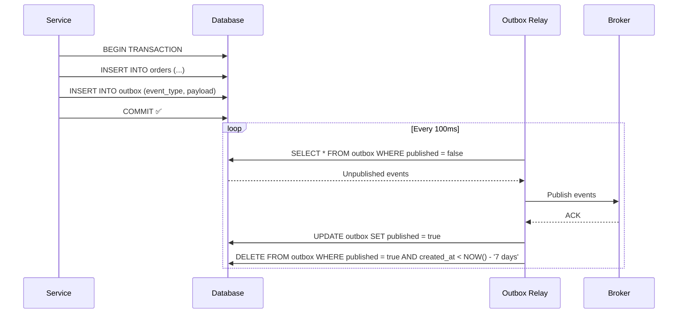

<span id="event-sourcing-cqrs-and-change-data-capture"></span>

# Event sourcing, CQRS, and change data capture

Distinguish event notification, history, CQRS, CDC, and outbox delivery.

**Prerequisite / previous:** [Microservices](microservices.md) · **Next:** [Containers and orchestration](../operations/containers.md)


A bank statement records what happened, while an account balance records the current result. Event sourcing makes the recorded events authoritative and derives current state from them. It is different from merely sending a notification after changing a database row.

## Three decisions that can be made separately

| Technique | Source of truth | Main purpose |
| --- | --- | --- |
| CRUD with change data capture (CDC) | Current database state and its transaction log | Propagate committed row changes to other systems |
| Event sourcing | An ordered domain event history | Reconstruct state and retain domain decisions |
| CQRS | Depends on the implementation | Give commands and queries different models or interfaces |

CQRS does not require event sourcing, separate databases, or eventual consistency. CDC describes storage changes, which may not capture the business reason for them. A Kafka topic is not automatically a permanent event store: retention, compaction, ordering, restore, and deletion requirements matter. These distinctions align with [Microsoft's event sourcing pattern](https://learn.microsoft.com/en-us/azure/architecture/patterns/event-sourcing) and [CQRS pattern](https://learn.microsoft.com/en-us/azure/architecture/patterns/cqrs).

## Worked example: a shopping cart

For cart 42, append `ItemAdded(book, 1)` and then `QuantityChanged(book, 2)`. Replaying those events yields two books. The command handler validates the invariant and atomically appends only if the stream's expected version still matches. Two writers starting at version 7 cannot both silently replace version 8.

A projection consumes committed events to build a read-friendly cart or sales report. Record the projection checkpoint with its own update atomically where possible. Duplicate deliveries must not increment counts twice. Rebuilding a projection is a controlled computation; it must not resend emails or charge cards.



## Snapshots and schema evolution

A snapshot stores derived state at a known stream position. Rebuild from the snapshot plus later events; retain enough history and metadata to verify the result. A snapshot is an optimization, not a second independent authority.

Events outlive application releases. Give them stable identities and schema versions. Support old events through compatible readers or explicit upcasters, and test a replay of historical data. Avro object container files carry their writer schema; reader/writer schema resolution helps only when evolution rules are respected. It does not automatically make arbitrary database changes compatible. See the [Avro specification](https://avro.apache.org/docs/1.12.0/specification/).

## CDC and migration boundaries

A log-based CDC connector reads committed changes and forwards them to consumers. A complete design includes the initial snapshot boundary, log position, connector restart, retention, schema changes, and deletion events. If the log is discarded before a failed connector catches up, resnapshotting may be necessary. Monitor lag in time and bytes and test recovery. See [Debezium's architecture](https://debezium.io/documentation/reference/stable/architecture.html).

The transaction outbox from the queue lesson is useful when a business commit must reliably lead to publication. CDC can transport outbox records; it does not eliminate consumer deduplication or external side-effect reconciliation.

## Trade-offs and failure modes

Event history supports audit and new projections, but adds storage, replay cost, compatibility obligations, and difficult correction/deletion questions. Do not put unnecessary personal data into immutable events. Consider encryption/key lifecycle and legally required deletion during design rather than assuming an append-only store solves retention policy.

Projection lag can make a successful command temporarily invisible to queries. Return an operation or version identifier so the client can wait for the required position, read an authoritative view, or display pending state. Corrupt events can block replay; quarantine with an explicit repair procedure rather than silently skipping financially significant events.

## Exercise and interview questions

Design a cart command, event stream, and read projection. Replay events twice, crash after applying a projection but before checkpointing, and change an event schema. **Check:** the same valid history produces the same state, counts do not double, and a new reader can consume old records.

Explain when CRUD plus an outbox is sufficient, how a snapshot is verified, and why replaying historical events must not repeat external actions.

## Implementation details

### Core Concepts

#### Events

Name an event after a fact that has happened. `TaskCompleted` states a result; `CompleteTask` asks for an action and is a command.

```json
{
  "id": "evt_9a3f2b1c",
  "type": "order.placed",
  "source": "order-service",
  "timestamp": "2025-03-15T14:30:00Z",
  "data": {
    "orderId": "ord_7821",
    "customerId": "cust_4491",
    "total": 124.5,
    "items": [{ "productId": "prd_001", "quantity": 2, "price": 49.99 }]
  }
}
```

**Event naming conventions:**

| Convention              | Example                               | Rationale                                        |
| ----------------------- | ------------------------------------- | ------------------------------------------------ |
| **Past tense**          | `order.placed`, `payment.refunded`    | Events describe things that already happened     |
| **Domain language**     | `shipment.delivered`                  | Use terms your business stakeholders understand  |
| **Namespace by domain** | `order.*`, `payment.*`, `inventory.*` | Clear ownership and routing boundaries           |
| **Not CRUD verbs**      | ❌ `OrderCreated`, ❌ `UserUpdated`   | Too generic; use meaningful domain names instead |

#### Producers

The producer records the change it owns and publishes the relevant fact. Decide how publishing stays connected to the saved change.

**Responsibilities of a producer:**

- Publish events only after the local transaction succeeds (use the Outbox pattern!)
- Assign unique event IDs; use a separate per-aggregate sequence when ordering is required
- Include source, timestamp, and schema version in every event
- Define the event contract independently of a particular consumer; still handle publishing failures

```typescript
// Producer example with Kafka (Node.js + kafkajs)
import { Kafka } from 'kafkajs';

const kafka = new Kafka({ clientId: 'order-service', brokers: ['localhost:9092'] });
const producer = kafka.producer();

await producer.connect();

await producer.send({
  topic: 'order.placed',
  messages: [
    {
      key: 'ord_7821', // partition key for ordering
      value: JSON.stringify({
        id: 'evt_9a3f2b1c',
        type: 'order.placed',
        source: 'order-service',
        schemaVersion: '1.0.0',
        timestamp: new Date().toISOString(),
        data: { orderId: 'ord_7821', customerId: 'cust_4491', total: 124.5 },
      }),
      headers: { 'message-id': 'evt_9a3f2b1c' },
    },
  ],
});
```

#### Consumers

A consumer reacts to events using the agreed fields. It can change separately when that contract stays compatible.

**Responsibilities of a consumer:**

- Make repeated handling safe: the same event should not repeat the intended effect
- Process events in the correct order (when ordering matters)
- Acknowledge after successful processing (for at-least-once brokers)
- Handle failures gracefully — retry, dead-letter, or skip

```typescript
// Consumer example with Kafka (Node.js + kafkajs)
import { Kafka } from 'kafkajs';

const kafka = new Kafka({ clientId: 'notification-service', brokers: ['localhost:9092'] });
const consumer = kafka.consumer({ groupId: 'notification-group' });

await consumer.connect();
await consumer.subscribe({ topic: 'order.placed', fromBeginning: false });

await consumer.run({
  eachMessage: async ({ topic, partition, message }) => {
    const event = JSON.parse(message.value!.toString());
    const eventId = message.headers?.['message-id']?.toString();

    // Idempotency check — skip if already processed
    const alreadyProcessed = await idempotencyStore.has(eventId!);
    if (alreadyProcessed) {
      console.log(`Skipping duplicate event: ${eventId}`);
      return;
    }

    // Process the event
    await sendOrderConfirmationEmail(event.data);

    // Mark as processed
    await idempotencyStore.set(eventId!, 'processed', 86400); // TTL 24h
  },
});
```

#### Brokers

A broker receives messages and routes or stores them for consumers. Its delivery, retention, and retry rules determine what the application must handle.

**Core broker capabilities:**

| Capability         | Description                                                             |
| ------------------ | ----------------------------------------------------------------------- |
| **Routing**        | Deliver events to the right consumers (topic, queue, exchange bindings) |
| **Persistence**    | Store events on disk so they survive broker restarts                    |
| **Replay**         | Allow consumers to re-read events from a point in time                  |
| **Partitioning**   | Split event streams for parallelism and ordering                        |
| **Replication**    | Copy events across nodes for durability and high availability           |
| **Dead-lettering** | Route unprocessable events to a separate topic/queue                    |

---


### Schema Design & Versioning

Events are long-lived contracts. An event published today might be consumed by services built years from now, or replayed months later. Schema design and versioning are critical.

#### Schema Design Principles

| Principle                                | Explanation                                                                         |
| ---------------------------------------- | ----------------------------------------------------------------------------------- |
| **Use a schema registry**                | Centralize schema definitions (Confluent Schema Registry, AWS Glue, Apollo GraphQL) |
| **Prefer Avro / Protobuf / JSON Schema** | Binary formats (Avro, Protobuf) save space; JSON Schema is human-readable           |
| **Never delete fields**                  | Mark as deprecated instead — old consumers may depend on them                       |
| **Never change field types**             | `string` → `number` breaks everything. Add a new field instead                      |
| **Additive changes only**                | New fields are safe; renaming, removing, or re-typing fields is breaking            |
| **Include schema version**               | Every event must carry its schema version: `"schemaVersion": "1.2.0"`               |

#### Avro Schema Example (with Confluent Schema Registry)

```json
{
  "type": "record",
  "name": "OrderPlaced",
  "namespace": "com.example.orders",
  "version": "1",
  "fields": [
    { "name": "orderId", "type": "string" },
    { "name": "customerId", "type": "string" },
    { "name": "total", "type": "double" },
    { "name": "items", "type": { "type": "array", "items": "string" } }
  ]
}
```

```typescript
// Producer with Avro + Schema Registry
import { Kafka } from 'kafkajs';
import { SchemaRegistry } from '@kafkajs/confluent-schema-registry';

const registry = new SchemaRegistry({ host: 'http://localhost:8081' });
const kafka = new Kafka({ clientId: 'order-service', brokers: ['localhost:9092'] });
const producer = kafka.producer();

await producer.connect();

const avroMessage = await registry.encode(1001, {
  // schema ID
  orderId: 'ord_7821',
  customerId: 'cust_4491',
  total: 124.5,
  items: ['prd_001', 'prd_002'],
});

await producer.send({
  topic: 'order.placed',
  messages: [{ key: 'ord_7821', value: avroMessage }],
});
```

#### Versioning Strategies

| Strategy | How it works | Pros | Cons |
| --- | --- | --- |
| **Backward compatible** | New schema can read data written by old schema | Safe to upgrade consumers first | Requires careful field additions |
| **Forward compatible** | Old schema can read data written by new schema | Safe to upgrade producers first | Requires default values for new fields |
| **Full compatible** | Both backward and forward compatible | Safe to upgrade in any order | Most restrictive |
| **No compatibility** | Breaking changes allowed | Simple, fast iteration | Requires coordinated upgrades and downtime |

**Compatibility matrix:**

| Change                | Backward | Forward | Full |
| --------------------- | :------: | :-----: | :--: |
| Add optional field    |    ✅    |   ✅    |  ✅  |
| Add required field    |    ✅    |   ❌    |  ❌  |
| Remove optional field |    ✅    |   ❌    |  ❌  |
| Remove required field |    ❌    |   ❌    |  ❌  |
| Change field type     |    ❌    |   ❌    |  ❌  |
| Rename field          |    ❌    |   ❌    |  ❌  |
| Add default value     |    ✅    |   ✅    |  ✅  |

#### Handling Breaking Changes

When you absolutely must make a breaking change:

1. **Introduce a new event type** — `order.placed.v2` alongside `order.placed.v1`
2. **Dual-publish** both versions during the migration period
3. **Migrate consumers** to consume `v2` (they can consume both during transition)
4. **Retire `v1`** once all consumers have migrated
5. **Never delete the old schema** from the registry — historical events still need it

```typescript
// Dual-publish during migration
async function publishOrderPlaced(order: Order): Promise<void> {
  const v1Event = toOrderPlacedV1(order);
  const v2Event = toOrderPlacedV2(order);

  await Promise.all([
    producer.send({ topic: 'order.placed', messages: [{ key: order.id, value: v1Event }] }),
    producer.send({ topic: 'order.placed.v2', messages: [{ key: order.id, value: v2Event }] }),
  ]);
}
```

---


### Idempotent Consumers

An **idempotent consumer** can process the same event multiple times without changing the outcome beyond the first processing. This is _essential_ for at-least-once delivery systems.

#### Implementation Strategies

**1. Event ID deduplication (most common):**

```typescript
// Store processed event IDs in Redis with TTL
async function isDuplicate(eventId: string): Promise<boolean> {
  // SET NX returns OK only if the key didn't exist
  const result = await redis.set(
    `processed:${eventId}`,
    '1',
    'NX',
    'EX',
    86400, // 24h TTL
  );
  return result !== 'OK'; // 'OK' means first time; null means duplicate
}

// Usage in consumer
if (await isDuplicate(event.id)) {
  logger.info({ eventId: event.id }, 'Skipping duplicate');
  return;
}
```

**2. Database upsert (natural key):**

```sql
-- Use a unique constraint on the natural key (not the event ID)
INSERT INTO orders (order_id, customer_id, total, status)
VALUES ('ord_7821', 'cust_4491', 124.50, 'placed')
ON CONFLICT (order_id) DO NOTHING;
```

**3. State check (optimistic concurrency):**

```typescript
// Use a version/sequence number to detect replays
async function applyPayment(event: PaymentAppliedEvent): Promise<void> {
  const invoice = await db.invoices.findOne({ id: event.data.invoiceId });

  // Skip if this payment has already been applied
  if (event.data.paymentSequence <= invoice.lastAppliedSequence) {
    logger.info('Payment already applied, skipping');
    return;
  }

  invoice.balance -= event.data.amount;
  invoice.lastAppliedSequence = event.data.paymentSequence;
  await db.invoices.save(invoice);
}
```

**4. Event sourcing (inherently idempotent):**

```typescript
// Replaying events is safe if your projections use upsert
async function projectOrderPlaced(event: OrderPlaced): Promise<void> {
  await db.orderProjections.upsert(
    { orderId: event.data.orderId }, // unique key
    { $set: { customerId: event.data.customerId, total: event.data.total, status: 'placed' } },
  );
}
```

#### Idempotency Key Lifecycle



---


### Ordering & Partitioning

In distributed systems, maintaining strict global ordering is impossible without sacrificing throughput. Instead, we use **partitioning** to guarantee order within a logical boundary.

#### How Kafka Partitions Work



**Rule:** With a stable partition count and partitioner, the same key routes to the same partition. Partition-count changes can move it; producers and consumers must also preserve the required processing order. Events across different partitions have no ordering guarantee.

#### Choosing a Partition Key

| Scenario                        | Partition Key        | Rationale                                                        |
| ------------------------------- | -------------------- | ---------------------------------------------------------------- |
| Order events for one order      | `orderId`            | All events for `ord_7821` stay ordered                           |
| User activity feed              | `userId`             | All events for one user are in order                             |
| Inventory updates per warehouse | `warehouseId`        | Stock changes per location stay ordered                          |
| Global ordering needed          | Single partition     | **Don't do this** — kills parallelism. Consider different design |
| No ordering needed              | Random / round-robin | Maximises parallelism across partitions                          |

#### Handling Out-of-Order Events

Sometimes events arrive out of order (multiple producers, network delays). Strategies:

**1. Sequence numbers in the event:**

```typescript
// Consumer maintains last processed sequence per aggregate
async function handleEvent(event: OrderEvent): Promise<void> {
  const lastSeq = await getLastSequence(event.data.orderId);
  if (event.data.sequence <= lastSeq) {
    return; // Skip out-of-order event
  }
  await applyEvent(event);
  await setLastSequence(event.data.orderId, event.data.sequence);
}
```

**2. Buffering and reordering:**

```typescript
// Buffer events for a short window, then process in order
class ReorderBuffer {
  private buffer = new Map<string, StoredEvent[]>();
  private ttl = 5000; // 5 seconds

  add(event: StoredEvent): void {
    const key = event.partitionKey;
    const events = this.buffer.get(key) || [];
    events.push(event);
    events.sort((a, b) => a.sequence - b.sequence);
    this.buffer.set(key, events);
    setTimeout(() => this.flush(key), this.ttl);
  }

  private flush(key: string): void {
    const events = this.buffer.get(key) || [];
    events.forEach((e) => consumer.process(e));
    this.buffer.delete(key);
  }
}
```

#### Consumer Groups & Partition Assignment



**Key rules:**

- Each partition is assigned to **exactly one** consumer per consumer group
- One consumer can handle **multiple** partitions
- Adding consumers beyond the partition count does nothing (they idle)
- If a consumer dies, its partitions are rebalanced to remaining consumers

---


### Outbox Pattern

The **Outbox Pattern** solves the dual-write problem: how to atomically update a database and publish an event without distributed transactions.

#### The Problem



If you update the database and publish an event separately, one can fail while the other succeeds — leading to inconsistent state.

#### The Solution

Write the event to an **outbox table** within the same database transaction as the business data. A separate process **(the relay/polling publisher)** reads from the outbox table and publishes to the broker.



#### Implementation

**Database schema:**

```sql
CREATE TABLE outbox (
    id          BIGSERIAL PRIMARY KEY,
    event_type  VARCHAR(255) NOT NULL,
    aggregate_id VARCHAR(255) NOT NULL,
    payload     JSONB NOT NULL,
    created_at  TIMESTAMPTZ DEFAULT NOW(),
    published   BOOLEAN DEFAULT FALSE
);

CREATE INDEX idx_outbox_published ON outbox (published, created_at);
```

**Writing to the outbox (inside the business transaction):**

```typescript
async function placeOrder(cmd: PlaceOrderCommand): Promise<void> {
  const pool = await getDbPool();
  const client = await pool.connect();

  try {
    await client.query('BEGIN');

    // Business operation
    const order = await client.query(
      'INSERT INTO orders (customer_id, total, status) VALUES ($1, $2, $3) RETURNING id',
      [cmd.customerId, cmd.total, 'placed'],
    );
    const orderId = order.rows[0].id;

    // Outbox event — same transaction!
    await client.query(
      'INSERT INTO outbox (event_type, aggregate_id, payload) VALUES ($1, $2, $3)',
      [
        'order.placed',
        orderId,
        JSON.stringify({ orderId, customerId: cmd.customerId, total: cmd.total }),
      ],
    );

    await client.query('COMMIT');
  } catch (error) {
    await client.query('ROLLBACK');
    throw error;
  } finally {
    client.release();
  }
}
```

**Outbox relay (polling publisher):**

```typescript
import { Kafka } from 'kafkajs';

const kafka = new Kafka({ clientId: 'outbox-relay', brokers: ['localhost:9092'] });
const producer = kafka.producer();

async function pollOutbox(): Promise<void> {
  await producer.connect();

  setInterval(async () => {
    const client = await getDbPool().connect();
    try {
      await client.query('BEGIN');

      // Lock a batch of unpublished events (prevents duplicate publishing with multiple relays)
      const { rows } = await client.query(
        `SELECT id, event_type, aggregate_id, payload
         FROM outbox
         WHERE published = FALSE
         ORDER BY id
         LIMIT 100
         FOR UPDATE SKIP LOCKED`,
      );

      for (const row of rows) {
        await producer.send({
          topic: row.event_type,
          messages: [
            {
              key: row.aggregate_id,
              value: row.payload,
              headers: { 'message-id': `outbox-${row.id}` },
            },
          ],
        });

        // Delete published event (or mark as published and clean up later)
        await client.query('DELETE FROM outbox WHERE id = $1', [row.id]);
      }

      await client.query('COMMIT');
    } catch (error) {
      await client.query('ROLLBACK');
      logger.error({ error }, 'Outbox relay error');
    } finally {
      client.release();
    }
  }, 100); // Poll every 100ms — adjust based on latency requirements
}
```

#### Outbox Variants

| Variant                       | Description                                               | Best For                                  |
| ----------------------------- | --------------------------------------------------------- | ----------------------------------------- |
| **Polling publisher**         | Application polls outbox table on interval                | Simple, works with any DB                 |
| **CDC (Change Data Capture)** | Use Debezium to tail the DB WAL; publish changes to Kafka | Zero code, low latency, needs CDC tooling |
| **Transactional log tailing** | Kafka Connect JDBC connector reads outbox table           | Kafka-native, no custom relay code        |

#### Outbox Gotchas

- **Ordering**: Poll in `id` order, publish sequentially per aggregate to preserve ordering
- **Duplicates**: Use `FOR UPDATE SKIP LOCKED` with multiple relay instances to avoid double-publishing
- **Cleanup**: Periodically delete old published rows or use a partitioned table
- **Latency**: Polling introduces 100-500ms latency; CDC reduces this to near real-time
- **Database load**: Batch reads and tune the polling interval

---


### Testing Event-Driven Systems

Testing event-driven systems requires a different approach than testing REST APIs. You're testing asynchronous, eventually consistent flows.

#### Testing Strategies

| Level                | What to test                                          | Tools                           |
| -------------------- | ----------------------------------------------------- | ------------------------------- |
| **Unit test**        | Consumer/producer logic in isolation (mock broker)    | Jest, Vitest, Sinon             |
| **Integration test** | Real broker (Testcontainers Kafka), real DB           | Testcontainers, Docker Compose  |
| **End-to-end**       | Full saga workflow across multiple services           | Docker Compose, wait-for-expect |
| **Chaos test**       | Network partitions, broker restarts, consumer crashes | Toxiproxy, Chaos Mesh           |

#### Integration Test Example (Testcontainers + Kafka)

```typescript
import { Kafka } from 'kafkajs';
import { GenericContainer, StartedTestContainer } from 'testcontainers';
import { startOutboxRelay } from '../src/outbox/relay';

describe('Order Processing Integration', () => {
  let kafkaContainer: StartedTestContainer;
  let kafka: Kafka;

  beforeAll(async () => {
    // Start Kafka in Docker
    kafkaContainer = await new GenericContainer('confluentinc/cp-kafka:7.6.0')
      .withExposedPorts(9092)
      .withEnvironment({
        KAFKA_NODE_ID: '1',
        KAFKA_LISTENERS: 'PLAINTEXT://:9092,CONTROLLER://:9093',
        KAFKA_ADVERTISED_LISTENERS: 'PLAINTEXT://localhost:9092',
        KAFKA_PROCESS_ROLES: 'broker,controller',
        KAFKA_CONTROLLER_QUORUM_VOTERS: '1@localhost:9093',
      })
      .start();

    const host = kafkaContainer.getHost();
    const port = kafkaContainer.getMappedPort(9092);

    kafka = new Kafka({ clientId: 'test', brokers: [`${host}:${port}`] });
  }, 30000);

  afterAll(async () => {
    await kafkaContainer.stop();
  });

  it('should publish order.placed event when an order is created', async () => {
    // Arrange: Create a test consumer
    const consumer = kafka.consumer({ groupId: 'test-group' });
    await consumer.connect();
    await consumer.subscribe({ topic: 'order.placed', fromBeginning: true });

    const receivedEvents: any[] = [];
    await consumer.run({
      eachMessage: async ({ message }) => {
        receivedEvents.push(JSON.parse(message.value!.toString()));
      },
    });

    // Act: Insert into outbox (simulating order creation)
    await pool.query(
      `INSERT INTO outbox (event_type, aggregate_id, payload)
       VALUES ($1, $2, $3)`,
      ['order.placed', 'ord_test', JSON.stringify({ orderId: 'ord_test', total: 100 })],
    );

    // Wait for outbox relay to publish
    await new Promise((resolve) => setTimeout(resolve, 500));

    // Assert
    expect(receivedEvents.length).toBeGreaterThanOrEqual(1);
    expect(receivedEvents[0].type).toBe('order.placed');

    await consumer.disconnect();
  });
});
```

---


### Monitoring & Observability

Event-driven systems need monitoring across all layers — brokers, producers, consumers, and the events themselves.

#### Key Metrics

| Layer        | Metric                      | Why it matters                                    |
| ------------ | --------------------------- | ------------------------------------------------- |
| **Broker**   | Bytes in/out per second     | Throughput monitoring                             |
| **Broker**   | Under-replicated partitions | Data loss risk                                    |
| **Broker**   | Active controller count     | Should always be exactly 1                        |
| **Producer** | Record send rate            | Is the producer healthy?                          |
| **Producer** | Record error rate           | Network issues, broker unavailable                |
| **Producer** | Request latency (p95, p99)  | Broker performance                                |
| **Consumer** | Records consumed rate       | Is the consumer keeping up?                       |
| **Consumer** | Consumer lag                | **Most critical** — are consumers falling behind? |
| **Consumer** | Processing error rate       | Bugs, downstream failures                         |
| **Consumer** | DLT depth                   | Unprocessable events accumulating                 |
| **Event**    | End-to-end latency          | Time from production to consumption completion    |

#### Consumer Lag Alerting

```typescript
// Health check that exposes consumer lag
import { Kafka } from 'kafkajs';

async function getConsumerLag(groupId: string, topic: string): Promise<number> {
  const kafka = new Kafka({ clientId: 'monitoring', brokers: ['localhost:9092'] });
  const admin = kafka.admin();
  await admin.connect();

  const groups = await admin.describeGroups([groupId]);
  const offsets = await admin.fetchTopicOffsets(topic);
  const groupOffsets = await admin.fetchOffsets({ groupId, topics: [topic] });

  await admin.disconnect();

  // Calculate total lag across all partitions
  let totalLag = 0;
  for (const partition of offsets) {
    const committed = groupOffsets.find(
      (g: any) => g.topic === topic && g.partition === partition.partition,
    );
    totalLag += parseInt(partition.offset) - parseInt(committed?.offset || '0');
  }

  return totalLag;
}

// Expose via Express health endpoint
app.get('/health/lag', async (req, res) => {
  const lag = await getConsumerLag('payment-processor', 'order.placed');
  // Alert if lag > 1000
  res.json({ status: lag > 1000 ? 'degraded' : 'healthy', lag });
});
```

---


### Anti-Patterns

| Anti-Pattern                         | Why it's bad                                                      | What to do instead                                                           |
| ------------------------------------ | ----------------------------------------------------------------- | ---------------------------------------------------------------------------- |
| **Using events as commands**         | "Please do X" — couples producer to consumer's behavior           | Events = past facts. Use explicit command messages or RPC for requests       |
| **God events**                       | One event type for everything (`entity.updated` with all fields)  | Small, specific events: `order.placed`, `order.shipped`, `order.cancelled`   |
| **No schema registry**               | Producers and consumers go out of sync silently                   | Use Schema Registry (Confluent, Apicurio) or at least versioned JSON schemas |
| **Ignoring idempotency**             | Duplicate events cause double-charging, double-shipping           | Every consumer must handle duplicates — use event ID or natural key dedup    |
| **Single partition (no key)**        | All events go to one partition — kills parallelism and throughput | Choose a meaningful partition key that balances load                         |
| **No dead letter handling**          | One poison pill event blocks the entire consumer group            | Always have a DLT and alerting                                               |
| **No event retention policy**        | Disk fills up, broker crashes                                     | Set `retention.bytes` and `retention.ms` based on your replay needs          |
| **Tight coupling via event schemas** | Every schema change requires coordinated deployments              | Use backward/forward compatible schemas; never remove fields                 |
| **Ignoring consumer lag**            | Silent backpressure buildup — consumers fall hours behind         | Monitor lag; autoscale consumers; set alerts                                 |
| **Outbox relay not idempotent**      | Same event published twice if relay crashes mid-publish           | `DELETE ... RETURNING *` with `SKIP LOCKED`; or CDC-based relay              |

---


### Further Reading

- **Enterprise Integration Patterns** — Gregor Hohpe & Bobby Woolf (the EDA bible)
- **Designing Data-Intensive Applications** — Martin Kleppmann (chapters on replication, partitioning, transactions, stream processing)
- **Building Event-Driven Microservices** — Adam Bellemare
- **Kafka: The Definitive Guide** — Neha Narkhede, Gwen Shapira, Todd Palino
- **Confluent developer courses** — [developer.confluent.io](https://developer.confluent.io/)
- **RabbitMQ tutorials** — [rabbitmq.com/getstarted](https://www.rabbitmq.com/getstarted.html)
- **Microservices Patterns** (Saga) — Chris Richardson, [microservices.io](https://microservices.io/patterns/data/saga.html)

## Engineering account: McDonalds Event-Driven Architecture

This McDonalds Event-Driven Architecture account is retained as historical design evidence. Read its workload and period with the linked sources; it is not a current technology inventory or a universal benchmark.


Think you know everything about McDonald's? What about its event-driven architecture?

McDonald's standardizes events using the following components:

*   **Event Registry:** An event registry to define a standardized schema.
*   **Custom SDKs:** Custom software development kits (SDKs) to process events and handle errors.
*   **Event Gateway:** An event gateway that performs identity authentication and authorization.
*   **Utilities and Tools:** Utilities and tools to fix events, keep the cluster healthy, and perform administrative tasks.

To scale event processing, McDonald uses a regional architecture that provides global availability based on AWS. Within a region, producers shard events by domains, and each domain is processed by an MSK cluster. The cluster auto-scales based on MSK metrics (e.g., CPU usage), and the auto-scale workflow is based on step-functions and re-assignment tasks.

Reference: Behind the scenes: [McDonald’s event-driven architecture](https://medium.com/mcdonalds-technical-blog/behind-the-scenes-mcdonalds-event-driven-architecture-51a6542c0d86)

### Exercise

Change an event schema while old consumers still run in another region. Define compatibility, authorization, replay, and ownership of failed migrations before increasing broker capacity.
