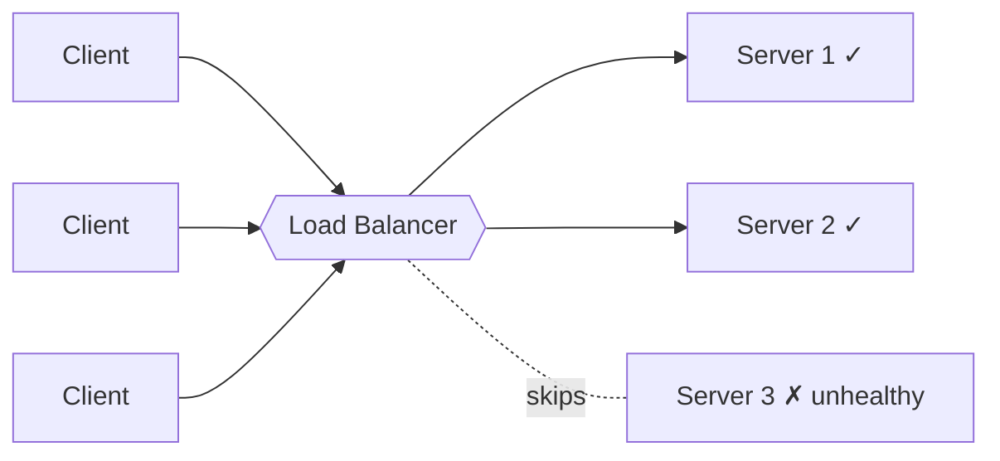
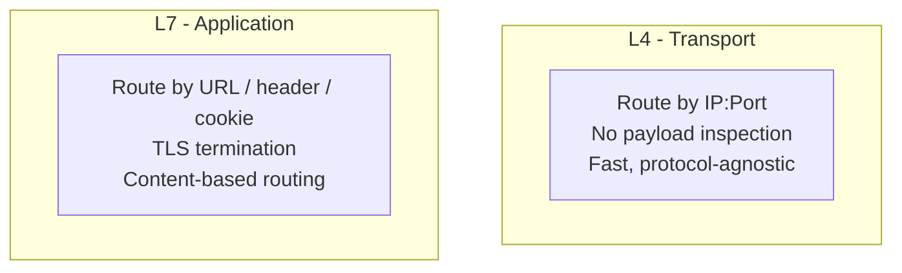
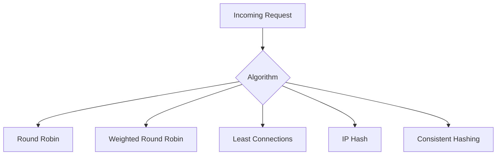
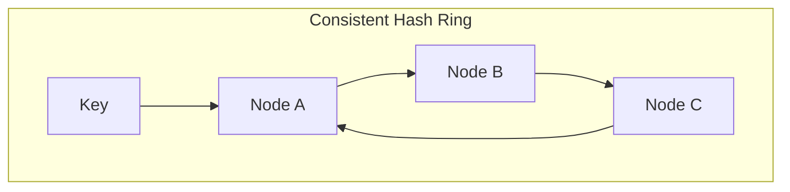
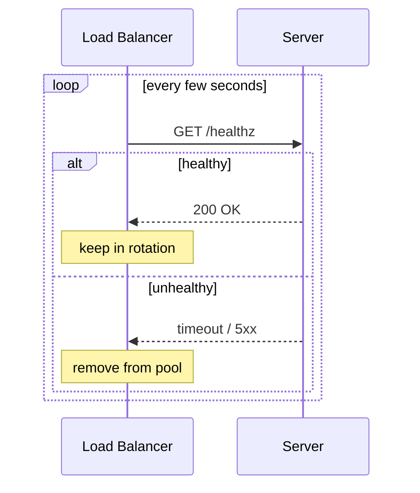
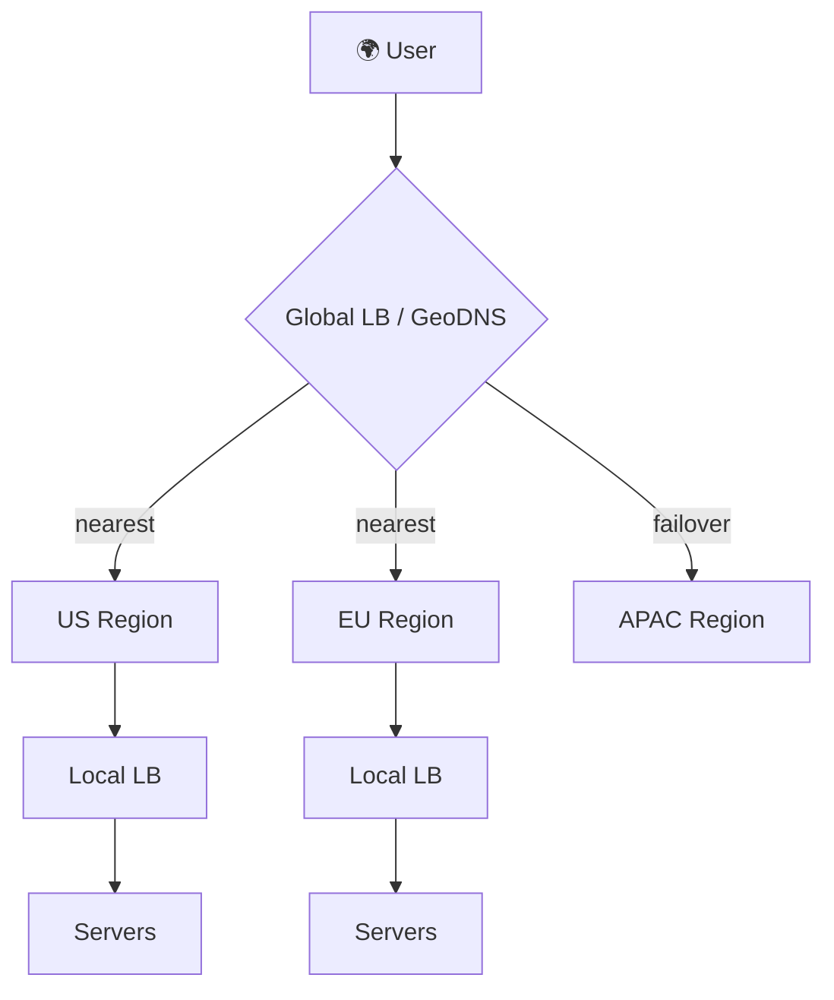

# Load Balancing

Choose traffic distribution, health checks, and connection behavior.

**Prerequisite / previous:** [Time-series data](../data/time-series.md) · **Next:** [Service Discovery](service-discovery.md)

A load balancer sends incoming requests to one of several servers. It helps spread work and avoid unhealthy servers. The routing rule, health checks, and handling of long-lived connections all affect the result.

---

## Follow the task app

A school can open two lunch counters and direct students to an available counter. With two task servers, a load balancer can similarly spread requests and avoid a server that is not ready.

1. Run two copies of the task service.
2. Send requests through one entry point.
3. Observe which server handles each request.
4. Stop one server and check how requests reach the remaining healthy copy.

## Words to know

| Word | Meaning |
| --- | --- |
| Backend server | A server behind the load balancer. |
| Health check | A check used to decide whether a server can take work. |
| Routing rule | The method used to choose a destination. |

## Core Concepts — What & Why

When you [scale horizontally](../foundations/capacity.md), you have many identical servers. Something must decide _which_ server handles each request — that's the **load balancer (LB)**. It sits between clients and your server pool and forwards traffic based on an **algorithm** and the **health** of each backend.

**Why load balance?**

- **Scalability** — spread load across many stateless servers.
- **High availability** — route around failed nodes automatically.
- **Zero-downtime deploys** — drain traffic from a node, update it, add it back.
- **Performance** — keep any single node below saturation, reducing latency.

---

## L4 vs. L7 Load Balancers

Load balancers operate at different layers of the network stack.

- **Layer 4 (Transport)** balances by **IP address and TCP/UDP port**. It doesn't inspect the payload — it just forwards packets/connections. Extremely fast and protocol-agnostic.
- **Layer 7 (Application)** understands **HTTP/HTTPS** — it can route on URL path, headers, cookies, or hostname, terminate TLS, and do content-based routing. More features, slightly more overhead.

| Feature             | L4 (Transport)         | L7 (Application)              |
| ------------------- | ---------------------- | ----------------------------- |
| **Routing basis**   | IP + port              | URL, headers, cookies, host   |
| **Payload aware**   | No                     | Yes                           |
| **Speed**           | Very fast              | Fast (more work per request)  |
| **TLS termination** | Product/listener dependent | Common for HTTPS inspection |
| **Content routing** | No                     | Yes (e.g., `/api` → API pool) |
| **Examples**        | AWS NLB, HAProxy (TCP) | AWS ALB, NGINX, Envoy         |

**Real-world example**: An [API gateway](../interfaces/api-design.md) uses an **L7** balancer to send `/images/*` to an image service and `/checkout/*` to a payment service, while a high-throughput game backend may prefer **L4** for raw speed.

---

## Load Balancing Algorithms

How does the LB pick a backend? The choice depends on whether servers are equal, how long requests take, and whether cache locality matters.

### Round Robin

Cycle through servers in order: 1 → 2 → 3 → 1… Simple and fair when servers are identical and requests are uniform. Ignores current load.

### Weighted Round Robin

Assign each server a **weight** based on capacity; more powerful servers get proportionally more requests. Great for heterogeneous hardware.

### Least Connections

Send each request to the server with the **fewest active connections**. Uses connection count as a load proxy. Multiplexed HTTP/2 connections or unequal per-connection work can make that proxy misleading.

### IP Hash

Hash the client's IP to pick a server, so a given client consistently reaches the same backend. A simple way to get **session affinity** without cookies.

### Consistent Hashing

Maps both servers and keys onto a hash ring so that **adding/removing a server only remaps a small fraction of keys** (not all of them). Essential for distributed caches and shard routing (deep dive in [Hashing](../../DSA/hashing/README.md) and [Sharding](../distributed/sharding.md)).

| Algorithm              | Best When                           | Weakness                    |
| ---------------------- | ----------------------------------- | --------------------------- |
| **Round Robin**        | Identical servers, uniform requests | Ignores load                |
| **Weighted RR**        | Mixed server sizes                  | Static weights              |
| **Least Connections**  | Variable request cost               | Needs live conn tracking    |
| **IP Hash**            | Simple affinity needed              | Uneven if IPs cluster (NAT) |
| **Consistent Hashing** | Caches, shard routing               | More complex to implement   |

---

## Health Checks

A load balancer must only send traffic to **healthy** backends. It periodically probes each server and removes failing ones from rotation.

- **Active checks** — the LB pings an endpoint (e.g., `GET /healthz`) on a schedule.
- **Passive checks** — the LB watches real traffic and ejects a node after repeated errors/timeouts.

> Separate liveness, readiness, and dependency health. Ejecting every instance because a shared optional dependency is down can turn partial failure into total outage; define a tested degraded mode.

---

## Sticky Sessions (Session Affinity)

**Sticky sessions** pin a client to the same backend for the duration of a session — useful for [stateful services](../foundations/capacity.md) that hold session data in memory. The LB uses a cookie or client IP to route consistently.

**Trade-off**: stickiness undermines even load distribution and complicates failover (if that server dies, the session is lost). **Preferred alternative**: keep app servers stateless and store session state in a shared store like Redis (see [Caching](../data/caching.md)), so _any_ server can handle _any_ request.

---

## Global vs. Local Load Balancing

- **Local (within a data center)** — distributes across servers in one region/zone. Usually L4/L7 as above.
- **Global (across data centers)** — routes users to the _nearest or healthiest region_, typically via **GeoDNS** or **Anycast**. Improves latency and provides disaster recovery / regional failover.

|               | Local LB                  | Global LB                   |
| ------------- | ------------------------- | --------------------------- |
| **Scope**     | One data center / zone    | Multiple regions            |
| **Mechanism** | L4/L7 proxy               | GeoDNS, Anycast             |
| **Optimizes** | Server-level distribution | Latency + regional failover |

---

## Trade-offs / When to Use

- **The LB can become a bottleneck or SPOF.** Run it in a redundant pair (active-passive or active-active) and consider managed cloud LBs.
- **L4 for speed, L7 for smarts.** Use L7 when you need path/host routing, TLS termination, or [rate limiting](rate-limiting.md); use L4 when raw throughput matters most.
- **Prefer stateless + shared store over sticky sessions** for clean horizontal scaling.
- **Match the algorithm to the workload** — least-connections for uneven request costs, consistent hashing for caches, round robin for uniform loads.

## Interview Questions

- How does L7 routing differ from L4? When would you pick one over the other?
- Explain how consistent hashing reduces remapping when nodes are added or removed.
- Describe a deployment strategy enabling zero-downtime upgrades with a load balancer.

## Production Checklist

- Health checks: active and passive probes for all backend pools
- TLS termination and certificate management at the appropriate layer
- Failover policies and circuit breakers to avoid cascading failures
- Observability: per-backend latency, error rates, connection counts
- Autoscaling triggers and graceful drain for instances being removed

## Testing & Monitoring

- Run chaos tests that kill backends and verify traffic drains and reconverges
- Validate session-affinity behavior under node failures and failover
- Load test both normal and pathological routing scenarios (uneven request sizes)

## Related Topics

- [Scalability](../foundations/capacity.md) — load balancing is what makes horizontal scaling work
- [Caching](../data/caching.md) — shared session/state store to keep servers stateless
- [Rate Limiting](rate-limiting.md) — often enforced at the L7 balancer / gateway
- [Microservices](microservices.md) — per-service routing and service discovery
- [API Design](../interfaces/api-design.md) — gateways and content-based routing
- [Consistency Models](../distributed/consistency-models.md) — implications of multi-region routing
- [Hashing](../../DSA/hashing/README.md) — consistent hashing internals

---

## Worked rollout and failure exercise

Suppose five API instances each sustain 150 requests/s at the target latency, while peak demand is 580 requests/s. Removing one instance leaves nominal capacity of 600 requests/s, with little headroom. Drain it before shutdown: stop assigning new requests, let in-flight requests finish up to a bounded deadline, and handle long-lived connections separately. A healthy TCP socket does not prove the instance can access its required database.

**Trade-off:** deep health checks detect dependency failures but can remove every instance when a shared dependency fails. Separate process liveness, readiness, and dependency health; use overload controls and explicitly designed degraded responses. Sticky sessions simplify local state but concentrate traffic and complicate failover. Externalizing session state creates its own dependency.

**Exercise:** terminate an instance during an upload and during a WebSocket session. **Check:** record retries, connection loss, and p99 latency; retry only operations whose contract permits it. Explain why the load balancer itself and its control plane need a failure strategy. Related: [API idempotency](../interfaces/api-design.md) and [rate limiting](rate-limiting.md).

## Proxies, gateways, and measured routing

A forward proxy represents clients to upstream destinations; a reverse proxy represents servers to clients. Load balancing distributes work among destinations. An API gateway adds API policy such as authentication, quotas, transformations, and aggregation. One component can perform several roles; three separate products are not required. A proxy does not provide secrecy or authorization merely by hiding an origin address.

Route by host/path or client class only when it has a clear requirement. Cross-zone balancing increases available capacity but can add transfer cost. Latency-aware routing should use robust measurements and bounded adjustments; chasing the currently fastest instance can create oscillation. Redundant data-plane instances do not automatically protect against a bad shared configuration.

## Further reading

- [Google SRE: load balancing](https://sre.google/sre-book/load-balancing-frontend/).
