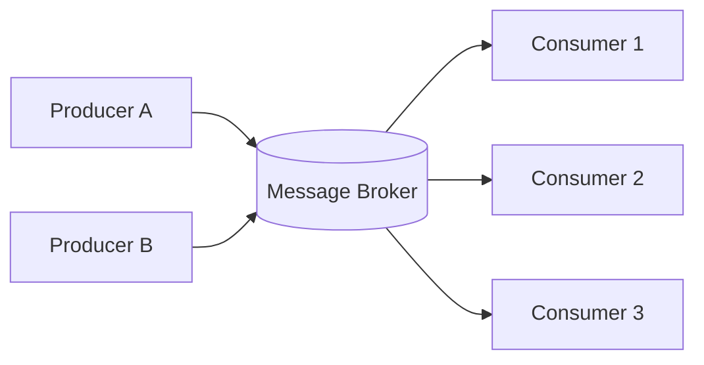
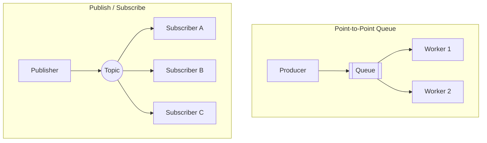
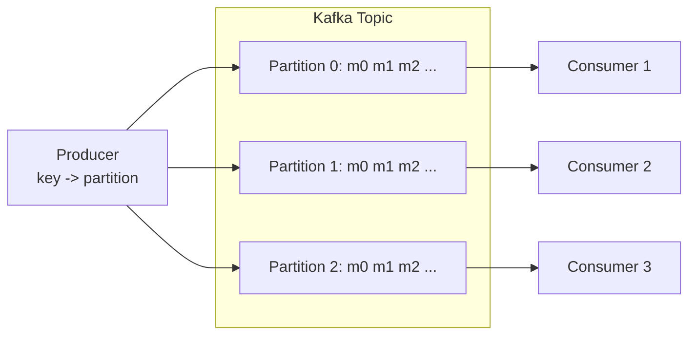
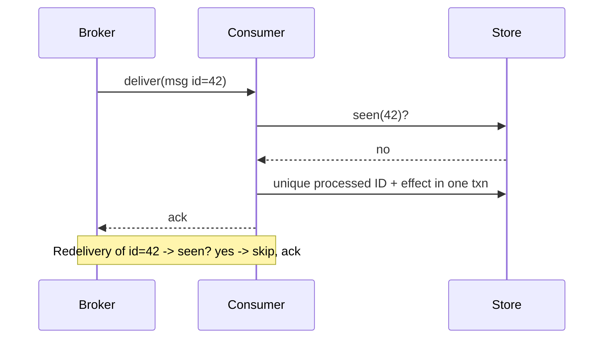
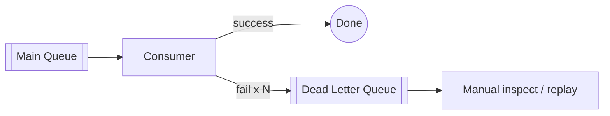
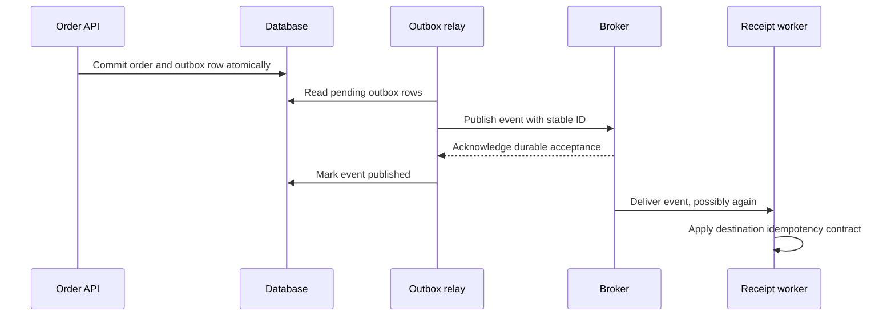
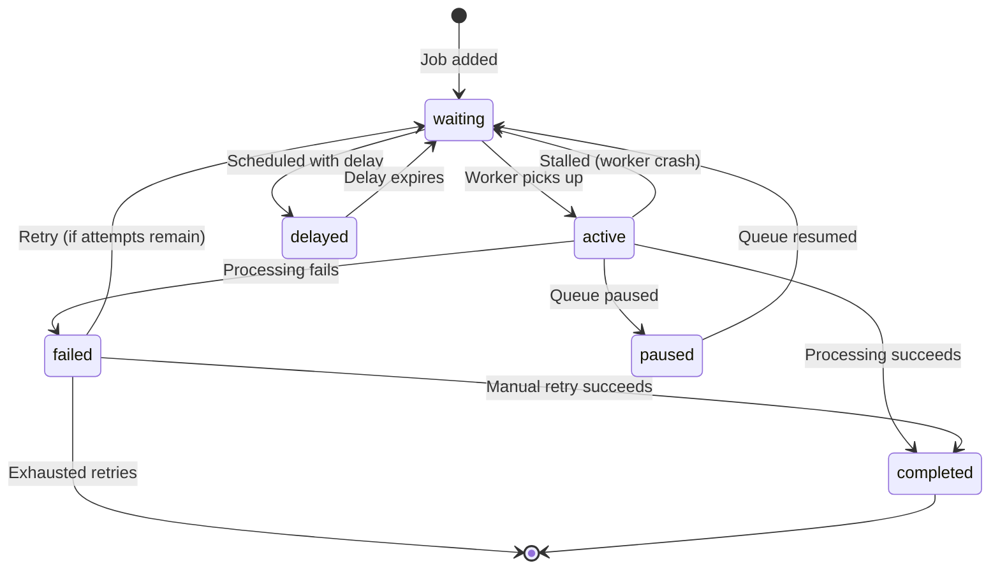

<span id="message-queues"></span>

# Message Queues

Define acknowledgement, retry, ordering, and backpressure boundaries.

**Prerequisite / previous:** [Rate Limiting](rate-limiting.md) · **Next:** [Realtime delivery and notifications](notifications.md)


A message queue lets one part of a system leave work for another part to do later. For example, placing an order can add a receipt-email job to a queue. Plan for retries and repeated messages as well as the successful path.

---

## Follow the task app

A homework tray holds work until a teacher can mark it. A queue similarly separates when a job is submitted from when it is processed. The worker still needs a plan for failures and repeated jobs.

1. Save the task and arrange for its reminder job to be submitted.
2. Have a worker take the job.
3. Record successful processing or schedule a limited retry.
4. Deliver the same job again and check the result.

## Words to know

| Word | Meaning |
| --- | --- |
| Producer | The program sending a message. |
| Consumer | The program processing it. |
| Acknowledgement | A signal that a delivery has been received or processed, according to the protocol. |

## Core Concepts

### Why Async Messaging?

Synchronous calls tightly couple services: the caller must wait for the callee, and a slow or failed downstream drags the whole request down. **Asynchronous messaging** breaks this coupling by placing a durable broker between the producer and consumer.

- **Decoupling** — producers and consumers don't need to know about, or be available at, the same time.
- **Load leveling (buffering)** — the queue absorbs bursts; consumers drain work at their own pace.
- **Resilience** — if a consumer crashes, messages persist and are reprocessed later.
- **Scalability** — add more consumers to increase throughput without changing producers.



### Point-to-Point vs. Publish/Subscribe



- **Point-to-point (work queue)**: each delivery is assigned to one consumer in a competing-consumers group; a retry may reach another consumer. Ideal for distributing tasks (e.g., image resizing).
- **Publish/subscribe (fan-out)**: publication is offered to each matching subscription under the broker’s durability and retention contract. Ideal for broadcasting events (e.g., "order placed" → email, analytics, inventory).

### Message Queues vs. Event Streaming

A **traditional queue** treats messages as transient tasks that are removed once acknowledged. An **event stream** (log) is an append-only, replayable record where consumers track their own read position (offset).

| Aspect               | Message Queue (RabbitMQ)                | Event Stream (Kafka)                              |
| -------------------- | --------------------------------------- | ------------------------------------------------- |
| **Model**            | Smart broker, dumb consumer             | Dumb broker, smart consumer                       |
| **Message lifetime** | Deleted after ack                       | Retained by time/size; replayable                 |
| **Consumption**      | Push or pull; redelivery depends on acknowledgements | Consumers pull by offset; many can re-read |
| **Ordering**         | Queue, delivery, retry, and consumer settings matter | Log order per partition; application completion can differ |
| **Throughput** | Benchmark with durability, payload, and consumer settings | Benchmark with replication, partition, and payload settings |
| **Routing**          | Rich (exchanges, bindings, priorities)  | Simple (topic + partition key)                    |
| **Best for**         | Task distribution, RPC, complex routing | Event sourcing, log aggregation, stream analytics |

### Kafka vs. RabbitMQ Semantics

- **RabbitMQ** — an **AMQP broker** with exchanges (direct, topic, fanout, headers) that route to bound queues. The broker tracks delivery and redelivers unacked messages. Great when you need flexible routing, priorities, or per-message TTL.
- **Kafka** — a **distributed commit log**. Topics are split into **partitions**; each partition is an ordered, immutable sequence. Consumers in a group each own a subset of partitions and commit **offsets**. Great for high-throughput, replayable event pipelines.



---

## Delivery Guarantees

| Guarantee         | Meaning           | Duplicates? | Loss?    | How                                |
| ----------------- | ----------------- | ----------- | -------- | ---------------------------------- |
| **At-most-once**  | Fire-and-forget   | No          | Possible | Ack before processing / no retries |
| **At-least-once** | Redelivery until acknowledged, within retention and durability assumptions | Possible | Outside the configured guarantee | Ack after processing + durable redelivery |
| **Exactly-once effects** | One committed effect inside a defined boundary | Deliveries may repeat | Depends on failure model | Atomic state and deduplication or a supported transaction boundary |

- **At-most-once** — lowest latency, acceptable for metrics or high-volume telemetry where a lost sample is harmless.
- **At-least-once** — the pragmatic default. Messages may be redelivered, so consumers **must** be idempotent.
- **Exactly-once** — the hardest and most expensive. In practice it is achieved as _effectively-once_ by combining at-least-once delivery with **idempotent consumers** and/or **transactional writes** (e.g., Kafka's transactional producer + read-committed consumer).

### Idempotent Consumers

Since at-least-once redelivers, design consumers so that processing the same message twice has the same effect as processing it once:

- Use a **unique message/business key** and record processed IDs in a dedup store.
- Prefer **upserts** over blind inserts; use conditional updates.
- Wrap the side effect and the offset/ack commit in a **single transaction** where possible.



---

## Ordering, Dead Letters, and Backpressure

### Ordering

- Global ordering is expensive and rarely needed. Kafka guarantees ordering **within a partition** — route related events with the same **partition key** (e.g., `userId`) to preserve their order.
- RabbitMQ preserves order **within a single queue** with a single consumer; competing consumers break strict order.

### Dead Letter Queues (DLQ)

When a message repeatedly fails (poison message), route it to a **dead letter queue** after N attempts instead of blocking the pipeline. Operators can inspect, fix, and replay DLQ messages.



### Backpressure

When producers outpace consumers, the queue grows unbounded and latency spikes. Manage it with:

- **Consumer prefetch limits** — cap in-flight unacked messages per consumer.
- **Bounded queues** — reject or block producers when full.
- **Autoscaling consumers** — scale out on queue depth / lag.
- **Shed load** — drop or sample low-priority messages under extreme load.

---

## Trade-offs / When to Use

| Use a message queue when...          | Avoid / reconsider when...                              |
| ------------------------------------ | ------------------------------------------------------- |
| Work can be processed asynchronously | The caller needs an immediate synchronous result        |
| You need to smooth traffic spikes    | Latency budget is sub-millisecond end-to-end            |
| Services should be decoupled         | The added broker/operational complexity isn't justified |
| You need retries, DLQs, fan-out      | Strict global ordering across all messages is required  |

**Common use cases**: order processing, email/SMS notifications, image/video transcoding, log & metrics pipelines, event-driven microservices, CQRS/event sourcing, and buffering writes to slow downstream systems.

---

## Interview Questions

- When would you choose Kafka over RabbitMQ and why?
- Describe how you'd ensure exactly-once processing semantics for a billing pipeline.
- How do you design consumers to be idempotent and handle poison messages gracefully?

## Production Checklist

- Monitor queue depth, consumer lag, and processing latency
- Implement DLQs and establish operational procedures to inspect & replay
- Enforce idempotency keys or dedup stores for business-critical consumers
- Secure broker endpoints and enable TLS + auth (SASL/OAuth where supported)

## Testing & Monitoring

- Load test producers and consumers to validate throughput and backpressure behavior
- Simulate consumer failures and verify DLQ routing and replay procedures
- Verify ordering semantics under partitioning and consumer group rebalances

## Related Topics

- [Scalability](../foundations/capacity.md) — add consumers to scale throughput horizontally
- [Load Balancing](load-balancing.md) — competing consumers distribute work like an L7 balancer
- [Consistency Models](../distributed/consistency-models.md) — async messaging typically yields eventual consistency
- [Rate Limiting](rate-limiting.md) — queues provide natural load leveling and backpressure
- [Microservices](microservices.md) — async messaging is the backbone of event-driven services


## Worked transaction boundary: the outbox

Saving an order and publishing an event are two writes. If the database commits but publishing fails, a receipt may never be scheduled. Store an outbox row in the **same database transaction** as the order. A relay publishes pending rows and marks them sent; crashing between publication and marking can publish a duplicate, so consumers must deduplicate.



For a database effect, insert the processed-event ID under a unique constraint and apply the effect in one transaction. Commit that transaction before acknowledging the broker. For an external email or payment provider, a local processed flag cannot make the remote action atomic. Use a provider-supported operation identity, query unknown outcomes, and reconcile. Kafka transactions cover their documented processing boundary; they do not automatically transact an arbitrary external API. See [Kafka delivery semantics](https://kafka.apache.org/41/design/design/#message-delivery-semantics).

**Capacity exercise:** arrivals are 1,000 jobs/s and service capacity is 800 jobs/s for five minutes. Backlog grows by 60,000 jobs. If arrivals then fall to 500 jobs/s, net drain is 300 jobs/s, so draining takes about 200 seconds, assuming stable service and no retries. Measure oldest-message age as well as queue depth.

**Failure drill:** crash before and after the database commit, broker acknowledgement, and external side effect. **Check:** show where a duplicate can occur, where a lost action is prevented, and how a poison message is replayed without reordering correctness-sensitive events. A DLQ requires ownership, alerts, retention, and a replay procedure.

## Broker selection and data-structure distinctions

A FIFO queue removes from one end and adds at the other; a circular buffer wraps bounded storage; a deque operates at both ends; a priority queue selects by priority and can starve lower-priority work. These local data structures do not by themselves establish broker durability or cross-worker completion order.

A nonblocking API may return immediately when no item is available. A lock-free algorithm guarantees system-wide progress; a wait-free algorithm gives each operation a bounded number of its own steps under its model. Neither property means that every operation succeeds immediately or that all surrounding application code is deadlock-free. CAS is a building block, not a proof of either guarantee.

Kafka throughput can benefit from append-oriented I/O, batching, compression, page cache, and reduced copies in supported paths. TLS, storage, replication, batching delays, and consumer work affect actual performance. For classic consumer groups, a partition is assigned to one active group member at a time; reassignment and application concurrency require careful offset management. Acknowledgements, minimum in-sync replicas, leader-election policy, producer error handling, retention, and offset commits all affect loss and replay boundaries. Committing an offset before finishing work can skip that work after a crash.

A claim-check pattern puts a large payload in durable object storage and publishes its reference. Keep the object accessible until all promised consumers and retries are finished, and authorize retrieval. For long jobs, return an accepted operation ID and status endpoint rather than claiming completion when enqueueing. Product families such as RabbitMQ, Kafka, Pulsar, and IBM MQ offer different routing and storage choices; they are not a universal sequence in which each replaces its predecessor.

## Implementation details

### Messaging Patterns

#### 1. Task Queue (Point-to-Point / Work Queue)

Workers share the jobs in a work queue. One worker handles a delivery, but a failed or unacknowledged job may be delivered again. Plan for retries and jobs that repeatedly fail.

```text
Producer → [Queue] → Consumer
```

**Examples:** Send a single email, resize one image, charge a credit card.

**Characteristics:**

- One intended worker per job; redelivery is possible after a failure
- Load-balanced across multiple consumer instances
- Order not strictly guaranteed unless using a FIFO queue

#### 2. Publish-Subscribe (Pub/Sub)

A producer publishes an event. Separate subscriptions can each receive a copy, letting a report and a notification react independently. The exact routing depends on the broker.

```text
Publisher → [Exchange/Topic] ─→ [Queue A] → Subscriber A
                              ├→ [Queue B] → Subscriber B
                              └→ [Queue C] → Subscriber C
```

**Examples:** "OrderPlaced" event triggers: email notification, inventory update, analytics tracking, loyalty points accrual — all in parallel.

**Characteristics:**

- One-to-many: each subscriber gets its own copy
- Subscribers can join or leave without affecting others
- Each subscriber has its own delivery/retry semantics

#### 3. Delayed / Scheduled Jobs

Jobs are submitted now but processed at a future time. Useful for time-based workflows.

**Examples:**

- Send a reminder 24 hours before an appointment
- Unlock an account after a 15-minute cooldown
- Retry a failed webhook after 30 seconds
- Expire an abandoned cart after 1 hour

**Implementation with BullMQ:**

```typescript
// Schedule a job to run 1 hour from now
await queue.add(
  'send-reminder',
  { appointmentId: 'apt_123' },
  {
    delay: 60 * 60 * 1000, // 1 hour in milliseconds
  },
);

// Schedule a job at an exact timestamp
await queue.add(
  'subscription-renewal',
  { userId: 'usr_456' },
  {
    delay: targetDate.getTime() - Date.now(),
  },
);
```

#### 4. Priority Queues

Higher-priority jobs jump ahead of lower-priority ones. Not all queue systems support true priority — BullMQ does.

```typescript
await queue.add('critical-alert', { message: 'CPU > 95%' }, { priority: 1 });
await queue.add('daily-report', { reportType: 'sales' }, { priority: 100 });
// Priority 1 processes before priority 100 (lower number = higher priority)
```

#### 5. Fan-Out with Routing Keys

Messages are routed to specific queues based on pattern matching (RabbitMQ topic exchanges) or attributes. Enables selective consumption without hardcoding queue names.

#### 6. Chaining / Pipelines

The output of one job becomes the input of another, forming a processing pipeline:

```text
[Extract PDF] → [OCR Text] → [Translate] → [Store Result]
```

---


### Job Lifecycle

A job passes through distinct states from creation to final resolution. Understanding this lifecycle is critical for debugging, monitoring, and designing retry logic.



**State descriptions:**

| State               | Meaning                                                          |
| ------------------- | ---------------------------------------------------------------- |
| `waiting`           | Job is enqueued, waiting for an available worker                 |
| `active`            | A worker has claimed the job and is processing it                |
| `completed`         | Job finished successfully; result is stored (if configured)      |
| `failed`            | Job threw an error; may be retried if attempts remain            |
| `delayed`           | Job is scheduled for a future time; not yet ready for processing |
| `paused`            | Queue is paused — no jobs move to `active` until resumed         |
| `stalled` (implied) | Worker died or timed out; job goes back to `waiting`             |

**Job retention:** Completed and failed jobs are retained in Redis for inspection (configurable). BullMQ can auto-clean old jobs:

```typescript
const queue = new Queue('emails', {
  connection,
  defaultJobOptions: {
    removeOnComplete: { age: 3600, count: 1000 }, // keep last 1000, or 1 hour
    removeOnFail: { age: 24 * 3600 }, // keep failed jobs for 24 hours
  },
});
```

---


### Dead Letter Queue (DLQ)

A Dead Letter Queue is a holding area for jobs that have **exhausted all retry attempts** or are otherwise undeliverable. Instead of silently dropping failed messages, the DLQ preserves them for inspection, manual intervention, and replay.

#### Why You Need a DLQ

- **Retention**: Failed payloads remain inspectable within the configured durability and retention contract
- **Debugging**: Inspect the job payload and error to diagnose root cause
- **Manual replay**: After fixing the bug, re-enqueue the job from the DLQ
- **Alerting**: Monitor DLQ size — a growing DLQ is a leading indicator of a problem

#### DLQ Architecture

```text
Producer → [Main Queue] → Worker ──success──→ Completed
                              │
                              └──failure──→ Retry (with backoff)
                                              │
                                              └──retries exhausted──→ [DLQ]
                                                                       │
                                                                       └──→ Alerting / Inspection / Manual Replay
```

#### BullMQ failure quarantine

Retain exhausted jobs in the failed set with a deliberate retention policy. A `QueueEvents` listener can notify an operator, but it is not a durable migration transaction: the listener can crash or disconnect. If a separate quarantine queue is needed, run a reconciler that scans retained failed jobs, copies them using a deterministic destination ID, verifies the copy, and records completion. Do not delete the only retained payload before the copy is durable. Replay the original business operation ID.

Set retry attempts on jobs or queue defaults, not on `Worker` options. The example below shows the separation.

**DLQ best practices:**

- Set up monitoring/alerting on DLQ depth
- Build a simple admin UI or CLI to inspect and replay DLQ messages
- Store the original queue name, job ID, error message, and timestamp
- Don't let the DLQ grow unbounded — have a retention policy

---


### Backpressure

Backpressure is the mechanism that prevents a fast producer from overwhelming a slow consumer. Without backpressure, queues grow unbounded, memory is exhausted, and the system crashes.

#### Backpressure Strategies

| Strategy                       | How It Works                                          | When to Use                                 |
| ------------------------------ | ----------------------------------------------------- | ------------------------------------------- |
| **Consumer concurrency limit** | Limit how many jobs a worker processes simultaneously | BullMQ: set `concurrency` on Worker         |
| **Rate limiting**              | Cap the number of jobs processed per time window      | API calls to rate-limited external services |
| **Queue size cap**             | Reject new jobs when queue depth exceeds a threshold  | Prevent unbounded memory growth             |
| **Producer throttling**        | Producer slows down or pauses submission              | Upstream awareness of downstream capacity   |
| **Load shedding**              | Drop non-critical jobs when overloaded                | Graceful degradation under extreme load     |

#### Implementing Backpressure in BullMQ

**Consumer-side (most common):**

```typescript
// Limit concurrency — process at most 10 jobs simultaneously
const worker = new Worker('image-processing', processImage, {
  connection,
  concurrency: 10,
});

// Rate limit — max 5 jobs per second
const worker = new Worker('api-calls', callExternalApi, {
  connection,
  limiter: {
    max: 5, // 5 jobs
    duration: 1000, // per 1 second
  },
});
```

**Producer-side:**

```typescript
async function enqueueWithBackpressure(queue: Queue, data: any) {
  // Approximate admission signal: concurrent producers can race this check.
  // A strict cap needs an atomic admission mechanism.
  const waitingCount = await queue.getWaitingCount();
  const MAX_QUEUE_SIZE = 10_000;

  if (waitingCount >= MAX_QUEUE_SIZE) {
    throw new Error('Queue at capacity — apply backpressure to producer');
  }

  await queue.add('my-job', data);
}
```

#### Signal-Based Backpressure (Advanced)

In distributed systems, backpressure signals can propagate upstream:

1. Consumer reports its capacity (e.g., via a `/health` endpoint or metrics)
2. Load balancer / API gateway reads capacity metric
3. If capacity is low, the gateway returns `503 Service Unavailable` with `Retry-After` header
4. Producers back off

---


### Retry Strategies

When a job fails, retrying is often the right approach — transient failures (network blips, deadlocks, temporary resource exhaustion) resolve themselves. But retrying without a strategy makes things worse.

#### Common Retry Strategies

| Strategy                    | Formula                                       | Behavior                                           |
| --------------------------- | --------------------------------------------- | -------------------------------------------------- |
| **Fixed delay**             | `delay_ms` after each failure                 | Simple, but can cause thundering herd              |
| **Linear backoff**          | `attempt × delay_ms`                          | Waits longer each attempt                          |
| **Exponential backoff**     | `delay_ms × 2^attempt`                        | Rapidly increases wait — standard for most systems |
| **Exponential with jitter** | `delay_ms × 2^attempt + random(0, jitter_ms)` | Spreads retries, prevents synchronization          |
| **Immediate retry**         | Retry instantly (1–3 times)                   | For transient deadlocks, connection resets         |

#### BullMQ backoff configuration

These are application fragments requiring a configured Redis connection and a `processPayment` implementation with durable business idempotency. Pin and test the installed BullMQ version.

```typescript
import { Queue, Worker } from 'bullmq';

const payments = new Queue('payments', {
  connection,
  defaultJobOptions: {
    attempts: 5,
    backoff: { type: 'exponential', delay: 1000 },
  },
});
const paymentWorker = new Worker('payments', processPayment, { connection });
```

For a custom strategy, set `backoff.type` on the job and supply `settings.backoffStrategy` on the worker. Return a bounded delay and account for the operation's total deadline. Built-in jitter options and custom callback signatures must match the pinned library version.

#### Retry Best Practices

- **Always set a maximum number of attempts**: Infinite retries hide bugs and fill queues.
- **Use exponential backoff with jitter**: Without jitter, retries from many jobs synchronize and hammer the downstream service simultaneously (thundering herd).
- **Classify failures by contract**: Do not retry an invalid request unchanged. A timeout, 5xx, or 429 may be retryable only within the deadline and idempotency contract; not every 5xx is transient.
- **Log every retry with context**: Job ID, attempt number, error message, and timestamp.
- **Set a global timeout per job**: A stuck job shouldn't hold a worker forever.
- **Monitor retry rates**: A sudden spike in retries signals a downstream problem.

---


### Idempotency at the business boundary

A Redis lock or a check followed by an insert does not make a database update and an external payment atomic. Commit an inbox event ID and the local mutation in one database transaction using a unique constraint. A duplicate conflicts on that ID and returns the recorded result. For a provider call, store a durable operation intent, reuse its provider idempotency key, and reconcile ambiguous outcomes. Retain IDs for at least the replay horizon. A timed-out lock holder may still be executing; use fencing for protected state.


### BullMQ Deep Dive

BullMQ is the modern, TypeScript-native successor to Bull. It's built on top of Redis and provides a rich job queue with scheduling, priorities, concurrency control, rate limiting, and event-driven monitoring.

#### Architecture

```text
┌──────────┐     ┌─────────────┐     ┌──────────────┐
│ Producer │────▶│    Redis     │◀────│   Worker 1   │
│ (Node.js)│     │  (Queue DB)  │     │  (Consumer)   │
└──────────┘     │              │     └──────────────┘
                 │  ┌────────┐  │     ┌──────────────┐
                 │  │  Lists │  │◀────│   Worker 2   │
                 │  │  Sets  │  │     └──────────────┘
                 │  │ Hashes │  │     ┌──────────────┐
                 │  │ Streams│  │◀────│   Worker N   │
                 │  └────────┘  │     └──────────────┘
                 └─────────────┘
                        │
                        ▼
                 ┌──────────────┐
                 │  Bull Board   │
                 │  (Monitoring) │
                 └──────────────┘
```

#### Core Components

| Component          | Responsibility                                           |
| ------------------ | -------------------------------------------------------- |
| **Queue**          | Holds jobs; producers add to it                          |
| **Worker**         | Picks up and processes jobs from the queue               |
| **Job**            | A single unit of work with data, options, and state      |
| **QueueEvents**    | Real-time event emitter for job state changes            |
| **FlowProducer**   | Creates job flows/chains with parent-child relationships |


#### Sandboxed Processors

By default, workers run job processors in the same Node.js process (good for I/O-bound work). For CPU-bound work (image processing, PDF generation), use sandboxed processors to avoid blocking the event loop:

```typescript
// main.ts — creates a worker with a sandboxed processor file
const worker = new Worker('image-processing', './processors/image-processor.js', {
  connection,
  concurrency: 4, // 4 parallel sandboxed processes
  useWorkerThreads: true, // Use worker_threads (Node 12+) instead of child_process
});
```

```typescript
// processors/image-processor.js
import sharp from 'sharp';

module.exports = async (job) => {
  const { inputPath, outputPath, width } = job.data;

  // CPU-intensive work — runs in a separate thread
  await sharp(inputPath).resize(width).toFile(outputPath);

  // Report progress to the queue
  await job.updateProgress(100);
  return { outputPath };
};
```

---


### BullMQ Code Examples

#### Complete Example: Order Confirmation Pipeline

A realistic scenario: when an order is placed, send a confirmation email and generate an invoice PDF asynchronously.

```typescript
// ---------------------------------------------------------------
// setup.ts — Queue and Worker initialization
// ---------------------------------------------------------------
import Redis from 'ioredis';

const connection = new Redis({
  host: process.env.REDIS_HOST || 'localhost',
  port: Number(process.env.REDIS_PORT) || 6379,
  maxRetriesPerRequest: null, // Required for BullMQ
});

// Define queues
export const emailQueue = new Queue('order-emails', {
  connection,
  defaultJobOptions: {
    attempts: 3,
    backoff: { type: 'exponential', delay: 2000 },
    removeOnComplete: { age: 3600 * 24, count: 500 },
    removeOnFail: { age: 3600 * 24 * 7 },
  },
});

export const invoiceQueue = new Queue('order-invoices', {
  connection,
  defaultJobOptions: {
    attempts: 5,
    backoff: { type: 'exponential', delay: 3000 },
    removeOnComplete: { age: 3600 * 24 * 30 },
  },
});


// QueueEvents for real-time monitoring
const emailEvents = new QueueEvents('order-emails', { connection });

emailEvents.on('completed', ({ jobId, returnvalue }) => {
  console.log(`✅ Email job ${jobId} completed`, returnvalue);
});

emailEvents.on('failed', ({ jobId, failedReason }) => {
  console.error(`Email job ${jobId} failed: ${failedReason}`);
});

emailEvents.on('delayed', ({ jobId, delay }) => {
  console.log(`⏰ Email job ${jobId} delayed by ${delay}ms`);
});

// ---------------------------------------------------------------
// Worker definition
// ---------------------------------------------------------------
const emailWorker = new Worker(
  'order-emails',
  async (job) => {
    const { orderId, customerEmail, customerName } = job.data;

    // Simulate sending an email
    console.log(`Sending confirmation email to ${customerEmail} for order ${orderId}`);

    // Update progress so Bull Board shows real-time status
    await job.updateProgress(50);

    // Call your email service
    await emailService.sendTemplate('order-confirmation', customerEmail, {
      name: customerName,
      orderId,
    });

    await job.updateProgress(100);

    return { sent: true, email: customerEmail };
  },
  {
    connection,
    concurrency: 20, // Send up to 20 emails simultaneously
    limiter: {
      max: 50, // But not more than 50 per second
      duration: 1000,
    },
  },
);

// ---------------------------------------------------------------
// Producer: Called from your order service
// ---------------------------------------------------------------
async function onOrderPlaced(order: Order) {
  // Add the email job
  await emailQueue.add(
    'send-confirmation',
    {
      orderId: order.id,
      customerEmail: order.customerEmail,
      customerName: order.customerName,
    },
    {
      jobId: `email-confirmation-${order.id}`, // Idempotent key as job ID
    },
  );

  // Add the invoice generation job with a 30-second delay
  // (allows inventory checks to complete first)
  await invoiceQueue.add(
    'generate-invoice',
    {
      orderId: order.id,
      items: order.items,
      totalAmount: order.totalAmount,
    },
    {
      delay: 30_000, // Process 30 seconds later
    },
  );
}
```

#### Graceful Shutdown

Workers should finish in-progress jobs before shutting down to avoid data loss:

```typescript
import { Worker } from 'bullmq';

const worker = new Worker('my-queue', processor, { connection });

async function gracefulShutdown() {
  console.log('Shutting down worker...');

  // Stop picking up new jobs; wait for active jobs to finish
  await worker.close(); // waits for active jobs; impose an application shutdown deadline

  console.log('Worker shut down cleanly');
  process.exit(0);
}

process.on('SIGTERM', gracefulShutdown);
process.on('SIGINT', gracefulShutdown);
```

#### Job Flow (Chaining with FlowProducer)

Complex workflows where the output of one job feeds into the next:

```typescript
import { FlowProducer, Queue } from 'bullmq';

const extractQueue = new Queue('pdf-extract', { connection });
const ocrQueue = new Queue('pdf-ocr', { connection });
const translateQueue = new Queue('pdf-translate', { connection });

const flowProducer = new FlowProducer({ connection });

async function createProcessingPipeline(pdfPath: string, targetLanguage: string) {
  const flow = await flowProducer.add({
    name: 'extract-text',
    queueName: 'pdf-extract',
    data: { pdfPath },
    children: [
      {
        name: 'ocr-text',
        queueName: 'pdf-ocr',
        data: {}, // Will receive parent's return value
        children: [
          {
            name: 'translate-text',
            queueName: 'pdf-translate',
            data: { targetLanguage },
            // opts can be set at any level
            opts: { attempts: 2 },
          },
        ],
      },
    ],
  });

  // A child only runs after its parent completes successfully.
  // If any job in the chain fails, downstream children are not executed.
  return flow;
}

// --- Worker implementations ---
new Worker(
  'pdf-extract',
  async (job) => {
    const text = await extractTextFromPdf(job.data.pdfPath);
    return { extractedText: text }; // Passed to next job in chain
  },
  { connection },
);

new Worker(
  'pdf-ocr',
  async (job) => {
    const { extractedText, ...parentResult } = job.data; // Inherits parent data
    // ...
  },
  { connection },
);

new Worker(
  'pdf-translate',
  async (job) => {
    // Receives combined data from all ancestors
    const { extractedText, targetLanguage } = job.data;
    const translated = await translateText(extractedText, targetLanguage);
    return { translated };
  },
  { connection },
);
```

#### Preventing duplicate jobs

A BullMQ job ID deduplicates only while that job record exists. Removing completed jobs permits the ID to be used again. Custom IDs must not contain a colon. Use a durable unique business-operation ID in the database and provider idempotency keys for external effects; a queue ID alone cannot prevent duplicate charges.


#### Manual inspection and replay

Inspect failed jobs with bounded pagination. Classify the failure, repair the cause, and replay using the original operation ID. Record the operator, reason, and resulting state. Never drain a production queue to make an alert disappear. Restrict administrative UIs to authenticated operators.


#### Bull Board — Admin UI

```typescript
import { createBullBoard } from '@bull-board/api';
import { BullMQAdapter } from '@bull-board/api/bullMQAdapter';
import { ExpressAdapter } from '@bull-board/express';
import express from 'express';

const app = express();

const serverAdapter = new ExpressAdapter();
serverAdapter.setBasePath('/admin/queues');

createBullBoard({
  queues: [new BullMQAdapter(emailQueue), new BullMQAdapter(invoiceQueue), new BullMQAdapter(dlq)],
  serverAdapter,
});

app.use('/admin/queues', serverAdapter.getRouter());
app.listen(3000, () => console.log('Bull Board at http://localhost:3000/admin/queues'));
```

---


### Further Reading

- [BullMQ Official Documentation](https://docs.bullmq.io/)
- [Redis Persistence](https://redis.io/docs/latest/operate/rs/databases/configure/database-persistence/)
- [RabbitMQ Tutorials](https://www.rabbitmq.com/tutorials)
- [Kafka Documentation](https://kafka.apache.org/documentation/)
- [AWS SQS Developer Guide](https://docs.aws.amazon.com/AWSSimpleQueueService/latest/SQSDeveloperGuide/welcome.html)
- [Enterprise Integration Patterns](https://www.enterpriseintegrationpatterns.com/) (the canonical book on messaging patterns)

## BullMQ version and delivery boundaries

The retained BullMQ fragments illustrate a Redis-backed queue and worker. Supply Redis connection settings, external providers, schema validation, and durable operation records before running a complete application. `QueueScheduler` was deprecated from BullMQ 2.0; do not add it as a current requirement. A worker lock duration is not an execution timeout. `await worker.close()` waits for active work; bound shutdown at the application layer. [Scheduler history](https://docs.bullmq.io/guide/queuescheduler), [graceful shutdown](https://docs.bullmq.io/guide/workers/graceful-shutdown).

Job-ID deduplication ends when that job record is removed, and custom IDs cannot contain a colon. It does not make a provider charge exactly once. Keep business idempotency for the full replay horizon. [BullMQ job IDs](https://docs.bullmq.io/guide/jobs/job-ids).
