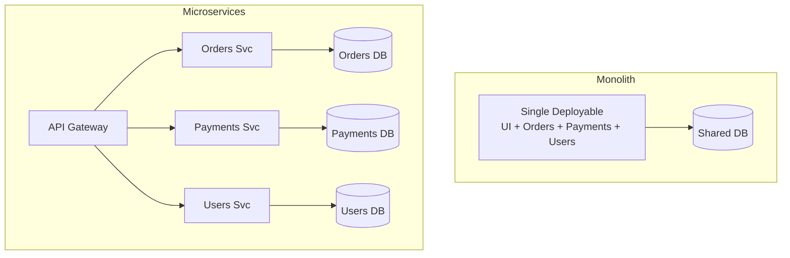
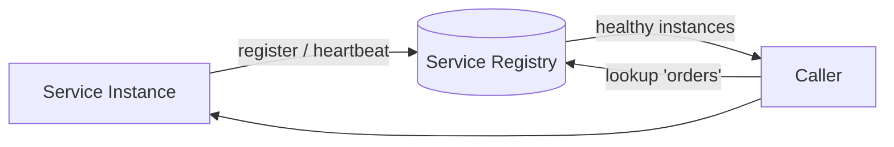
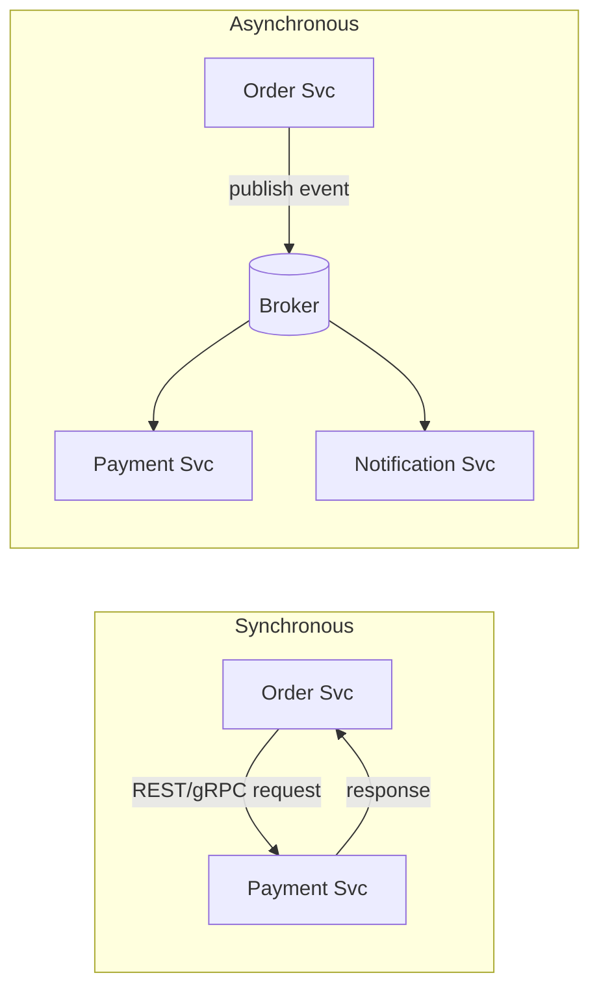

# Microservices

Choose ownership and deployment boundaries from concrete needs.

**Prerequisite / previous:** [Realtime delivery and notifications](notifications.md) · **Next:** [Event sourcing, CQRS, and change data capture](event-sourcing.md)

Microservices split an application into services that can be deployed separately. For example, orders and payments may run as different services. This gives teams more independence but adds network calls, coordination, and more failure cases.

---

## Follow the task app

A task app can begin as one program. If reminders later need separate ownership or different capacity, that part might become a separate service. Splitting it also adds work: communication, monitoring, and recovery.

1. Build and understand the feature inside one application.
2. Identify a concrete reason it needs to run separately.
3. Define the data and operations owned by each side.
4. Test what the task service does when the reminder service is unavailable.

## Words to know

| Word | Meaning |
| --- | --- |
| Monolith | An application deployed as one main unit. |
| Service boundary | The responsibilities and data owned by one service. |
| Distributed system | Parts of a system communicating across a network. |

## Core Concepts

### Monolith vs. Microservices

| Aspect               | Monolith                     | Microservices                           |
| -------------------- | ---------------------------- | --------------------------------------- |
| **Deployment**       | One unit                     | Independent per service                 |
| **Scaling**          | Whole app together           | Per-service, targeted                   |
| **Tech stack**       | Uniform                      | Polyglot allowed                        |
| **Team autonomy**    | Coupled                      | High (own service end-to-end)           |
| **Data**             | Shared DB, easy joins/txns   | DB-per-service, distributed data        |
| **Operational cost** | Low                          | High (infra, observability, networking) |
| **Fault isolation**  | Weak (one bug can crash all) | Requires timeouts and workload isolation         |
| **Local dev/debug**  | Simple                       | Complex (many moving parts)             |

**Start with a well-structured monolith**; extract services when team size, scaling needs, or deployment friction justify the added complexity.

### Service Boundaries & DDD

Use **Domain-Driven Design** to draw boundaries. Each service should own a **bounded context** — a cohesive business capability with its **own data**. Aim for **high cohesion inside** a service and **loose coupling between** services. Avoid the _distributed monolith_ anti-pattern (services that must deploy together).

### Service Discovery

Instances come and go (autoscaling, failures), so their network locations are dynamic. A **service registry** tracks healthy instances.

- **Client-side discovery** — caller queries the registry and load-balances itself.
- **Server-side discovery** — a load balancer / gateway resolves the target (e.g., Kubernetes Services, Consul, Eureka).

### API Gateway

A single entry point for clients that handles cross-cutting concerns so individual services don't have to:

- Routing & request aggregation
- Authentication / authorization
- Rate limiting & throttling
- TLS termination, caching, request/response transformation

See [API Design](../interfaces/api-design.md) for the contract details behind the gateway.

### Inter-Service Communication: Sync vs. Async

|                    | Synchronous (REST/gRPC)     | Asynchronous (events/queues)        |
| ------------------ | --------------------------- | ----------------------------------- |
| **Coupling**       | Temporal (both must be up)  | Decoupled                           |
| **Latency**        | Immediate response          | Eventual                            |
| **Failure impact** | Cascades if downstream slow | Buffered within broker capacity and retention                  |
| **Best for**       | Query needing an answer now | Fire-and-forget, fan-out, workflows |

Prefer **async messaging** for workflows and fan-out (see [Message Queues](message-queues.md)); use **sync** when the caller genuinely needs an immediate result.

---

## Cross-service workflows

Use [distributed transactions and sagas](../distributed/distributed-transactions.md) to decide between atomic commit and compensating workflows. A saga can expose intermediate states and compensation can fail. Keep frequently co-updated invariants within one data owner when possible.

## Observe across boundaries

Propagate correlation context and define ownership for failures spanning services. Use the [observability lesson](../operations/observability.md) for the complete logging, metrics, tracing, and SLO design.

## Bound dependency failure

Apply deadlines and isolate scarce resources for each dependency. The [resilience lesson](../operations/resilience.md) owns retry budgets, circuit breakers, bulkheads, and failure detection.

## Trade-offs / When to Use

| Adopt microservices when...                  | Stay monolithic when...                            |
| -------------------------------------------- | -------------------------------------------------- |
| Multiple teams need to ship independently    | Small team / early-stage product                   |
| Components have very different scaling needs | Domain is not yet well understood                  |
| You need fault isolation and polyglot stacks | Operational maturity (CI/CD, observability) is low |
| Deployment of the monolith is a bottleneck   | Simplicity and low latency joins matter most       |

**Prerequisites**: reliable release automation, observability, contract testing, and clear ownership; containers and orchestration are optional implementation choices — without these, microservices amplify pain.

---

## Interview Questions (expanded answers)

### How do you decide whether to extract a component from the monolith into a microservice?

Decision factors:
- Business ownership: separate teams owning a capability is a strong signal.
- Scaling needs: if a component needs a different scaling profile (e.g., CPU-heavy vs I/O-light), separate it.
- Release cadence: independent deploy cycles argue for service extraction.
- Operational readiness: ensure CI/CD, observability, and incident processes exist before extracting.

If costs (operational overhead, network latency, distributed testing) exceed benefits, delay extraction or consider modular monolith patterns.

### Compare choreography vs orchestration for sagas — when is each preferable?

- Choreography (event-driven): services publish events and react. Prefer when flows are naturally decoupled, event volume is manageable, and eventual consistency is acceptable. Pros: no single coordinator, easier horizontal scale. Cons: harder to debug and reason about end-to-end.

- Orchestration (central controller): a saga orchestrator issues commands and tracks progress. Prefer when the sequence must be controlled, error handling needs centralized visibility, or business processes require strict ordering. Pros: clearer flow and observability. Cons: central point to scale/maintain.

### How do you design service boundaries to minimize cross-service transactions and latency?

- Model around bounded contexts: group data and operations that are touched together.
- Co-locate frequently-used data; denormalize when read latency dominates and you can tolerate eventual consistency.
- Favor asynchronous messaging for long-running tasks and use request/response only where immediate answers are necessary.
- Instrument and set SLAs for inter-service calls; identify hotspots and consider API gateway-level aggregation.

## Production Checklist

- Ensure CI/CD pipelines for each service and a global integration test workflow
- Centralize observability (traces, metrics, logs) and enforce structured logs with correlation IDs
- Harden network policies, mTLS, and service-to-service auth (e.g., SPIFFE/SPIRE)
- Automate schema and contract migrations with consumer-driven contract tests
- Maintain a shared dashboard with SLOs and error budgets per service

## Testing & Monitoring

- Run integration tests that validate sagas and compensations end-to-end
- Simulate partial failures and validate circuit breakers and bulkheads behave correctly
- Measure cross-service latency and set SLOs per interaction
- Validate tracing propagation (trace IDs) across service boundaries under load

## Related Topics

- [Scalability](../foundations/capacity.md) — scale individual services independently
- [Load Balancing](load-balancing.md) — distribute traffic across service instances
- [Consistency Models](../distributed/consistency-models.md) — sagas yield eventual consistency
- [Rate Limiting](rate-limiting.md) — enforced at the API gateway
- [Message Queues](message-queues.md) — async backbone for inter-service events
- [API Design](../interfaces/api-design.md) — the contracts services expose

## Worked boundary decision and exercise

Start the task product as a modular monolith with task ownership rules and notifications in separate modules. Extract notification delivery only when independent scaling, deployment cadence, or fault isolation justifies its network boundary. The task database remains authoritative; an outbox carries committed changes. The notification service cannot silently become a second writer of task state.

A synchronous chain with three dependencies at 99.9% availability has about 99.7% combined availability **only under the simplified assumption of independent failures and a request requiring all three**. Shared infrastructure creates correlated failures. Define timeouts inside a total deadline, avoid retries at every layer, and isolate worker pools so a slow provider does not consume the entire service.

**Trade-off:** a saga coordinates local commits and business compensations; it is not an ACID rollback across services. Sending an email cannot be undone, and a refund is a new business action. **Exercise:** extract notifications, then simulate broker failure and a schema change. **Check:** show data ownership, compatibility with the old consumer, bounded retry behavior, tracing, and rollback. Explain when retaining the module in the monolith is preferable.

## Domain and integration patterns

Use the domain's **ubiquitous language**. An entity has identity; a value object is defined by its values. An aggregate is a consistency boundary accessed through its root, not necessarily one database table. A repository abstracts loading and storing aggregates, a factory handles creation, and a domain service represents behavior that does not belong naturally to one entity. A bounded context defines where a model's terms have a consistent meaning; it need not correspond one-to-one with a deployed service.

Logical layers separate responsibilities; physical tiers separate deployments. Several layers can live in one process. Ports-and-adapters architecture isolates domain logic behind interfaces. A plugin architecture extends a stable core with optional capabilities. An enterprise service bus centralizes transformations and routing, which can simplify integration while creating shared release and failure dependencies. None of these patterns automatically provides fault tolerance.

A registry can use self-registration or infrastructure-driven registration. Expiry and stale discovery entries need handling. A service mesh can provide traffic policy and telemetry, but adds a control plane and operational cost. Clustering describes cooperating nodes; active-active and active-passive describe workload placement, not a guarantee of conflict-free writes.

Latency-sensitive game loops or trading paths may need co-located state and avoid network calls in the critical path. That does not prohibit all other product functions from being separate services. A modular monolith and stateful components can both be valid cloud designs.

An ambassador is a helper/proxy at a service boundary, often handling connectivity concerns. Treat its resource, failure, and security behavior as part of the dependency path rather than assuming a side process is invisible to application correctness.

## Engineering account: Airbnb: service ownership and API evolution

This Airbnb: service ownership and API evolution account is retained as historical design evidence. Read its workload and period with the linked sources; it is not a current technology inventory or a universal benchmark.

### Evidence and scope

In Jessica Tai's 2021 presentation, Airbnb's move from the Rails Monorail application to service-oriented architecture addressed ownership and development constraints. The account distinguishes data, business-logic, and presentation responsibilities and explains the collaboration overhead created by many service dependencies. Later API aggregation changes reduced the amount of service orchestration exposed to presentation clients. Treat this as a dated account of that migration, not a universal growth sequence or a current complete architecture. [Jessica Tai: Evolving Airbnb's architecture](https://www.infoq.com/presentations/airbnb-api-architecture/).

### Design lesson and exercise

A reservation page needs listing, guest, date, and pricing data. Compare client orchestration, a presentation service, and an aggregation layer. Count network dependencies, assign ownership, and specify what happens when pricing is slow. Preserve a clear write authority even if read aggregation spans several services.

Interview check: explain how you would migrate one capability with comparison traffic and rollback, and why adding more services can increase coordination cost. Related: [service boundaries](microservices.md), [API design](../interfaces/api-design.md), and [deployments](../operations/deployments.md).

## Engineering account: How to Design Stack Overflow

This How to Design Stack Overflow account is retained as historical design evidence. Read its workload and period with the linked sources; it is not a current technology inventory or a universal benchmark.

A modular monolith and on-premises servers can be valid interview and production choices when their capacity, ownership, and recovery meet the requirements.

**What people think it should look like**
A more distributed alternative could use the following components, but each needs justification.

*   Microservice is used to decompose the system into small components.
*   Each service has its own database. Use cache heavily.
*   The service is sharded.
*   The services talk to each other asynchronously through message queues.
*   The service is implemented using Event Sourcing with CQRS.
*   Showing off knowledge in distributed systems such as eventual consistency, CAP theorem, etc.

**What it actually is**
The imported illustration describes a historical deployment using a small on-premises web-server fleet and a monolithic application. It is not evidence of the current fleet size or hosting arrangements.

This is contrary to all our popular beliefs these days.

### Exercise

Design a question-and-answer service from its read/write ratio and moderation needs. Defend a modular monolith baseline and state the measured condition that would justify extracting a service.
