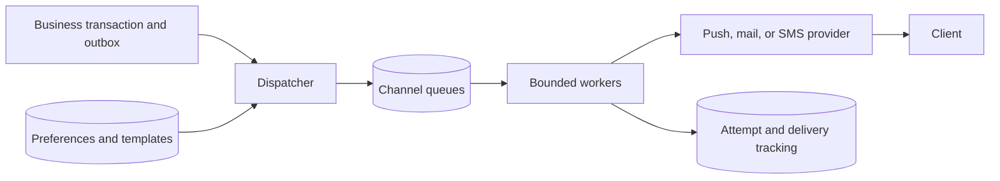

# Realtime delivery and notifications

Deliver updates through providers with deduplication and preferences.

**Prerequisite / previous:** [Message Queues](message-queues.md) · **Next:** [Microservices](microservices.md)

A notification tells someone that something changed. It is usually not the authoritative record of that change. If a phone misses a push about a new task, opening the application should still retrieve the task from its source of truth.

## Choose the connection model

| Approach | Request flow | Good fit | Cost or failure |
| --- | --- | --- | --- |
| Short polling | Client asks periodically | Simple clients, low update rates | Empty requests and interval-dependent delay |
| Long polling | Server holds a request until an event or timeout | Infrequent updates without a persistent stream | Reconnects, held connections, races between polls |
| Server-sent events | Server streams events over an established HTTP response | One-way browser updates | Reconnect/replay handling; client writes use separate requests |
| WebSocket | Persistent bidirectional channel | Chat or interactive state | Connection routing, heartbeat, backpressure, and reconnect handling |
| Webhook | Service calls a registered receiver endpoint | Service-to-service event notification | Duplicate, delayed, reordered, or failed delivery |
| Device push | Application server uses a platform delivery provider | Background mobile notifications | Device/provider policies, expiry, token churn |

SSE does not prevent the browser from making separate HTTP requests. WebSocket delivery does not prove a business action committed. Webhooks are not guaranteed instantaneous or lossless.

## A durable delivery pipeline

Record the business change and an outbox entry atomically. A dispatcher loads user preferences, locale, template version, and channel policy. It creates channel jobs with stable notification IDs. Workers apply channel quotas, retry eligible failures under a deadline, and record delivery attempts and provider identifiers.

Distinguish **accepted by provider**, **delivered to device**, **displayed**, and **read**. They are different signals. Keep an inbox or cursor so reconnecting clients can catch up from durable state. Expiring low-value notifications can be preferable to flooding a user with stale messages.

## Device registration and webhooks

Bind each device registration token to the authenticated user and app installation, record its update time, and handle token refresh and provider invalidation. On logout or account switching, stop sending that account's private notifications to the old association. A registration token is a delivery address, not proof of authorization. See [Firebase token management](https://firebase.google.com/docs/cloud-messaging/manage-tokens).

For webhooks, authenticate the sender using its documented signature scheme, protect against replay, validate the event, durably enqueue it, and return promptly. Deduplicate by stable event identity. Restrict outbound destinations if users configure webhook URLs, preventing access to internal network resources. Reconciliation polling can recover missed notifications; polling and webhooks can be combined.

## Capacity and failure example

At 100,000 idle clients polling every ten seconds, polling generates about 10,000 requests/s before useful events. A persistent connection reduces empty polling but requires memory, file descriptors, routing, and reconnect capacity. If all clients reconnect together after an edge restart, use jitter and resume cursors to avoid a recovery storm.

A worker crash after provider acceptance but before recording success creates an unknown outcome. A local dedup row cannot make an external send atomic. Use the provider's idempotency mechanism where available and make any remaining duplicate risk explicit. Grouping or collapsing notifications changes semantics and must match the product.

## Exercise and interview questions

Design a task-assignment notification for an offline phone and an online browser. Include unsubscribe preferences, token rotation, rate limits, duplicate callbacks, expiry, and reconnect catch-up. **Check:** the user can recover missed tasks from authoritative state and cannot receive another user's private notification after account switching.

Explain why a sent notification is not a payment receipt, why a message ID does not establish global ordering, and how you would test one million simultaneous reconnects without overwhelming a provider.
